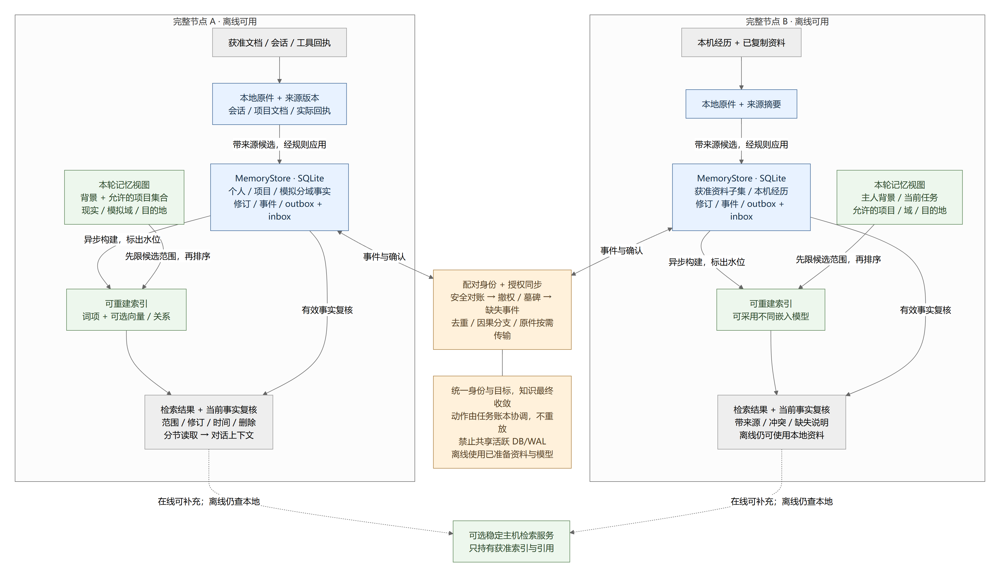
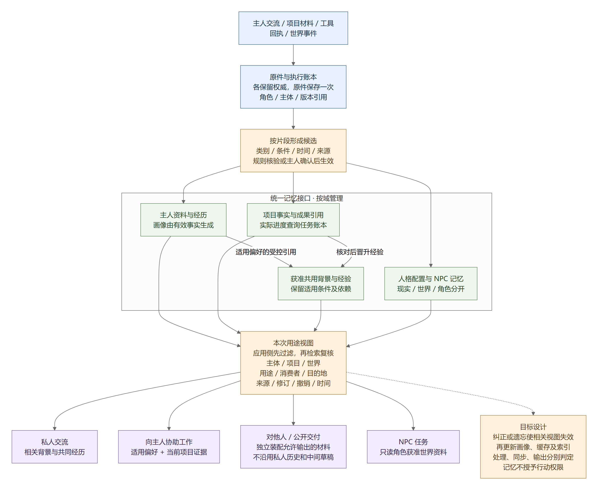
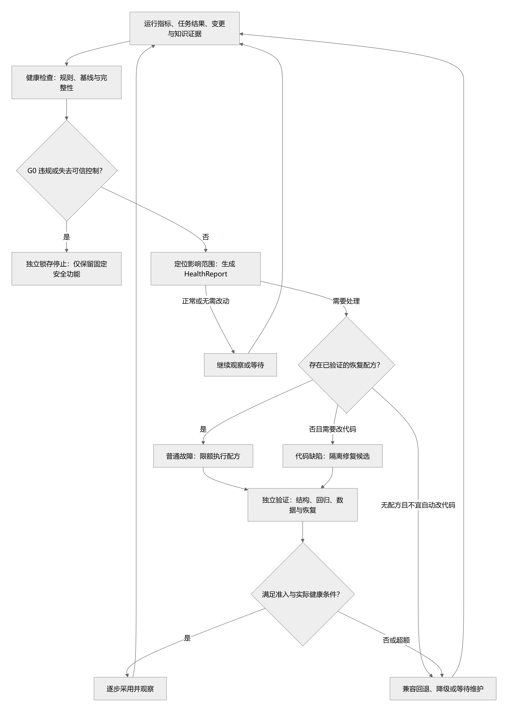

# 架构与流程图册

> 状态：proposed（设计视图） · 更新：2026-10-15
> [文档入口](README.md) · [维护规则](MAINTENANCE.md)

图源以 diagrams 下的 .mmd 文件为唯一可编辑版本；主题页和本图册引用同一份 PNG/SVG。图的箭头说明设计关系，不证明相关程序已经实现或达到性能目标。详细约束以对应主题正文为准。

<!-- book-nav:start -->
[全书目录](README.md#book-tree) › [第五篇 · 验证与参考](README.md#part-evidence) › 第 19 章 · 架构与流程图册

## 本章导航

- [19.1 图表索引](#section-b888574d1a5c)
- [19.2 修改和重新渲染](#rendering)
- [19.3 架构与流程](#section-0c5d1bf57621)
  - [19.3.1 共同体重连与对账](#federation-reconnect)
  - [19.3.2 总体架构](#overview)
  - [19.3.3 系统边界与信任分区](#system-boundaries)
  - [19.3.4 Windows 单节点部署](#windows-deployment)
  - [19.3.5 共同体多节点部署](#federation-deployment)
  - [19.3.6 状态所有权与事务边界](#state-ownership)
  - [19.3.7 模型路由与恢复](#model-routing)
  - [19.3.8 任务生命周期](#task-lifecycle)
  - [19.3.9 自主进化发布流程](#evolution-pipeline)
  - [19.3.10 对话与任务并行](#parallel-dialogue-task)
  - [19.3.11 断网任务处理](#offline-task-flow)
  - [19.3.12 Agent 团队生命周期](#agent-team-lifecycle)
  - [19.3.13 学习与知识晋升](#knowledge-learning-flow)
  - [19.3.14 节点本地记忆与共同体同步](#memory-local-federation)
  - [19.3.15 个人、工作与共享记忆的用途视图](#personal-work-memory)
  - [19.3.16 网络诊断与恢复](#network-recovery)
  - [19.3.17 安全锁存与关停](#safety-shutdown)
  - [19.3.18 多语言构建与发布](#build-and-release)
  - [19.3.19 健康检查与修复](#health-and-repair)
  - [19.3.20 种子核心成长闭环](#seed-core)
  - [19.3.21 个人助手核心与按需扩展](#pc-runtime-convergence)
<!-- book-nav:end -->

<a id="section-b888574d1a5c"></a>
## 图表索引

| 图 | 详细设计 | 图源 |
|---|---|---|
| [共同体重连与对账](#federation-reconnect) | [离线自治、多设备共同体与重连](federation.md) | [federation-reconnect.mmd](diagrams/federation-reconnect.mmd) |
| [总体架构](#overview) | [系统架构、运行边界与模块职责](architecture.md) | [overview.mmd](diagrams/overview.mmd) |
| [个人助手核心与按需扩展](#pc-runtime-convergence) | [架构收敛设计](architecture.md#pc-runtime-convergence) | [pc-runtime-convergence.mmd](diagrams/pc-runtime-convergence.mmd) |
| [系统边界与信任分区](#system-boundaries) | [系统架构、运行边界与模块职责](architecture.md) | [system-boundaries.mmd](diagrams/system-boundaries.mmd) |
| [Windows 单节点部署](#windows-deployment) | [系统架构、运行边界与模块职责](architecture.md) | [windows-deployment.mmd](diagrams/windows-deployment.mmd) |
| [共同体多节点部署](#federation-deployment) | [系统架构、运行边界与模块职责](architecture.md) | [federation-deployment.mmd](diagrams/federation-deployment.mmd) |
| [状态所有权与事务边界](#state-ownership) | [系统架构、运行边界与模块职责](architecture.md) | [state-ownership.mmd](diagrams/state-ownership.mmd) |
| [模型路由与恢复](#model-routing) | [模型路由、本地模型与离线生存](models-offline.md) | [model-routing.mmd](diagrams/model-routing.mmd) |
| [任务生命周期](#task-lifecycle) | [任务、动作、多 Agent 与资源调度](tasks-agents.md) | [task-lifecycle.mmd](diagrams/task-lifecycle.mmd) |
| [自主进化发布流程](#evolution-pipeline) | [自主进化、外部编码协作与版本发布](evolution-release.md) | [evolution-pipeline.mmd](diagrams/evolution-pipeline.mmd) |
| [对话与任务并行](#parallel-dialogue-task) | [任务、动作、多 Agent 与资源调度](tasks-agents.md) | [parallel-dialogue-task.mmd](diagrams/parallel-dialogue-task.mmd) |
| [断网任务处理](#offline-task-flow) | [离线自治、多设备共同体与重连](federation.md) | [offline-task-flow.mmd](diagrams/offline-task-flow.mmd) |
| [Agent 团队生命周期](#agent-team-lifecycle) | [任务、动作、多 Agent 与资源调度](tasks-agents.md) | [agent-team-lifecycle.mmd](diagrams/agent-team-lifecycle.mmd) |
| [学习与知识晋升](#knowledge-learning-flow) | [记忆、知识库与持续学习](knowledge-learning.md) | [knowledge-learning-flow.mmd](diagrams/knowledge-learning-flow.mmd) |
| [节点本地记忆与共同体同步](#memory-local-federation) | [记忆选型设计](knowledge-learning.md#memory-selection-design) | [memory-local-federation.mmd](diagrams/memory-local-federation.mmd) |
| [个人、工作与共享记忆的用途视图](#personal-work-memory) | [分类与共享规则](knowledge-learning.md#memory-scope-model) | [personal-work-memory.mmd](diagrams/personal-work-memory.mmd) |
| [网络诊断与恢复](#network-recovery) | [模型路由、本地模型与离线生存](models-offline.md) | [network-recovery.mmd](diagrams/network-recovery.mmd) |
| [安全锁存与关停](#safety-shutdown) | [主人利益原则、身份授权与停止控制](security-sovereignty.md) | [safety-shutdown.mmd](diagrams/safety-shutdown.mmd) |
| [多语言构建与发布](#build-and-release) | [开发环境、多语言工具链与构建](toolchains.md) | [build-and-release.mmd](diagrams/build-and-release.mmd) |
| [健康检查与修复](#health-and-repair) | [系统健康、防退化与自愈](health-maintenance.md) | [health-and-repair.mmd](diagrams/health-and-repair.mmd) |
| [种子核心成长闭环](#seed-core) | [最小核心、初始资产与开发路线](core-bootstrap.md) | [seed-core.mmd](diagrams/seed-core.mmd) |

<a id="rendering"></a>
## 修改和重新渲染

先修改 .mmd，再导出 PNG/SVG，目视检查中文、箭头、节点及正文一致性，最后更新 manifest 的源文件和图片 SHA256；不直接改生成图片。render-validation.json 由渲染器生成，只记录图源解析及导出结果。

首次使用在有网络的开发环境准备工具依赖；这些只是文档工具，不是 Jarvis 运行栈：

```text
npm install --prefix tools
node tools/render_docs.cjs
python tools/check_docs.py --root .
```

渲染器使用固定 Mermaid 11.12.2 和 Playwright；Windows 可复用 Edge。也可用 --mermaid-js 指定预先准备的同版本浏览器 bundle，--executable-path 指定已安装浏览器。首次依赖准备后，可在这些依赖均已就绪的条件下离线渲染。以 tools/package.json 和渲染器参数说明为准，不把开发者机器的绝对路径写进工具。

更新摘要前必须确认生成物来自本次图源并已目视复核；文档校验不会自动替换摘要来掩盖过期图片。新增/移除图时同步主题页、本页、manifest 与导出文件；不要遗留无主图源。

<a id="section-0c5d1bf57621"></a>
## 架构与流程

<a id="federation-reconnect"></a>
### 共同体重连与对账


[详细设计](federation.md) · [SVG](diagrams/federation-reconnect.svg) · [Mermaid 图源](diagrams/federation-reconnect.mmd)

<a id="overview"></a>
### 总体架构


[详细设计](architecture.md) · [SVG](diagrams/overview.svg) · [Mermaid 图源](diagrams/overview.mmd)

<a id="system-boundaries"></a>
### 系统边界与信任分区


[详细设计](architecture.md) · [SVG](diagrams/system-boundaries.svg) · [Mermaid 图源](diagrams/system-boundaries.mmd)

<a id="windows-deployment"></a>
### Windows 单节点部署


[详细设计](architecture.md) · [SVG](diagrams/windows-deployment.svg) · [Mermaid 图源](diagrams/windows-deployment.mmd)

<a id="federation-deployment"></a>
### 共同体多节点部署


[详细设计](architecture.md) · [SVG](diagrams/federation-deployment.svg) · [Mermaid 图源](diagrams/federation-deployment.mmd)

<a id="state-ownership"></a>
### 状态所有权与事务边界


[详细设计](architecture.md) · [SVG](diagrams/state-ownership.svg) · [Mermaid 图源](diagrams/state-ownership.mmd)

<a id="model-routing"></a>
### 模型路由与恢复


[详细设计](models-offline.md) · [SVG](diagrams/model-routing.svg) · [Mermaid 图源](diagrams/model-routing.mmd)

<a id="task-lifecycle"></a>
### 任务生命周期


[详细设计](tasks-agents.md) · [SVG](diagrams/task-lifecycle.svg) · [Mermaid 图源](diagrams/task-lifecycle.mmd)

<a id="evolution-pipeline"></a>
### 自主进化发布流程


[详细设计](evolution-release.md) · [SVG](diagrams/evolution-pipeline.svg) · [Mermaid 图源](diagrams/evolution-pipeline.mmd)

<a id="parallel-dialogue-task"></a>
### 对话与任务并行


[详细设计](tasks-agents.md) · [SVG](diagrams/parallel-dialogue-task.svg) · [Mermaid 图源](diagrams/parallel-dialogue-task.mmd)

<a id="offline-task-flow"></a>
### 断网任务处理


[详细设计](federation.md) · [SVG](diagrams/offline-task-flow.svg) · [Mermaid 图源](diagrams/offline-task-flow.mmd)

<a id="agent-team-lifecycle"></a>
### Agent 团队生命周期


[详细设计](tasks-agents.md) · [SVG](diagrams/agent-team-lifecycle.svg) · [Mermaid 图源](diagrams/agent-team-lifecycle.mmd)

<a id="knowledge-learning-flow"></a>
### 学习与知识晋升


[详细设计](knowledge-learning.md) · [SVG](diagrams/knowledge-learning-flow.svg) · [Mermaid 图源](diagrams/knowledge-learning-flow.mmd)

<a id="memory-local-federation"></a>
### 节点本地记忆与共同体同步



[矢量图](diagrams/memory-local-federation.svg) · [唯一图源](diagrams/memory-local-federation.mmd) · [详细设计](knowledge-learning.md#memory-selection-design)

<a id="personal-work-memory"></a>
### 个人、工作与共享记忆的用途视图



这是完整目标设计，图源解析成功不代表自动画像、共享晋升或用途隔离已经通过运行验收。

[详细设计](knowledge-learning.md#memory-scope-model) · [SVG](diagrams/personal-work-memory.svg) · [Mermaid 图源](diagrams/personal-work-memory.mmd)

<a id="network-recovery"></a>
### 网络诊断与恢复


[详细设计](models-offline.md) · [SVG](diagrams/network-recovery.svg) · [Mermaid 图源](diagrams/network-recovery.mmd)

<a id="safety-shutdown"></a>
### 安全锁存与关停


[详细设计](security-sovereignty.md) · [SVG](diagrams/safety-shutdown.svg) · [Mermaid 图源](diagrams/safety-shutdown.mmd)

<a id="build-and-release"></a>
### 多语言构建与发布


[详细设计](toolchains.md) · [SVG](diagrams/build-and-release.svg) · [Mermaid 图源](diagrams/build-and-release.mmd)

<a id="health-and-repair"></a>
### 健康检查与修复



[详细设计](health-maintenance.md) · [SVG](diagrams/health-and-repair.svg) · [Mermaid 图源](diagrams/health-and-repair.mmd)

<a id="seed-core"></a>
### 种子核心成长闭环


[详细设计](core-bootstrap.md) · [SVG](diagrams/seed-core.svg) · [Mermaid 图源](diagrams/seed-core.mmd)

<a id="pc-runtime-convergence"></a>
### 个人助手核心与按需扩展

本图依照 2026-10-17 主人确认的个人助手定位修订，架构实现为 proposed：个人身份、记忆与交流在中心，工作和成长按需接入；不代表当前各通道已统一。完整职责与实际运行差异见[架构正文](architecture.md#pc-runtime-convergence)。


[矢量图](diagrams/pc-runtime-convergence.svg) · [唯一图源](diagrams/pc-runtime-convergence.mmd)

<!-- book-footer:start -->
[返回全书目录](README.md#book-tree) · [上一章：架构决策、批判性评审与评分](decisions-review.md) · [下一章：研究资料与证据边界](references.md)
<!-- book-footer:end -->
