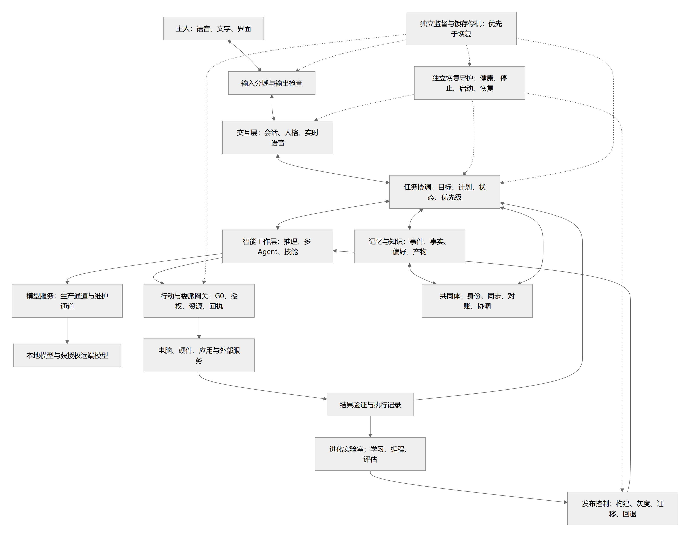
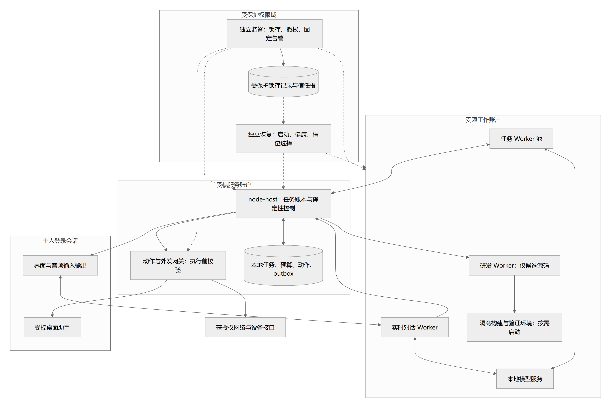
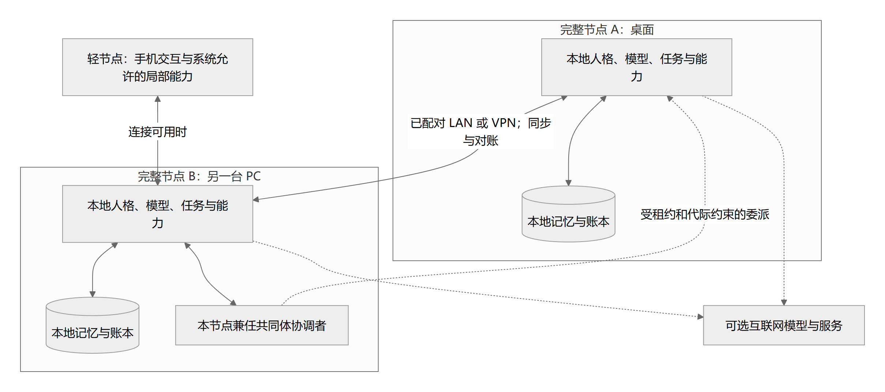
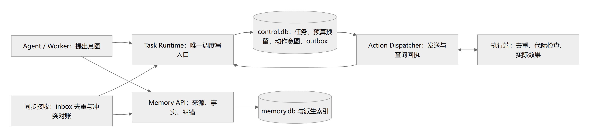

# 系统架构、运行边界与模块职责

> 状态：proposed（设计基线，尚未实现） · 更新：2026-10-15  
> [文档入口](README.md) · [维护规则](MAINTENANCE.md) · [架构图册](architecture-atlas.md)

<!-- book-nav:start -->
[全书目录](README.md#book-tree) › [第二篇 · 核心与工程基础](README.md#part-foundation) › 第 05 章 · 系统架构、运行边界与模块职责

## 本章导航

- [5.1 研究结论与设计原则](#design-principles)
  - [5.1.1 从研究到本项目的决策](#design-principles-1)
  - [5.1.2 核心原则](#design-principles-2)
- [5.2 总体架构与运行边界](#architecture-runtime)
  - [5.2.1 逻辑架构](#architecture-runtime-1)
  - [5.2.2 分阶段启用的进程边界](#architecture-runtime-2)
  - [5.2.3 依赖方向](#architecture-runtime-3)
  - [5.2.4 补齐架构视图：每张图回答不同问题](#architecture-runtime-4)
    - [5.2.4.1 图 A：系统边界与四个职责域](#section-aa9f0387a61d)
    - [5.2.4.2 图 B：Windows 单机运行与信任边界](#section-2badef848a6d)
    - [5.2.4.3 图 C：断网单体与联网共同体部署](#section-ed95a7231c80)
    - [5.2.4.4 图 D：状态写入所有权与事务边界](#section-7ef56ffe6b47)
  - [5.2.5 Computer Use：独立浏览器模块与后续桌面扩展](#computer-use-design)
  - [5.2.6 控制器的唯一权威：消除相互抢控制](#architecture-runtime-5)
  - [5.2.7 单机连续性的实际承诺](#architecture-runtime-6)
- [5.3 模块职责与替换契约](#module-responsibilities)
- [5.4 动态角色、资源、学习与监督模块](#extensions-1)
<!-- book-nav:end -->

<a id="design-principles"></a>
## 研究结论与设计原则


<a id="design-principles-1"></a>
### 从研究到本项目的决策

以下“采用方案”是本项目的设计推导，论文中的实验结果不直接等于 Jarvis 的能力保证。

| 研究或工程依据 | 对本项目的启示 | 不能推导出的结论 |
|---|---|---|
| Local-first [S01](references.md#s01) | 本地数据和本地运行优先，连接服务用于扩展和同步 | 所有云功能都能离线工作 |
| CRDT [S02](references.md#s02) | 适合笔记、集合等允许并发合并的数据 | 数据收敛等于记忆真实、行动不冲突 |
| CAP 与 Raft [S03](references.md#s03)[S04](references.md#s04) | 分区时需要明确哪些全局动作等待；关键控制状态有唯一顺序 | 离线节点仍可任意修改强一致共享状态 |
| Chubby 与幂等 API [S05](references.md#s05)[S06](references.md#s06) | 执行端验证所有权，重试携带稳定意图编号 | 仅有锁或事件总线即可让现实动作恰好执行一次 |
| Voyager、Reflexion [S07](references.md#s07)[S08](references.md#s08) | 可生成技能、利用反馈与记忆改进策略 | 已证明现实世界通用自主进化或能力无限增长 |
| SWE-agent [S09](references.md#s09) | 代码 Agent 需要良好的仓库、编辑、运行、测试工具 | 任意自我重写都能正确完成 |
| 多 Agent 工程经验 [S10](references.md#s10) | 明确分工、上下文、产物与预算，按需并行 | Agent 越多越强，或者必然胜过单 Agent |
| LangGraph、Temporal [S11](references.md#s11)[S12](references.md#s12) | 持久状态、检查点、工作者版本绑定有成熟参考 | 自动迁移任意程序内存或撤销外部副作用 |
| Protobuf 与部署控制 [S13](references.md#s13)[S14](references.md#s14) | 契约兼容、并行版本、就绪检测、排空是升级基础 | 滚动部署自然保证零中断及自动业务回滚 |

<a id="design-principles-2"></a>
### 核心原则

以下原则均从属于 G0。所有恢复、升级、路由和共同体自治都必须首先检查独立停机锁；锁存期间不能继续业务。

1. **本地可用优先。** 完整节点无需共同体才能启动、聊天、读取本地记忆或执行本地授权任务。
2. **身份、状态和实现解耦。** 更换模型、框架、界面或进程，不改变 Jarvis 的身份与用户数据所有权。
3. **对话、任务、进化、恢复分离。** 长任务和实验不占满实时交互资源。
4. **动作经过统一执行入口。** 模型提出计划，执行网关核对权限、资源和动作状态。
5. **各模块有独立契约。** 不跨模块导入内部对象，不直接写其他模块数据库。
6. **所有软件模块具备替换路径。** 普通模块热替换；有状态模块迁移；基础恢复层双槽替换。G0 的规范含义不属于自我进化的可修改对象；可信监督实现可以在独立维护程序中升级，但不能削弱约束。
7. **更新以证据准入。** 候选版本通过独立测试后发布，失败可定位、停止和恢复。
8. **同步信息和执行动作分离。** 重放日志可以重建状态，不能因此重发历史命令。
9. **普通 PC 优先，按需扩展。** 默认部署遵守[组件准入规则](stack-project-layout.md#technology-selection-4)；连接多台设备不自动引入集群组件。
10. **不把框架当成身份载体。** 外部框架只实现可替换接口，业务数据和稳定契约由项目掌握。

<a id="architecture-runtime"></a>
## 总体架构与运行边界


<a id="architecture-runtime-1"></a>
### 逻辑架构



[矢量图](diagrams/overview.svg) · [可编辑图源](diagrams/overview.mmd)


图中节点是逻辑模块，不要求一开始每个模块都运行成独立服务。

<a id="architecture-runtime-2"></a>
### 分阶段启用的进程边界

以下列出需要隔离的职责。K0—K2 先实现监督、恢复、业务宿主和必要 Worker/模型；K3 接入研发构建，K4 验证成长发布闭环。自然语音与桌面助手按 K6 扩展，并通过 M2 能力验收。进化与构建按需启动，不要求第一版同时常驻全部进程。

表与图表达职责和信任边界，不是要求普通 PC 安装九个常驻服务。默认以小型控制底座和业务宿主承载必要职责，恢复 CLI、隔离 Worker、推理及研发环境按使用场景启动；未启用的能力不驻留。可以合并同信任域的部署，不能合并业务与受保护控制权限。具体默认选择归[技术栈页](stack-project-layout.md#technology-selection-4)。

| 进程 | 保持独立的原因 |
|---|---|
| sovereignty-supervisor | 独立检查 G0、管理停机锁与确定性关停；业务无写权限 |
| recovery-supervisor | 普通故障可恢复；锁存后禁止恢复业务，依赖少 |
| node-host | 承载本地持久任务、策略、事件写入、能力注册等基础服务 |
| dialogue-worker | 语音与实时交互不被长任务阻塞 |
| task-worker（可多个） | 处理工具使用、复杂推理和项目工作 |
| desktop-agent | 运行在登录用户会话中，负责桌面 UI 能力 |
| evolution-worker | 候选开发环境与生产任务隔离 |
| model-server（可多个） | 本地模型资源、版本和生命周期独立 |
| desktop-ui | 界面关闭或更新不结束后台工作 |

Windows 服务不能直接当作交互桌面进程使用；桌面操作助手应运行在用户会话中，与服务通过受保护 IPC 通信。锁屏、UAC、注销等状态下按能力等待或改走获授权后台 API。[S22](references.md#s22)

<a id="architecture-runtime-3"></a>
### 依赖方向

```text
客户端 / 外部适配器
        ↓
应用服务：对话、目标、任务、进化
        ↓
领域契约：身份、任务、记忆、动作、模块、发布
        ↑
基础设施实现：数据库、模型、传输、操作系统、工具框架
```

领域契约不能依赖具体 LLM SDK、LangGraph、数据库驱动或 UI 框架。基础设施被替换时，业务语义和数据契约不变。

<a id="architecture-runtime-4"></a>
### 补齐架构视图：每张图回答不同问题

总体逻辑图之外，还需要进程、部署、信任和数据所有权视图。以下视图借鉴 C4 的分层表达方法，但不是宣称完成了完整 C4 建模。图中的“容器”泛指独立运行单元，不专指 Docker 容器。[S38](references.md#s38)

阅读顺序：系统边界 → 单机部署 → 共同体部署 → 状态所有权 → 构建发布。实线表示调用或数据流，虚线表示控制、授权或可选连接；具体故障语义以对应章节为准。图中合并展示的安全监督与恢复是**两个不同权限域**，不是允许恢复器重启锁存后的业务。

<a id="section-aa9f0387a61d"></a>
#### 图 A：系统边界与四个职责域


[矢量图](diagrams/system-boundaries.svg) · [可编辑图源](diagrams/system-boundaries.mmd)


这四个职责域是架构分工，不是新增四套调度器。人格决定表达方式，规划器提出候选工作，控制域决定当前是否可执行，研发域只能产生候选产物；发布资格不是由生成者授予。

<a id="section-2badef848a6d"></a>
#### 图 B：Windows 单机运行与信任边界



[矢量图](diagrams/windows-deployment.svg) · [可编辑图源](diagrams/windows-deployment.mmd)


账户、文件 ACL、IPC 身份验证和网络隔离需要共同实现这些边界；画进不同框或换一种语言不会自动形成隔离。UI 呈现和音频播放必须使用已通过输出检查的片段，图中的对话连接不代表允许绕过输出网关。桌面助手拥有高影响能力，必须在执行入口再次校验授权与停机状态。

初期 Host 与 Gate 可以同属一个可信服务和本地事务边界；它们与任意生成代码必须分开。监督实现可以很小，但实际可信计算基础仍包括操作系统、执行器、凭据存储、授权实现与发布控制，不能宣称整个安全性只依赖几百行代码。

<a id="section-ed95a7231c80"></a>
#### 图 C：断网单体与联网共同体部署



[矢量图](diagrams/federation-deployment.svg) · [可编辑图源](diagrams/federation-deployment.mmd)


每个完整节点都有本地运行所需材料；断开 A—B 连接不会将 A 变成空壳。互联网可用不意味着能加入共同体，互联网断开也不妨碍局域网共同体。协调者不可达时，不再发放新的全局独占权；本地工作按既有授权继续。手机是轻节点时不能承诺与完整节点同等自治能力。

<a id="section-7ef56ffe6b47"></a>
#### 图 D：状态写入所有权与事务边界



[矢量图](diagrams/state-ownership.svg) · [可编辑图源](diagrams/state-ownership.mmd)


首期任务受理、预算预留、动作意图和 outbox 共用一个 `control.db` 的本地事务。逻辑模块通过各自 API 写其表；Worker 没有数据库文件权限。记忆入库、模型请求和外部设备不属于该事务，采用事件与幂等处理、状态查询或补偿；不假装存在跨这些边界的原子提交。停机锁独立于该数据库，即便数据库卡住也须阻断执行。

`control.db` 拆成独立服务时，必须先重新设计预算预留、动作受理和所有权转移协议。拆表、拆目录或使用消息总线均不自动提供跨服务事务。

<a id="computer-use-design"></a>
### Computer Use：独立浏览器模块与后续桌面扩展

Jarvis 的通路是：观察指定应用/浏览器 → 模型提出结构化动作 → Host 检查任务与授权 → 独立适配器执行 → 重新观察并核对结果。**0.1.8 已实现限定 DOM 浏览器子集**，完整桌面仍为 proposed。模型和驱动分开，换供应商不重做元素操作底座；[模型候选](models-offline.md#computer-use-models)独立维护。元数据 Worker 保持原来的 LPAC 边界，不承载浏览器。

| 已实现模块 | 职责与替换边界 |
|---|---|
| ComputerService | 复用 CoreService 的 Task/Action、取消、停止和产物提交；维护附属步骤日志，不另建任务调度权威 |
| ComputerWeb | 独立网页入口的薄接纳层；任务与队列登记提交后返回 ID，查询/截图/取消均回到原账本 |
| ComputerQueue（0.1.10） | 原账本附表维护 FIFO/版本/宿主，复用全局执行锁；单线程运行、暂停/继续、未知结果阻断，具体语义见[任务章](tasks-agents.md#browser-durable-queue) |
| ModelPlanner | 将任务和 DOM 交给既有 ChatService；模型 ID 自动关联供应商；返回有 observation_id 的单动作 JSON |
| protocol | 校验任务与模型动作 schema、固定目标/输入值及观察代次；模型不能扩大任务范围 |
| EdgeBrowser | Playwright 驱动现有 Edge，新上下文执行 fill/select/check/click；不继承个人登录态，不导入模型代码 |
| DriverJob | Windows Job 管理本次私有驱动与浏览器进程树；只承担生命周期，不提供 Host 的 LPAC 隔离 |

上述是代码模块独立、浏览器进程独立；规划与编排仍在调用用户的 Python Host 内，没有伪装成完整微服务隔离。替换模型只改规划适配，替换浏览器驱动要保持观察/动作/结果接口并重跑[测试](delivery-validation.md#computer-evidence)。当前不支持热替换正在执行的任务，也不声称已实现自主更新。实现目录归[技术栈页](stack-project-layout.md#implemented-layout)，启动归[核心页](core-bootstrap.md#runtime-computer)。

普通 PC 首期按需启用一个适配器：能通过软件 API 完成的步骤优先走固定接口；网页用浏览器元素定位；Windows 应用优先使用 UI Automation 元素身份，截图坐标作为补充。所有方式使用同一动作账本。观测绑定窗口、时间、缩放和元素代次，切换窗口后重取状态；未知结果先查询，不能盲目重复点击。

可以参考 OpenAI 的 Computer Use 执行循环 [S114](references.md#s114)，以及 Qwen 的 `open-computer-use` [S117](references.md#s117)。后者的 Windows 实现基于 Go/PowerShell UI Automation；它是可替换适配候选，不表示已经安装或通过 Jarvis 的权限验收。MCP 只是接口，不能代替执行授权。

同一桌面会话只允许一个真实键鼠控制租约；多个 Agent 可以并行规划、调用独立 API 或使用各自浏览器上下文，不能同时抢同一个鼠标。用户接管输入时暂停自动操作，停止入口保持可用。截图和页面文字是观测资料，不能修改主人规则；外发截图按已有数据范围处理。完整桌面扩展仍归 K6/M2，早期实验只在独立测试页面/应用验收，不跳过 K1/K2 门。

<a id="architecture-runtime-5"></a>
### 控制器的唯一权威：消除相互抢控制

| 控制决策 | 唯一权威 | 其他模块允许做什么 |
|---|---|---|
| G0 锁存与禁止执行 | sovereignty-supervisor 与受保护执行入口 | 任何模块可报告；不能自行解锁 |
| 普通崩溃后是否重启进程 | recovery-supervisor | 读取已激活拓扑；必须先检查锁存 |
| 某个任务下一步做什么 | goal-task-runtime | 规划器、团队控制器提交建议和子任务 |
| 有多少执行资源可以使用 | resource-governor | 发放有上限配额；不重新执行任务 |
| 创建哪些 Agent 身份和职责 | agent-orchestrator | 提交工作规格；不直接启动无限进程 |
| 哪个版本成为生产版本 | release-controller | 使用受保护准入策略和评估证据 |
| 拓扑怎样变化 | topology-manager 提议，release-controller 激活 | recovery-supervisor 只落实激活配置 |
| 共同体任务所有权 | 当前权威协调者 | 节点接收明确委派，不因失联自行夺权 |
| 包是否通过测试 | 独立 evaluation-service | 生成者可自测，但不能签发独立验收结论 |

这些是逻辑权限，不要求九个独立常驻服务；安全、隔离或生命周期不同的部分才必须独立运行。所有控制循环都读取可观察状态、核对代际，再执行有限操作；不得相互无限重启或扩容。首期不让通用 LLM 在控制循环中决定“是否遵守”确定性锁存与预算。

<a id="architecture-runtime-6"></a>
### 单机连续性的实际承诺

对话、长任务、模型与构建进程分别限额；编译大项目可以排队或迁往其他节点。只要物理机器总资源不足，就不能同时保证全速编译、低延迟语音和零停顿更新。资源优先级以[Agent、模型与模块的统一资源自调度](tasks-agents.md#resource-scheduling)为准。

单机最小配置允许安全点暂停 Host 后接管，但不暂停独立监督；UI 可显示重连状态。第二完整节点可提供更多服务连续性，但不能用双活执行同一外部动作来掩盖切换延迟。[持续服务、升级与迁移](evolution-release.md#service-continuity) C0—C3 是逐模块承诺，不是全系统永不停止的保证。

<a id="module-responsibilities"></a>
## 模块职责与替换契约

基础模块与扩展模块共同构成逻辑职责目录，扩展职责见下文。

| 模块 | 主要责任 | 自有状态 | 替换方式 |
|---|---|---|---|
| sovereignty-supervisor | G0 检查、独立告警、授权代际与锁存停机 | 独立受保护的停机记录 | 主人维护入口更新实现，G0 不可削弱 |
| recovery-supervisor | 普通故障启动、探活、版本选择、恢复；服从停机锁 | 双槽版本、最后可用版本、恢复记录 | 外部引导器与 A/B 槽 |
| node-host | 本地运行容器、能力注册、基本协调 | 节点配置与注册信息 | 服务实例排空/接管 |
| identity-policy | 身份、配对、授权、撤销、策略执行 | 成员与策略版本 | 新旧策略解释器兼容验证 |
| session-gateway | 连接、会话、输出序列、音频控制 | 会话状态与输出偏移 | 会话绑定，边界切换 |
| persona-service | 人格、关系、声音与交互偏好 | 版本化配置 | 新轮次/新会话生效 |
| dialogue-runtime | 快速理解、交流、打断、简短状态解释 | 对话检查点 | 会话安全点切换 |
| goal-task-runtime | 目标、依赖、调度、持久状态 | 任务库、检查点 | 固定版本或显式迁移 |
| agent-orchestrator | 分工、上下文、预算、产物汇总 | 子任务与协作记录 | 新任务选择新版本 |
| model-gateway | 模型适配、能力检查、限流、路由 | 健康、成本、路由策略 | 多实例与独立恢复入口 |
| memory-service | 记忆入库、检索、冲突与遗忘 | 记忆与派生索引 | 兼容迁移、可重建索引 |
| artifact-service | 文件、设计产物、对象哈希和版本 | 内容对象与元数据 | 存储适配器迁移 |
| action-gateway | 动作授权、资源互斥、代际、回执 | 动作日志、资源状态 | 排空并转移资源所有权 |
| capability-adapters | 桌面、浏览器、设备、软件适配 | 最小设备连接状态 | 独立插件包 |
| federation | 发现、同步、对账、共享控制 | 同步游标、节点与控制状态 | 协议版本并存 |
| skill-registry | 技能查找、依赖、版本与授权范围 | 不可变技能清单 | 新增版本，旧任务固定 |
| evolution-lab | 发现不足、查资料、写程序、实验 | 候选分支、实验与提案 | 实验可随时重启 |
| evaluation-service | 契约、回归、独立测试与实测 | 测试集版本、结果 | 新版评估需重新校准 |
| release-controller | 签名校验、就绪、灰度、排空、回退 | 发布事务与恢复计划 | 独立发布流程 |
| topology-manager | 声明式进程拓扑、依赖与流量配置 | 拓扑版本、资源配置 | 计划验证后逐步应用 |
| observability | 日志、指标、追踪、成本和告警 | 可检索运行记录 | 采集和导出端独立替换 |

所有模块至少提供：标识与版本、提供/依赖的接口、资源与权限、健康检查、状态格式、迁移方案、测试入口、停止/排空方式和恢复说明。声明“支持回退”必须由演练验证。

<a id="extensions-1"></a>
## 动态角色、资源、学习与监督模块

| 模块 | 归属与职责 | 状态与关键边界 |
|---|---|---|
| sovereignty-supervisor | 独立可信运行进程 | 停机锁和安全事件，业务无写权 |
| output-delegation-gateway | 核心执行边界 | 输出、提示外发、委派链和实际目的 |
| persona-compiler / embodiment-manager | 智能配置 + 形态适配 | 人格可变，主体身份和 G0 不变 |
| agent-factory / team-controller | 智能工作层 | 蓝图与组织方案，准入由核心执行 |
| capability-observer / resource-governor | node-host 核心模块 | 新鲜能力、资源与预算租约 |
| agent-registry / world-runtime | 核心状态模块 | 身份、世界事实、时间与分支 |
| simulation-cognition | 可隔离 Worker | 仅模拟工具与记忆域 |
| learning-planner / technology-watch | 智能工作层 | 目标相关学习任务与来源 |
| knowledge-evolution / memory-curator | 智能提案 + 核心数据接口 | 数据不能越权迁移或污染根策略 |
| local-component-manager | 核心模型/组件生命周期 | 离线包、候选、活动和回退版本 |
| network-recovery | 平台适配器 + 诊断工作流 | 只做批准的检查和有限修复 |

这些职责与基础模块共同部署，仍遵守[总体架构与运行边界](architecture.md#architecture-runtime)的少量故障域与[项目文件结构与依赖规则](stack-project-layout.md#project-structure)的模块化原则；不把每个逻辑名称都立即拆成独立服务。

<!-- book-footer:start -->
[返回全书目录](README.md#book-tree) · [上一章：最小核心、初始资产与开发路线](core-bootstrap.md) · [下一章：主人利益原则、身份授权与停止控制](security-sovereignty.md)
<!-- book-footer:end -->
