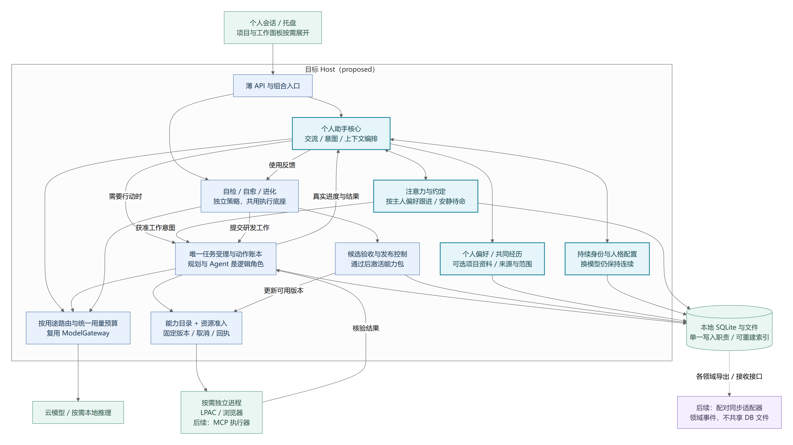

# 系统架构、运行边界与模块职责

> 状态：总体架构 proposed；实际运行结构与对话现状摘要按0.1.59更新，原历史证据保留其范围 · 更新：2026-10-19
> [文档入口](README.md) · [维护规则](MAINTENANCE.md) · [架构图册](architecture-atlas.md)

<!-- book-nav:start -->
[全书目录](README.md#book-tree) › [第二篇 · 核心与工程基础](README.md#part-foundation) › 第 06 章 · 系统架构、运行边界与模块职责

## 本章导航

- [6.1 研究结论与设计原则](#design-principles)
  - [6.1.1 从研究到本项目的决策](#design-principles-1)
  - [6.1.2 核心原则](#design-principles-2)
- [6.2 总体架构与运行边界](#architecture-runtime)
  - [6.2.1 逻辑架构](#architecture-runtime-1)
  - [6.2.2 分阶段启用的进程边界](#architecture-runtime-2)
  - [6.2.3 依赖方向](#architecture-runtime-3)
  - [6.2.4 补齐架构视图：每张图回答不同问题](#architecture-runtime-4)
    - [6.2.4.1 图 A：系统边界与四个职责域](#section-aa9f0387a61d)
    - [6.2.4.2 图 B：Windows 单机运行与信任边界](#section-2badef848a6d)
    - [6.2.4.3 图 C：断网单体与联网共同体部署](#section-ed95a7231c80)
    - [6.2.4.4 图 D：状态写入所有权与事务边界](#section-7ef56ffe6b47)
  - [6.2.5 Computer Use：独立浏览器模块与后续桌面扩展](#computer-use-design)
  - [6.2.6 项目资源与扩展接入的独立模块](#project-extension-modules)
  - [6.2.7 控制器的唯一权威：消除相互抢控制](#architecture-runtime-5)
  - [6.2.8 单机连续性的实际承诺](#architecture-runtime-6)
- [6.3 模块职责与替换契约](#module-responsibilities)
- [6.4 动态角色、资源、学习与监督模块](#extensions-1)
- [6.5 已实现的成长模块边界](#evolution-runtime-modules)
- [6.6 三能力分离后的模块协作](#growth-center-architecture)
- [6.7 普通 PC 下一阶段：个人助手核心与按需扩展](#pc-runtime-convergence)
  - [6.7.1 实际运行结构与目标边界](#current-runtime-topology)
  - [6.7.2 对话、语音与工作分离的代码核对（2026-10-18）](#dialogue-separation)
    - [6.7.2.1 当前具备什么，缺少什么](#dialogue-separation-audit)
    - [6.7.2.2 改造选择：一个交流核心，多个独立执行通道](#dialogue-separation-design)
  - [6.7.3 防止结构在自修改中退化](#runtime-boundary-fitness)
<!-- book-nav:end -->

<a id="design-principles"></a>
## 研究结论与设计原则


<a id="design-principles-1"></a>
### 从研究到本项目的决策

以下“采用方案”是本项目的设计推导，论文中的实验结果不直接等于 Jarvis 的能力保证。

| 研究或工程依据 | 对本项目的启示 | 不能推导出的结论 |
|---|---|---|
| Local-first [S01](references.md#s01) | 本地数据和本地运行优先，连接服务用于扩展和同步 | 所有云功能都能离线工作 |
| CRDT [S02](references.md#s02) | 适合笔记、集合等允许并发合并的数据 | 数据收敛等于记忆真实、行动不冲突 |
| CAP 与 Raft [S03](references.md#s03)[S04](references.md#s04) | 分区时需要明确哪些全局动作等待；关键控制状态有唯一顺序 | 离线节点仍可任意修改强一致共享状态 |
| Chubby 与幂等 API [S05](references.md#s05)[S06](references.md#s06) | 执行端验证所有权，重试携带稳定意图编号 | 仅有锁或事件总线即可让现实动作恰好执行一次 |
| Voyager、Reflexion [S07](references.md#s07)[S08](references.md#s08) | 可生成技能、利用反馈与记忆改进策略 | 已证明现实世界通用自主进化或能力无限增长 |
| SWE-agent [S09](references.md#s09) | 代码 Agent 需要良好的仓库、编辑、运行、测试工具 | 任意自我重写都能正确完成 |
| 多 Agent 工程经验 [S10](references.md#s10) | 明确分工、上下文、产物与预算，按需并行 | Agent 越多越强，或者必然胜过单 Agent |
| LangGraph、Temporal [S11](references.md#s11)[S12](references.md#s12) | 持久状态、检查点、工作者版本绑定有成熟参考 | 自动迁移任意程序内存或撤销外部副作用 |
| Protobuf 与部署控制 [S13](references.md#s13)[S14](references.md#s14) | 契约兼容、并行版本、就绪检测、排空是升级基础 | 滚动部署自然保证零中断及自动业务回滚 |

<a id="design-principles-2"></a>
### 核心原则

以下原则均从属于 G0。所有恢复、升级、路由和共同体自治都必须首先检查独立停机锁；锁存期间不能继续业务。

1. **本地可用优先。** 完整节点无需共同体才能启动、聊天、读取本地记忆或执行本地授权任务。
2. **身份、状态和实现解耦。** 更换模型、框架、界面或进程，不改变 Jarvis 的身份与用户数据所有权。
3. **对话、任务、进化、恢复分离。** 长任务和实验不占满实时交互资源。
4. **动作经过统一执行入口。** 模型提出计划，执行网关核对权限、资源和动作状态。
5. **各模块有独立契约。** 不跨模块导入内部对象，不直接写其他模块数据库。
6. **所有软件模块具备替换路径。** 普通模块热替换；有状态模块迁移；基础恢复层双槽替换。G0 的规范含义不属于自我进化的可修改对象；可信监督实现可以在独立维护程序中升级，但不能削弱约束。
7. **更新以证据准入。** 候选版本通过独立测试后发布，失败可定位、停止和恢复。
8. **同步信息和执行动作分离。** 重放日志可以重建状态，不能因此重发历史命令。
9. **普通 PC 优先，按需扩展。** 默认部署遵守[组件准入规则](stack-project-layout.md#technology-selection-4)；连接多台设备不自动引入集群组件。
10. **不把框架当成身份载体。** 外部框架只实现可替换接口，业务数据和稳定契约由项目掌握。

<a id="architecture-runtime"></a>
## 总体架构与运行边界


<a id="architecture-runtime-1"></a>
### 逻辑架构


[矢量图](diagrams/overview.svg) · [可编辑图源](diagrams/overview.mmd)


图中节点是逻辑模块，不要求一开始每个模块都运行成独立服务。

<a id="architecture-runtime-2"></a>
### 分阶段启用的进程边界

以下列出需要隔离的职责。K0—K2 先实现监督、恢复、业务宿主和必要 Worker/模型；K3 接入研发构建，K4 验证成长发布闭环。自然语音与桌面助手按 K6 扩展，并通过 M2 能力验收。进化与构建按需启动，不要求第一版同时常驻全部进程。

表与图表达职责和信任边界，不是要求普通 PC 安装九个常驻服务。默认以小型控制底座和业务宿主承载必要职责，恢复 CLI、隔离 Worker、推理及研发环境按使用场景启动；未启用的能力不驻留。可以合并同信任域的部署，不能合并业务与受保护控制权限。具体默认选择归[技术栈页](stack-project-layout.md#technology-selection-4)。

| 进程 | 保持独立的原因 |
|---|---|
| sovereignty-supervisor | 独立检查 G0、管理停机锁与确定性关停；业务无写权限 |
| recovery-supervisor | 普通故障可恢复；锁存后禁止恢复业务，依赖少 |
| node-host | 承载本地持久任务、策略、事件写入、能力注册等基础服务 |
| dialogue-worker | 语音与实时交互不被长任务阻塞 |
| task-worker（可多个） | 处理工具使用、复杂推理和项目工作 |
| desktop-agent | 运行在登录用户会话中，负责桌面 UI 能力 |
| evolution-worker | 候选开发环境与生产任务隔离 |
| model-server（可多个） | 本地模型资源、版本和生命周期独立 |
| desktop-ui | 界面关闭或更新不结束后台工作 |

Windows 服务不能直接当作交互桌面进程使用；桌面操作助手应运行在用户会话中，与服务通过受保护 IPC 通信。锁屏、UAC、注销等状态下按能力等待或改走获授权后台 API。[S22](references.md#s22)

<a id="architecture-runtime-3"></a>
### 依赖方向

```text
客户端 / 外部适配器
        ↓
应用服务：对话、目标、任务、进化
        ↓
领域契约：身份、任务、记忆、动作、模块、发布
        ↑
基础设施实现：数据库、模型、传输、操作系统、工具框架
```

领域契约不能依赖具体 LLM SDK、LangGraph、数据库驱动或 UI 框架。基础设施被替换时，业务语义和数据契约不变。

<a id="architecture-runtime-4"></a>
### 补齐架构视图：每张图回答不同问题

总体逻辑图之外，还需要进程、部署、信任和数据所有权视图。以下视图借鉴 C4 的分层表达方法，但不是宣称完成了完整 C4 建模。图中的“容器”泛指独立运行单元，不专指 Docker 容器。[S38](references.md#s38)

阅读顺序：系统边界 → 单机部署 → 共同体部署 → 状态所有权 → 构建发布。实线表示调用或数据流，虚线表示控制、授权或可选连接；具体故障语义以对应章节为准。图中合并展示的安全监督与恢复是**两个不同权限域**，不是允许恢复器重启锁存后的业务。

<a id="section-aa9f0387a61d"></a>
#### 图 A：系统边界与四个职责域


[矢量图](diagrams/system-boundaries.svg) · [可编辑图源](diagrams/system-boundaries.mmd)


这四个职责域是架构分工，不是新增四套调度器。人格决定表达方式，规划器提出候选工作，控制域决定当前是否可执行，研发域只能产生候选产物；发布资格不是由生成者授予。

<a id="section-2badef848a6d"></a>
#### 图 B：Windows 单机运行与信任边界


[矢量图](diagrams/windows-deployment.svg) · [可编辑图源](diagrams/windows-deployment.mmd)


账户、文件 ACL、IPC 身份验证和网络隔离需要共同实现这些边界；画进不同框或换一种语言不会自动形成隔离。UI 呈现和音频播放必须使用已通过输出检查的片段，图中的对话连接不代表允许绕过输出网关。桌面助手拥有高影响能力，必须在执行入口再次校验授权与停机状态。

初期 Host 与 Gate 可以同属一个可信服务和本地事务边界；它们与任意生成代码必须分开。监督实现可以很小，但实际可信计算基础仍包括操作系统、执行器、凭据存储、授权实现与发布控制，不能宣称整个安全性只依赖几百行代码。

<a id="section-ed95a7231c80"></a>
#### 图 C：断网单体与联网共同体部署


[矢量图](diagrams/federation-deployment.svg) · [可编辑图源](diagrams/federation-deployment.mmd)


每个完整节点都有本地运行所需材料；断开 A—B 连接不会将 A 变成空壳。互联网可用不意味着能加入共同体，互联网断开也不妨碍局域网共同体。协调者不可达时，不再发放新的全局独占权；本地工作按既有授权继续。手机是轻节点时不能承诺与完整节点同等自治能力。

<a id="section-7ef56ffe6b47"></a>
#### 图 D：状态写入所有权与事务边界


[矢量图](diagrams/state-ownership.svg) · [可编辑图源](diagrams/state-ownership.mmd)


首期任务受理、预算预留、动作意图和 outbox 共用一个 `control.db` 的本地事务。逻辑模块通过各自 API 写其表；Worker 没有数据库文件权限。记忆入库、模型请求和外部设备不属于该事务，采用事件与幂等处理、状态查询或补偿；不假装存在跨这些边界的原子提交。停机锁独立于该数据库，即便数据库卡住也须阻断执行。

`control.db` 拆成独立服务时，必须先重新设计预算预留、动作受理和所有权转移协议。拆表、拆目录或使用消息总线均不自动提供跨服务事务。

<a id="computer-use-design"></a>
### Computer Use：独立浏览器模块与后续桌面扩展

Jarvis 的通路是：观察指定应用/浏览器 → 模型提出结构化动作 → Host 检查任务与授权 → 独立适配器执行 → 重新观察并核对结果。**0.1.8 已实现限定 DOM 浏览器子集**，完整桌面仍为 proposed。模型和驱动分开，换供应商不重做元素操作底座；[模型候选](models-offline.md#computer-use-models)独立维护。元数据 Worker 保持原来的 LPAC 边界，不承载浏览器。

| 已实现模块 | 职责与替换边界 |
|---|---|
| ComputerService | 复用 CoreService 的 Task/Action、取消、停止和产物提交；维护附属步骤日志，不另建任务调度权威 |
| ComputerWeb | 独立网页入口的薄接纳层；任务与队列登记提交后返回 ID，查询/截图/取消均回到原账本 |
| ComputerQueue（0.1.10） | 原账本附表维护 FIFO/版本/宿主，复用全局执行锁；单线程运行、暂停/继续、未知结果阻断，具体语义见[任务章](tasks-agents.md#browser-durable-queue) |
| ModelPlanner | 将任务和 DOM 交给既有 ChatService；模型 ID 自动关联供应商；返回有 observation_id 的单动作 JSON |
| protocol | 校验任务与模型动作 schema、固定目标/输入值及观察代次；模型不能扩大任务范围 |
| EdgeBrowser | Playwright 驱动现有 Edge，新上下文执行 fill/select/check/click；不继承个人登录态，不导入模型代码 |
| DriverJob | Windows Job 管理本次私有驱动与浏览器进程树；只承担生命周期，不提供 Host 的 LPAC 隔离 |

上述是代码模块独立、浏览器进程独立；规划与编排仍在调用用户的 Python Host 内，没有伪装成完整微服务隔离。替换模型只改规划适配，替换浏览器驱动要保持观察/动作/结果接口并重跑[测试](delivery-validation.md#computer-evidence)。当前不支持热替换正在执行的任务，也不声称已实现自主更新。实现目录归[技术栈页](stack-project-layout.md#implemented-layout)，启动归[核心页](core-bootstrap.md#runtime-computer)。

普通 PC 首期按需启用一个适配器：能通过软件 API 完成的步骤优先走固定接口；网页用浏览器元素定位；Windows 应用优先使用 UI Automation 元素身份，截图坐标作为补充。所有方式使用同一动作账本。观测绑定窗口、时间、缩放和元素代次，切换窗口后重取状态；未知结果先查询，不能盲目重复点击。

可以参考 OpenAI 的 Computer Use 执行循环 [S114](references.md#s114)，以及 Qwen 的 `open-computer-use` [S117](references.md#s117)。后者的 Windows 实现基于 Go/PowerShell UI Automation；它是可替换适配候选，不表示已经安装或通过 Jarvis 的权限验收。MCP 只是接口，不能代替执行授权。

同一桌面会话只允许一个真实键鼠控制租约；多个 Agent 可以并行规划、调用独立 API 或使用各自浏览器上下文，不能同时抢同一个鼠标。用户接管输入时暂停自动操作，停止入口保持可用。截图和页面文字是观测资料，不能修改主人规则；外发截图按已有数据范围处理。完整桌面扩展仍归 K6/M2，早期实验只在独立测试页面/应用验收，不跳过 K1/K2 门。

<a id="project-extension-modules"></a>
### 项目资源与扩展接入的独立模块

0.1.30 增加独立 [SampleTaskService](../runtime/node-host/jarvis_core/sample_tasks.py)，通过同一核心 FIFO 和账本组合模型规划、固定目录 Worker 与统计报告。规划器只返回有界候选；核心保留取消、身份代际、受限目录与产物提交的唯一执行边界。任务适配层只接纳参数、投影状态，不另起调度器。此组合工作流与用户登记的扩展执行分开；详细运行语义见[任务章](tasks-agents.md#sample-task-runtime)。

0.1.27 已实现资源访问、文本编辑和扩展登记；后续运行适配器仍 proposed。保持接口独立、同一轻量宿主部署，不为模块化默认增加微服务、K8s、常驻 Node 或向量数据库。

| 模块 | 当前权威与可替换边界 |
|---|---|
| ProjectCatalog / ProjectMenu | 2026-10-17 增量：独立 SQLite 项目显示档案、置顶/分区/软移除与聊天归档标记；借用 WorkspaceService 的根身份、ConversationStore 的有效聊天列表。系统资源管理器只打开登记根目录，不提供任意命令参数；详情归[组织契约](contracts.md#project-organization-contract) |
| WorkspaceService | 项目目录身份、最近项目和文本导出回执；不管理编辑缓冲、MCP 进程或知识事实 |
| WorkbenchLayout | 0.1.29 的浏览器布局控制器：宽度、面板显隐、焦点入口与布局偏好；不拥有聊天历史、文件正文、模型路由或任务生命周期。Explorer 通过 attach/show 接入，文件缓冲继续由 Explorer 管理 |
| ProjectFiles / Explorer | 按需目录元数据、显式文本读写、摘要冲突和工程配置；编辑 UI 可以换成 CodeMirror/Monaco，目录/写入契约不随编辑器更换 |
| KnowledgeStore | 既有按范围文档检索、来源摘要与引用链；浏览所有文件不等于将所有内容上传或写入长期记忆 |
| ExtensionCatalog | MCP/技能配置、来源、修订和检查；无进程启动、网络握手、工具执行或技能注入职责 |
| MCP transport adapter（Context7 HTTP子集已实现） | 已接通限定 Context7 HTTP；通用按需 stdio 子进程或 Streamable HTTP 会话、协议协商仍待扩展，、超时/取消/资源回收；只向能力注册模块提交工具描述，不授予执行权限 |
| SkillManager（原生目录子集已实现，通用加载待实现） | 0.1.36 已实现原生目录、范围策略、宿主意图选择与限定报告/齿轮模板；用户登记的任意 SKILL.md 不因此获得执行能力。按[统一技能规则](tasks-agents.md#skill-selection-policy)筛选和解释选用/不用，技能文字不是高级别系统规则，附带代码仍经执行适配器 |
| Capability registry / Action gateway（完整通路待实现） | 统一可用能力、任务作用域、调用证据与资源约束；模型只能提出调用，扩展不能另建无限权限的任务循环 |

当前操作流程是“打开文件夹/工程 → 绑定项目身份 → 按需列举 → 读取文件摘要 → 编辑草稿 → 预期版本校验 → 保存回执”；知识检索走独立引用链。扩展流程先到“登记 → 格式/来源检查”，后续才连接“协商/发现 → 范围绑定 → 按需调用 → 结果记录 → 停用回收”。每一步有失败状态，登记成功不折算为运行成功。

2026-10-17 已采纳 [Anatomy 科普能力](stack-project-layout.md#anatomy-integration-choice)与 [Matt Pocock 编程技能包](stack-project-layout.md#matt-pocock-skills-evaluation)的分阶段接入设计。0.1.36 已接入限定原生指南、项目文本报告和固定齿轮模板，使用 SkillTaskService / SkillRenderer 与现有 Task/Action；它们不等于任意 Anatomy 创作或通用仓库编码。后续绘图、编码执行器与产物预览分别适配，不另建模型、任务或发布权威。[实际范围](core-bootstrap.md#native-skills-entry)与[验证](delivery-validation.md#versioned-evidence)优先于早期“尚无适配器”的历史描述。

后续升级只替换相应适配器和契约兼容实现；旧版本的在途任务由原适配器完成或明确取消后释放，不宣称当前任意代码热替换已经实现。扩展源与项目文件在不同设备可能缺失，共同体只同步经允许的描述和状态；不得因收到同步配置就自动安装代码或取得本机目录执行权。多设备一致性仍由[共同体章](federation.md#offline-federation)拥有。

交互归[资源工作台](interaction-persona.md#project-resource-workbench)与[扩展设置](interaction-persona.md#extension-management-ui)，字段与配额归[契约章](contracts.md#project-resources-contract)，验证归[0.1.27 证据](delivery-validation.md#project-resources-evidence)。

<a id="architecture-runtime-5"></a>
### 控制器的唯一权威：消除相互抢控制

| 控制决策 | 唯一权威 | 其他模块允许做什么 |
|---|---|---|
| G0 锁存与禁止执行 | sovereignty-supervisor 与受保护执行入口 | 任何模块可报告；不能自行解锁 |
| 普通崩溃后是否重启进程 | recovery-supervisor | 读取已激活拓扑；必须先检查锁存 |
| 某个任务下一步做什么 | goal-task-runtime | 规划器、团队控制器提交建议和子任务 |
| 有多少执行资源可以使用 | resource-governor | 发放有上限配额；不重新执行任务 |
| 创建哪些 Agent 身份和职责 | agent-orchestrator | 提交工作规格；不直接启动无限进程 |
| 哪个版本成为生产版本 | release-controller | 使用受保护准入策略和评估证据 |
| 拓扑怎样变化 | topology-manager 提议，release-controller 激活 | recovery-supervisor 只落实激活配置 |
| 共同体任务所有权 | 当前权威协调者 | 节点接收明确委派，不因失联自行夺权 |
| 包是否通过测试 | 独立 evaluation-service | 生成者可自测，但不能签发独立验收结论 |

这些是逻辑权限，不要求九个独立常驻服务；安全、隔离或生命周期不同的部分才必须独立运行。所有控制循环都读取可观察状态、核对代际，再执行有限操作；不得相互无限重启或扩容。首期不让通用 LLM 在控制循环中决定“是否遵守”确定性锁存与预算。

<a id="architecture-runtime-6"></a>
### 单机连续性的实际承诺

对话、长任务、模型与构建进程分别限额；编译大项目可以排队或迁往其他节点。只要物理机器总资源不足，就不能同时保证全速编译、低延迟语音和零停顿更新。资源优先级以[Agent、模型与模块的统一资源自调度](tasks-agents.md#resource-scheduling)为准。

单机最小配置允许安全点暂停 Host 后接管，但不暂停独立监督；UI 可显示重连状态。第二完整节点可提供更多服务连续性，但不能用双活执行同一外部动作来掩盖切换延迟。[持续服务、升级与迁移](evolution-release.md#service-continuity) C0—C3 是逐模块承诺，不是全系统永不停止的保证。

<a id="module-responsibilities"></a>
## 模块职责与替换契约

基础模块与扩展模块共同构成逻辑职责目录，扩展职责见下文。

| 模块 | 主要责任 | 自有状态 | 替换方式 |
|---|---|---|---|
| sovereignty-supervisor | G0 检查、独立告警、授权代际与锁存停机 | 独立受保护的停机记录 | 主人维护入口更新实现，G0 不可削弱 |
| recovery-supervisor | 普通故障启动、探活、版本选择、恢复；服从停机锁 | 双槽版本、最后可用版本、恢复记录 | 外部引导器与 A/B 槽 |
| node-host | 本地运行容器、能力注册、基本协调 | 节点配置与注册信息 | 服务实例排空/接管 |
| identity-policy | 身份、配对、授权、撤销、策略执行 | 成员与策略版本 | 新旧策略解释器兼容验证 |
| session-gateway | 连接、会话、输出序列、音频控制 | 会话状态与输出偏移 | 会话绑定，边界切换 |
| persona-service | 人格、关系、声音与交互偏好 | 版本化配置 | 新轮次/新会话生效 |
| dialogue-runtime | 快速理解、交流、打断、简短状态解释 | 对话检查点 | 会话安全点切换 |
| goal-task-runtime | 目标、依赖、调度、持久状态 | 任务库、检查点 | 固定版本或显式迁移 |
| agent-orchestrator | 分工、上下文、预算、产物汇总 | 子任务与协作记录 | 新任务选择新版本 |
| model-gateway | 模型适配、能力检查、限流、路由 | 健康、成本、路由策略 | 多实例与独立恢复入口 |
| memory-service | 记忆入库、检索、冲突与遗忘 | 记忆与派生索引 | 兼容迁移、可重建索引 |
| artifact-service | 文件、设计产物、对象哈希和版本 | 内容对象与元数据 | 存储适配器迁移 |
| action-gateway | 动作授权、资源互斥、代际、回执 | 动作日志、资源状态 | 排空并转移资源所有权 |
| capability-adapters | 桌面、浏览器、设备、软件适配 | 最小设备连接状态 | 独立插件包 |
| federation | 发现、同步、对账、共享控制 | 同步游标、节点与控制状态 | 协议版本并存 |
| skill-registry | 技能查找、依赖、版本与授权范围 | 不可变技能清单 | 新增版本，旧任务固定 |
| evolution-lab | 发现不足、查资料、写程序、实验 | 候选分支、实验与提案 | 实验可随时重启 |
| evaluation-service | 契约、回归、独立测试与实测 | 测试集版本、结果 | 新版评估需重新校准 |
| release-controller | 签名校验、就绪、灰度、排空、回退 | 发布事务与恢复计划 | 独立发布流程 |
| topology-manager | 声明式进程拓扑、依赖与流量配置 | 拓扑版本、资源配置 | 计划验证后逐步应用 |
| observability | 日志、指标、追踪、成本和告警 | 可检索运行记录 | 采集和导出端独立替换 |

所有模块至少提供：标识与版本、提供/依赖的接口、资源与权限、健康检查、状态格式、迁移方案、测试入口、停止/排空方式和恢复说明。声明“支持回退”必须由演练验证。

<a id="extensions-1"></a>
## 动态角色、资源、学习与监督模块

| 模块 | 归属与职责 | 状态与关键边界 |
|---|---|---|
| sovereignty-supervisor | 独立可信运行进程 | 停机锁和安全事件，业务无写权 |
| output-delegation-gateway | 核心执行边界 | 输出、提示外发、委派链和实际目的 |
| persona-compiler / embodiment-manager | 智能配置 + 形态适配 | 人格可变，主体身份和 G0 不变 |
| agent-factory / team-controller | 智能工作层 | 蓝图与组织方案，准入由核心执行 |
| capability-observer / resource-governor | node-host 核心模块 | 新鲜能力、资源与预算租约 |
| agent-registry / world-runtime | 核心状态模块 | 身份、世界事实、时间与分支 |
| simulation-cognition | 可隔离 Worker | 仅模拟工具与记忆域 |
| learning-planner / technology-watch | 智能工作层 | 目标相关学习任务与来源 |
| knowledge-evolution / memory-curator | 智能提案 + 核心数据接口 | 数据不能越权迁移或污染根策略 |
| local-component-manager | 核心模型/组件生命周期 | 离线包、候选、活动和回退版本 |
| network-recovery | 平台适配器 + 诊断工作流 | 只做批准的检查和有限修复 |

这些职责与基础模块共同部署，仍遵守[总体架构与运行边界](architecture.md#architecture-runtime)的少量故障域与[项目文件结构与依赖规则](stack-project-layout.md#project-structure)的模块化原则；不把每个逻辑名称都立即拆成独立服务。

<a id="evolution-runtime-modules"></a>
## 已实现的成长模块边界

0.1.37 / evolution-v1 将成长协调、模型编码适配、独立契约与验收、Windows 隔离执行、包与改进账本拆为单独 Python 模块。0.1.64 增加独立用途策略并把混合检查拆开，继续复用同一账本与 Worker，没有增加服务或模型常驻。完整职责表与事务流程只在[进化章](evolution-release.md#bounded-evolution-loop)维护，API 归[公共契约](contracts.md#evolution-runtime-contract)。

成长数据由 EvolutionStore 独占维护，不复用对话数据库，也不直接修改已有 SkillManager 的用户策略。当前生成技能是独立可发布工具包，通过成长面板 / API 显式调用；MCP 登记、原生技能与扩展目录的运行边界保持原样。CodingProvider 使用已有模型配置与用量记账；候选 Worker 不继承编码器凭据。单维护通道与聊天请求槽分开，不引入容器平台、消息队列或常驻模型副本。

成长模块初始化失败时，该模块报告不可用，Host 与聊天继续启动；不会切换到无隔离执行。受控配方是可扩展点，现阶段只接通文件清单导出。它承担 K3—K4 的有限垂直验证，不把模型生成权限扩展到 Host、根控制、验收器、任意项目或第三方工具链。总体架构图仍表示目标设计，不能以图上全链路已经存在推断这些部分都已实现。

<a id="growth-center-architecture"></a>
## 三能力分离后的模块协作

**proposed。** 在现有成长包内分出逻辑模块，仍采用单机模块化宿主；三种能力不是三个常驻 Agent，也不要求三套服务、模型或数据库。完整职责定义归[成长中心](evolution-release.md#growth-governance)，检查计划归[自检调度](health-maintenance.md#inspection-scheduling)，模型策略归[用途路由](models-offline.md#growth-model-policy)。

| 部件 | 唯一责任与协作 |
|---|---|
| ProbeScheduler / Inspector | 消费变化事件、缓存与到期计划，调用有界探针，写报告；不持有发布动作 |
| IncidentCoordinator | 将观察去重为故障，保存影响范围、责任人与暂停状态；将获准故障交自愈 |
| RecoveryController | 恢复原契约，优先已验证配方；需要编码时请求共享候选流水线 |
| EvolutionPlanner | 从主人目标和证据形成能力提案；健康版本的能力差距不进入故障列表 |
| PurposeRouter | 在自检/自愈/进化档案及其阶段中选择合格模型，复用 ModelGateway 的凭据、回执和连接事实 |
| CandidatePipeline / ReleaseController | 继续拥有唯一构建、独立验收、发布和回退路径；绑定对象基线并串行提交 |
| GrowthStore | 在原 EvolutionStore 的受控迁移上保存报告/故障/提案/尝试关联、设置代际、预算和恢复证据；不拥有项目或个人记忆 |

第一步按可测试函数与类拆开现有 manager，不为了目录齐全预建空进程。观察、纯检查与模型编码的排队分离，修复和进化共用有界工作通道；事件持久化复用本机 SQLite，不新增 Redis、Kafka 或 K8s。模型服务按需使用，动画仅在客户端。权限和数据所有权依然沿用现有安全、任务与记忆模块，不能让成长控制器成为绕过各域 API 的超级入口。

检查器自身失败应形成“观察不可用”，不能判定被观察对象损坏。成长初始化失败只停用成长模块；主路由不可用时确定性恢复仍可进行，独立恢复模型路径 R 仍按原计划验收，不能声称共用网关便能修好网关自身。未来多设备按对象发布租约与代际协调，不共享活跃 SQLite 文件；断网本机仅维护自己有权控制的对象。

<a id="pc-runtime-convergence"></a>
## 普通 PC 下一阶段：个人助手核心与按需扩展

**产品定位 accepted，架构实现 proposed，2026-10-17。** 依照[个人助手核心](product-requirements.md#personal-companion-core)和 ADR-028，结构中心是能相处、行动和自主成长的持久个人助手。交流编排、个人状态与成长控制各有独立模块，共同构成产品核心；项目、设备和 Agent 按需要扩展。沿用 ADR-017/019/023/027 的轻量宿主与执行边界，不新增平行核心或开发时间线。代码差距见[当前审计](decisions-review.md#current-system-audit)，既有证据见[验证记录](delivery-validation.md#current-audit-evidence)。



[矢量图](diagrams/pc-runtime-convergence.svg) · [唯一可编辑图源](diagrams/pc-runtime-convergence.mmd)

<a id="current-runtime-topology"></a>
### 实际运行结构与目标边界

当前是本地网页/托盘加一个 Python ThreadingHTTPServer。Host 持有 CoreService、ChatService 编排、任务队列、记忆/项目服务、ModuleMonitor 和 EvolutionManager；0.1.54 已将普通对话的上下文/模型工作，以及目录/技能/REA解释等限定后台模型路径移到按需子进程，分别有两个对话槽和一个后台模型槽，见[分槽证据](delivery-validation.md#conversation-lanes-evidence)。LPAC 工具、私有浏览器、本地推理也有各自执行进程；成长和部分维护/网页规划路径未因此全部迁出。CPU、原生崩溃、权限和依赖隔离应按这些真实边界讨论，不能把普通子进程等同于LPAC，也不能把 Python 文件名当进程边界。

聊天最多两个并发请求，普通后台队列一个执行槽；成长和模块维护另有线程。control.db 持有当前任务/动作/产物；会话、事实、项目资料登记、项目组织、扩展、模型用量和成长有各自存储。已有少量进程外执行和局部事务，尚无贯穿全部通道的资源租约、预算预留、领域事件同步及通用热替换。

| 目标模块 | 从现有代码演进 | 对外职责 / 不拥有的权威 |
|---|---|---|
| Personal Assistant Core | 组合现有 ChatService、ContextAssembler、MemoryView；扩展已有持久表达配置、意图参考和限定受理，补日常注意力策略 | 维护交流连续性，选择相关上下文，决定回应、提出建议或提交工作意图；不直接执行工具、修改数据库或自行授予权限 |
| Identity / PersonaProfile | 扩展0.1.39已有的固定风格/关系修订；完整多形态资料和跨节点身份仍待实现 | 保存稳定助手标识及主人设定的表达/关系配置；模型和插件只读取适用视图，不拥有主体身份；完整跨节点身份协议仍按 K6 |
| Attention / Commitments | 读取会话事件、主人设置与任务状态，补有界待办/提醒策略 | 管理何时回应、跟进或安静；约定有来源、状态和有效范围，实际执行仍查 Task Runtime；不另建常驻推理循环 |
| RuntimeFacade / 薄 HTTP 路由 | 从 server.py 抽组合初始化、领域路由和可选资产加载 | 连接 UI 与领域 API；不直接写领域表或决定模型重试 |
| CapabilityRegistry | 收敛 policy、队列、资源配置、原生技能和已验证成长包的能力描述 | 声明契约/版本/执行器/所需资源；登记不授予新权限，也不自动运行用户提供代码 |
| Task Runtime 与 Admission | 沿用账本和队列；接收研发任务意图和跨通道资源/费用预留 | 唯一受理、取消、执行回执与恢复语义；前台/后台/维护可并行分级调度，不能变成一条堵塞聊天的总 FIFO |
| PurposeRouter | 在既有 ModelGateway 上收敛聊天/规划/成长策略 | 同一模型目录、按用途档位/备选/用量；不替代 Task Runtime 决定外部动作重放 |
| 自检 / 自愈 / 进化控制器 | 按[三能力协作](#growth-center-architecture)拆现有 manager | 分别产出检查报告、故障恢复计划、改进目标；共享执行和候选底座，不各建无限工具循环 |
| CandidatePipeline / ReleaseController | 保留现有独立验收、不可变包与确认后激活 | 管理版本资格和实际选择；生成者不改验收，不让“修复完成”替代原任务结果 |
| Memory / Knowledge Context | 沿用事实、归档、来源和 MemoryView，补个人经历的有界接续；抽出范围契约 | 主人通用偏好与个人经历先于可选项目上下文；事实纠正与项目来源各有写入者；索引为派生数据，角色/模型不得绕过资料范围 |
| Optional Worker / Connector | LPAC、浏览器、本地推理继续按需；Context7已实际接通，其他MCP和桌面执行器逐项准入 | 接受经核验的能力调用、回传绑定结果；不自行调度别人的任务或修改 Host |
| 后续 Sync Adapter | 依照共同体章，在各数据所有者接口接 outbox/inbox | 同步被允许的领域事件；数据合并不获得新执行权，不直接共享活跃 SQLite 文件 |

默认仍是一个业务 Host、本地数据库和少量按需进程。不为画出的每个框启动服务；不将每个 Agent 与一个模型进程绑定。若将来某个模块确需独立重启/依赖隔离，先固定接口与版本，再移出 Host。

Personal Assistant Core 是领域编排职责，不是把所有功能塞进新“大脑类”。一次普通交流经会话 → 适用人格与记忆 → 模型/确定性回应即可完成，不必穿过任务执行器；确有行动需求才提交工作意图，任务状态以账本为准。项目编辑器、设备连接器、Agent/NPC 和成长控制器通过能力接口服务该核心，可独立不可用。注意力策略由事件唤醒并受资源限制，空闲不持续调用模型；完整接口约束仍归[契约章](contracts.md#personal-assistant-contracts)。

离线保留本机个人状态、已安装表达与能力，推理不足时明确降级；联网后由领域所有者同步获准身份/资料/事件，不将多个节点的全部 prompt 拼成“统一意识”。模型、人格呈现和设备可以换，真实记忆及既有承诺不能被它们重置。语义分别沿用[人格连续性](interaction-persona.md#persona-embodiment-2)、[记忆作用域](knowledge-learning.md#memory-scope-model)及[共同体](federation.md#offline-federation)。

<a id="dialogue-separation"></a>
### 对话、语音与工作分离的代码核对（2026-10-18）

<a id="dialogue-separation-audit"></a>
#### 当前具备什么，缺少什么

最初0.1.45—0.1.46的[检查记录](../evals/reports/dialogue-separation-review-2026-10-18.json)保留原源码摘要与61项回归范围。**下表于2026-10-19按0.1.59源码和后续分版本证据更新**，不是将新功能记入旧报告。已有文字回执、有限恢复、进程分槽、手动朗读和限定自动任务；完整文字/语音统一对话及通用意图调度仍未验收。剩余工作定位见[后续指南](development-guide.md#direction-dialogue)。

| 能力 | 当前证据 | 缺口与影响 |
|---|---|---|
| 文字聊天 | `DialogueTurns`及异步回执；0.1.49有限持久恢复；0.1.54普通上下文/模型子进程 | 同一会话有序回复，页面可暂存后续文字；语义合并补充、逐字流式及完整轮次修改仍未完成 |
| 从聊天做事 | 明确任务入口、0.1.56意图参考、0.1.57 Flash限定单项只读文档自动受理；0.1.58限定编程、0.1.59混合样例报告及指定取消/未开始目标修订 | 更多工具/模型、模糊指代和通用任务目标修改待验证；能力注册不等于自动执行授权 |
| 后台与聊天并行 | 两个对话进程槽、一个限定后台模型槽；持久任务队列独立执行；0.1.58合成模型负载复验 | 尚无语音/CPU/GPU/供应商额度统一预留，部分维护/规划路径未迁出；不能保证各种负载下互不影响 |
| 语音输出 | `ReadoutLane`、Qwen 主力、分段标签和连续 WAV 播放 | 用户点击后才朗读；历史真机冷启动首声约 9.34 秒，不等于实时语音对话 |
| 语音输入与打断 | `speech_probe.py` 有文件级 STT/VAD/声纹探测 | 网页未接麦克风/STT/自动轮次/声学插话；声纹也未构成主人认证 |
| 资源与恢复 | 内存准入/迟滞、限定取消和任务回执、资源面板 | 不是统一资源租约；单 Host 崩溃仍会影响多个内存中的通道 |

**0.1.48 更新：**[运行证据](delivery-validation.md#dialogue-receipt-evidence)验证了回复受理/查询/取消分离，以及显式任务命令在回复期间运行。`turns.py` 拥有回复状态，不创建任务或新任务账本；0.1.49 的 `dialogue_journal.py` 在既有会话库中登记有限恢复结果，规则见[持久契约](contracts.md#dialogue-recovery-contract)；旧同步聊天与新回执共享两个推理槽，原任务队列不变。界面待发和推理执行有明确区别；缓存、范围、重启边界归[实际接口](contracts.md#dialogue-receipt-contract)，不把线程并行描述为完整 R07 隔离。

聊天模型能给出安慰、讨论工作，不表示宿主已识别并持续管理这些意图。文字中说“我去做”不构成任务受理，音色有情绪也不构成情感理解准确率。源码与测试范围、历史模型/声音证据必须分开解释。

<a id="dialogue-separation-design"></a>
#### 改造选择：一个交流核心，多个独立执行通道

**0.1.54 局部实现：**普通回复的上下文准备、路由及模型调用已一起移到按需子进程；目录规划、技能报告与 REA 解释另用一个后台模型槽。[实际边界](contracts.md#dialogue-process-contract)保留 Host 的个人事务、回执和任务执行权威；[验证](delivery-validation.md#conversation-lanes-evidence)覆盖上下文卡住、后台慢规划与继续聊天。维护、网页操作规划和全部 Host 故障隔离仍未完成，下表仍描述总体选择。

**0.1.56 局部实现：**在现有一次回复调用中增加[有界意图影子协议](contracts.md#dialogue-intent-shadow-contract)，由宿主检查原文片段、候选字段并附在原回执中；没有独立常驻分类模型或第二条工作队列。Context7 候选可经真实能力检查准备草稿，尚不自动执行；模型格式/分类失效不重放输入。其余路线继续原聊天协议，完整自动工作分流仍未实现。

**需求 accepted；完整协调器仍 proposed。** 在现有 Personal Assistant Core 内落实统一 Turn 受理和有界 Dialogue Coordinator：接收文字/最终转写，组装范围正确的上下文，产生回应和候选意图，交给现有数据所有者及 Task Runtime。它不能执行长工具循环，不能长期持有锁，也不能成为每个任务必须回调的单线程总调度器。意图语义归[任务章](tasks-agents.md#conversation-intent-routing)，字段归[契约章](contracts.md#dialogue-turn-contract)。

| 方案 | 优点 | 本项目判断 |
|---|---|---|
| 同一个聊天循环同步调用所有工具 | 接线少，短演示容易 | 长规划、等待工具和语音会争占同一轮，难满足边做边聊 |
| 每种意图一个常驻 Agent/模型，另建完整消息集群 | 独立伸缩空间大 | 普通 PC 的驻留、状态同步和排障成本高；“更多 Agent”不直接带来更好对话 |
| 模块化 Host＋隔离资源池＋按需 Worker | 复用现有账本、语音和模型，逐步加隔离 | **推荐**；先验证同机边界，再按故障域移出进程，不整体重写 |

共用人格、事实和会话身份，不共用一份无边界的历史提示词。前台关注交流和简短任务状态；后台拥有自己的目标、检查点、产物与取消范围。任务通过持久事件/投影回到界面，不能向当前模型历史灌入所有日志。语音输入/输出是适配层，替换 STT、TTS 或 LLM 不改变任务所有权。

用版本契约隔开 `TurnIngress → IntentDecision → WorkAdmission`、`Dialogue → SpeechOutput`、`TaskEvent → Notification`。一个用户请求可产生零个或多个工作分支；任务控制器是执行账本的唯一写入权威，通知器只有读取和呈现权。控制路径绕过长计算与任务队列。通道、资源和公平性完整规则只在[资源调度](tasks-agents.md#conversation-resource-isolation)维护。

本机仍保留一个业务 Host、SQLite 与少量按需的 STT/TTS/任务进程。不为每个模块新增服务，不引入 K8s、Redis 或第二个工作流账本。逻辑通道先解决阻塞依赖，独立进程解决崩溃/依赖隔离；二者不等价。当前 Host 故障的共同影响应保留为明确限制，后续通过现有恢复入口恢复，而不是承诺任何组件升级都绝不中断。

这一渐进方案不删除 [R07 对话独立进程](product-requirements.md#r07)的最终要求：先收敛接口与有界通道，再将 Dialogue Worker 从 Host 中移出，保持同一协议和回执；Host 保留受理、事件与账本协调。完整 R07 验收需证明工作/维护进程故障时交流仍可用，单 Host 内的线程分离只算过渡子集。进程独立仍共享整机和入口，电源、内核或统一入口故障不可能靠增加线程消除。

<a id="runtime-boundary-fitness"></a>
### 防止结构在自修改中退化

1. **依赖方向可检查。** 基础作用域/能力契约不导入 HTTP、UI 或领域编排；领域服务通过明确端口调用模型/执行器，不通过其他模块的私有 SQL 或全局 DOM 状态。
2. **修改单元可识别。** 一个能力包绑定实现、输入输出 schema、资源估算、验证器、版本与来源；同一用户操作可沿 conversation/task/action/model-attempt/package 标识追溯，避免各页各自报告“成功”。
3. **事务边界有理由。** 必须共同提交的任务、预算预留、动作意图和 outbox 在控制事务内；知识/会话/成长实验状态不强行合成一个巨型数据库。跨库操作采用可恢复记录与幂等对账，不能靠一次函数调用假装原子。
4. **发布验证真实可替换性。** 旧任务固定旧实现；新任务才用新包；失败版本停止新受理并可退回。不对有状态 Host 和数据库迁移承诺无条件热切换。
5. **退役服从引用关系。** 活动、回退、在途任务和证据引用必须保留；健康缓存可重建，历史候选按既有保留规则归档。细则仍归[维护章](health-maintenance.md)，此处不另定删除策略。
6. **恢复独立性逐步实测。** 常用用途路由先统一；未来恢复通道只支持确定性诊断和已验证本地/备选连接，在主路由配置损坏时有独立最小材料。它不是再部署一套常驻大模型或赋予恢复器无限权限。
7. **核心体验不随扩展退化。** 可选模块损坏不阻断个人交流；更新和换模型不重置人格资料、适用记忆或承诺；个人聊天不依赖项目目录。按[V-PAL](delivery-validation.md#personal-companion-validation)验证真实体验，不能只验证包加载成功。

这些是后续架构约束，尚无新的自动依赖门禁或统一 Admission 实现。本轮保持生产代码和正在运行的策略不变；相关验证进入既有 K1/K2 与 V-GROW，不另开第二条开发路线。

<!-- book-footer:start -->
[返回全书目录](README.md#book-tree) · [上一章：后续方向指南：现状、缺口与优化工作清单](development-guide.md) · [下一章：主人利益原则、身份授权与停止控制](security-sovereignty.md)
<!-- book-footer:end -->
