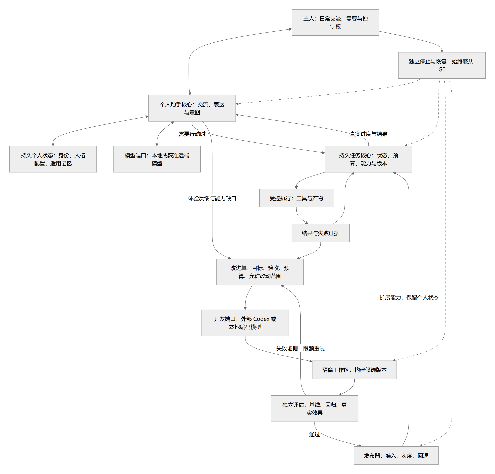

# 最小核心、初始资产与开发路线

> 状态：整体 proposed；0.1.21 增加聊天附件输入，保留工作台与后台页面配色，保留模型与费用后台、Eachlabs Claude 文本接入，保留托盘与会话待命；完整 K1/K2/K3 未通过 · 更新：2026-10-16
> [文档入口](README.md) · [维护规则](MAINTENANCE.md) · [架构图册](architecture-atlas.md)

<!-- book-nav:start -->
[全书目录](README.md#book-tree) › [第二篇 · 核心与工程基础](README.md#part-foundation) › 第 04 章 · 最小核心、初始资产与开发路线

## 本章导航

- [4.1 当前实现、启动与下一步](#current-implementation)
  - [4.1.1 在当前机器运行](#section-6a93004233bf)
    - [4.1.1.1 Windows 托盘与无控制台启动（0.1.18）](#windows-tray-entry)
  - [4.1.2 文字聊天与本地网页](#section-b3e262fa3ec1)
  - [4.1.3 模型与费用后台（0.1.19）](#model-admin-entry)
  - [4.1.4 项目文件夹与文本文件保存（0.1.11）](#project-workspace-entry)
  - [4.1.5 本机状态与旧版兼容（0.1.14）](#runtime-control)
    - [4.1.5.1 恢复密钥与密码流程已取消](#owner-recovery-enrollment)
  - [4.1.6 固定元数据 Worker（0.1.7）](#runtime-worker)
  - [4.1.7 独立浏览器 Computer Use（0.1.8）](#runtime-computer)
    - [4.1.7.1 网页后台任务控制台（0.1.13）](#web-computer-console)
  - [4.1.8 运行包与本机版本选择（0.1.15）](#runtime-package)
    - [4.1.8.1 0.1.17 启动前检查与故障回退](#runtime-startup-recovery)
    - [4.1.8.2 任务故障与程序网络阻断探测](#fault-network-probes)
  - [4.1.9 浏览器任务的临时目录回收（0.1.15）](#browser-residue-recovery)
  - [4.1.10 只读运行预检（0.1.5）](#runtime-preflight)
  - [4.1.11 下一步仍从 K1 出口推进](#section-d660c77ef363)
- [4.2 种子核心与初始资产](#seed-foundations)
  - [4.2.1 核心从哪里开始](#bootstrap-1)
  - [4.2.2 最小核心必须有哪些](#bootstrap-2)
  - [4.2.3 第一版就要有三类基础库](#system-health-1)
  - [4.2.4 种子资产与可信等级](#system-health-2)
  - [4.2.5 种子核心图](#bootstrap-3)
  - [4.2.6 两个层次：哪些能长大，哪些不能自行放开](#bootstrap-4)
- [4.3 开发顺序与每一步的出口](#bootstrap-5)
- [4.4 接下来具体做什么、什么时候进入下一步](#next-implementation)
  - [4.4.1 K1：先交付可控、可恢复的单机执行底座](#next-k1-work)
  - [4.4.2 K2：再把“聊天”接到“做事”](#next-k2-work)
  - [4.4.3 工作台设计怎样进入既有阶段](#workbench-stage-map)
  - [4.4.4 K3—K6 什么时候开始](#section-0f6c7791761e)
- [4.5 实施边界与成长演示](#bootstrap-implementation-boundaries)
  - [4.5.1 每次成长的共同约束](#system-health-3)
  - [4.5.2 第一个应该做的演示](#bootstrap-9)
  - [4.5.3 首期目录子集](#bootstrap-10)
  - [4.5.4 什么时候算“核心已经有了”](#bootstrap-11)
  - [4.5.5 第一版必须保留的扩展点](#delivery-gates-1)
  - [4.5.6 首期实施应更小，但不能删除必需边界](#critical-review-9)
  - [4.5.7 核心先行、外部协作、持续评估](#product-definition-8)
<!-- book-nav:end -->

<a id="current-implementation"></a>
## 当前实现、启动与下一步

2026-10-15 从 K0 开始实现 `jarvis-seed 0.1.0`，随后逐步增加文字聊天、模型目录、预检、独立控制、隔离 Worker 与浏览器适配器。当前 **0.1.21 新增拖拽文件、图片粘贴与多模态聊天输入**，见[附件使用方法](interaction-persona.md#composer-attachments)；0.1.20 已增加浅色、深色、暖纸和系统配色，在“设置 → 外观”切换后立即生效并保留草稿，见[配色规则](interaction-persona.md#workbench-appearance)；0.1.19 已增加模型配置与费用后台及 Eachlabs Claude 文本接入，见[使用入口](#model-admin-entry)；0.1.18 已增加 Windows 托盘与明确退出入口；0.1.17 已增加启动前健康检查与备用版本恢复；0.1.16 已增加后台任务内存准入、等待提示和稳定恢复；0.1.15 已增加浏览器任务临时目录回收与本机运行版本管理；保留会话停止、助手待命、免恢复认证、共用后台队列和项目根目录保存。任务记录仍来自同一本机账本；[托盘验证](delivery-validation.md#tray-evidence)、[启动恢复证据](delivery-validation.md#runtime-start-evidence)、[故障与网络阻断实测](delivery-validation.md#task-fault-network-evidence)与[既有版本记录](delivery-validation.md#versioned-evidence)分开登记。已按主人指定地址建立 [Git 仓库](https://github.com/Samuel521199/JarvisSystem)。以下区分当前实现与验证，其余章节仍是完整设计。

| 部分 | 当前实现 | 未完成边界 |
|---|---|---|
| K0 规范和夹具 | 六类 JSON Schema、知识/规则/技能种子、系统清单、有效/无效契约夹具、摘要检查 | 没有生产自主权限；规则摘要固定不等于独立 OS 保护 |
| K1 确定性外壳子集 | Task/Action 账本、幂等与取消、历史代际兼容、崩溃 UNKNOWN、固定元数据 Worker 与样例目录产物 | Host/监督器仍属调用用户；受保护身份和全局监督延期，已实现显式运行包切换/回退；整机离线及功能验收待补，K1 不算完整通过 |
| K1/W1 预检 | 独立于账本读写的 `preflight` 命令、身份/权限元数据、精确依赖版本、端口与源码摘要、角色/资源声明 | ACL 快照不等于隔离身份的有效权限；不读取锁存状态、不恢复任务，不签发执行授权 |
| K2 前置聊天与诊断 | 本地小模型、四家官方云端和 Eachlabs 初始共 20 个模型档案、CLI 与网页文字聊天、内存会话、有限候选路由、用量与额度提示；不设本地累计调用次数上限 | 未接结构化规划、检索和工具循环；模型输出不会执行指令，K2 未通过 |
| 项目工作台子集 | 持久登记项目文件夹、会话切换/草稿、明确生成文本文件与保存回答、最终路径和摘要回执 | 会话仅页面内存；不读取项目文件、不执行生成代码、不支持图片/Word 等二进制产物；完整桌面工作台仍待完成 |
| 语音前置诊断 | 文件 TTS/STT、声纹向量、VAD | 未启用麦克风、主人登记、活体检测、全双工对话；不改变 K0—K6 顺序 |
| 明确任务范围的浏览器实验 | 独立 CLI、网页任务面板、持久 FIFO 队列、DOM 规划、四种元素操作、步骤与截图、取消；聊天并行 | 无通用工作流、原生桌面、视觉定位、登录态导入或开放式网页探索；不代表完整 K2/K6 达标 |

固定目录能力当前可做的真实任务是：枚举获准样例目录的文件元数据，保存带摘要的 JSON 产物；查询持久任务状态；拒绝越界路径与重复 ID 的不同参数。任务失败或进程崩溃不能简单改成“没发生”：未确认的 DISPATCHING 进入 UNKNOWN，不自动重放。

<a id="section-6a93004233bf"></a>
### 在当前机器运行

2026-10-16 默认端口 18181 已更新至 0.1.18，Windows 托盘报告“待命中”；沿用原有 Python 环境和数据目录，保留浏览器依赖。原有任务、项目和产物核查见[本轮部署](delivery-validation.md#tray-evidence)，先前 0.1.12 → 0.1.17 记录见[历史部署](delivery-validation.md#local-deployment-idle-evidence)。这是源码启动，不是运行槽位激活；以后更改源码仍需显式重启后端，普通页面刷新不能替代。

**日常使用入口：[打开 Jarvis 工作台](http://127.0.0.1:18181/)。**

| 本机端口 | 用途 | 使用方式 |
|---|---|---|
| `18181` | Jarvis 工作台：项目、聊天、文件保存、后台任务 | 在浏览器打开；服务未启动时，在仓库运行 `.\jarvis.ps1 tray`，随后双击托盘图标进入 |
| `18180` | 可选的本地 Qwen 小模型推理接口 | 选择本地模型前按[本地模型启动](#section-b3e262fa3ec1)操作；云端聊天不需要它。它不是 Jarvis 工作台地址，未启动时连接被拒绝是预期状态 |

如果 18181 也打不开，先执行 `.\jarvis.ps1 tray`：已有服务会返回 `already_running`；启动失败时检查[托盘诊断日志](#windows-tray-entry)。当前没有开机自启，电脑重启或明确退出助手后需再次启动。浏览器刷新会清空当前页面的对话与草稿，排障前先保存需要的回答。

PowerShell 工作目录为 `H:\Jarvis`。当前已初始化默认数据；`init` 仅用于首次初始化，不能用来解除停止。所有路径和依赖归属见[实际落地范围](stack-project-layout.md#implemented-layout)。

```powershell
.\jarvis.ps1 status
.\jarvis.ps1 inventory --request-id my-first-inventory
.\jarvis.ps1 status
```

同一请求 ID、同一参数再次运行会返回已有结果；不同参数会被拒绝。样例输入根默认为 `tests/fixtures/workspace`，不是整块硬盘。命令的完整选项可通过 `--help` 查询；`inventory --prepare-only` 可准备后再取消，`cancel <task-id>` 取消尚未完成的任务。

首次安装或重建开发环境使用锁定依赖；当前环境已经配置完成，无需每次启动都同步：

```powershell
$env:UV_PROJECT_ENVIRONMENT = 'H:\JarvisData\envs\dev'
uv sync --locked --extra speech --extra computer
$py = 'H:\JarvisData\envs\dev\Scripts\python.exe'
& $py tools/check_seed.py
& $py tools/prepare_worker.py
.\jarvis.ps1 init
```

<a id="windows-tray-entry"></a>
#### Windows 托盘与无控制台启动（0.1.18）

在仓库根目录执行 `.\jarvis.ps1 tray`，可在后台启动带托盘图标的助手；也可指定 `--port`、`--data-dir`、`--config`。同一端口已有新版 Jarvis 时返回 `already_running`，不会再启动一份或把传入配置应用到已有实例。直接运行 `apps/web/server.py` 的 Windows 入口也默认启用托盘；诊断或无交互桌面可用 `--no-tray`。

图标在 Windows 右下角通知区域；系统可能将新图标放入 `^` 隐藏图标区，可由用户拖到常显位置。双击图标打开默认浏览器，右键菜单可查看当前状态、最近检查时间、刷新或退出。退出结束本实例的本机服务，已有账本与项目保留；有活动时提示确认。关闭浏览器页签继续待命，输入区停止仍只取消当前回复。完整状态与生命周期规则见[私人助手生命周期](interaction-persona.md#personal-assistant-lifecycle)。

托盘依赖 Windows 自带的 Windows PowerShell 5.1、.NET Framework/Windows Forms；不增加 Python GUI 依赖或更改执行策略。助手与托盘通过本次启动专属命名事件交接退出，HTTP 只读状态含版本与实例标识；没有新增网页全局停止接口。诊断在数据目录的 `diagnostics/tray/`，只记录状态、版本和实例信息；`server.log` 与 `tray.log` 用于启动失败排查。托盘异常不会给其他进程发送终止命令，没有安装开机自启或服务看护。

<a id="section-b3e262fa3ec1"></a>
### 文字聊天与本地网页

命令行与网页共用 ChatService；聊天只产生文字回答，不会执行模型建议的命令、工具或自编程序。模型、用量与自动切换的权威规则见[当前模型配置](models-offline.md#configured-models)。

```powershell
.\jarvis.ps1 models
.\jarvis.ps1 chat --provider auto --message '请帮我列一个今天的学习计划。'
.\jarvis.ps1 chat --provider openai --model gpt-6-astra
.\jarvis.ps1 chat --provider bailian --model qwen3.8-max
.\jarvis.ps1 chat --provider vertex --model gemini-4-argon
```

不传 `--message` 时进入交互模式：`/model <provider> [model-id]` 切换提供商与模型，`/models` 查看可选项，`/clear` 清空当前内存对话，`/exit` 退出聊天。支持 `auto / vertex / bailian / openai / xai / local`；输出显示实际提供商、模型、用量、切换尝试和额度提示。切换模型会把当前输入及保留的会话历史发给所选提供商；`auto` 也可能把这些内容发给其后续候选，UNKNOWN 不会触发盲目重发。

日常优先使用上方的[托盘启动](#windows-tray-entry)。只有使用本地 Qwen 模型时才需额外启动推理服务；以下是前台调试方式，网页服务已运行时不必重复启动：

```powershell
$py = 'H:\JarvisData\envs\dev\Scripts\python.exe'
& $py tools/local_llm.py serve
# 另一个 PowerShell 窗口中执行：
& 'H:\JarvisData\envs\dev\Scripts\python.exe' apps/web/server.py
```

浏览器打开 `http://127.0.0.1:18181`。网页采用侧栏、中央会话和底部输入区，保留 Jarvis 的 J 标识与星形图标。点击输入区下方模型名称，在同一个可搜索列表中选择各家模型，供应商自动匹配；旁边可调整该模型支持的推理级别。`auto` 跟随各家的默认模型和参数。初始六条线路注册可选，新增或停用后以后台有效配置为准，每条消息调用当前选中的一个模型；不同页面可并发，服务器现有上限为两个在途请求。该界面不表示同一条消息自动由多个模型联合回答。级别映射与限制见[推理级别](models-offline.md#reasoning-controls)。会话历史只在当前页面内存中；“新对话”保留旧会话供本页面切换，刷新或关闭页面后移除。新对话不会删除持久调用记录。Eachlabs 可在[后台](#model-admin-entry)显式查询余额；尚无长期聊天记忆、麦克风或语音聊天。网页服务与本地推理服务均需显式启动；关闭网页页签只关闭界面，服务仍可工作；完整退出语义见[私人助手生命周期](interaction-persona.md#personal-assistant-lifecycle)。

**0.1.12：运行时发送箭头变为方形“停止生成”按钮。** 点击后停止接收本次回复、提交后台取消，并恢复发送；原问题会回到空输入框，已输入的新草稿保留。运行中按 Enter 不会误触停止。停止后的迟到回答不追加、不进入后续历史，也不会触发尚未开始的自动文件保存；已经进入文件落盘时显示“正在保存文件”并等待回执，不把写完的文件假装撤回。此按钮仅作用于本次聊天，其他页面、浏览器任务和核心停止锁存不受影响。远端已接收的请求仍可能产生用量；具体处理边界见[模型调用边界](models-offline.md#section-896f72aed9a9)，验证见[停止验收](delivery-validation.md#chat-stop-evidence)。

模型调试与语音验证仍使用同一核心的停止状态；诊断入口保留：

```powershell
$py = 'H:\JarvisData\envs\dev\Scripts\python.exe'
& $py tools/model_probe.py --status
& $py tools/model_probe.py --provider vertex --prompt '用一句话说明你的作用。'
& $py tools/local_llm.py smoke
& $py tools/speech_probe.py
```

`local_llm.py smoke` 启动已校验的 CPU 服务、验证后退出；`serve` 提供前台服务并监听核心停止状态，Ctrl+C 也会结束子进程。只监听 `127.0.0.1:18180`，端口被占用时拒绝接入未知服务。它尚无独立进程权限隔离，同用户程序可能绕过探测网关访问端口，不能作为生产授权边界。

**0.1.14：助手空闲时显示“待命中”，本页回答时显示“回复中”，其他会话或后台任务执行时显示“运行中”。** 停止当前回复后即可继续提问，不需要恢复或解锁，也不会停止其他会话或后台任务。当前不设置恢复密钥或密码。

<a id="model-admin-entry"></a>
### 模型与费用后台（0.1.19）

点击工作台左栏底部“设置”，进入[设置中心](http://127.0.0.1:18181/settings)，再选择“接入方与 Key”“模型与价格”“用量总览”或“调用明细”。新标签页保留原会话草稿；旧 `/admin` 地址仍兼容。后台无需登录密码；API 凭据仍是各模型服务自身所需，不是 Jarvis 恢复认证。

1. **接入方与 Key**：查看现有官方线路与 Eachlabs；添加、替换、切换 Key，或通过模板增加另一个账户/中转。Vertex 填服务账户 JSON，其他云端模板填 API Key。新增 Key 保存后只显示尾号，不自动花费测试。
2. **模型与价格**：按线路添加模型 ID，设置默认模型、推理级别、输出上限、币种、四类 Token 单价与平台附加费。对未定价档案先填写真实价格；停用默认项前先选择另一个默认项。
3. **用量总览 / 调用明细**：按日期、接入方、模型和 Key 筛选，查看每日总量、调用时价格、未知结果，导出当前 50 条分页的 CSV。Eachlabs 账户余额在其连接卡片中显式查询。
4. 回工作台点击右上角“检查连接”，模型菜单会更新。三个 Claude 型号在 Eachlabs 分组下；默认全局路由仍保持原设置，不会因为新增中转自动消耗其余额。

配置存储、费用范围与历史处理以[模型后台规则](models-offline.md#model-admin-config)为准。此版本运行的是源码启动的本机服务；0.1.18 历史运行包仍为旧版，尚未生成 0.1.19 的完整独立运行包。

<a id="project-workspace-entry"></a>
### 项目文件夹与文本文件保存（0.1.11）

在现有网页点击侧栏“打开文件夹”，选择系统目录选择器或输入现有目录的完整路径。普通文件夹也能成为项目，不要求 Git；输入区上方显示项目和根目录，点击“新对话”继承当前项目。侧栏可切换项目与本页面中的历史会话；无项目会话可聊天，生成文件前需选择项目。

- **边生成边保存：**勾选输入区“生成文件”，输入任务后发送。输出位置留空时自动产生 `回答-<请求标识>.md`，直接保存到项目根目录；也可填 `说明.md`、`docs/说明.md` 或明确的完整绝对路径。当前不会从自然语言中猜测输出路径，需要在“输出位置”填写指向。
- **保存已有回答：**点击回答下的“保存回答…”，在同样的路径规则下保存。成功后显示真实完整路径、字节数，并可复制路径；“保存记录”显示最近 50 项请求。其余输出规则由[交互章](interaction-persona.md#project-root-output)维护。
- **遇到失败：**重名文件不覆盖；目录丢失、被替换或写入失败，不改存其他位置。回答正文和草稿留在页面。网络丢失回执后沿用原请求核验；结果待核对时不重复写入，确认原文件后可明确点击“改为另存…”创建新请求。

项目登记与保存回执持久化；对话/草稿只保留在当前页面内存，刷新会丢失。打开项目本身不读取、索引或上传其中的文件，也不修改元数据 Worker 的样例目录授权。输出服务只保存用户选定的单份 UTF-8 文本（最多 1 MiB），不执行其内容；多文件代理创作、附件、文件搜索预览、持久聊天、项目输出偏好、桌面壳和实时语音尚未实现。系统目录选择器不可用时保留完整路径输入方式；实际验证范围见[0.1.11 验收](delivery-validation.md#project-workspace-evidence)。

<a id="runtime-control"></a>
### 本机状态与旧版兼容（0.1.14）

日常操作直接使用输入区的停止按钮；作用域和待命规则由[交互章](interaction-persona.md#personal-assistant-lifecycle)维护。需要查询本机旧控制状态时可执行：

```powershell
.\jarvis-control.ps1 status
```

控制 CLI 只保留 `status` 与 `migrate-local`，主 CLI 和控制 CLI 都不再提供全局 `stop`。旧库中的 `stopped` 仅是历史准入状态，不能解释为助手是否正在回复；网页展示实际的待命/运行状态。

只有从旧版升级且旧数据仍显示停止时，才显式执行一次 `.\jarvis-control.ps1 migrate-local`，然后重新启动原业务服务。该操作不需要密钥或密码；保留节点、事件、审计和业务记录，递增代际，旧请求不自动重放。正常运行实例执行它只查询状态，不改动数据。没有旧锁存的当前实例无需这一步。

已有 v1 业务库仍通过 `.\jarvis.ps1 upgrade-control` 显式升级，保留节点和任务/动作/产物，不覆盖独立控制区；新建实例直接使用 v2。兼容协议见[消息契约](contracts.md#recovery-contract)，验证见[当前证据](delivery-validation.md#personal-lifecycle-evidence)。

<a id="owner-recovery-enrollment"></a>
#### 恢复密钥与密码流程已取消

2026-10-16 用户明确取消密钥和密码要求。旧版密钥创建、登记、挑战、签名和认证恢复命令均已移除，不需要准备公钥文件、私钥、密码或恢复介质。保留本锚点用于旧链接指向当前决定；历史验证记录不等于现行使用步骤。

<a id="runtime-worker"></a>
### 固定元数据 Worker（0.1.7）

`inventory` 现在经过：Host 检查授权和目录范围 → 枚举文件元数据 → 暂存只读输入 → 启动一个 Windows LPAC/Job Worker → 校验绑定回复 → Host 再检查停止/代际并提交产物。原文件内容、凭据和数据库不会暂存给 Worker。正常结束、超限或取消后进程退出；本轮不新增常驻服务。

本机已准备好小型 Python 运行包。`tools/prepare_worker.py` 使用已安装的 Windows Python 3.13 离线组装，没有联网下载；已有包只校验、不覆盖。新机器生成的包可能有不同摘要，需核对来源、更新 [固定 profile](../config/worker-profile.json) 并重跑测试后使用，工具不会自行接受新摘要。缺包、摘要错、隔离身份校验失败均拒绝任务，不能退回普通子进程。实际目录归[落地结构](stack-project-layout.md#implemented-layout)维护。

```powershell
& 'H:\JarvisData\envs\dev\Scripts\python.exe' tools/prepare_worker.py
& 'H:\JarvisData\envs\dev\Scripts\python.exe' tools/worker_probe.py
.\jarvis.ps1 inventory --request-id my-isolated-inventory
```

这一步提供可运行的隔离计算通路，仍不接受 Shell、任意脚本、模型生成程序或网络权限。完整权限边界和崩溃残留限制见[Worker 安全范围](security-sovereignty.md#worker-isolation)，协议见[固定 Worker 消息](contracts.md#worker-contract)，实测见[0.1.7 证据](delivery-validation.md#worker-evidence)。

0.1.13 在网页队列启动时回收已登记、已退出的固定 Worker 残留，也可运行 `.\jarvis.ps1 recover-workers` 显式核查。只处理固定暂存根内身份匹配的任务目录和对应 profile；未知旧目录或变动内容保留并报告，不重放任务、不解除停止。新增实测见[本轮证据](delivery-validation.md#k1-progress-evidence)。

<a id="runtime-computer"></a>
### 独立浏览器 Computer Use（0.1.8）

按本次明确要求实现可运行的早期浏览器子集，采用**现有模型网关 + 独立适配器 + 系统 Edge**。能力按需启动，不新增常驻服务，也不下载第二套浏览器或视觉模型。普通文字聊天仍不执行工具。模块拆分与替换关系见[架构](architecture.md#computer-use-design)，安全和当前限制见[浏览器边界](security-sovereignty.md#computer-boundary)。

本机依赖已安装。新环境需安装现有 Microsoft Edge，并在已配置的开发环境执行 `uv sync --locked --extra computer`；若需要保留语音依赖，同时加 `--extra speech`。演示页是程序内部提供的合成表单，不连接实际业务网站。

```powershell
# 使用已注册的模型，供应商自动匹配；四步完成表单并保存截图。
.\jarvis-computer.ps1 demo --model gpt-6-luna
# 显示本任务专用的 Edge 窗口：
.\jarvis-computer.ps1 demo --model gpt-6-luna --headed
# 无模型、无云端费用的固定动作测试；这不是离线 AI 能力证明：
.\jarvis-computer.ps1 demo --scripted
# 查看回执或取消正在进行的任务；task-id 来自主账本 status：
.\jarvis.ps1 status
.\jarvis-computer.ps1 status --task-id <task-id>
.\jarvis-computer.ps1 cancel --task-id <task-id>
```

真实任务使用 `run --task <本地JSON路径> --model <模型ID>`。任务文件需明确 URL、允许的 HTTP(S) origin、目标元素的 role/name、允许动作和值、成功文字、最多步骤与时间。以[演示任务](../config/computer-use/demo-task.json)为结构样本；`demo` 才提供内置页面，不能直接把它的虚构地址用于 `run`。完整字段由[契约页](contracts.md#computer-contract)指向唯一 schema。`--model auto` 复用现有有限候选路由；不是所有候选都已验证适合规划。

例如把已授权网站的“搜索”输入框和“查询”按钮写入任务范围后，模型可以根据当前值决定是否填写、点击；新增目标页面不需要修改浏览器底座。当前还不能仅凭一句开放目标自行探索任意网站、接管用户现有标签页或上传文件。需要登录跳转、验证码、密码、弹窗、新窗口或重定向的网站暂不支持。

任务执行流程：校验任务 → 记录 Task/Action → 新建浏览器上下文 → 观察 DOM → 模型选下一步 → 校验动作及页面是否变化 → 记录 IN_FLIGHT → 操作 → 再观察 → 核对成功文字 → 保存 JSON 和 PNG。JSON 位于既有 `artifacts` 目录，含每步模型用量与状态；PNG 留在本地。当前页面文字和允许的输入值会送给选中模型，`auto` 可能转发给候选供应商。

同一 `--request-id` 的完成或未知任务只返回记录，不重新点击。外部网站没有幂等回执，发生中断后需先核对实际结果，再明确提交新任务。停止/取消保留历史，已发出的云端请求仍可能计费。浏览器任务与目录 Worker 当前共用一个执行锁，聊天可继续；多浏览器并行、后台队列和原生桌面仍待后续验收，不另建开发时间线。

<a id="web-computer-console"></a>
#### 网页后台任务控制台（0.1.13）

打开 `http://127.0.0.1:18181/`，点击左栏底部 **设置 → 后台任务**，或直接进入[任务设置页](http://127.0.0.1:18181/settings#tasks)。默认目录清单无需模型；浏览器模式的执行模型独立选择，默认 GPT-6 Luna，采用模型档案的默认推理配置，不改变聊天模型和推理级别。

1. 选择“模型演示”并启动：模型决定内置合成表单的四步操作。也可选“固定动作测试”，只验证执行通路、不调用模型。
2. 要操作自己的已授权网页，选择“自定义任务”，粘贴符合[浏览器契约](contracts.md#computer-contract)的 JSON；仍需明确 URL、目标和值，不接受任意命令或用户文件路径。
3. 右侧最多显示 30 条目录/浏览器任务，未完成任务优先。点击记录查看状态；目录任务显示清单与已核验产物路径，浏览器任务显示各步操作、实际模型用量和成功截图；失败/UNKNOWN 会保留可核对的状态。
4. 运行期间可以切回聊天；切换面板保留聊天草稿和当前页面的会话。刷新/关闭页面不会取消已接纳任务，重新打开面板可查询账本；刷新仍会清空聊天历史和草稿。
5. 可连续添加任务，最多 20 个等待任务加 1 个执行任务；右侧显示排队位置。“暂停队列”只暂停后续派发，不中断当前任务；“继续队列”恢复未开始任务。服务重启后先核对记录再继续，UNKNOWN 不会被重新执行。
6. 从任务详情取消执行。取消处于“正在取消”时等待执行器收口，不能解释成撤销已发生效果。核心停止后允许查看历史，但不接纳新任务；网页不提供清锁或恢复密钥接口。

默认“目录清单”无需模型，输入 `.` 或获准样例根下的相对目录即可提交。面板明确显示初始化时绑定的样例根；选择项目文件夹不会扩大这个读取范围。此处是内部任务审计产物，保存在实例产物区；用户在聊天中生成或保存的文件仍遵守[项目根目录输出规则](interaction-persona.md#project-root-output)。

网页服务一次执行一个目录或浏览器任务，其他新请求进入同一持久 FIFO 队列；同时保留原有两个聊天请求槽。任务与队列登记必须在同一事务写入主账本才返回接纳成功，同一请求 ID 重复提交不会重新执行已完成或未知任务。请求等待异常时先刷新记录；页面保留当前提交的请求 ID，可用于核对，修改输入才产生新意图。

执行器是现有网页进程中的一个后台线程，队列持久保存在原 SQLite 账本中；未新增系统服务、消息代理或第三方依赖。正常关闭服务会暂停队列并请求取消活跃任务，等待任务保留；强制退出后先对账。完整排序、交接和 UNKNOWN 处理以[队列语义](tasks-agents.md#browser-durable-queue)为准。服务启动方式沿用[本地网页](#section-b3e262fa3ec1)，仍无开机自启。

<a id="runtime-package"></a>
### 运行包与本机版本选择（0.1.15）

[打包工具](../tools/release_bundle.py)收集固定源码、配置、文本说明、核心 Python 依赖及已校验 Worker Python，不包含凭据、现用账本、模型权重和可选浏览器/语音依赖。当前托盘候选包为 `artifacts/releases/jarvis-0.1.18-tray-runtime.zip`；[本轮证据](delivery-validation.md#tray-evidence)记录摘要、实际包启动和回退结果。0.1.13—0.1.17 包保留为历史回退测试对象。

[版本入口](../tools/runtime_releases.py)提供安装、独立健康检查、选择、回退和启动。默认槽位目录为 `%LOCALAPPDATA%\Jarvis\runtime`，可用 `--root <完整路径>` 指定本机支持 ACL 的位置；每个运行包独占一个槽，业务数据始终放在独立的数据目录。安装不会启动服务或改变当前版本。

```powershell
$py = 'H:\JarvisData\envs\dev\Scripts\python.exe'
$installed = & $py tools/runtime_releases.py install artifacts/releases/jarvis-0.1.18-tray-runtime.zip | ConvertFrom-Json
$releaseId = $installed.id
& $py tools/runtime_releases.py health $releaseId
& $py tools/runtime_releases.py select $releaseId
& $py tools/runtime_releases.py status
& $py tools/runtime_releases.py run --data-dir "$env:LOCALAPPDATA\Jarvis\data" --mode web
# 选择上一个已验证版本，下一次显式启动时生效：
& $py tools/runtime_releases.py rollback
```

`health` 使用随包 Python 在全新临时实例执行真实 LPAC 目录任务并核验产物，不触碰现用账本；失败包不能选择。每次选择、回退和启动重新校验完整成员与内容摘要；选择记录与历史在同一事务中更新。通过该入口运行的进程持有版本使用锁，运行时拒绝切换，须先明确退出该进程；不会为了升级杀掉当前助手，也不改动独立启动的 18181 旧服务。

`run --mode status` 查询同一数据目录，`--mode inventory` 执行固定清单能力，`--mode web --port <端口>` 启动本机网页。包未包含 Playwright 时仍可聊天和运行清单，浏览器能力显示不可用。0.1.17 的启动前恢复见下节；当前没有开机自启、运行中崩溃重启、热更新、数据库降级迁移或受保护监督；Python 禁网钩子的健康检查不等于整机断网验收。接口和持久状态归[版本管理契约](contracts.md#runtime-slots-contract)，演进边界见[版本连续性](evolution-release.md#service-continuity-4)。

<a id="runtime-startup-recovery"></a>
#### 0.1.17 启动前检查与故障回退

安装、健康检查并选择版本后，可用 `start` 代替 `run`：

```powershell
& 'H:\JarvisData\envs\dev\Scripts\python.exe' tools/runtime_releases.py start --data-dir "$env:LOCALAPPDATA\Jarvis\data" --mode web
```

此命令明确启动一次助手：先检查数据格式和当前包，再在临时实例运行健康检查；当前包不可用时，只尝试已经登记的上一个已验证版本。启动前向标准错误流报告实际选定版本和回退原因，`status` 的 `starts` 返回最近 10 次启动记录。正常退出沿用业务进程退出码；没有可用版本时保留失败原因并退出，不重置数据。完整边界见[启动恢复规则](evolution-release.md#runtime-startup-policy)，故障与实际包证据见[本轮验收](delivery-validation.md#runtime-start-evidence)。

仍可使用 `run` 直接运行当前已验证版本，它不追加自动健康回退。两个入口都不终止现有服务；端口占用应先处理原实例，不能把新进程启动失败当作重放任务的理由。

<a id="fault-network-probes"></a>
#### 任务故障与程序网络阻断探测

在 Windows 开发环境中运行以下命令。故障探测创建独立临时数据，以真实子进程退出覆盖固定目录任务的持久化边界；不会中断现用 Jarvis。

```powershell
& 'H:\JarvisData\envs\dev\Scripts\python.exe' tools/probe_task_faults.py
& 'H:\JarvisData\envs\dev\Scripts\python.exe' tools/probe_network_recovery.py artifacts/releases/jarvis-0.1.16-runtime.zip artifacts/releases/jarvis-0.1.17-runtime.zip --elevate
```

网络探测需要两个已经准备好的不同版本完整包，包不随 Git 上传；按[运行包说明](#runtime-package)准备。`--elevate` 仅通过 Windows UAC 提权防火墙辅助进程；已在管理员终端时可省略。它核对 4 个临时可执行文件路径后设置出站阻断，结束/失败后移除自身规则，最长保留 10 分钟；不更改网卡和防火墙配置文件。当前用户对新建探测目录的结果文件保留访问权限。助手和电脑上的其他应用保持原网络状态。

默认输出为 `evals/reports/task-fault-matrix.json` 与 `network-recovery.json`；需要保留前次结果时通过 `--output <路径>` 指定新位置。只有阻断前后正向连接、阻断期间拒绝及未阻断对照、恢复演练和规则清理全部成功，网络报告才能通过；失败时保留诊断，清理未经确认时保留临时目录。完整结果与未验证范围只在[验收记录](delivery-validation.md#task-fault-network-evidence)维护。

<a id="browser-residue-recovery"></a>
### 浏览器任务的临时目录回收（0.1.15）

每个浏览器任务使用独立登记的 profile 和下载暂存目录，不复用用户浏览器配置。正常结束后清理；服务重启时核查已登记残留，或显式执行 `.\jarvis.ps1 recover-browsers`。检查和清理不调用模型，不重跑旧任务，也不停止助手或其他浏览器。

仍有使用锁、驱动/Job 存在、启动过程尚未完成登记、目录身份不符或出现链接/未知顶层内容时保留并报告。只处理固定根中的登记目录，不按名称扫除旧版 Playwright 临时目录。完整范围见[浏览器实现边界](security-sovereignty.md#computer-boundary)。

<a id="runtime-preflight"></a>
### 只读运行预检（0.1.5）

在项目根目录运行：

```powershell
.\jarvis.ps1 preflight
.\jarvis.ps1 preflight --json
```

默认输出中文摘要，`--json` 输出带版本的诊断证据；`--data-dir` 可指定临时实例。命令不会初始化目录、读取密钥、调用模型、安装服务、修改权限、清锁或恢复任务，也不会自动保存报告。它短暂绑定并释放本机 IPv4 端口以观察是否可用，不连接未知服务；已占用只表示有占用，不证明对方是 Jarvis。需要留档时由调用者显式保存 JSON。

状态分为已核对、未满足、提示、未确认。固定元数据 Worker 已实现；恢复认证在 0.1.14 按用户要求取消，报告将其记为延期提示，不再要求登记材料。受保护监督和通用隔离执行仍保留未满足记录，因此完整部署就绪状态仍为 `blocked`；它不阻止已支持的个人聊天、待命和限定任务，也不代表高级部署已通过。退出码 1 是诊断结论，退出码 2 表示未完成评估；报告不签发执行授权。JSON 契约见[预检接口](contracts.md#preflight-contract)。

权限检查读取路径类型和 ACL 元数据；不通过写测试文件或改 ACL 猜测实际权限。它只确认当前诊断进程身份，不声称发现其他进程身份。普通 `status` 会对未决任务执行恢复对账，预检为保持只读而不调用它，也不打开运行数据库，明确把锁存状态标为未评估。验证范围及未通过项目见[本轮证据](delivery-validation.md#preflight-evidence)。

<a id="section-d660c77ef363"></a>
### 下一步仍从 K1 出口推进

0.1.17 已补充当前开发机的五分钟待命采样并完成实际网页更新，见[部署与资源证据](delivery-validation.md#local-deployment-idle-evidence)；固定目录任务的进程崩溃矩阵与运行包出站阻断恢复已获得[局部实测证据](delivery-validation.md#task-fault-network-evidence)。接下来仍需选定运行包整机断网冷启动、目标普通 PC 的资源证据及跨能力故障矩阵汇总；不能将程序禁网或开发机五分钟结果扩展为完整 K1 或长期稳定性通过。

按当前个人使用范围，浏览器登记回收与显式运行版本回退已补齐；0.1.16 已增加[队列内存准入](tasks-agents.md#queue-resource-admission)和短时竞争验证，继续完成整机离线、普通 PC 长时资源与 K1 整体验收。固定目录、浏览器和版本管理仍是明确限定范围。密钥、密码、受保护监督部署和全局停止已由用户延期，不再作为个人功能开发的前置条件。K1 完整通过后，把已验证模型端口接入有限计划和技能调用；K3/K4 再引入外部 Codex、候选编程、固定构建、独立验收、灰度回退。当前没有自主下载或替换模型、自改源码、自动学习、后台 Agent 或硬件控制；这些能力需各自的权限和验收出口，不能由一次模型回答启用。

0.1.5 已交付 [K1/W1 预检](#runtime-preflight)，0.1.6 曾交付同用户控制原型，0.1.14 按用户要求将 W2 收敛为[会话停止、待命及旧数据兼容](#runtime-control)，0.1.7 已交付 [W3 固定元数据 Worker](#runtime-worker)。余项沿用[唯一推进表](#next-implementation)，不建立第二条版本路线。

<a id="seed-foundations"></a>
## 种子核心与初始资产

<a id="bootstrap-1"></a>
### 核心从哪里开始

**从一个能够“接任务、受控执行、保存结果、生成候选改动、验证并切换版本”的最小成长闭环开始。**

第一行实现不应是人格提示词或多 Agent 工厂，而应是 **任务/动作契约与本地持久账本**，并同步建立可独立停止的底座。第一段智能来自已有本地模型或获授权远端模型；不需要先训练一个新的基础模型，也不要求首版本机小模型已经拥有强编程能力。

建设关系：

**主人确定目标和边界 → 我们与外部 Codex 做出种子版本 → Jarvis 管理真实任务与改进需求 → 本地模型或外部 Codex 提出代码 → 独立构建/评估 → 发布或拒绝 → Jarvis 使用新能力。**

这里“自己进化”指 Jarvis 能发起、组织、验证和采用改进；复杂代码可以由外部开发 Agent 协助完成。谁写代码与谁掌握运行身份、任务、权限、评估记录和发布权是不同问题。

<a id="bootstrap-2"></a>
### 最小核心必须有哪些

以下是八个职责，不是要求八个大型服务或八个 Agent。

| 核心职责 | 第一版具体做什么 | 为什么现在就需要 |
|---|---|---|
| 初始知识、规则、技能与系统清单 | 随种子版本预装可信资料、有效规则、基本技能及版本/依赖信息 | 首次启动就知道自己的结构、边界与已有能力 |
| 受保护停止与恢复底座 | 身份/授权入口、锁存、停止、最后可用版本、恢复 CLI | 系统出错或升级失败时主人仍能控制它 |
| 持久任务内核 | 接受任务、状态机、取消、预算预留、动作意图、回执与 UNKNOWN | 不能把进程中断当成任务从未发生 |
| 能力执行器 | 读限定文件、写候选产物、运行受限工具；权限和资源检查 | 模型可以建议行动，但不能直接获得整台电脑 |
| 模型与开发者端口 | 一个本地模型适配、一个可选外部编码适配 | 允许先借助强编码 Agent，再逐步提升本地能力 |
| 候选工作区与构建器 | 源码快照、固定工具链、隔离构建、产物摘要 | “写出代码”必须变成可检查、可运行的包 |
| 独立评估与发布器 | 保护基线、运行验收、灰度、回退、记录结果 | 自己说“改进了”不能自动等于允许上线 |
| 最薄进化循环 | 从失败或明确需求生成改进单，提交候选，读取评估结果 | 让已有核心能够发起下一次成长 |

三库种子与可信等级详见本页对应定义：知识保存带来源的事实，规则经受保护执行器生效，技能通过测试后注册。初期另保存任务记录、主人明确偏好、能力目录、改进记录和产物引用；无需先建立通用知识图谱。防止结构退化、代码/文档污染、误删旧版本与无限自愈的完整要求见设计文档集[初始知识、规则、技能与长期健康自愈](health-maintenance.md#system-health)。最初一个任务 Worker 和一个编码任务就能验证闭环；语音、丰富人格、NPC 小镇和大规模共同体是后续能力，保留接口即可。

所有正式效果仍受[G0 最高宗旨](security-sovereignty.md#product-definition-6) 约束。没有完整语义判断能力的早期版本，只开放能明确限制和验收的任务范围；不能把功能不完整解释为暂时取消监督。

<a id="system-health-1"></a>
### 第一版就要有三类基础库

**最小核心出生时就必须拥有知识库、规则库和技能库，同时具备自己的能力与版本清单。** “最小”指规模有限、来源清楚、可验证，不是只有一个模型加聊天窗口。它们是本页种子闭环的基础数据，不必各自部署大型服务。

| 基础资产 | 回答什么 | 第一版必须预装 | 初期实现 |
|---|---|---|---|
| 知识库 | 我知道什么，证据在哪里？ | 项目定义、系统结构、接口、安装与恢复说明、模型/设备能力、主人明确偏好、已验证操作经验 | 原始资料 + SQLite 元数据/全文检索；向量检索按需 |
| 规则库 | 我可以做什么，必须遵守什么？ | G0、主人身份与权限、文件/网络/设备范围、预算、停机、发布和数据外发规则 | 受保护版本化配置与确定性执行；不能只靠检索提示词 |
| 技能库 | 我如何可靠地完成一种工作？ | 查询状态、限定目录读取、产物生成、候选构建、验证、报告等基本技能 | 不可变技能清单 + 执行器 + 测试与依赖 |
| 系统清单 | 我现在由什么组成？ | 模块/接口版本、依赖关系、数据所有者、运行位置、权限、工具链、健康探针、当前/回退发布版本 | 发布清单与模块注册表；由实际安装/运行状态核对 |

模型训练中已有知识不是本项目的事实库；对话摘要不是规则；一段建议或代码也不是已可用技能。外部 Codex 可以协助编写候选内容，但没有把候选规则自动提升为根规则的权限。

主人身份、权限引用等敏感资产只保留必要元数据或密钥库引用；不因为叫“系统知识库”就把全部凭据集中进可检索文本。

<a id="system-health-2"></a>
### 种子资产与可信等级

建议随首个版本发布 SeedBundle，绑定代码/配置/文档/技能/测试摘要和版本：

- **事实与系统说明：**当前架构图、模块职责、接口契约、数据格式、安装与恢复手册、支持矩阵。
- **主人明确设置：**名称、可用设备、目标、偏好、预算、禁区、授权范围和适用期限。
- **基本技能：**查看能力和任务状态、读取获准样例目录、写入产物区、提交改进单、运行候选构建、查询评估报告。
- **基本维护：**只读健康检查、已验证组件重启/回退配方；停止与解锁属于受保护底座，不伪装成可随意重写的普通技能。
- **基线与已知限制：**初始真实任务、恢复测试、不能做什么、失败案例、待确认事项。

知识记录至少有 kind、source、version、evidence_ref、validity、scope、owner 和 privacy。区分“原始证据、已验证事实、主人偏好、待验证假设、外部未可信资料、模拟内容、已撤回记录”。互联网学习先进入待验证区；不能覆盖主人规则，也不能把 NPC 情节当成现实经验。

规则通过受保护加载路径生效，知识检索仅用于解释。知识库损坏或检索不到 G0 时，执行器仍必须执行已经验证加载的规则；规则状态无法验证则拒绝业务。技能使用前匹配当前契约、运行依赖和授权，技能描述中自称“可信”没有准入效力。

<a id="bootstrap-3"></a>
### 种子核心图



[矢量图](diagrams/seed-core.svg) · [可编辑图源](diagrams/seed-core.mmd)


这不是无限循环：没有真实改进需求时等待；预算耗尽、连续失败或收益不足时结束本次实验；确认 G0 违规时按设计文档集锁存全部自主活动。系统持续运行不要求持续消耗模型调用或不停改代码。

<a id="bootstrap-4"></a>
### 两个层次：哪些能长大，哪些不能自行放开

**受保护的根控制层：**主人身份、停止状态、权限执行、发布信任根、基线评估规则和恢复入口。Jarvis 可以提出这些实现的改进方案，但不能在自身业务权限下修改、批准并激活；由主人维护入口处理。G0 宗旨不属于可修改对象。

**可演进的工作层：**技能、工具、检索策略、人格配置、编码适配器、规划器、任务策略、模型组合，以及后期获准的运行模块。这些使用版本化包替换，不直接覆盖正在执行的生产目录。

评估器可以扩展测试；候选不能删除旧测试、降低阈值或查看受保护保留集。新评估规则也要独立审查，并保留历史结果的口径。否则系统很容易通过修改自己的评分标准获得“越来越高分”。

“底座小”是控制复杂度的目标，不是声称 OS、执行网关、授权代码和发布器不属于信任基础。

<a id="bootstrap-5"></a>
## 开发顺序与每一步的出口

| 顺序 | 我们与 Codex 先实现什么 | Jarvis 能自主做什么 | 进入下一步的证据 |
|---|---|---|---|
| K0：规范和夹具 | 初始知识/规则/技能包与系统清单；Task/Action/Capability/Artifact/Module/BuildProfile 六个契约；G0 执行边界；测试数据 | 暂无生产自主行为 | 相同输入、预期产物、失败条件已明确 |
| K1：确定性外壳 | 会话/任务取消、待命、故障恢复、SQLite 账本、受限文件能力、命令行入口 | 执行预定义本地任务、报告真实状态 | 崩溃恢复、重复请求、取消、未知结果和越权拒绝通过 |
| K2：最小智能 | 本地模型端口、结构化计划、有限工具循环、三库检索与技能使用 | 用自然语言发起限定任务；断网继续已支持工作 | 本地模型可用；错误计划不越权；状态和产物可追踪 |
| K3：开发协作 | 候选工作区、一个离线工具链、Codex 适配器、构建任务 | 为不会做的事提交改进单，调用编码助手产出候选 | 无生产密钥泄露、失败限额、真实构建产物 |
| K4：第一个自主成长闭环 | 外部评估、包目录、灰度/回退、改进账本 | 自动生成、验证并启用一个低风险新工具 | 通过保留测试；坏版本被拒；生产不被原地改写 |
| K5：首次真正修改自身模块 | 一个可替换的检索或规划模块、兼容与回退协议 | 提出并验证自己的模块改进 | 同一任务集净收益成立、旧能力未退化、可以回退 |
| K6：逐能力扩展 | 语音体验、多语言、第二节点等按需接入 | 逐步组织更多开发工作和 Agent | 各能力单独满足设计文档集验收 |

K1 可以暂时用假模型/规则输入验证可靠性，但它还不能叫完整智能 Jarvis；K2 才形成最小本地智能。K4 是自主扩展能力，K5 才包含替换自己运行模块的证据，二者不混为一谈。

这张表是唯一实施顺序；[M0—M6](delivery-validation.md#delivery-gates) 仅定义能力验收门：可以在语音、界面和共同体尚不完整时，先用纯文本和本地文件任务验证 K4。不能等待整个目标架构完工才开始进化，也不能在缺少评估与恢复时就开放自修改。

编码适配、凭据隔离和改进事务详见 [外部编码协作](evolution-release.md#bootstrap-6)；净收益评估详见 [证据标准](delivery-validation.md#bootstrap-8)。

<a id="next-implementation"></a>
## 接下来具体做什么、什么时候进入下一步

本节在 0.1.4 缺口基础上制定，**W1、W2 同用户控制、W3 固定 Worker、W4 两类任务共用队列与 W5 候选包已有可运行增量，受保护部署和后续工作仍为 proposed**。按个人使用范围继续完成离线、资源与整体验收；浏览器登记回收和显式运行版本回退已有 0.1.15 实现，持续用 W1 报告核对实际功能缺口；监督身份、认证和全局停止延期。当前仍缺受保护 Host、通用任务规划与知识/技能通路。工作包编号仅细分上面的 K 阶段；不另设按版本或日期推进的路线。

<a id="next-k1-work"></a>
### K1：先交付可控、可恢复的单机执行底座

| 工作包 | 具体交付与用户可见结果 | 依赖与验收入口 |
|---|---|---|
| K1/W1 运行边界与预检 | **0.1.5 已实现诊断增量**：本进程身份、路径/ACL 元数据、依赖/版本、端口、源码摘要与边界缺口；有效权限尚待真实 Worker 测试 | [当前使用](#runtime-preflight)、[本轮证据](delivery-validation.md#preflight-evidence)；完整 [V-K1-01](delivery-validation.md#v-k1-01) 仍待受保护部署后验收 |
| K1/W2 会话取消与旧版兼容 | **0.1.14 当前个人范围**：停止本次回复、助手待命、另一会话/后台任务继续；无恢复密钥/密码，旧停止数据显式迁移并保留审计 | [实际使用](#runtime-control)、[当前证据](delivery-validation.md#personal-lifecycle-evidence)；V-K1-02 原全局监督项延期，[V-K1-03](delivery-validation.md#v-k1-03) 按最新范围验证 |
| K1/W3 隔离执行器 | 原生 LPAC/Job、只读输入、有界管道、回复绑定、超限终止；0.1.13 增加登记元数据 Worker 崩溃回收；0.1.15 增加登记浏览器 profile 回收；受保护 Host 和通用工具范围延期/待实现 | [当前实现](#runtime-worker)、[新增验证](delivery-validation.md#k1-progress-evidence)；完整 [V-K1-04](delivery-validation.md#v-k1-04) 不因子集通过而关闭 |
| K1/W4 后台队列与真实状态 | 0.1.13 共用持久 FIFO；0.1.16 增加内存准入与等待；按用户要求在 0.1.18 提前加入轻量托盘，显示真实状态并提供明确退出；完整 CPU/GPU/模型统一调度仍待实施 | W3；复用现有账本；[V-K1-05](delivery-validation.md#v-k1-05)、[V-K1-06](delivery-validation.md#v-k1-06)、[托盘证据](delivery-validation.md#tray-evidence) |
| K1/W5 可恢复运行包 | 0.1.15 安装、健康检查、事务化版本选择、显式启动与回退；已验证跨代码版本共用 v2 数据不丢任务；0.1.17 增加显式启动时一次健康回退；整机断网、数据库迁移和运行中故障恢复待验/待实现 | [候选包使用](#runtime-package)、[状态迁移](evolution-release.md#service-continuity-4)；[V-K1-07](delivery-validation.md#v-k1-07) 尚未完整通过 |
| K1/W6 整体验收 | 交付本机权限证据、故障矩阵结果、恢复说明和一次可复现演示；界面显示真实执行阶段、产物与未知状态 | 前述工作包及既有核心回归通过；完成 [K1 出口](delivery-validation.md#next-k1-acceptance)才进入 K2 的真实工具循环 |

W1 已包含预检、角色声明和诊断报告；W2 当前采用[个人生命周期](interaction-persona.md#personal-assistant-lifecycle)。此前非提升令牌、exFAT 卷与受保护身份缺失属于延期的部署增强项，不再要求用户登记公钥或密码。继续完成离线、资源与本机任务可靠性总体验收；保留已有 Worker 执行方式和历史验证，未完成的功能不因范围修订而自动记为通过。

已有 Python/SQLite 业务代码、原生模型适配和网页继续复用。小型底座的语言按已登记候选实测冻结；不为接一个 Worker 就整体重写、不同时引入多个任务框架。状态/取消/停止路径不等待 LLM 或后台任务完成。

K1/W3—W5 按[普通 PC 优先规则](stack-project-layout.md#technology-selection-4)实施：W3 先验证一个原生受限 Worker，W4 在现有账本上实现本机队列，W5 打包当前必需依赖和恢复材料。不得为了这三项引入容器编排、消息集群或全套研发环境。隔离证据不足时保留受限能力边界，不能用“轻量”放宽权限验收；资源开销同时按[PC 验收](delivery-validation.md#pc-footprint)记录。

<a id="next-k2-work"></a>
### K2：再把“聊天”接到“做事”

| 工作包 | 具体交付与用户可见结果 | 依赖与验收入口 |
|---|---|---|
| K2/W1 三库运行入口 | 加载有效种子知识、已发布技能及系统清单；提供带来源的项目查询、能力列表与可纠正偏好；规则继续由受保护执行器加载 | K1 出口；[首期知识与记忆范围](knowledge-learning.md#initial-runtime-memory)、[V-K2-01](delivery-validation.md#v-k2-01) |
| K2/W2 有限计划与技能调用 | 将自然语言转成结构化候选计划，逐步调用已登记技能，展示实际产物；不支持的请求说明缺少什么能力 | W1；[任务执行闭环](tasks-agents.md#initial-task-loop)、[V-K2-02](delivery-validation.md#v-k2-02) |
| K2/W3 会话与任务面板 | 区分聊天、任务与产物；显式保存的会话可恢复，任务状态来自账本；能边聊天边查询或取消后台任务 | W2；[V-K2-03](delivery-validation.md#v-k2-03)、[V-K2-04](delivery-validation.md#v-k2-04) |
| K2/W4 离线与失败收口 | 断网时用已有本地模型完成固定范围任务；云端异常、模型乱填工具、资源紧张时保留可解释状态 | W3；[V-K2-05](delivery-validation.md#v-k2-05)、[V-K2-06](delivery-validation.md#v-k2-06) |

第一个自然语言任务选择“列出样例目录的文件，按类型统计并保存结果”，继续使用已有目录清单能力和确定性结果检查。这个演示证明规划与执行连通，不称为自主生成新技能。资料外发、持久聊天和主人偏好分别设置范围；当前允许云端聊天不自动扩大到读取并上传整份知识库。

K2/W1 按[知识与记忆开源选型](stack-project-layout.md#memory-open-source)先做本地事实与中文检索，保留来源、修订、域和删除字段；向量后端是增量试验，不阻塞确定性知识入口。依据[V-MEM 验证计划](delivery-validation.md#memory-selection-evaluation)冻结首期配置，K5 再验证检索替换，实际多节点同步仍在 K6，不能把预留事件字段当作共同体已经实现。

<a id="workbench-stage-map"></a>
### 工作台设计怎样进入既有阶段

按用户本轮要求，**先完善类 Codex 的通用工作台，再逐步接入 Jarvis 专属能力**。布局、输入框、设置与标识只在[交互章](interaction-persona.md#desktop-workbench)维护；这里把交付落在已有 K 阶段，不新增第二条开发时间线。界面可提前设计和做无副作用的交互验证，真实执行仍须满足所在阶段前置出口。

| 既有阶段/工作包 | 工作台交付范围 | 相应验证 |
|---|---|---|
| K0 设计与夹具 | 本轮形成布局、目录流程、输入控件、设置、品牌候选和异常场景；均为 proposed | 文档/来源核查；[V-UI](delivery-validation.md#workbench-validation)只登记为待验收 |
| K1/W4、W6 | 在现有网页完善任务队列、真实状态、断联/会话取消和持续待命；保留现有聊天/模型菜单 | K1 原有出口及 V-UI-07/08/13 的相应子集，不能提前宣称通用目录工具已开放 |
| K2/W1—W3 | 新会话选文件夹、项目与会话、文件搜索和引用、保存会话、输入框、产物与任务详情；基础设置复用现有服务 | V-UI-01—10、13—16；完整能力依赖 K1/K2 出口，缺项记录为待验 |
| K2/W4 | 离线能力与模型回退可见，故障后草稿/会话/任务各自恢复 | V-UI-11 及既有离线验收；不是只展示一个“离线”标签 |
| K3—K5 | Git 工作树、终端/构建、候选差异、评估、发布与回退面板 | V-UI-09/12、原有构建/进化验收；非 Git 项目继续正常使用，不自动初始化 Git |
| K6 按能力扩展 | 实时语音、人格形态、多设备、动态团队、NPC；必要时加入完整桌面壳。轻量托盘已按用户要求纳入 K1/W4，不据此跳过后续门 | V-UI-10/12/14 及各领域验收；只启用已实现和可配置的能力 |

通用工作台完成前可预留专属入口和数据展示位置，但不先堆满不可用开关。完整浏览器、多格式编辑和桌面集成按实际适配器增量加入；先沿用一套网页，桌面宿主取舍见[技术栈](stack-project-layout.md#workbench-host-choice)。0.1.11 已落地[项目文件夹与文本保存子集](#project-workspace-entry)，不新增自主执行权或替换运行图标；完整工作台按该表继续推进。

<a id="section-0f6c7791761e"></a>
### K3—K6 什么时候开始

- **K3：K2 限定任务闭环通过后。** 实现一个 CodingProvider 和一个可离线重建小工具的工具链，交付候选补丁、真实构建包与外部验收记录。Codex 可离线等待；在它未接通之前仍可用假适配器验证协议，不把假输出计为协作成功。
- **K4：K3 能稳定产出隔离候选后。** 完成[首个成长演示](#bootstrap-9)，让 Jarvis 自动开发、检验并采用一个原来没有的低风险工具；坏候选被拒、回退有效，才扩大自动研发范围。
- **K5：K4 的发布与回退经验证后。** 只先替换一个检索模块，用相同数据和冻结查询集证明净收益，再讨论规划器或内部结构改造；不把新增模型或改人格当成内核进化。
- **K6：按需求和单项证据逐步加入。** 语音、第二节点、动态团队、NPC 世界分别验收；独立的诊断和设计可提前准备，但不能因此跳过真实权限、任务所有权或停止门禁。

不把阶段写成“过几天必然完成”：当前没有完整权限隔离和离线运行包构建的实测工期。每个工作包完成后记录实际投入、返工和未解问题，再更新剩余估算。是否继续由出口证据决定，不以新增文档数量、模型数量或自评分决定。表中未实现部分仍为设计；当前没有自主后台循环或自动维护任务。

<a id="bootstrap-implementation-boundaries"></a>
## 实施边界与成长演示

<a id="system-health-3"></a>
### 每次成长的共同约束

K0 准备 SeedBundle、契约、规则与夹具；详细开发出口只维护于本页 K0—K6 表。每次成长同步维护代码、知识、规则兼容性和技能目录。初期只准备首个任务所需的完整离线生态，多语言工具链按可验收改进扩展。

外部 Codex 可以作为可替换 CodingProvider。[S54](references.md#s54)[S55](references.md#s55) 所有候选经过同一独立构建评估流程，不改变离线运行能力或本地规则。
<a id="bootstrap-9"></a>
### 第一个应该做的演示

**让 Jarvis 在已有目录清单能力上，自行补齐“清单转 Markdown/CSV 报告工具”，随后改进自己的一个检索模块。**

0.1.4 已有目录清单实现，不能把重新调用它当成自主成长。首个新工具只消费已有清单产物，在获准产物区生成报告，避免为了演示开放任意文件读取。

第一段验证能力扩展：

- 用户要求把已生成的样例目录清单整理为按文件类型统计的 Markdown/CSV 报告。
- 初始核心已能生成结构化清单，但尚未安装这个报告转换工具；演示前记录能力目录和包摘要，证明缺口真实存在。
- Jarvis 生成改进单，Codex 或本地编码模型编写候选工具。
- 测试覆盖空清单、中文文件名、引号/换行和公式型文件名的文本转义、无效输入、权限拒绝、取消、重复执行、输出可重复，以及目录边界/链接路径。
- 工具只读取获准清单产物，在新的产物位置输出；不覆盖源文件，也不发送网络请求。
- 独立验收通过后注册能力并完成原任务；坏候选被拒绝并记录。

第二段验证自身模块迭代：

- 用冻结的检索查询集发现当前排序不足。
- Jarvis 修改独立检索适配器，保留数据接口和原始资料。
- 对照验证检索质量、延迟、内存和已支持任务；收益成立才灰度切换。
- 注入一个错误版本并验证回退；评估器和发布器自身不被候选修改。

这两个演示分别证明“能为自己造工具”和“能修改自己的工作模块”。不能仅用聊天声称学会了、生成了一段代码或换了人格名称来证明自主进化。

<a id="bootstrap-10"></a>
### 首期目录子集

所有目录沿用 [唯一源码树](stack-project-layout.md#project-structure-1)，不另建 jarvis-seed 仓库或第二套核心。

| 首期职责 | 正式目录 |
|---|---|
| 六类契约与种子 | contracts/、seed/ |
| 根控制、恢复 | runtime/sovereignty-supervisor/、runtime/recovery-cli/、modules/core/identity-policy/ |
| 任务、动作、能力 | modules/core/goal-task-runtime/、action-gateway/、capability-registry/ |
| 成长与版本 | modules/intelligence/evolution-lab/、modules/core/release-controller/ |
| 模型与编码 | adapters/models/llamacpp/、adapters/coding/{codex,local}/ |
| 执行、构建和独立验证 | runtime/worker-host/、build-runner/、verification-runner/ |
| 文本入口与工具链 | apps/cli/、toolchains/ |
| 验收 | tests/、evals/；保留集另设保护权限 |

参考实现从 Python 业务宿主与 Worker、小型 Rust 监督/恢复、SQLite 和 CLI 起步。熟悉 Go/.NET 的团队可以替换实现语言，不能换掉状态与权限契约。首个完整离线工具链足以启动成长闭环，多语言通过后续可验收改进加入。

<a id="bootstrap-11"></a>
### 什么时候算“核心已经有了”

只有同时满足下面条件，才把种子交给后续自主成长循环：

- 断网可启动、处理至少一个自然语言本地任务，停止入口独立有效。
- 工作进程崩溃后任务仍在，现实效果不因重试被盲目重复。
- 未验证代码无法绕过目录、网络、设备和凭据边界。
- 能从改进单产生一个真实包，独立验收并采用，坏包被拒。
- 有真实版本、评估证据、失败记录与可执行的回退路径。
- Codex 不在线时仍能使用已有能力，不把外部编码服务当作唯一生命线。

完成之后，才逐步扩大它自己负责的开发范围。核心的价值不是提前具备所有功能，而是让每一次新增能力都能被执行、验证、停止和恢复。

<a id="delivery-gates-1"></a>
### 第一版必须保留的扩展点

即使第一版功能少，也必须有契约版本、技能清单、模型适配、任务检查点、动作账本、模块生命周期与恢复入口。否则后期“给自己升级”会演变为重写整套系统。

<a id="critical-review-9"></a>
### 首期实施应更小，但不能删除必需边界

首期冻结 Task、Action、Artifact、Capability、Module、BuildProfile 六类契约。保留独立监督、动作网关、输出/外发检查与候选隔离；业务模块先同宿主，进化与模型 Worker 按需运行。

首个完整验证链按 K0—K6 逐步覆盖：断网文字任务与本地查询 → 动作提交/回执故障注入 → 自编低风险工具的验收、发布与回退 → 自身检索模块对照 → 第二语言实现 → 第二节点自治与对账。语音、跨语言与共同体属于后续扩展出口，不是 K4 的前置条件。

动态 Agent 从可解释的小团队开始，NPC 从少量角色验证世界状态。自动改核心拓扑、自动换数据库、大规模多模态人格等待基础闭环稳定。

<a id="product-definition-8"></a>
### 核心先行、外部协作、持续评估

先建立最小种子，再在已有授权内组织后续开发。下列 K0—K6 是唯一实施顺序；能力验收门另见 [验收文档](delivery-validation.md#delivery-gates)。Codex 是可替换的开发提供者，日常运行与恢复不依赖其在线。

<!-- book-footer:start -->
[返回全书目录](README.md#book-tree) · [上一章：NPC 小镇与虚拟世界](simulation.md) · [下一章：系统架构、运行边界与模块职责](architecture.md)
<!-- book-footer:end -->
