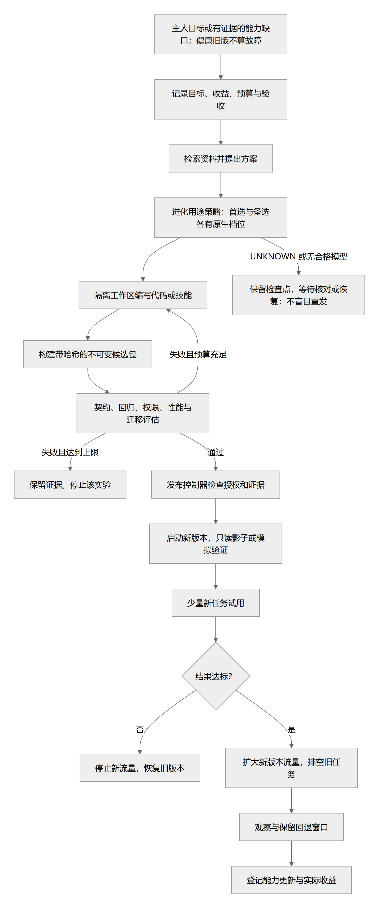

# 自主进化、外部编码协作与版本发布

> 状态：总体 proposed；evolution-v1 已实现限定工具成长闭环，0.1.41 增加会话需求与实际交付，证据见[本轮验收](delivery-validation.md#growth-demand-evidence) · 更新：2026-10-18
> [文档入口](README.md) · [维护规则](MAINTENANCE.md) · [架构图册](architecture-atlas.md)

<!-- book-nav:start -->
[全书目录](README.md#book-tree) › [第四篇 · 自主成长与维护](README.md#part-evolution) › 第 14 章 · 自主进化、外部编码协作与版本发布

## 本章导航

- [14.1 成长中心：三种能力、一个可追溯的成长过程](#growth-governance)
  - [14.1.1 成长记住什么，怎样避免越改越乱](#growth-learning-ledger)
- [14.2 外部 Codex 放在哪里](#bootstrap-6)
  - [14.2.1 第三方编码执行器：Codex 首期与后续提供者](#external-coding-executor)
- [14.3 最小进化循环应该如何工作](#bootstrap-7)
  - [14.3.1 已实现：限定工具的自动成长闭环](#bounded-evolution-loop)
  - [14.3.2 已实现：从会话需求到实际交付（0.1.41）](#demand-growth-runtime)
  - [14.3.3 K4 项目工具：发布、需求选用、契约审阅和回退（0.1.75）](#project-tool-runtime)
    - [14.3.3.1 受控准入、灰度收益与可恢复退役（0.1.75）](#project-tool-lifecycle)
    - [14.3.3.2 本地需求选择与能力缺口交接（0.1.72）](#project-tool-intents)
    - [14.3.3.3 验收草案、明确审阅与编码交接（0.1.73）](#project-tool-contract-drafts)
- [14.4 自主进化与自我重构](#self-evolution)
  - [14.4.1 六级进化对象](#self-evolution-1)
  - [14.4.2 进化触发条件](#self-evolution-2)
  - [14.4.3 发布流水线](#self-evolution-3)
  - [14.4.4 研发、验证与发布分权](#self-evolution-4)
  - [14.4.5 技能包的准入、升级与退役](#skill-admission-release)
  - [14.4.6 修改自己的“形态和结构”](#self-evolution-5)
  - [14.4.7 评估防退化](#self-evolution-6)
- [14.5 持续服务、升级与迁移](#service-continuity)
  - [14.5.1 连续性分级](#service-continuity-1)
  - [14.5.2 新旧版本并行](#service-continuity-2)
  - [14.5.3 长任务与会话](#service-continuity-3)
  - [14.5.4 状态迁移](#service-continuity-4)
    - [14.5.4.1 0.1.17 启动恢复规则](#runtime-startup-policy)
  - [14.5.5 恢复底座自身升级](#service-continuity-5)
  - [14.5.6 必须显式测试的底层条件](#service-continuity-6)
- [14.6 自主改进实际例子](#end-to-end-flows-4)
- [14.7 发布单元矩阵](#critical-review-7)
<!-- book-nav:end -->

<a id="growth-governance"></a>
## 成长中心：三种能力、一个可追溯的成长过程

**0.1.64 / growth-purposes-v2，2026-10-19：限定工具的职责分离、独立用途模型与三标签已 implemented。** 本节是三能力的目标定义；当前可执行子集、边界和迁移见[限定成长运行](#bounded-evolution-loop)，检查证据见[本轮记录](delivery-validation.md#growth-purposes-evidence)。持续理解主人、保留经验并验证改进仍是个人助手目标；动画不表示意识或生物生命。

| 能力 | 回答的问题 | 产物与成功条件 | 明确边界 |
|---|---|---|---|
| **自检 Inspect** | 现在是否正常，有什么证据？ | 有时间、范围、版本、覆盖度与新鲜度的检查报告；异常形成事件 | 检查完成不等于全系统健康；不改代码、不发布、不自动转为升级 |
| **自愈 Heal** | 怎样恢复原本承诺的能力？ | 恢复到既有契约，实际复测后关闭故障；必要时产生修复候选 | 不趁修复增加功能、换架构或放宽验收；修好必须有原故障复测证据 |
| **进化 Evolve** | 为主人的目标增加什么能力，改进是否值得？ | 带基线和验收的改进单，新能力/质量/成本收益经验证并发布 | 健康的旧版本低于期望新版本属于能力差距，不是故障；不能为持续动画或成长分数而制造任务 |

例如：v1 的 CSV 输出损坏属于自愈；v1 正常但主人希望增加 TSV 属于进化；检查 v1 是否正常属于自检。首次安装缺少一个可选新工具属于进化，已承诺启用的工具丢失才属于自愈。软件“有更新”只是进化候选，不自动证明应升级。修复可能写代码，进化也可能仅修改技能、配置或知识索引；分类依据目标，不依据是否调用编码模型。

三者分别有开关、模型策略、记录与成功定义。自检只写观察账本；是否自动消费异常由自愈策略决定，能力差距由进化策略决定。关闭自愈不会关闭自检，关闭进化不妨碍恢复旧能力。修复途中发现的新机会另建提案，不偷偷扩张本次故障范围。

<a id="growth-learning-ledger"></a>
### 成长记住什么，怎样避免越改越乱

共用一条可查询的因果链：**主人目标 → 观察/纠错 → 故障或能力提案 → 实验 → 独立验收 → 发布 → 实际收益 → 保留或退役**。界面展示这条链的证据摘要，不要求模型透露内部思考全文。每项记录绑定项目/个人/设备作用域、基线、来源、真实用量、成功或失败原因；失败和拒绝也形成可检索的经验，不能只记“成功故事”。

进化优先级先比较主人明确目标、对日常交流和协助的影响、重复发生的证据，再比较收益、耗时、费用、资源和可恢复性。改进可以是更准确地使用偏好、减少重复询问、避免不合时宜的提醒、改善离线回应，也可以是研发新工具；不以代码量、Agent 数量或更新频次定义成长。没有观察样本时显示“待评估”，不用模型给自己的高分替代事实。候选改善需在同一基准上满足冻结的最低要求，并说明旧能力是否退化；简单问题优先采用规则或已有技能，新增模型调用和依赖必须有可验证用途。

人格调整、事实纠正和程序发布分别走各自既有接口与验证，不把每次偏好更新变成一次代码发布。可执行能力的更新必须保留身份、适用记忆和未结事项；基础伙伴体验按[V-PAL](delivery-validation.md#personal-companion-validation)回归。相处是否更合意需要主人反馈，不用在线时长、聊天频率或让主人依赖系统作为收益指标。

个人偏好、技能经验和工程事实分别通过既有 Memory / Knowledge / Capability API 写入，不把运行日志全部变成长久记忆。用户纠正可撤销；旧结论绑定适用版本和失效条件；项目私有内容不因成长而自动跨项目或跨设备共享。身份和约定属于 Jarvis 的受控状态，模型替换不创建“另一个主人”或重置关系。共同体后续复制已验证事件与包引用，仍遵守[节点与作用域规则](federation.md#offline-federation)。

自愈与进化共用已有候选构建、验收、发布和回退流程，不复制两套发布器。独立验收器由宿主控制，模型评审只能提出风险，不能替代契约、兼容、隔离、迁移和真实结果测试。旧代码、文档、模型和调试产物的退役必须有去向与恢复窗口，完整规则沿用[长期健康与结构治理](health-maintenance.md#system-health)。所有自主行为遵守当前主人范围与[安全主题页](security-sovereignty.md#identity-authorization)，此设计不恢复已延期的认证工程，也不新设逐步人工审批。

<a id="bootstrap-6"></a>
## 外部 Codex 放在哪里

Codex 作为 `CodingProvider` 的一个实现，收到**改进单和候选工作区**，返回补丁、候选产物引用、测试记录和无法完成的事项。它不成为 Jarvis 的身份、任务账本、记忆所有者或最终发布批准者。

官方提供 `codex exec` 非交互调用、JSONL 事件与结构化结果，也提供程序化控制的 Codex SDK。首期可以选一个适配方式：简单批任务用 CLI；需要较强事件和会话集成时用 SDK。不要同时实现多套相同功能，也不要把桌面应用的界面点击当成唯一自动化协议。[Codex 非交互模式](https://learn.chatgpt.com/docs/non-interactive-mode)、[Codex SDK](https://learn.chatgpt.com/docs/codex-sdk)。

我们的适配契约至少包含：

```yaml
coding_job:
  job_id: improve-example-001
  goal: "为限定目录生成可重复的文件清单"
  base_snapshot: "sha256:<source-snapshot>"
  workspace_ref: "candidate-workspace-001"
  allowed_changes: ["skills/file-inventory/**"]
  forbidden_changes: ["root-policy/**", "release-keys/**", "protected-evals/**"]
  public_acceptance_ref: "inventory-public-v1"
  budget_ref: "maintenance-budget-001"
  max_attempts: 3
  output_contract: "patch-artifacts-tests-limitations/v1"
```

允许路径清单需要由宿主检查实际 diff 和 OS 权限；写在提示词中不等于已经强制执行。Codex 报告“测试通过”后仍由 Jarvis 的独立验证环境重跑必要验收。补丁必须匹配 base_snapshot，不能套用到已变化的生产版本。

编码模型调用与候选代码执行使用隔离的凭据路径。不能将 API key、登录凭据或发布密钥作为整个构建任务的共享环境变量；官方同样明确提醒仓库构建和安装脚本可能读取这些环境信息。[Codex 自动化认证](https://learn.chatgpt.com/docs/non-interactive-mode#authenticate-in-automation)

Codex 不可用、限流或网络断开时，保存 coding_job 并显示等待；可以切换到已经验证的本地 CodingProvider 完成较小改动，不能假装本地模型能胜任所有复杂编程。既有生产任务不应因此停止。不会因为接入 Codex 就自动获得未授权账号、费用额度或文件权限。

此处的完整外部执行器方案仍为设计状态；当前已有 ModelCodingProvider 和 0.1.65 CodexCodingProvider 文本候选适配，0.1.66 增加可运行工具包。具体实现见[当前适配](#external-coding-executor)，不包含任意仓库修复或通用终端权限。

<a id="external-coding-executor"></a>
### 第三方编码执行器：Codex 首期与后续提供者

**0.1.65 首个 Codex 文本候选适配 implemented；完整外部执行器方案仍 proposed。** `CodingProvider` 是统一替换点；现有 ModelCodingProvider 与 CodexCodingProvider 都交出候选，后续走同一独立编译、验收与应用流程，不新增外部发布者。入口为[设置 → 编码协作](http://127.0.0.1:18181/settings#coding)，概览有独立卡片；任务中选择当前模型网关或外部 Codex。Codex 不常驻、不自动安装；已核验的本机 0.142.1 CLI 按需运行，版本变化先重新核对。完整机制与可信边界见[候选隔离](security-sovereignty.md#bounded-coding-boundary)。

适配器使用 `codex exec` 的 JSONL、结构化最终输出、临时会话与配置隔离能力；实测不能用当前 CLI 覆盖保留的 openai 供应商条目，故使用不硬编码 base_url 的独立 OpenAI 登录配置，按实际认证选择服务并关闭自动请求/流重连。不得把 ChatGPT 登录令牌发往硬编码 API 地址。参考官方[非交互执行](references.md#s239)、[配置](references.md#s240)和[权限档案](references.md#s241)，本机差异以[运行证据](delivery-validation.md#k3-coding-evidence)为准。

只持久化开关、模型、推理档位和设置修订；使用已有本机 Codex 登录，不复制 Key。外部账单归 Codex 登录账户，回执中的输入/输出 token 单独记录，不冒充 Jarvis ModelGateway 的价格或余额观测。尚不提供 Codex 任意终端、仓库扫描、自动发布或独立长期 Agent。Grok 是否接入仍按[开源对照](stack-project-layout.md#grok-build-comparison)另作评估。

以下为通用外部执行器的后续完整流程，不能把首个文本候选适配等同全部完成：

Grok 候选首轮选择 headless 的结构化事件输出；需要持续插话/交互恢复时再评估 ACP，并只维护一条已采用的传输路径。[S150](references.md#s150) 中的 `--max-turns`、`--tools`、`--no-auto-update` 是应用级控制，不能当成 OS 沙箱。尤其 headless 的 built-in 工具 allowlist 会保留 MCP meta-tools，不能据此承诺已经关闭所有其他工具。启动前必须解析实际有效配置与工具集合，无法确定范围时不能启用写入/执行。

一次调用按以下顺序收口：

1. 既有 Task Runtime 受理改进任务、固定 coding_job 与基线，构建协调器准备独立候选工作区；普通目录可使用受控副本，不自动要求 Git。
2. 适配器核验二进制/协议版本、能力、认证与本机执行边界；限定配置、插件来源、工作目录和凭据暴露。仅设置 cwd 或 worktree 不等于隔离；不能继承整份主人环境或让候选构建读取编码器凭据。
3. 通过受限执行器按需启动。外层限制生命周期、总时间/输出/进程资源与网络范围；已授权的小范围内自动执行，不给每一步增设确认。编码器不能自提额度或重写生产安装。
4. 映射外部 session/call ID 到 coding_job/attempt ID；进度、工具日志、usage、最终报告分别保存为引用。重复/乱序通知只更新视图；外部成功消息先成为待验候选，不能直接将改进事务标为已发布。
5. 正常结束后核对实际 diff、基线摘要、允许路径和产物，再交独立构建/验收流程。外部测试报告是证据输入，仍需按原计划复验。
6. 取消先发协议取消，再在期限内回收已登记的进程树；先核对候选产物后结束。崩溃、断联或不完整终态保留实际状态及 UNKNOWN 待核对结果，不能自动重跑可能已有副作用的调用。
7. 固定版本随任务排空，候选数据按既有保留/退役规则处理；删除适配器不能删除源码原件、任务记录或恢复材料。

**两种模型控制范围。** Jarvis 原生规划/工具循环统一走现有 ModelGateway；完整外部编码器通常自己请求模型，由 CodingProvider 约束整个作业的授权、预算和结果。先验证是否支持受控模型端点；不能未经测试宣称它已使用 Jarvis 路由。若使用外部认证/账单，单独展示其用量与观测来源；仅有迟到 usage 或轮数限制时不能承诺精确费用硬上限。已有 xAI API Key 也不证明 Grok Build 登录、模型权限与计费方式已匹配。

Grok 内部子 Agent 视为该 coding_job 的执行细节，不能自行成为共同体节点、获得 Jarvis 长期身份、访问全部记忆或产生独立发布权限。复用的价值是加快产生可检查候选；独立评估、版本切换和回退仍由 Jarvis 拥有。边界与故障测试统一归 [V-OSS](delivery-validation.md#open-source-adoption-validation)。

<a id="bootstrap-7"></a>
## 最小进化循环应该如何工作

事件来源先限定为：主人明确要求、任务失败、重复手工步骤、已测量瓶颈。先不启用无边界“逛互联网寻找任何可改进点”。

一次改进事务：

1. 固定问题：哪项任务失败、预期结果是什么、为什么值得改。
2. 保存基线：当前源码/包/模型/测试版本、任务结果、时间和资源。
3. 生成改进单：允许改动范围、验收方法、预算、成功和停止条件。
4. 调用本地或外部编码者，在候选空间修改。
5. 隔离构建；独立评估先检查不可违反条件，再比较能力与成本。
6. 失败时保留证据并限额重试；超过额度回到等待，不自动扩大权限。
7. 通过时按预授权范围灰度发布；超出范围生成主人可审查的提案。
8. 观察真实任务；退化则阻断进一步发布并回退到可兼容版本。
9. 写入改进账本：采用/拒绝原因、效果、代价和恢复记录。

发布普通技能、非根模块以及自动化工作只要在主人已经设定的授权范围内，可以自动完成，无需每次请求确认。根控制变更、新权限、超出预算的外部服务使用等超出既有授权时，保留具体提案供主人决定；不能让“自主”变成自授权。

持续评估按事件触发：候选生成后、发布前、灰度期、真实任务失败后和冻结的周期基准。运行期优先使用低成本健康和结果检查；不是每一秒都调用多个大模型给自己评分。

<a id="bounded-evolution-loop"></a>
### 已实现：限定工具的自动成长闭环

**0.1.37 建立闭环；0.1.64 / growth-purposes-v2 完成限定对象的三能力拆分，implemented。** 按主人本轮要求，现在开始打通 K3 候选研发到 K4 工具发布的垂直子集，不再等待全部语音、记忆、共同体或 UI 完工。它不代表 K1—K4 的整体验收已全部完成，也不等于 K5 宿主自身重构。可复现证据统一见[成长闭环验收](delivery-validation.md#evolution-loop-evidence)。

当前升级对象为 `inventory-export`：v1 将已提供的路径与大小生成 CSV / Markdown；v2 保留旧格式并增加 TSV。**候选 Python 是编码模型实时生成的，运行时没有使用预写的工具实现代替生成。** 宿主拥有输入契约、适用/排除条件、技能说明模板和独立结果检查器；生成代码无权更改这些准入条件。当前只在成长面板 / API 显式调用，未扩大普通聊天自动技能匹配范围。

模块边界：

| 独立部件 | 责任与源码 |
|---|---|
| EvolutionManager | [manager.py](../runtime/node-host/jarvis_core/evolution/manager.py)：分开观察、故障恢复与目标进化，组织有限候选循环、停止和运行后检查 |
| CodingProvider | [provider.py](../runtime/node-host/jarvis_core/evolution/provider.py)：使用已登记模型线路；只发送工具契约、旧候选代码及失败反馈，沿用凭据隔离与用量账本 |
| PurposePolicy | [settings.py](../runtime/node-host/jarvis_core/evolution/settings.py)：三用途设置校验、旧配置迁移和明确失败的备选判断；复用原模型网关 |
| Recipe / Verifier | [recipes.py](../runtime/node-host/jarvis_core/evolution/recipes.py)：版本化输入输出、适用与不适用例、固定样例及未发送给编码模型的回归输入和期望值 |
| IsolatedRunner | [runner.py](../runtime/node-host/jarvis_core/evolution/runner.py)：检查 AST、编译并执行候选，复用已校验的 Windows Python / LPAC / Job |
| EvolutionStore | [store.py](../runtime/node-host/jarvis_core/evolution/store.py)：独立 SQLite 改进账本、内容寻址包、活动/前一版本指针、基线代际和事务恢复 |
| Web / CLI | [路由](../apps/web/evolution_routes.py)、[设置面板](../apps/web/evolution.js)、[CLI](../tools/evolution.py)：发起、查询、取消、调用、查看源码与回退 |

一次实际执行顺序：

1. 自检只读取活动包的登记、三个文件摘要与契约绑定，报告完整、能力差距、可选能力缺失或真实包故障。显式进化任务才按目标补齐能力；自愈只恢复损坏前的契约版本。
2. 固定当前活动包与 generation、目标 revision、用途策略修订及验收摘要；检查可用内存与 Worker 工具链，避免不能运行时仍先付费编码。
3. 模型返回有界 JSON 候选。只接受 `code` 和 `notes`；限制为纯 `transform(data) -> str`，仅可使用 `csv` / `io` 的有限能力，不接受安装命令、任意包依赖、源码树补丁或额外工具授权。
4. 将代码、宿主生成的 `SKILL.md` 和受控 manifest 写入新的内容寻址包。候选进程只获得本次数据和代码；生产目录、凭据、网络及写入权限不授予候选。标准输出、CPU 时间、内存、墙钟时间和进程数均由现有受限执行器约束；Python 静态检查本身不被称为 OS 沙箱。
5. 独立检查空清单、排序、重复名称、中文、逗号/引号/换行/管道符/HTML 字符、大整数和 100 条输入。期望结果在宿主计算；候选只返回输出，不提交“我通过了”的验收结论。输入不得被修改。
6. 不通过就登记拒绝原因并反馈给编码者，每单合计最多两次模型尝试（含备选）；通过则检查基线仍未变化，在 SQLite 事务中切换活动指针。新调用取得新包，正在执行的调用使用已读取的固定代码，不覆盖宿主或旧包。
7. 启用后重新跑健康样例；失败自动回退或停用。真实工具调用也检查实际输入的结果，错误输出不会交付为成功。
8. 自动自愈已单独启用且出现包故障时，先验证并恢复旧版本，再按损坏前的契约生成修复包、验收并启用。巡检只留下观察，策略消费者另建有来源的 `heal` 单；实际工具执行失败先回退隔离，允许的修复尝试仍计入该执行单的同一预算。健康旧版与首次缺少可选工具不触发修复；内存不足、余额、网络和认证问题不变成代码故障。原失败任务仍保持失败。

**自动运行与预算。** 新安装默认关闭周期自检和自动自愈；旧设置保留原自检开关/周期，新增自动自愈默认关闭，三个用途继承旧线路但不自动调用。周期及分层演进由[检查调度](health-maintenance.md#inspection-scheduling)维护；模型尝试、备选与费用由[用途路由](models-offline.md#growth-model-policy)维护。当前只复用一个进程内观察线程和一个成长 Worker，没有新服务或常驻模型。自动修复按对象/基线/故障身份去重，每 UTC 日最多四个事件；每单合计最多两次模型尝试，手动任务也不能绕过单单上限。进化仅由明确目标启动，没有定时自动升级。退出 Jarvis 后线程结束，不创建操作系统或 Codex 自动化。

**当前行为的局限。** 快速自检只证明包完整性，不执行函数回归，也不表示全系统健康。发布前后与真实调用仍有独立执行核验。事件化探针、持久到期/缓存、深度检查页、跨模块故障编排、总费用硬预算和持续收益评估仍 proposed，不能把本次拆分视为完整 V-GROW 通过。

**数据、恢复和防污染。** 运行数据为 `<data-dir>/evolution/evolution.db` 与 `packages/<sha256>/`，不写仓库生产源码。每包仅允许 `candidate.py`、`SKILL.md`、`manifest.json`，额外调试文件、链接、摘要或契约变化使包不可调用。包附独立 build ID，同源码重建也成为新候选；损坏包保留隔离状态，不原地覆盖。最多保留 64 包与 1,000 条重要任务记录，达到上限停止新增并说明原因；当前尚无自动删除候选包服务。健康的自动只读巡检仅保留最近 30 条，改进、拒绝、失败、UNKNOWN 和恢复证据不参与此压缩。

进程中断后，未完成改进标为 `INTERRUPTED`，模型调用不重放；已切换但尚未确认的候选停用，再次验收后才可采用。修复包通过发布后观察即单独提交确认，即使触发它的原始调用仍记为失败，重启也保留已验证修复。手动回退同时暂停自动维护，避免下一次巡检立刻升级回去；自动故障回退仍沿用已有维护设置。本次成长账本设置迁移至 schema 2，保留原包、任务和活动指针；启动器拒绝将该库交给不理解新策略的旧运行包。包回退不会回滚用户聊天、项目、记忆或已完成任务。宿主与账本仍在同一 OS 用户下，不能声称能抵御该用户的恶意并发篡改、已攻陷的宿主或未知 OS 漏洞。

**明确尚缺。** 任意目标生成新契约、外部 Codex 适配、依赖安装、多语言构建、跨模块回归、索引/路由器替换、Host 独占接管与数据迁移、长时资源验证以及共同体一致发布均未由此实现。当前完整性只针对固定契约；不能用本节推导“任何代码都能自修”或“越改一定越强”。扩展对象应新增受控配方、执行与独立验收边界，复用同一账本和发布流程。

<a id="demand-growth-runtime"></a>
### 已实现：从会话需求到实际交付（0.1.41）

**范围说明：**以下为固定目录报告格式的成长分支。0.1.68 新增[有界编码改进交接](tasks-agents.md#bounded-coding-workflow)，由同一会话入口分派至原共享任务队列，交付经过独立验收的候选；其创建、结果与明确应用规则以该节为准，不套用本节的自动工具发布步骤。

**implemented / 验证范围见[本轮证据](delivery-validation.md#growth-demand-evidence)。** `ConversationGrowth` 是现有 evolution-v1 的需求适配器，复用同一 SQLite 成长账本、单执行通道、CodingProvider、LPAC 验收和发布/回退。没有第二套 Agent 调度、数据库、巡检器或安装依赖；普通聊天仍走独立通道。

当前首个需求是把本会话已成功完成的样例目录报告导出为 CSV、Markdown 或 TSV。范围来自已核验产物，既不重新扫描当前项目，也不把聊天中的任意文件路径当成输入。意图匹配只接受这个有独立验收配方的完整要求；不支持的目标明确返回未执行。请求分析和查询不调用模型。

1. 从当前已归档普通会话取最近的成功报告，复核产物摘要，提取路径与大小。形成 `PROPOSED` 改进单，固定目标、会话/项目范围、来源任务与摘要、输入摘要、活动能力代际、编码模型和验收摘要。
2. 比较已发布能力：健康的足够版本优先复用；缺失才补齐，版本不足才升级，包异常归修复。分析只检查元数据和完整性，不宣称已经做过执行健康测试。
3. 主人通过该单的开始动作发起工作。开始前重新核对来源、模型、能力基线和验收摘要；变化时拒绝旧单。随后同一成长 Worker 复用或生成候选，沿用上节独立验收、启用与观察。
4. 能力可用后立即处理冻结的本次输入；宿主将实际结果与独立期望值比较。只有这一步也成功才交付文本、结果摘要、来源摘要与实际记录数。生成成功但实际调用失败不能记为需求完成。
5. 查询、取消和下载仍指向原单。相同请求编号只产生一单；重复开始返回原状态；中断、UNKNOWN 或模型不可用不自动重放。未启动提案可跨重启保留，已经排队/运行的中断沿用既有恢复规则。

0.1.43 增加显式重新分析适配：结束的失败/中断/未知/取消记录可生成引用原单的新提案，重新冻结本会话最新有效输入及能力基线，随后仍按上述开始与验收流程处理。原记录、费用不确定性及接续关联不被覆盖，不把新请求当作原动作的恢复成功。字段与去重归[需求接口](contracts.md#growth-demand-contract)，使用入口归[聊天成长面板](interaction-persona.md#growth-demand-ui)。

每单生成及后续修复共用最多两个候选预算，不能通过“先补齐再修复”叠加次数。编码模型只收到配方、旧候选和验收反馈，不收到实际文件清单、原会话或用户需求原文。输入容量沿用[契约](contracts.md#growth-demand-contract)。保存的来源快照、提案和失败记录属于成长审计；删除聊天不级联销毁审计，已删除会话不能从会话入口继续启动。实际输入与结果不会自动写成长期个人记忆或跨项目共享。

这一步接通需求、缺口、生成、验收、发布和本次使用的技术链。`inventory-export` 的完整答案仍由宿主掌握，不能据此宣称获得未知能力、完整 V-PAL-10 或通用自主改造；三用途模型路由由 0.1.64 单独接通。后续新增目标需有独立受控的输入、执行和验收配方，继续复用此通路；阶段归属见[K2 最小成长核心](core-bootstrap.md#k2-growth-core)。

<a id="project-tool-runtime"></a>
### K4 项目工具：发布、需求选用、契约审阅和回退（0.1.75）

**发布与复用 implemented / verified 于 0.1.71；0.1.72 增加[需求选用与缺口交接](#project-tool-intents)，0.1.73 增加[契约草案与审阅](#project-tool-contract-drafts)，完整 K4 仍开放。** 在 K3 候选交付之后增加“纳入项目工具”：把经过独立验收的 Python 产物保存为项目能力，在相同项目的其他已保存会话中复用。它是个人助手按需长出工具的第一条通路；日常聊天、私人记忆和人格继续由原模块管理。本轮验证集中于[项目工具证据](delivery-validation.md#k4-project-tool-evidence)，界面见[使用入口](interaction-persona.md#project-tool-ui)，字段见[接口](contracts.md#project-tool-contract)。

流程：**K3 确认回执 → 冻结产物、用途与公开/留出案例 → 明确准入审阅 → 隔离复验与候选登记 → 有界新输入灰度 → 核对收益和正式启用 → 原子切换与启用后复验 → 调用回执 → 保留、停用、回退或退役**。0.1.75 将原先直接启用的 `publish` 改为候选准入，完整规则见[生命周期](#project-tool-lifecycle)。

| 环节 | 当前规则 |
|---|---|
| 来源与用途 | 只接收当前已保存项目会话的已确认 K3 回执；校验产物摘要、配方与独立留出验收。名称、适用和不适用说明分别填写，不将说明直接当作模型指令 |
| 契约延续 | 升级合并旧版和新版行为案例，以及旧稳定版已独立核验的实际输入。相同输入改变预期必须改用新的工具标识；不允许为了新代码通过而抹去旧验收 |
| 版本与启用 | 工具身份由项目 ID＋工具 ID 确定；包内容摘要确定不可变版本；代际和生命周期修订比较避免覆盖。准入不切换稳定版，正式启用前后复验；中断恢复见下节 |
| 实际调用 | 每次调用先核验包与保留案例，再在既有 LPAC 中运行输入。记录实际文本、摘要、版本、耗时和隔离证据；提供独立预期且一致才标为“结果独立核验”，仅执行成功不能证明答案正确 |
| 失败恢复 | 契约、完整性或独立预期失败时，复验上一版本后回退；没有合格旧版本则停用。原调用保持失败，不把失败输入悄悄重放。旧契约通过而无独立预期的新输入执行错误，不单凭此隔离整个工具 |
| 作用域 | 同一项目会话共用工具选择与汇总用量；任务详情仍按原会话绑定。项目不同不共享；项目范围变化使未完成任务失效。个人记忆不自动进入工具包 |
| 收益证据 | 记录新增能力、保留案例数、调用/成功/独立核验次数。本轮复用不调用 LLM，不据此虚构节省时间、普遍成功率提升或长期净收益 |

**实现落点与本机成本。** `evolution/catalog.py` 管目录、契约和调用；复用 `EvolutionManager` 单通道、`EvolutionStore` 和 `IsolatedRunner`。Web 路由及右侧面板仅适配入口，不另建调度器、数据库服务、容器集群或常驻模型。当前仅支持既有可执行 Python 配方（含锁定 JMESPath 与子目录包）；源码 ZIP、JS 场景继续使用原交付方式。包与回执存入已有 SQLite，按需启动 Worker。

目录全局上限 32 个工具、64 个不可变版本，每工具最多 64 条案例；输入最多 8 KiB、独立预期最多 16 KiB，沿用账本 32 MiB 和 1,000 条任务上限。新工具任务受理额外预留包、输出和恢复回执空间，估算超过 28 MiB 即拒绝新增。满额明确拒绝，不删除恢复材料换取成功；因此这是有界本机试用，不是无限工具仓库。退役标记仍占配额；证据导出、引用释放与可恢复容量回收尚待后续实现。

0.1.71 新增工具选择/版本表为 schema 3；0.1.75 在同一 `evolution.db` 增加生命周期投影表，升级到 schema 4。运行槽拒绝旧程序打开 schema 4，避免旧发布/恢复逻辑绕过准入或退役。工具版本回退与整个 Jarvis 程序降级是不同操作。任务冻结执行器摘要，执行器变动后须重提；候选代码无法修改自己的验收、宿主或选择账本。

**下一批仍属 K4：**更广的语义匹配、契约语义的独立验证、不同工具和项目/个人作用域策略；更多真实任务的质量/成本对照、长期负收益判断与容量回收。当前仍需明确审阅，不能表述成“任意技能可自主生成并正式发布”。模块结构自改仍归 K5，多设备复制及 Agent 共同体归 K6。

<a id="project-tool-lifecycle"></a>
#### 受控准入、灰度收益与可恢复退役（0.1.75）

**implemented / verified；验证与部署范围见[本轮证据](delivery-validation.md#k4-lifecycle-evidence)。** 独立模块 `evolution/lifecycle.py` 管候选状态和门槛，目录/实际执行继续由 `catalog.py` 负责；复用原单通道、SQLite 和 LPAC，无新增调度器、常驻服务、模型或依赖。

| 状态/操作 | 行为与保护 |
|---|---|
| 准入 `CANARY` | 核对用途、独立案例及本轮范围后登记候选，冻结稳定选择、执行器、审阅依据和次数/延迟预算。新工具不可调用，升级时原稳定版照常服务；同一工具不能覆盖在途灰度 |
| 灰度试用 | 明确提交本次真实 JSON 输入、独立预期、用途反馈与依据；先跑保留回归再运行新输入。有稳定版时对同一输入做隔离配对比较。只支持纯转换配方，不复制外部动作。没有自动分流比例、后台流量采集或自动影子执行 |
| 准入计数 | 仅本轮成功且不属于保留案例的不同输入计数；重复输入不增加数量。达到冻结的新输入门槛、至少一项明确用途反馈，且无失败、范围/执行器/稳定基线变化，才允许再次明确启用。数量达标不证明契约完备 |
| 正式启用 `ACTIVE` | 重新复验、原子切换、启用后再复验。取消、失败或重启留下未确认切换时隔离候选，只恢复记录中完整且已验证的旧稳定包；没有合格旧包则停用。失败输入不重放 |
| 暂停/拒绝 | 明确暂停为 `PAUSED`，重启也暂停原灰度，不自动继续。基线未变且复验通过才能明确继续；基线已变须放弃原灰度、重新准入。新输入不符、回归/包错误或超过本轮延迟门槛为 `REJECTED`，只隔离候选，原稳定选择不变 |
| 放弃 `ABANDONED` | 结束未完成/被拒灰度并释放候选选择，保留记录；不会启用它。可从新 K3 回执重新审阅 |
| 能力退役 `RETIRED` | 明确依据后停止此工具所有调用，旧恢复/发布接口也不能绕过。保留内容、回执和恢复引用，用户文件删除数为零。恢复仅重新进入新一轮灰度，旧轮计数不复用 |
| 旧版本退役 | 仅无稳定/前版/候选/退役恢复引用的版本可标记 `RETIRED`，禁止执行与回退。内容和证据继续保留；这不是物理删除或磁盘空间回收 |

原“停用/回退”仍用于日常稳定版本管理，分别显示 `DISABLED/ROLLED_BACK`；如果它们改变在途灰度的稳定基线，灰度自动变成 `PAUSED`，不能沿用旧准入继续。退役恢复中的候选也不能通过“恢复上一版本”直接启用。无法读取或已隔离的恢复包不强行复活；当前需修复受控恢复材料或另建工具标识，尚无任意损坏包的自动重建保证。

**收益评估分层。** 独立预期一致是确定性的样本结果；“有用途”是当前本地调用者的明确声明，不能冒称认证评审或自动语义判断；配对记录旧版正确性、双方运行耗时和 Worker 进程内存证据。延迟包含进程启动噪声，无旧版、样本少或使用场景有限时明确证据不足，不输出通用净收益评分。上述操作本身不调用 LLM，不能据此虚构开发成本、token 节省、长期节能或普遍正确率。

旧 schema 3 的稳定工具可继续使用，标为 `LEGACY`，不补造历史灰度；之后新升级必须走新准入。生命周期修订和选择代际分别冻结，避免同一稳定版下的旧页面在暂停/退役之后继续操作。操作仍按原请求 ID 对账，未知结果只查询；跨项目/会话任务详情不泄露。字段和预算边界只在[接口契约](contracts.md#project-tool-contract)维护；UI 在[同一项目工具面板](interaction-persona.md#project-tool-ui)。

<a id="project-tool-intents"></a>
#### 本地需求选择与能力缺口交接（0.1.72）

**implemented / verified；这是有界本地匹配，不是通用语义规划器。** 新增独立适配器 `evolution/tool_intent.py`，目录、执行器和 K3 编码模块继续各司其职。请求先形成可恢复的分析记录，再决定复用还是补齐能力；不另建 Agent、常驻模型或服务。

| 判定 | 条件与行为 |
|---|---|
| 明确调用 | “请用求和工具处理 [10,20]”一类指令，工具 ID 或名称唯一精确匹配、已启用且完整，携带完整 JSON，才可直接发起现有隔离调用；名称比较忽略大小写和空白。面板的“分析需求”只分析，聊天明确指令才自动开始 |
| 待选择 | 名称重复或只有用途词法重合时，最多列出五个候选和适用/不适用说明；中文双字与英文标识重合不代表语义正确，必须选择工具与输入 |
| 待补输入 | 已明确工具但缺少合法 JSON 时保留原话；不从示例、聊天历史或私人记忆猜参数，不用生成者的输出当独立预期 |
| 不执行 | 否定、问题、引用、未来或条件表达的支持形式只作为讨论；指定工具停用或损坏则提示核对，不能自动绕过它生成替代代码。规则覆盖是有限的，普通聊天无 JSON 的泛化表达不被工具入口截走 |
| 目录中未匹配 | 仅表示当前项目已登记工具没有匹配，不表示助手或其他项目没有此能力。可将原话交给既有 K3 改进单，补齐源码范围、公开案例、独立留出案例、模型与构建配方，再得到待开始的编码记录；分析与建单不调用模型、不直接发布代码 |

持久流程为：**原话与请求 ID → 冻结作用域/目录/执行器 → 判定 → 原工具调用，或原目标绑定的编码改进单 → 实际回执**。执行和编码结果是子记录，分析记录保持 `PROPOSED/CANCELLED`，界面分别展示实际任务状态；不能将“已分析”冒充“已完成”。编码产物通过 K3 后仍走上节工具发布与独立复验，不因能力缺口自动获得启用资格。

请求和选择记录复用 `evolution.db` 的 `jobs`，聊天复用现有 `growth_ref/growth_request_id` 控制回执；不增加数据库表或 schema 版本。查询按会话/项目/根目录绑定，目录或执行器变化时旧分析必须重做；已受理的子任务可按原 ID 对账，不因刷新、超时或重启重复调用。会话改进入口的查询、取消和重新分析也委派到同一记录。控制消息不自动进入个人长期记忆或普通模型聊天历史；完整输入和输出仍在本机任务回执中，不等于无痕处理。

需求文本最多 12 KiB，JSON 输入沿用上节 8 KiB 上限；拒绝重复键、非有限数字、尾随指令和多段 JSON。最近列表最多 30 条，配额沿用成长账本；不以删除历史或恢复证据换取准入。分析、查询与复用不调用 LLM，真正开始编码才使用 K3 模型通道。0.1.72 继续读写 schema 3，0.1.71 可读旧目录数据但没有新增需求界面；不把数据可读等同于功能向后兼容。

<a id="project-tool-contract-drafts"></a>
#### 验收草案、明确审阅与编码交接（0.1.73）

**implemented / verified；未实现无人审阅的通用契约裁决。** 能力缺口可请求模型拟定输入、输出、不包含的能力、公开案例及待澄清问题。`evolution/tool_contract.py` 独立负责这一过程，模型连接复用 `ModelCodingProvider`，生成任务仍由原 `EvolutionManager` 单通道执行；编码、目录发布与回退继续由原模块负责。

流程为：**已保存缺口 → 模型草案 → 明确审阅和澄清 → 提供独立留出案例及依据 → 冻结审阅/源码基线 → 原 K3 待开始单 → 编码和独立运行验收 → 原工具发布通路**。模型草案自身没有执行代码或发布工具的权限。审阅通过也只建立待开始的编码单；K3 成功仍不是自动纳入工具。

- **生成与费用：**只发送原需求和固定工具边界，不发送项目源码、聊天历史、个人记忆或留出案例。生成沿用成长中心“进化”的首选、备选及档位，每次请求最多首选一次与符合既有条件的备选一次。余额/认证等明确失败才可切换；结果未知、格式错误或不完整不自动重发。相同请求号可查询原记录，每个需求最多四次草案请求。
- **草案不是结论：**模型输出只有结构建议，不接受可执行代码、批准字段或它自称通过的结果。支持严格 JSON 或完整包裹它的代码围栏，拒绝外围指令、重复键和超限内容。结构合法不证明语义正确；已有明确要求也可能被模型误解。
- **审阅与独立预期：**可以修改输入/输出和公开案例，必须回答草案留下的问题、明确核对，并补充与公开输入不重合的留出案例及预期依据。该依据是本地客户端的明确声明，系统不冒称已认证审阅人或证明其正确。编码模型只看到原目标、审阅后的公开要求和公开案例；专用留出字段与依据说明留在本机。
- **冻结与恢复：**审阅保存原草案摘要、修订内容、声明、源码摘要和交接编号。已接受审阅不可覆盖；修改目标须重新分析。目录、执行器、项目范围变化阻止旧草案交接；审阅保存后编码单尚未提交时中断，可以按原编号继续，但源码已变化会拒绝，不能偷偷换用新文件。已有子单按原回执核对，不重复编码。
- **本机成本与边界：**复用已有 `evolution.db/jobs` 和 K3 账本，没有新表、schema、依赖或常驻模型。生成占用原成长通道，不占普通对话通道；既有账本配额和恢复余量继续生效。当前只接现有可运行 Python 纯转换配方，不扩展 Shell、设备、网络或依赖安装权限。

字段与限额见[工具接口](contracts.md#project-tool-contract)，交互见[项目工具入口](interaction-persona.md#project-tool-ui)，测试、真实调用及失败修复见[0.1.73 证据](delivery-validation.md#k4-contract-evidence)。

<a id="self-evolution"></a>
## 自主进化与自我重构


<a id="self-evolution-1"></a>
### 六级进化对象

| 层次 | 可改变内容 | 典型验收 |
|---|---|---|
| E1 经验 | 纠正、偏好、失败原因与案例 | 检索正确、来源可追溯、不错误泛化 |
| E2 技能 | 操作流程、工具组合、例外处理 | 固定与保留测试场景通过 |
| E3 工具 | 脚本、插件、API 适配、小程序 | 契约、运行、权限、依赖和回归通过 |
| E4 策略 | 路由、检索、拆分、Agent 配置 | 在同等预算下比较真实任务表现 |
| E5 系统与形态 | 模块实现、UI、人格呈现、服务拓扑 | 兼容、迁移、连续性与恢复演练 |
| E6 模型 | 微调、蒸馏、训练本地模型 | 数据许可、训练资源、独立评估与部署 |

前五层可通过调用模型和软件工程实现，不要求直接修改模型权重。Voyager 的可执行技能积累与 Reflexion 的反馈记忆提供了研究参考，但都不证明任意现实任务可以稳定自进化。[S07](references.md#s07)[S08](references.md#s08)

<a id="self-evolution-2"></a>
### 进化触发条件

主人明确提出新能力或改造要求。
- 重复劳动超过预设频率。
- 已有技能成功率下降、耗时或成本异常。
- 工具接口变化、依赖停用、设备能力改变。
- 在获授权的维护预算内发现明确可验证的改善机会。

没有任务时不无限寻找改造目标。每项进化提案记录预期收益、影响范围、预算、验收标准、最大尝试次数、退出条件和恢复方案。

<a id="self-evolution-3"></a>
### 发布流水线



[矢量图](diagrams/evolution-pipeline.svg) · [可编辑图源](diagrams/evolution-pipeline.mmd)

<a id="self-evolution-4"></a>
### 研发、验证与发布分权

编写候选代码的 Agent 可以改候选实现和相关普通测试，但不能自行改动独立验收基线、提高自己的权限上限或取得发布签名密钥。发布控制器根据预先设定的范围自动放行普通改进；超出已有授权时才形成具体变更提案。

候选构建在没有生产凭据、文件和网络权限受限的独立环境运行；验收启动器、基线和阈值不位于候选可写路径。测试结果由外部评估器采集，再交给发布控制器核对。独立进程、目录或代码分支本身不能替代权限隔离。

这允许在授权范围内自动完成研发、测试和部署，无需每一步都询问主人。关键在于权限可继承但不可自行扩张。

SWE-agent 说明工具界面设计与软件修复能力有关；实际发布仍必须验证运行结果。[S09](references.md#s09)

<a id="skill-admission-release"></a>
### 技能包的准入、升级与退役

2026-10-17 accepted：所有内置、导入及自主生成的技能发布前，须具备[选择契约](contracts.md#skill-selection-contract)中的适用/排除规则、正反例、完整包摘要、依赖与执行边界，并通过[V-SKL](delivery-validation.md#skill-selection-validation)。技能包中的每项分别准入；缺规则或反例的候选保留待评估，不能通过扩大 description 自动启用。Anatomy 与编程包沿用同一发布控制器，不建立例外通路。

新增/更新时同时比较正文、脚本、依赖、使用范围和默认模式；禁止以新版本覆盖用户禁用项、提高预算或扩张外发范围。扩大自动匹配范围必须重新通过相关正反例与保留样本，不把误触发记录删除后宣称进步。回退保留可兼容策略修订、旧包及在途任务证据；停用/卸载不删除用户产物、原始资料和回执。选择顺序及作用域只维护于[任务章](tasks-agents.md#skill-selection-scope)，不在发布器复制另一套规则。

0.1.36 的本轮整理按完整产出准入，组件归入能力详情；逐项处置见[技能目录](tasks-agents.md#skill-applicability-catalog)。验证须先声明样例预期并保留失败，发现不遵循核心用途时修订指导并用同一输入复测；修订后仍失败则移出活跃目录，记录失败版本与原因。无执行器、模型失败/UNKNOWN 与技能本身无效分别处理，不能自动删除用户文件或仅凭一次网络失败退役技能。本轮人工评估不等于已实现持续监控/自动退役服务。

<a id="self-evolution-5"></a>
### 修改自己的“形态和结构”

支持以下改造：

- **表现形态：**桌面悬浮窗、语音界面、移动端界面、虚拟形象和不同交互密度。
- **人格呈现：**称呼、语言、声音、角色、主动程度；身份和历史保持连续。
- **能力组成：**安装新技能、替换插件、增加或退役专业 Agent。
- **运行拓扑：**把重任务迁移到服务器、拆分进程、合并轻量服务、改模型部署。
- **内部实现：**替换检索引擎、规划框架、存储适配器、同步实现和部分语言实现。
- **基础底座：**通过外部引导与双槽机制替换 supervisor；恢复入口不能和被替换版本同时失去可用性。

拓扑使用声明式配置描述“哪些模块、版本、资源、依赖和路由”，先验证强制启动依赖可排序且无环，以及容量、契约、状态迁移与恢复可行性，再逐步应用。运行时调用和事件反馈可以形成循环，但必须有超时、去重、迭代上限和背压。禁止仅因为生成了代码就直接覆盖正在服务的目录。

<a id="self-evolution-6"></a>
### 评估防退化

评估包括主人真实任务样本、独立保留样本、异常输入、资源受限、离线环境和升级演练。模型评分只作为部分信号，不能替代文件检查、程序测试或设备反馈。

记录成功率、人工介入、耗时、成本和失败分布。候选版本可以失败，正式升级应满足声明的验收目标；不能承诺每次实验都变强。

<a id="service-continuity"></a>
## 持续服务、升级与迁移


<a id="service-continuity-1"></a>
### 连续性分级

本章只适用于安全状态有效且未锁存的普通升级。每次启动、迁移、回退和接管均重新检查 G0 门禁；安全关停优先于可用性目标。

| 等级 | 目标 | 适用场景 |
|---|---|---|
| C0 无感切换 | 新请求进入新版本，旧请求继续 | 无状态工具、提示词、部分配置 |
| C1 安全点接续 | 局部短暂停顿，任务状态保留 | 长任务迁移、单实例有状态模块 |
| C2 跨节点接续 | 其他完整节点接收可迁移功能 | 主机维护、服务器更新 |
| C3 维护窗口 | 明确暂停部分能力并保留恢复信息 | 无冗余 OS/驱动/固件更新、破坏性迁移 |

所有软件结构可升级，不等于所有升级都能在单机零中断；G0 规范不允许被自我改造削弱。服务等级应由组件、资源和实际演练决定。

<a id="service-continuity-2"></a>
### 新旧版本并行

1. 下载或构建新版本 B，验证来源、哈希和依赖。
2. A 继续服务，B 在独立端口/进程/环境启动。
3. 检查协议与状态兼容；执行准备和只读验证。
4. 将少量新任务交给 B；有副作用动作不进行双重影子执行。
5. 通过后扩大新流量，A 继续完成原有任务。
6. A 排空后退出，保留包、配置和恢复数据。
7. B 退化时停止新流量并回到 A；对 B 已发生的动作单独对账。

**有状态 node-host 的额外规则：**A/B 不能同时作为本机活动调度器和动作控制者。候选 B 先只读预热；A 停止领取新任务，排空或登记未决动作。supervisor 在唯一仲裁记录的持久事务中授予新的 host_instance_id / host_epoch，随后要求各执行端确认新代际，再激活 B。数据库提交和独立执行器均检查活动宿主代际，不能只依靠旧进程自觉退出。存量 Worker 经稳定入口重新连接；已发出动作仍需完成或对账。无法完成排空、状态交接或执行端确认时，使用 C1/C3，不套用普通无状态模块灰度方式。

流量切换不负责自动撤销数据库变更或外部动作。Kubernetes 的滚动机制可以作为后期部署参考，但不会自动替本项目完成业务回退；部署卡住也需要发布控制器处理。[S14](references.md#s14)

<a id="service-continuity-3"></a>
### 长任务与会话

任务固定 workflow_version、skill_version、planning_policy_version 和 checkpoint_schema，以便复现。每次动作仍由网关使用当前可验证的 enforcement_policy_version、撤销状态、授权有效期和离线规则检查；固定旧代码不意味着旧权限永久有效。新任务采用新版本，旧任务优先在原版本完成；必须迁移时在安全点导出状态，经迁移函数验证后再接管。

长期目标按阶段拆成可结束的工作流片段。旧版本设支持窗口和迁移检查点，到期前完成、迁移或明确暂停，不能直接终止仍持有动作的工作者。供应商模型退役也视为依赖迁移，不能假定固定模型名称可以永久调用。

Temporal 的版本化工作者是可选参考实现；不具备任意 Python 内存快照迁移能力。[S12](references.md#s12)

语音流绑定现有会话；声音或模型更新在轮次/会话边界切换。若硬件只能独占一个设备句柄或显存无法同时加载双模型，必须采用接续、另一节点承接或明确短暂加载等待。

<a id="service-continuity-4"></a>
### 状态迁移

0.1.15 已有[本机运行版本选择](core-bootstrap.md#runtime-package)：安装、独立健康检查、事务化选择、显式启动和回退；实测 0.1.13 → 0.1.15 → 0.1.13 共用 v2 数据，任务与产物保留。它只切换代码槽位，不复制或还原业务数据，不是数据库 schema 降级迁移；运行中的受管进程持锁时拒绝切换。0.1.17 增加下述启动前健康回退；受保护引导器、运行中崩溃重启和热切换仍未实现，当前个人使用无需密钥或密码。

0.1.22 增加[设置维护入口](health-maintenance.md#module-monitoring)，可在当前源码服务继续工作时准备候选并选择下次启动版本。它复用同一槽位锁与验证，不增加运行中热替换或自动重启。

采用：扩展新格式 → 新旧兼容读写 → 回填 → 验证 → 切换读路径 → 等待回退窗口 → 清理旧格式。

跨版本协议遵循兼容规则，例如 Protobuf 不复用已删除字段编号；业务语义兼容还需要测试。[S13](references.md#s13)

数据库恢复快照可能丢失升级后新数据，所以“恢复旧快照”不等于无损回退。不可逆迁移应声明影响、备份点、前向修复方案和维护窗口。

<a id="runtime-startup-policy"></a>
#### 0.1.17 启动恢复规则

只有用户显式运行 `start` 才执行一次恢复流程，不创建定时任务、开机自启或持续监督。启动器持有既有版本使用锁，读取当前/上一个版本，先核对业务库 v2、控制库 v1、节点绑定和配置摘要；未知数据格式或未知版本兼容关系直接报告失败，不通过退回旧代码尝试降级数据库。当前可参与的版本家族由 `releases.py` 的 `START_DATA_VERSIONS` 明确列出；后续扩展须另有兼容验证。0.1.62 补入经过独立运行包验证的当前家族，并只读核验已存在的个人/会话/项目/扩展/成长库版本；存在这些库时，还必须属于明确的 `PERSONAL_DATA_VERSIONS` 家族。历史仅核心包不能作为新个人数据的自动备用，未知库版本拒绝，不删除或降级存储。

按“当前已验证包 → 上一个已验证包”最多检查两个候选。每个候选先复核完整内容，再用临时数据运行实际固定任务健康检查；失败有记录，未验证包不被自动验证后启用。两者均不可用时不启动业务，原版本指向保留。备用通过后，版本选择、递增 generation、startup_fallback 历史与 launching 记录同事务提交；中间故障不会留下部分选择。数据目录和运行版本目录必须分离。

数据核对只执行 SQLite 只读查询，不迁移、复制、恢复快照、清除旧状态或重放任务；SQLite 可能创建/更新 WAL/SHM 辅助文件，因此不称为文件系统零写入；依据见 [S21](references.md#s21)。派发前再次核对数据身份与包内容；同用户恶意并发修改仍不在当前边界内。

业务进程一旦开始启动，退出非零、端口占用、启动系统调用失败或用户中断都只记结果，不再切换版本执行。该限制保留可能已经产生的效果，避免把“启动出错”误当作“什么都没做”。这里的 launching 表示准备启动，不是 HTTP 就绪或模型可用证明。使用锁归启动器持有，不承诺启动器意外死亡后自动托管、终止或重启其业务子进程；这些仍是后续进程生命周期模块。当前回退不需要密码/密钥，运行中的助手不被这一流程停止。

<a id="service-continuity-5"></a>
### 恢复底座自身升级

引导器与运行中的 supervisor 是两个边界；两者每次启动都先验证独立停机锁，锁存、状态损坏或回退时禁止业务启动。
- supervisor A/B 槽由引导器选择，新版需在期限内写入健康确认。
- 未确认则回到旧槽；本地 CLI/安装修复入口仍可用。
- 引导器自身升级需要外部安装器或离线恢复入口，不能承诺无条件自救。
- 单次更新不能同时覆盖当前版本、备用版本、唯一恢复入口和全部恢复数据。

<a id="service-continuity-6"></a>
### 必须显式测试的底层条件

单机断电、硬盘损坏、OS 重启、唯一 GPU 驱动重置、唯一麦克风切换，都可能中断对应能力。跨设备接续也只能接续另一节点具备的能力；另一台机器不能凭网络连接接管已经断电的实体执行器。

<a id="end-to-end-flows-4"></a>
## 自主改进实际例子

主人要求“每周整理设计素材”。系统发现导出环节反复失败：

1. 从失败记录创建改进提案，目标是提高导出成功率，限定开发预算。
2. Researcher 查阅软件官方接口资料。
3. Builder 在隔离工作区开发导出适配器。
4. Verifier 使用正常、空文件、大文件、断连样本和独立保留样本验证。
5. 发布控制器核对既有授权，启动候选版本。
6. 对少量新任务使用新工具；旧任务仍使用旧版本。
7. 达标后扩大发布，记录改善证据；退化则回退。
8. 日后软件接口改变时重新进入这一流程，而不是覆盖生产代码后再尝试修复。

<a id="critical-review-7"></a>
## 发布单元矩阵

| 发布单元 | 首期实际承载 | 状态与权限 | 更新方式 | 连续性条件 |
|---|---|---|---|---|
| safety-host | G0 锁存、撤权、固定告警 | 独立受保护状态 | 主人维护入口；外部引导与已验证槽位 | 必要时 C3；不得普通自升级 |
| recovery-host | 普通进程恢复与版本启动 | 只读安全状态、获准拓扑 | 外部引导双槽切换 | 无可信监督时不启动业务 |
| node-host 包 | 任务、授权、预算、动作、记忆 API、包目录等 | 自有数据库；受信服务身份 | 排空或安全点检查点后独占接管 | 首期 C1；经验证才承诺更低暂停 |
| worker 包 | 对话、规划和任务执行 | 检查点引用、短期限定能力 | 新任务切新包；旧任务固定旧版本 | 资源足够可 C0；语音在轮次边界 |
| 工具/模型包 | 一个能力或一个模型组合 | 各自清单与兼容要求 | 版本并存、能力测试、灰度 | 显存不足时允许排队或短暂停顿 |
| desktop-helper | 用户会话内桌面操作 | 窗口/会话与资源租约 | 停止接受新动作，交接独占资源 | C1；不能两版本同时控制同一桌面 |
| builder/工具链包 | SDK、编译器、构建环境 | 只读输入与候选目录 | 新构建用新包，旧构建继续 | 不应中断生产；构建本身可重试 |
| memory 索引 | 可重建检索结构 | 来源数据不变 | 影子重建、双读对比、切换 | 数据量和存储余量允许时 C0 |

表中的同包模块具有源码与契约边界，但不会因为单独建目录就独立热更新。要提取成单独发布单元，必须同时解决数据所有权、IPC、生命周期和兼容测试。

检查点使用项目定义的版本化结构与产物引用；禁止把 Python pickle、框架闭包或供应商 SDK 私有对象当作长期跨语言格式。不可迁移的内部状态保留旧 Worker 运行，或显式结束后重新规划，不能假称自动迁移。

<!-- book-footer:start -->
[返回全书目录](README.md#book-tree) · [上一章：离线自治、多设备共同体与重连](federation.md) · [下一章：开发环境、多语言工具链与构建](toolchains.md)
<!-- book-footer:end -->
