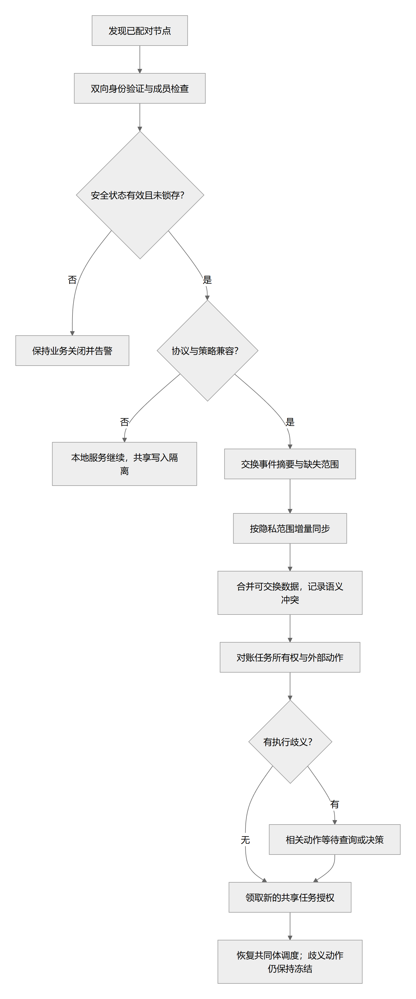
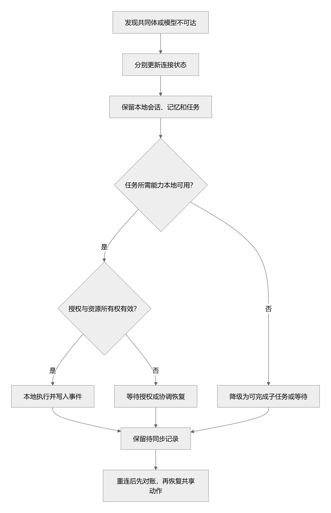

# 离线自治、多设备共同体与重连

> 状态：总体 proposed；0.1.85 已实现双节点共享卡、本机模型用途与可失效引用，未实现全记忆共同体 · 更新：2026-10-20
> [文档入口](README.md) · [维护规则](MAINTENANCE.md) · [架构图册](architecture-atlas.md)

<!-- book-nav:start -->
[全书目录](README.md#book-tree) › [第三篇 · 智能运行与多设备协同](README.md#part-runtime) › 第 13 章 · 离线自治、多设备共同体与重连

## 本章导航

- [13.1 离线自治与联网共同体](#offline-federation)
  - [13.1.1 节点分级](#offline-federation-1)
  - [13.1.2 三个相互独立的平面](#offline-federation-2)
  - [13.1.3 网络状态不能只用“在线/离线”](#offline-federation-3)
  - [13.1.4 “一个贾维斯”的工程身份](#offline-federation-4)
  - [13.1.5 任务和设备控制权](#offline-federation-5)
  - [13.1.6 共同体初期与后期](#offline-federation-6)
  - [13.1.7 重连流程](#offline-federation-7)
- [13.2 记忆复制与开源同步取舍（proposed）](#memory-replication)
  - [13.2.1 统一意志的工程含义与离线边界](#unified-intent-memory)
  - [13.2.2 同步方式取舍](#memory-sync-options)
  - [13.2.3 复制顺序与收敛条件](#section-f7d85c1ef91d)
  - [13.2.4 哪些内容可以合并，哪些不能](#section-6f50d96f4bfc)
- [13.3 单机离线继续工作](#end-to-end-flows-2)
- [13.4 双节点共享资料卡（0.1.85）](#shared-cards-runtime)
  - [13.4.1 运行结构与选择](#shared-cards-components)
  - [13.4.2 一次完整使用流程](#shared-cards-flow)
  - [13.4.3 导出、归档与容量维护](#shared-cards-lifecycle)
  - [13.4.4 版本异常后的受控资料恢复](#shared-cards-recovery)
  - [13.4.5 旧版副本与当前引用的关系](#shared-card-copies)
  - [13.4.6 本机模型用途授权](#shared-model-use)
  - [13.4.7 会话引用、重新核验与派生历史](#shared-live-references)
  - [13.4.8 限制与恢复边界](#shared-cards-boundaries)
<!-- book-nav:end -->

## 离线自治与联网共同体

### 节点分级

| 类型 | 组成 | 离线能力 | 典型设备 |
|---|---|---|---|
| 完整节点 | 本地模型、记忆、任务、工具、恢复服务 | 在已安装能力范围内完整自治 | 工作站、家中 PC、服务器 |
| 轻量节点 | 交互、少量本地模型或规则、缓存任务 | 基础交互与有限本地技能，复杂工作等待 | 部分笔记本、手机、平板 |
| 感知/执行节点 | 传感器或执行器、设备身份、确定性控制 | 预设设备行为与本地保护 | 智能设备、微控制器、机器人底层 |
| 协调节点 | 完整节点加共同体控制服务 | 本地自治；维护可达成员的协调 | 稳定在线家庭主机 |

同一节点可兼任多个角色。手机系统后台约束需要实机验证，不把移动端默认当作全天在线投票节点。[S22](references.md#s22)[S23](references.md#s23)

完整节点也可以是装有合适能力包的普通 PC，不以工作站或服务器配置为门槛。首个共同体先连接两台各自可运行的设备，复用本地账本与应用层同步；协调职责可由其中一台承担，无需另建集群平台。单机部署与组件选择遵守[普通 PC 优先规则](stack-project-layout.md#technology-selection-4)，不因节点数量增加自动改变默认安装要求。

### 三个相互独立的平面

1. **本地自治平面：**当前节点的交互、推理、记忆、任务、设备控制和恢复。
2. **记忆同步平面：**按分享范围同步事件、资料、偏好和产物，处理可合并内容与冲突。
3. **行动协调平面：**分配共享任务所有权、资源代际和全局预算，确定共同体控制指令顺序。

网络分区时，本地自治和可合并信息继续工作；需要全局独占的操作按既有授权或等待规则处理。这个选择来自分区期间强一致性与可用性的约束。[S03](references.md#s03)

### 网络状态不能只用“在线/离线”

| 状态 | 行为 |
|---|---|
| 本机完全离线 | 本机任务运行；记录待同步事件 |
| 局域网共同体可达，互联网不可达 | 共享局域网算力和信息；云端模型回退 |
| 互联网可达，共同体不可达 | 可在策略允许时用云模型；不擅自接管全局任务 |
| 正常共同体 | 同步、分工、跨设备接续 |
| 重连对账中 | 本地交互继续；有歧义的全局动作等待 |
| 版本/身份不兼容 | 保留本地工作，隔离共同体写入 |
| 共同体协调者不可达 | 本地自治；需要协调的新动作排队 |

### “一个贾维斯”的工程身份

`community_id`：属于主人的共同体。
- `persona_id`：稳定的角色身份。
- `node_id`：具体设备，拥有独立密钥。
- `session_id`：一次交互会话。
- `goal_id / task_id`：跨设备持续目标与任务。
- `policy_version / persona_version`：当前获认可的规则与人格版本。

联网时合并获授权的信息并协调未来行动；离线期间各节点可能形成不同经历，必须保留来源。模型权重不因联网自动融合，向量也不应跨不同嵌入模型直接混合。

### 任务和设备控制权

每项任务有一个负责人，子任务独立登记。每个物理资源有一个执行网关，本机桌面、串口和机械动作由该网关互斥控制。

所有权转移由唯一协调权威或共识域生成更高的 `owner_epoch`，持有者不能自行递增来抢占。执行端持久记录有效代际，拒绝旧代际请求。只有心跳超时不够：暂停后的旧进程可能恢复执行，因此接收方也必须检查授权。[S05](references.md#s05)

无法验证代际或幂等性的外部 API、GUI 操作，不能仅因节点掉线就自动由另一节点重做。动作已发出却没收到结果时，进入 `UNKNOWN`，优先对账。

### 共同体初期与后期

初期指定一台稳定主机为协调者。协调者离线时，各节点自治；全局独占任务等待，不宣称自动高可用。
- 后期确有需求时，使用成熟共识实现构成三个独立稳定节点的控制集群，仅管理小规模关键元数据。
- 手机与经常休眠的笔记本作为客户端；不要求所有节点参加 Raft。
- 三个进程放在同一物理机器上不能提供主机容灾。多数派失效时停止新的强一致提交。[S04](references.md#s04)

### 重连流程

[矢量图](diagrams/federation-reconnect.svg) · [可编辑图源](diagrams/federation-reconnect.mmd)

离线节点不能即时获知撤权；权限需有范围、有效期与断网规则。授权期限不能因休眠、重启、时钟回拨或业务回滚续期，使用可信时间或可持久验证的期限依据；普通进程内单调时钟不足以独立解决跨重启问题。期限无法验证时冻结依赖该授权的业务。预算可预先分配为不重叠的节点额度，不能每个离线节点都使用同一个“全局剩余金额”。

## 记忆复制与开源同步取舍（proposed）

完整节点各自持有本地数据库和需要离线使用的原件；联网合并获授权的变更，索引可按各自模型重建。共享身份和共同经历是产品语义，不是把多份模型权重融成一个意识的技术证明。大规模资料允许选择性复制，界面必须显示尚未下载、权限不足、索引落后或仅本地结果。

### 统一意志的工程含义与离线边界

统一的是主人身份与目标引用、受控人格核心版本、可追溯经历以及任务所有权；不同设备可以拥有不同模型、索引和资料子集。同一个助手的连续体验不要求每台设备每次对话读到全部原文，也不要求每个 Agent 持有一份独立知识库。共享与隔离的内容语义见[记忆作用域](knowledge-learning.md#memory-scope-model)。

个人/项目/共用资料同步时携带主体、用途限制和依赖；同步许可不等于允许该设备的云模型、通知或朗读公开内容。画像、Wiki 和已装配上下文不是脱离原依赖的独立真相：接收节点按当前策略、撤销水位和本地可用资料重建视图，缺源或未同步部分明确说明。具体类别和共享晋升只在[分类规则](knowledge-learning.md#memory-domain-catalog)及[用途边界](knowledge-learning.md#memory-use-boundary)维护。

| 平面 | 需要的一致性 | 分区时怎样工作 |
|---|---|---|
| 经历、知识与资料目录 | 在授权副本间最终收敛，冲突有来源 | 本地追加和查询，显示已知水位；全局回答标出不可达范围 |
| 人格核心与分享配置 | 可识别的版本/签署者；普通事实不能更改 | 使用已确认版本；本机临时表达覆盖或待同步提案不冒充全局生效 |
| 现实任务与独占动作 | 明确任务所有者和执行代次，不能靠合并文本决定 | 只有本机可确认的有效所有权才执行；跨设备独占事项不能确定时等待 |
| 模型、向量与缓存 | 无需逐字节全局一致 | 节点按资源构建，保留同一源资料版本与可解释检索范围 |

首次先让两台设备在一个指定协调节点下交换获准事件，协调服务可与主 PC 同机，空闲时等待事件；不增加 Redis/Kafka/K8s。离线笔记本继续本机任务，协调节点不可用只暂停需要全局协调的部分。未来只有实际需要自动容错、且有稳定在线成员时才评估共识组；不能把临时联网的手机和笔记本组成必须在线的投票集群。

重连是同步和对账，不是用另一台的数据库整包覆盖自己。任务交接带任务 ID、检查点、产物和所有权版本；接收了“任务完成”的记忆不代表可以再执行一次。分享原文、共享目录与允许云模型处理是三个独立选择；跨节点查询和模型服务必须保留原资料标签。链路、设备身份与访问实现仍属后续阶段，当前个人使用原型没有因此获得集群认证或同步能力。

### 同步方式取舍

| 方式 | 适用性 | 当前选择 |
|---|---|---|
| 本地 SQLite + 应用事件复制 | 事实修订、来源、作用域、撤销可沿用 Jarvis 契约；需要自己实现并验证缺失检测与冲突处理 | **首期协议方向。** 复用成熟传输/加密库，只维护小而明确的领域协议；不从零设计密码或通用数据库 |
| Automerge CRDT [S99](references.md#s99) | 离线并发编辑笔记、标签等共享文档；可收敛并不表示矛盾事实被正确裁决 | 按需加入文档协作适配器；不合并授权、任务所有权或安全锁存 |
| CouchDB 复制 [S101](references.md#s101) | 已有双向文档复制与冲突分支；默认可见的 winning revision 不等于事实真相 | 若大量双向文档协作成为主需求，可比较替代本地文档存储；仍需领域冲突/遗忘协议，不仅为一个同步接口额外部署 |
| Qdrant / PostgreSQL 等稳定服务集群 | 适合持续在线服务的复制与查询；不是每台休眠设备独立修改后自动合并的完整方案 | 可作为附加检索服务，不能取代节点自治 |
| 云盘复制 DB / 网络盘共享 WAL | 无法提供所需的事务、并发修改和冲突语义；SQLite WAL 要求同主机共享内存 [S100](references.md#s100) | 禁用这种部署；离线备份采用数据库支持的一致快照流程，和实时同步区分 |

### 复制顺序与收敛条件

共同体[重连流程](#offline-federation-7)先完成停止/安全代际对账，再进入记忆平面：

1. 验证设备配对身份、协议版本、当前分享范围及其有效期。断网时无法即时得知远端撤权，沿用授权期限规则；不能承诺即时全局删除。
2. 优先应用撤权、删除墓碑和保留策略变化；新资料在本地必要的安全/删除水位到齐前不进入可查询视图。
3. 交换各发送节点的连续提交游标与缺失区间，补齐获授权事件。事件身份采用节点 ID、节点实例代次和单调序号；恢复旧快照或克隆设备不得复用旧发送序列。
4. inbox 去重与事实应用在本地事务内提交后才确认。乱序事件暂存，缺少因果前驱则请求补传，不能仅凭最大时间戳跳过缺口。
5. 按作用域获取缺少的原件，验证摘要后建立视图；派生索引异步跟上。摘要、向量和图关系也继承原资料的分享/删除范围，不能绕过隐私边界。
6. 显示本地提交、共同体已知提交、检索索引三个水位，保持对话可用；冲突或不可达资料明确标注。持续可达、版本兼容、消息最终送达的授权副本才有最终收敛承诺。

### 哪些内容可以合并，哪些不能

追加经历按唯一事件 ID 去重；并发事实保留各自证据、时间范围与分支，禁止用“最后写入”静默覆盖主人信息。明确且有因果关系的纠正替代其指定旧事实；不相关的并发纠正不能靠设备时钟大小决定胜负。查询只有在冲突影响当前答案或行动时才提出必要澄清，其余可保留并显示不确定性。

人格核心与授权配置采用有签署者的版本，离线改动是提案或明确的本机覆盖，不通过普通事实合并改变全局授权。产物/二进制按内容摘要和版本获取，不能合并时保留分支；索引从合并后的获准资料重建。

例如，电脑记录“以后称呼我 Sam”，手机离线记录“今天在游戏里叫我船长”，作用域和有效时间不同，两者可共存；两台设备都记录相互矛盾的长期称呼且缺少因果关系时，保留冲突，不能让重连顺序决定主人偏好。NPC 的世界记忆始终在模拟域，不能覆盖现实身份。

遗忘通过稳定对象 ID 和墓碑阻止旧节点重传造成复活；日志不能以“追加不可变”为理由永久保留已要求删除的正文。墓碑只保留防复活所必需的最小元数据，正文、摘要、向量、关系、缓存与可管理备份按保留/遗忘协议清理。墓碑压缩需要所有仍支持的副本确认或退出复制代次；过期、长期离线或被撤销节点必须重新配对/取得当前快照，不能把旧全量数据无条件并回。尚未接触的离线副本不能声称已经物理擦除。

事实修订不重放现实工具动作；动作账本和独占资源仍遵循[唯一所有权](#offline-federation-5)。知识库故障回退也不能撤销已经生效的安全锁存、删除或权限撤回。接口在[记忆契约](contracts.md#memory-provider-contracts)登记，故障实验见[V-MEM 系列](delivery-validation.md#memory-selection-evaluation)。

## 单机离线继续工作

[矢量图](diagrams/offline-task-flow.svg) · [可编辑图源](diagrams/offline-task-flow.mmd)

## 双节点共享资料卡（0.1.85）

**implemented；配对同步见[0.1.83 证据](delivery-validation.md#k6-federation-evidence)，资料生命周期与聊天副本见[0.1.84 证据](delivery-validation.md#k6-shared-lifecycle-evidence)。** 这是 K6 联网共同体的首个受限数据模块。每台设备仍是完整的本机助手；只有主人在专用共享空间中新写入的资料卡才参与同步。生活计划和工作笔记都可以手工填写；聊天、个人画像、人格、个人/项目记忆、项目文件、凭据、技能及任务账本不自动复制。收到的文字不是指令，不自动注入模型上下文或提升为个人记忆；0.1.85 的聊天引用按[模型用途授权](#shared-model-use)与[可失效引用](#shared-live-references)使用，并遵守[记忆作用域](knowledge-learning.md#memory-scope-model)。

### 运行结构与选择

| 组件 | 当前职责 | 替换边界 |
|---|---|---|
| `federation.py` | 配对、空间生命周期、同步入口、本地编辑 | 只调用核心短事务守卫与网络策略，不持有工具权限 |
| `federation_identity.py` | P-256 设备密钥、证书、Windows 当前用户 DPAPI | 密钥独立于模型供应商；损坏不自动生成新身份 |
| `federation_lifecycle.py` | 导出、归档、只读恢复与副本生成 | 资料恢复不恢复连接授权；不调用模型或写入个人记忆 |
| `federation_access.py` | 本机模型用途、签名引用、路由解析与依赖检查 | 授权不复制给对端；真实模型子进程重建使用守卫 |
| `federation_store.py` | 独立 SQLite 与版本标记 | 业务记忆库不变；不复制 SQLite/WAL 文件 |
| `federation_protocol.py` | 签名、版本关系、冲突、删除与容量约束 | 协议版本明确，未来替换协议须迁移/另建空间 |
| `federation_transport.py` | 按需 HTTPS 接收端与证书指纹固定的客户端 | 不复用或暴露本机工作台 HTTP 接口 |
| `apps/web/federation.js`、`shared-access.js`、`shared-reference.js` | 设置页生命周期与聊天资料选择 | 交互权威见[设备与共享](interaction-persona.md#shared-cards-ui) |

复用 Python 标准库、SQLite 和已有 cryptography；没有新数据库服务器、集群组件、模型下载或后台定时同步。只在主人打开监听后占用一个接收线程，最多两个请求工作线程；密钥初始化和建空间均为显式操作。真实消耗以[实测及限制](delivery-validation.md#k6-federation-evidence)为准。

### 一次完整使用流程

1. 两端分别启用设备身份。共享端填写本机局域网 IPv4 和端口，显式打开监听，创建有名称的共享空间。
2. 加入端粘贴一次性配对码，先固定共享端证书指纹，再发送配对证明。配对码有效期 10 分钟，绑定原宿主实例；共享端重启使未确认的邀请失效，不依赖回拨系统时钟续期。丢失回执时保留原请求编号，点击“重试原配对”，不会把同一码交给第二个身份。
3. 双方在这个空间编辑各自资料卡。离线或对方退出不妨碍本地编辑；保存按钮仅保存本机。
4. 加入端点击“立即双向同步”，一次请求先提交本端快照，共享端原子合并后返回自身快照。签名和空间身份检查失败不写入本次变更；重复请求只做对账，不执行任何外部动作。两端的“最近同步”各指本端最近完成的合并，不是另一端已经收到本轮回复的证明。
5. 资料已顺序更新则保留新版本；并发修改保留两份，页面展示冲突。主人编辑合并后生成支配两份旧版本的新修订。旧页面带修订摘要保存时若已经过期，保留草稿并拒绝覆盖。
6. 删除产生永久绑定卡 ID 的最小删除记录。它优先于并发编辑；旧副本不能恢复原 ID。正文从本模块当前状态中去除，只保留摘要与删除元数据；不能承诺擦除系统备份、磁盘历史、已复制文本或离线对端副本。
7. 撤销空间使本端拒绝后续同步，本地内容保留。软件离线开关关闭接收监听；恢复联网和宿主重启均不自动打开监听或重放同步。

### 导出、归档与容量维护

`导出资料副本` 生成带本机签名的明文 JSON，保留空间、成员公开证书、当前卡修订、冲突版本和删除记录；不含设备私钥、配对令牌、远端地址或连接权限。文件由主人下载保管，不是整机备份；当前不支持从任意外部 JSON 重新入群。

归档先只读预览，确认时核对整个空间摘要；资料变化则拒绝旧预览。先写入并校验独立归档文件，再移除在线记录、撤销该空间的同步准入，释放在线名额。归档目录保留原空间 ID，不能用旧配对码重新加入。事务中断留下的未登记文件计入物理配额；内容一致时可复用，不覆盖或自动删除异文。

恢复归档只把资料重新打开为**本机只读空间**，保留卡来源、冲突与删除记录，旧连接仍撤销；再次归档复用原件。需要继续共同编辑时另建空间并重新配对，再明确选择需要转录的内容；当前没有自动跨空间迁移。已经发出的资料副本不因归档而消失。

### 版本异常后的受控资料恢复

每次写入先持久化独立 DPAPI 版本标记，再提交数据库。单独恢复旧数据库或提交期间崩溃造成标记不一致时，停止本模块正常读取/修改/同步，设置页进入检查状态；普通聊天不依赖该模块。关闭共享监听并等待在途连接结束后，可以预览可验证的恢复范围。

恢复只接受当前支持结构、仍可读取且与本机身份匹配的数据库：逐卡核验签名，同时检查登记的归档；任意无效内容使整次恢复拒绝，不能偷偷丢弃坏卡。确认重新核对数据库、版本号和独立标记的摘要，先把原 SQLite、原标记及恢复清单保存在独立目录，再推进到新版本，将所有可恢复空间设为只读且撤销连接。原恢复材料不覆盖、不自动清理。途中再次中断仍停止同步，须重新检查。

这是**内容挽救**，不是恢复旧授权或证明内容最新。旧备份中缺失的新修改、不可读数据库、丢失的设备身份不能凭空恢复；全目录连同身份一起克隆/回滚、同一 OS 用户篡改，仍没有硬件单调锚或完整检测保证。不得据此宣传不可克隆身份或无损自动自愈。

### 旧版副本与当前引用的关系

0.1.84 的资料选择器生成文字附件副本；副本一旦选取或发出，原卡变化不能撤回它。其验证记录保留为历史范围。0.1.85 起选择器改用下节受控引用；旧 `reference` HTTP 动作拒绝并要求刷新。已经导出、手工复制、下载或发送的文本仍不能追溯控制，不以“撤销”承诺抹除供应商、另一设备或系统备份中的数据。

### 本机模型用途授权

**配对同步与模型使用是两层权限。** 配对仍允许两个身份同步该空间全部资料卡；本节只决定当前这台设备可以将哪些卡用于模型聊天，不实现对端逐卡接收许可。每个空间独立维护一个本机策略：明确卡 ID、允许的模型接入方、个人聊天或一个已登记项目。新空间默认不给任何模型使用；同一卡改用于另一用途时需重新审阅修改策略，目前没有多策略叠加。

接入方许可绑定实际适配器、地址、区域和凭据版本摘要，不绑定明文密钥，不因模型显示名相同而跨供应商放行；在同一接入配置内切换模型可继续使用。保存或全部撤销都会推进授权修订，使旧引用失效。并发保存核对原修订，旧页面不能覆盖新授权。策略只保存在本机共享库，不进入对端快照或资料导出；只读恢复和异常恢复不恢复模型许可。

授权设置和引用核验均为本机确定性操作，不调用 LLM，也不新增周期检查或常驻模型。沿用 SQLite、已有签名组件和原模型执行器；没有新增数据库服务或集群环境。每次使用最多核验 8 个引用，普通无引用聊天不读取共享库。

### 会话引用、重新核验与派生历史

1. 主人选择卡时签发短期引用：绑定本机身份、空间、卡 ID、当前内容摘要、授权修订、会话 ID、项目 ID 和到期时间。引用有效期最多 24 小时，不把正文复制进浏览器附件草稿；附件和当前引用合计最多 8 项。
2. 每次模型路由在本机解析正文，核验空间仍可用、卡未更新/删除/冲突、用途匹配、签名和时效有效、接入方仍获准。明确选择的当前引用失效时拒绝整次发送，不悄悄丢掉资料继续回答。自动路由可跳过未授权接入方，仅检查原配置中的后备；不会增加新供应商或扩大许可。
3. 在真正模型子进程内重建核验守卫。使用与授权写入共用的短准入锁，锁外才进行网络 I/O；派发前、网关检查点及结果返回时再次检查。在途撤销后停止交付正文，保留费用/已派发/不确定结果记录。检查点之间已发送的数据无法撤回，也不能保证远端停止计算。
4. 回答携带所依赖引用；同页追问按完整问答轮次检查这些引用。失效或不允许给当前供应商的历史轮次被排除，并提示裁剪；连续派生回答继续携带依赖。全部保留历史与当前引用的不同依赖最多 8 个，超额优先舍弃较旧轮次。
5. 共享及其派生问答仍可在会话中阅读，但持久化标记为上下文省略，排除个人候选/接续来源。刷新、重开或断线取回的回答不自动恢复为模型历史，需重新选择资料。可见答案不等于主人的个人事实。手工把文本重新粘贴或作为文件输入属于新的明确输入，不承诺识别所有语义转述。

本机撤销只约束本机后续使用；离线副本无法得知另一端尚未同步的编辑、删除或撤销。同步到新版本后，旧引用拒绝使用。两端各自授予的模型用途彼此独立；不能把这一子集称为跨设备即时撤回、全记忆授权或共同体统一意识。[本轮验证与限制](delivery-validation.md#k6-shared-access-evidence)单列。

### 限制与恢复边界

当前每空间只连接两个身份，最多 8 个在线空间（包括未归档的已撤销/只读空间），每空间最多 32 张卡（包括删除记录）、4096 个修订摘要，正文最多 4000 UTF-8 字节。独立归档最多 32 个、目录合计 16 MiB、单文件 512 KiB；异常恢复原件最多 8 组、合计 64 MiB。达到容量时拒绝新增，不静默删资料；归档释放在线名额，但不代表无限增长。这里使用有界**全状态快照**，并非上文设计的连续事件游标协议，不宣称已经具备缺口补传、全记忆域复制或大规模同步能力。

默认不监听、不开放防火墙、不发现设备；仅接受明确的 IPv4 回环/RFC1918 地址，拒绝公网、DNS 名称、重定向和任意 URL 路径。地址变化需重新配对新空间；没有自动漫游、IPv6、互联网中继或 NAT 穿透。原工作台继续绑定回环。首次配对码只能通过主人选择的可信途径交给目标设备；已有副本无法靠撤销即时远程抹除。资料分享是持久的可撤销空间关系，不是远端任务租约，不赋予设备接管或动作执行权。

后续先补第二台真实设备的网络/休眠证据，再按实际需求扩展对端接收许可和记忆域同步；本机模型用途与可失效引用已实现，不再列为待办。任务唯一所有权和共同体协调属于另一个控制平面，继续按[总体设计](#offline-federation)独立实现。

<!-- book-footer:start -->
[返回全书目录](README.md#book-tree) · [上一章：任务、动作、多 Agent 与资源调度](tasks-agents.md) · [下一章：自主进化、外部编码协作与版本发布](evolution-release.md)
<!-- book-footer:end -->
