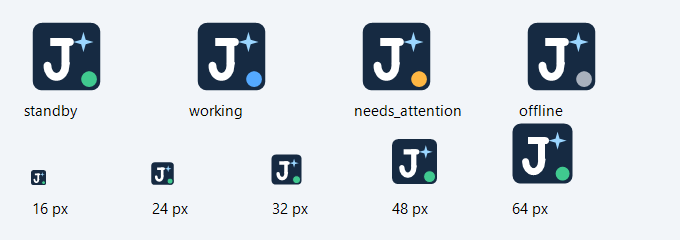

# 桌面工作台、实时交流与人格形态

> 状态：完整交互 proposed；个人助手生命周期 accepted，现有会话停止/待命等子集 implemented / verified · 更新：2026-10-16  
> [文档入口](README.md) · [维护规则](MAINTENANCE.md) · [架构图册](architecture-atlas.md)

<!-- book-nav:start -->
[全书目录](README.md#book-tree) › [第一篇 · 产品与体验](README.md#part-product) › 第 02 章 · 桌面工作台、实时交流与人格形态

## 本章导航

- [2.1 桌面工作台：先完善通用体验，再承载 Jarvis 能力](#desktop-workbench)
  - [2.1.1 私人助手的常驻、待命与会话停止](#personal-assistant-lifecycle)
  - [2.1.2 Codex 参考基线与证据边界](#codex-reference-baseline)
  - [2.1.3 布局、页面与视觉尺度](#workbench-layout)
  - [2.1.4 新会话、打开文件夹与项目连续性](#workspace-folder-flow)
    - [2.1.4.1 项目根目录与默认输出位置](#project-root-output)
  - [2.1.5 输入区：每个入口做什么](#composer-design)
  - [2.1.6 侧栏、搜索、会话与工作面板](#workspace-panels)
  - [2.1.7 Jarvis 专属体验与功能入口](#jarvis-distinctive-controls)
  - [2.1.8 设置中心与配置生效规则](#workbench-settings)
    - [2.1.8.1 页面配色（0.1.20）](#workbench-appearance)
  - [2.1.9 模型与费用后台布局（0.1.19）](#model-admin-experience)
  - [2.1.10 Jarvis 图标与品牌使用规范](#jarvis-brand-icon)
- [2.2 当前语音验证与主人识别](#speech-prototype)
- [2.3 实时交互](#interaction-tasks)
  - [2.3.1 五条执行通道](#interaction-tasks-1)
  - [2.3.2 语音链路](#interaction-tasks-2)
- [2.4 人格、性别表达与具身形态的开放扩展](#persona-embodiment)
  - [2.4.1 人格是可组合的能力配置](#persona-embodiment-1)
  - [2.4.2 切换与连续性](#persona-embodiment-2)
  - [2.4.3 虚拟机器人与实体机器人分开](#persona-embodiment-3)
  - [2.4.4 配置与接口](#persona-embodiment-4)
<!-- book-nav:end -->

<a id="desktop-workbench"></a>
## 桌面工作台：先完善通用体验，再承载 Jarvis 能力

**新会话应当可以像 Codex 一样选择并打开本机文件夹，也可以先不选项目直接聊天。** 以用户提供的 Windows Codex 截图为布局参考，在现有网页上完善项目侧栏、中央会话、底部输入区和可展开工作面板。通用工作体验稳定后，再逐项接入 Jarvis 的长期记忆、离线自治、共同体和进化控制；阶段归属统一见[界面实施映射](core-bootstrap.md#workbench-stage-map)。

本节是 **2026-10-15 的 proposed 产品设计**，不是已交付桌面软件。现有 0.1.20 网页已提供聊天及单次停止、模型/推理选择、目录与限定浏览器共用队列，以及[项目文件夹与文本保存子集](core-bootstrap.md#project-workspace-entry)；项目登记持久化，会话历史仍在页面内存。下述个人助手生命周期按 2026-10-16 用户要求 accepted；已增加[模型与费用后台](#model-admin-experience)与[页面配色](#workbench-appearance)；多标签文件工作台、实时语音与完整设置尚未实现。当前使用和运行证据分别见[原型入口](core-bootstrap.md#section-b3e262fa3ec1)与[分版本验收](delivery-validation.md#versioned-evidence)。

<a id="personal-assistant-lifecycle"></a>
### 私人助手的常驻、待命与会话停止

**当前私人电脑使用约定：助手开启后持续可用，没有工作时显示“待命中”；输入区的停止只结束当前会话的本次回复。** 这是 2026-10-16 用户明确修订的产品规则，优先于早期全局停止和恢复认证设计。

- 发送后，发送箭头变为方形“停止生成”；当前回复结束或被停止后恢复发送箭头，可以继续输入。停止不关闭助手，不清空其他会话，也不取消独立后台任务。
- 本页回复时显示“回复中”；其他会话或后台任务仍在执行时显示“运行中”；没有活动时显示“待命中”。连接失败明确显示异常，不能假装待命。
- 任务中心的“取消任务”只针对选中的任务；暂停队列只暂停后续派发。不提供全局停止锁存操作；托盘的“退出 Jarvis”是用户明确关闭当前应用，不把会话取消变成退出或锁存。
- 当前使用不设置恢复密钥、密码、公钥登记或解锁认证。旧版留下的停止数据仅提供[一次性本机兼容迁移](core-bootstrap.md#runtime-control)，不成为日常使用步骤。
- 用户明确退出助手时才结束其运行。关闭网页页签只关闭界面，后台服务继续存在；0.1.18 的 Windows 托盘新增明确退出入口，只结束其绑定的助手实例。有活动时先提示，退出后不再派发并取消当前本机活动；尚未确认的外部效果保留既有 UNKNOWN 语义，不保证已经被远端接纳的模型调用或计费撤回。

托盘的图标、悬浮文字与右键菜单共同表达状态：绿色徽标“待命中”、蓝色“运行中”、黄色“需要处理”、灰色“正在连接/连接中断”。每轮完成后约 2 秒发起下一次本机状态检查，请求超时 1.5 秒；只接受启动时绑定的实例标识。连接失败或端口被另一实例接管时不显示待命，恢复后更新。助手异常退出时托盘留下断连提示，可明确关闭图标；正常退出后移除图标。双击和“打开 Jarvis”使用默认浏览器；不另建第二套工作台。启动方式见[托盘入口](core-bootstrap.md#windows-tray-entry)，验证见[本轮证据](delivery-validation.md#tray-evidence)。

待命意味着服务进程仍可接受请求，不意味着一直调用模型、计费或自行创建任务。本轮不安装开机启动、守护服务或定时任务，也不承诺关机、休眠或进程崩溃期间仍在线。生命周期与两会话取消隔离的实现证据见[0.1.14 验证](delivery-validation.md#personal-lifecycle-evidence)。

<a id="codex-reference-baseline"></a>
### Codex 参考基线与证据边界

截图可直接观察到：Windows 菜单和返回/前进、最左侧全局入口、项目及聊天列表、中央新会话欢迎语、输入区上方的项目/电脑选择，以及输入区中的加号、访问范围、模型/推理、麦克风和发送。截图未展开的菜单内容不能靠图标猜测。下表补充已阅读的官方资料；具体功能会随平台、版本、账户和插件变化，不把官网列表当作截图所在安装的完整实测。

| 参考面 | 官方资料确认的能力 | Jarvis 的采用方式 |
|---|---|---|
| 项目与会话 | 本地项目可挂载文件夹、设主目录；支持无项目聊天、固定、重命名、搜索和归档 [S119](references.md#s119) | 完整支持普通资料目录与代码目录；项目、会话、任务分开显示 |
| 新会话与工作位置 | 新会话使用项目主目录；Git 工作树支持独立开发和交接 [S119](references.md#s119)、[S120](references.md#s120) | 首先完成本机目录；已有 Git 才提供工作树，非 Git 文件夹正常可用 |
| 输入与命令 | `/` 命令、技能入口、模型与项目选择、发送键及跟进方式设置 [S122](references.md#s122)—[S124](references.md#s124) | 同一输入框完成目标描述、上下文、模型和执行范围选择；完整交互见下文 |
| 文件与预览 | 文档、表格、幻灯片、PDF、HTML 与 LaTeX 的相应预览/修订入口 [S125](references.md#s125) | 先文本、图片和 Markdown，其他格式按已安装查看器逐项加入 |
| 浏览器与工作布局 | 内置浏览器、会话/标签分屏、全屏、网页批注；浏览器配置与普通浏览器分开 [S127](references.md#s127) | 区分“看网页”和“执行网页任务”，保留来源、任务状态与结果 |
| 研发检查 | 文件搜索、文件树、终端入口；PR 描述、改动、检查及评审 [S123](references.md#s123)、[S126](references.md#s126) | 文件差异和验证结果先可见；终端、Git 写入、外部发布按实际能力接入 |
| 扩展与长期工作 | 功能目录包括插件、计划任务、长任务、语音、图像和 dots；设置包含记忆、主题、通知及快捷键 [S121](references.md#s121)、[S122](references.md#s122) | 借鉴发现与配置方式；不能据此声称“记忆/语音/Agent 是 Codex 没有的” |

“类 Codex”指学习已经清楚的工作组织和交互结构，并采用 Jarvis 自己的品牌与后端。Jarvis 的差异是下文所列的系统约束与组合体验；已读资料没有说明的 Codex 能力标为“未确认”，不推断其不存在。不会把桌面产品内部实现当作可直接复用的公开源码。

<a id="workbench-layout"></a>
### 布局、页面与视觉尺度

默认是安静的浅色工作台，延续现有深蓝 J 标识；新会话保留充足留白，开始工作后再按内容展开面板。以下尺度是 Jarvis 的设计值，不是对截图的像素测量。

| 区域及相对位置 | 常驻内容 | 展开后的内容与行为 |
|---|---|---|
| 顶部窗口/菜单条 | 返回、前进、文件、编辑、视图、帮助；桌面壳提供系统窗口按钮 | 文件含打开文件夹/文件与最近项目；编辑含撤销、复制、查找；视图控制侧栏、工作面板、缩放和主题；帮助显示快捷键、版本及诊断 |
| 最左全局栏，56px | Jarvis 图标、工作台、任务、记忆、设备；底部设置 | 进化、人格与世界等入口放入更多；可固定常用入口；未实现能力显示状态说明 |
| 项目侧栏，默认 260px，可调 220—360px | 新会话、打开文件夹、搜索、固定项、最近会话、项目树 | 项目下展开会话；运行、等待、需处理、未读用图形加文字提示；侧栏可折叠 |
| 中央上方，约 56px | 会话标题、项目名、当前工作位置、任务活动、工作面板开关 | 路径可复制；远端同时显示设备名；改名、归档、导出在会话菜单中 |
| 中央会话区 | 新会话问候“今天想让 Jarvis 帮你完成什么？”；选项目后改为项目问候 | 消息、执行摘要、来源和产物链接；长日志默认折叠；不会用欢迎页卡片挤占输入空间 |
| 中央底部输入区，最大宽度 880px | 上下文条、正文、附件条、工具栏、状态提示 | 与会话同一轴线；正文随输入增高到约 240px 后内滚动；不遮住最后一条消息 |
| 右侧工作面板，默认关闭 | 打开时为文件/预览/差异/浏览器/任务详情标签 | 默认约可用宽度的 40%，可拖动或全屏；切换会话按会话保存标签与滚动位置 |
| 底部辅助面板，默认关闭 | 日志、执行输出；具备能力后显示终端 | 会话仍可输入；关闭面板只隐藏视图，任务生命周期见任务章 |
| 全局状态区 | 服务连接、离线/联网、需处理提示、停止入口 | 断联展示最后更新时间；不能把最后一次正常状态继续显示为实时健康 |

在 1440px 桌面上优先显示侧栏和会话；打开右面板时收窄或折叠侧栏。在 1024px 下优先保留会话和一个工作面板；低于 900px 时面板以标签切换，低于 700px 时两侧使用抽屉。390px 窄屏与 200% 缩放仍能输入、提交、查看结果和停止，不能靠横向滚动找发送按钮。

基础色沿用现有 `#16283B` 深蓝、`#315E91` 强调色、`#F3F5F7` 侧栏、`#FFFFFF` 内容面；正文建议 14—16px，Segoe UI / Microsoft YaHei，代码用系统等宽字体；4/8px 间距体系，菜单圆角 8—12px，输入框 16—18px。深色主题单独配置可读文本和边界；警告/错误不只靠颜色。按钮点击区域以不小于 32px 为桌面目标，触屏重要按钮以 44px 为目标，焦点始终可见。图标规范见[Jarvis 标识](#jarvis-brand-icon)。

<a id="workspace-folder-flow"></a>
### 新会话、打开文件夹与项目连续性

**“项目”组织资料和会话，“会话”保存一次交流，“任务”记录被接纳的工作，“工作目录”指定文件操作位置。** 一个项目可以有多个会话，一个会话可以引用多个任务；切换页面不等于取消任务。文件夹中的文本是上下文材料，其指令可信范围由[授权规则](security-sovereignty.md#identity-authorization)约束。

1. 从“新会话”、`Ctrl+N` 或项目菜单“在此新建会话”进入。全局新会话允许选择“无项目”；项目内新会话预选该项目并明确显示目录和电脑，不悄悄继承上一个无关项目。
2. 点击“打开文件夹”或 `Ctrl+O`。桌面版调用系统目录选择器；网页原型通过本机适配器选目录或输入绝对路径并由服务端校验。普通附件上传只提供文件副本，不冒充已获得原文件夹的持续读写能力；浏览器不支持的选择方式应说明替代入口。
3. 将打开的文件夹登记为该项目的根目录，同时作为默认工作目录和默认产物位置，具体规则见[项目根目录与输出位置](#project-root-output)。展示项目名称、规范化后的根路径、所在设备、是否 Git、现有访问策略和可用能力。选择目录本身不运行脚本、不安装依赖、不递归上传内容，也不自动初始化 Git。现有有效授权覆盖时直接复用，仅缺少实际范围时才申请补充。
4. 用户发送第一条消息时创建会话；“临时 / 保存到本机”状态一直可见，默认采用[首期会话规则](knowledge-learning.md#initial-runtime-memory)的临时模式。选择保存后才持久化会话及草稿；保存失败保留草稿并明确显示，不能显示“已保存”。
5. 挂载根目录先显示文件树和可检索状态；用户选中文件、`@` 引用或任务需要时按范围读取。新增附属目录单独展示，不自动改变项目根目录或默认产物位置；目录引用、文本片段和外发范围都能在上下文面板查看。
6. 重新打开已保存项目恢复会话记录、面板位置与任务关联；实时任务从账本读取。不会因为重开会话再次执行历史消息，归档不会停止或删除关联任务。

| 特殊情况 | 用户可见结果 |
|---|---|
| 无项目聊天 | 可聊天和附单次文件；需要保存产物时明确选择目的地，不默认写入整个用户目录 |
| 非 Git 文件夹 | 项目与文件检索正常工作；工作树/分支按钮不可用并解释原因 |
| 根目录改名、磁盘拔出或远端离线 | 显示“路径不可用”或“设备离线”，保留草稿与历史，提供重新定位；不会自动改到另一个同名目录 |
| 重复挂载、大小写和连接路径 | 本机适配器规范化并展示真实目标；符号链接/目录联接越界不扩大授权；完整安全语义仍归安全章 |
| 切换项目或电脑时尚有草稿 | 草稿保留在原会话，新工作位置重新列出可用附件和范围；不能把旧项目引用隐式带入新项目 |
| 会话正在运行时换目录 | 提供“在该目录新建会话”；已受理任务保持原绑定，不能中途重新解释相对路径 |
| 多会话改同一文件 | 显示冲突与最新文件版本，复核差异后再写；Git 项目可选择独立工作树，不能把多会话当作天然隔离 |

桌面壳和当前网页只共用一套工作台与服务接口；是否引入 Tauri 等壳由[技术栈](stack-project-layout.md#workbench-host-choice)决定。

<a id="project-root-output"></a>
#### 项目根目录与默认输出位置

**按用户明确要求采纳（accepted）：打开哪个文件夹，就以该文件夹作为该项目的根目录；产生的文件内容没有明确指定其他位置时，默认保存在该根目录下。** 本条是已确定的产品规则；0.1.11 的项目登记和单份文本保存已实现，[验证范围](delivery-validation.md#project-workspace-evidence)不涵盖下表所有未来能力。当前输出指向由用户在输入区或保存框明确填写，尚不解析自然语言路径、项目规范或持久输出设置。

| 情况 | 位置解析规则 |
|---|---|
| 未指定位置，或只给出文件名 | 直接使用项目根目录，例如打开 `H:\ExampleProject` 后生成 `报告.md`，保存为 `H:\ExampleProject\报告.md`；不擅自改到下载、桌面、临时目录或另建 `outputs` 目录 |
| 指定项目内相对路径 | 相对项目根目录解析，例如 `docs/报告.md` 对应 `H:\ExampleProject\docs\报告.md`；按已明确的路径创建必要子目录 |
| 明确指定绝对路径或其他目的地 | 按本次要求保存；用户已明确设置的项目输出目录或适用项目规范中的明确目录也属于指向，本次更具体的要求优先；路径仍须满足既有授权 |
| 仅打开/引用某个文件或挂载附属目录 | 不改变默认输出位置；修改现有文件仍写回所指定的原文件，不能因引用附件而将新产物默认写到附件旁 |
| 明确选择工作树或另一工作位置 | 作为本次任务显式指定的位置，受理前展示其真实根路径；不把它的输出写回原项目目录，不暗中修改项目根目录登记 |
| 根目录不可写、丢失或离线 | 展示实际失败原因并保留任务/草稿，不静默改存其他位置；需要替代位置时再由用户指定 |

项目内新会话继承该根目录及明确设置的输出指向；不同项目分别保存配置。任务受理时固定本次根路径、执行设备与已解析的输出位置，工具内部切换当前目录、切换界面或引用其他资料都不能改变这次落点。输入区可查看默认位置，产物卡显示最终完整路径并支持打开所在文件夹；已有有效指向时不必逐次询问保存位置。

文档、图片、代码、表格等面向用户的最终文件遵守上述规则。生成工具若先返回临时文件，交付步骤须将其落到本次目的地并核验，再报告已保存；只存在于缓存不能冒充已经保存在项目。系统自身的凭据、模型、任务账本、日志及临时缓存仍按[运行数据结构](stack-project-layout.md#project-structure-3)管理，这些内部记录不替代用户可见交付物。

<a id="composer-design"></a>
### 输入区：每个入口做什么

输入区从上到下是**工作上下文条 → 附件与引用 → 多行正文 → 操作工具栏 → 本次状态**。上下文条始终显示项目/目录、执行电脑和临时/保存状态；选中云模型时，靠近发送处显示实际资料处理去向。“执行电脑”和“模型在哪里推理”是两个独立字段。

| 控件 | 功能与展开项 | 边界及反馈 |
|---|---|---|
| 项目/文件夹 | 无项目、最近项目、打开文件夹、管理附属目录 | 可展开复制项目根路径，查看[默认输出位置](#project-root-output)；新任务显示最终工作目录和输出指向 |
| 电脑/执行位置 | 此电脑；后续可选已配对节点或 Git 工作树 | 离线节点显示不可用；切换不会转移未提交附件或接管运行任务 |
| 附件加号 | 文件、图片、粘贴截图、已支持的资料来源、技能/插件入口 | 每项显示大小、来源、解析状态、移除按钮；失败可单项重试；文件夹走项目入口，不伪装成普通上传 |
| `@` 引用 | 本项目文件/文件夹、明确选择的会话、任务、知识来源或设备 | 类型分组搜索；插入可点开的引用片，不仅一段路径；显示读取/外发范围与内容版本 |
| `/` 命令 | 搜索可用动作；候选包括新会话、状态、任务、模型、记忆查询、帮助 | 仅列当前能力可支持项；选择后显示作用域，修改权限与恢复不通过普通文本命令绕过控制入口 |
| 多行正文 | 粘贴长文本、代码块、拖入文件、中文输入法、选区编辑 | `Enter` 默认发送，`Shift+Enter` 换行，可改 `Ctrl+Enter` 发送；中文组合输入完成键不能误发送 |
| 处理方式 | “交流”“计划”“执行” | 计划只产出步骤和材料请求；执行提交当前已准入任务；切换方式不扩展授权，也不暗中把聊天变动作 |
| 模型与推理 | 一个可搜索模型列表，提供商自动匹配；显示本地/云端、能力、可用性；仅显示支持的推理档位 | 复用[当前模型目录](models-offline.md#configured-models)，不复制供应商名单；实际调用/回退与用量在结果中可查 |
| 权限范围 | 展开目录、工具、网络、设备与有效期，标明沿用项目还是本次范围 | 默认显示“项目内已授权”等具体摘要；不以一个不透明的“完全访问”按钮代替范围，详细规则归安全章 |
| 记忆与上下文 | 查看本次引用、临时/保存、是否允许使用已授权记忆；一键移除候选引用 | 保存聊天与写入长期事实分开；显示片段来源和裁剪提示，不宣称读完全部目录 |
| 麦克风 | 后续按键录音 → 转写预览 → 编辑/发送 | 与实时语音会话为两个入口；录音指示和取消始终可见；当前未实现时禁用并说明 |
| 实时语音 | 后续进入听说界面，显示输入/输出设备、转写、静音、结束 | 不因打开设置启动录音；打断和身份语义见[语音链路](#interaction-tasks-2) |
| 发送/运行中操作 | 发送前校验正文、附件、模型和工作位置；受理后显示本次活动 | 运行中允许编写新草稿，提供“追加指导 / 下一轮发送”；作用对象和排队状态必须可见 |
| 停止生成、取消任务 | 发送按钮切换为停止当前回复；任务中心取消选定任务 | 作用域始终明确；取消显示处理中直到回执；助手继续运行或待命，详见[生命周期](#personal-assistant-lifecycle) |
| 用量与状态 | 本次耗时、处理去向、实际模型、可获取的 tokens/费用；缺失显示“未返回” | 不编造账户余额、上下文剩余量或计费数据；失败与 UNKNOWN 明确区分 |

输入状态统一为：**空白可编辑 → 附件准备/校验 → 可发送 → 提交中 → 已受理/运行中 → 完成、失败或结果未知**。同一提交重复点击不能重复接纳；提交失败恢复原文本和引用。断线后按请求标识查询已有结果，不能自动把请求当成失败重发。上下文超限先展示将缩减的内容和摘要来源；仍超限保留草稿并指出需缩短的部分。

“追加指导”交给当前任务在可接受的边界处理，显示已接收/尚未应用；“下一轮发送”进入会话消息队列，可撤回为草稿。这是会话队列的设计，不能与现有浏览器 FIFO 混用状态。完整任务执行与恢复仍由[任务章](tasks-agents.md#interaction-tasks-3)拥有。

<a id="workspace-panels"></a>
### 侧栏、搜索、会话与工作面板

侧栏按固定项、最近会话和项目组织，支持重命名、移动分组、固定、归档和恢复。归档是可恢复的列表整理；“删除会话”“移除项目关联”“删除磁盘文件”是不同操作，文案必须写清对象。全局搜索提供会话、项目、文件、任务、记忆的类型筛选；结果带项目、路径、命中片段与时间。文件搜索默认限当前已授权项目，搜不到时区分“无命中”“尚未索引”“无权限”和“设备离线”。

| 页面/面板 | 具体内容 | 核心操作 |
|---|---|---|
| 会话 | 用户消息、可折叠执行摘要、来源、模型/节点、产物、验证结论 | 复制、选区引用、编辑后新分支、从此处新会话、导出；旧消息不被静默改写 |
| 文件 | 文件树、路径/类型搜索、文本编辑、Markdown/图片预览 | 打开、搜索内容、引用选区、查看差异、保存；大文件分段，二进制不强行文本解码 |
| 差异与审阅 | 修改列表、前后对照、检查结果、对应任务/版本 | 查看问题、接受选定修改、拒绝候选；“接受”须按当前文件版本复核，不能覆盖用户后续编辑 |
| 浏览器 | 地址、来源、标签、截图/批注及相关任务入口 | 打开/刷新/返回；执行任务另显示目标、范围与状态；具体边界见[浏览器安全](security-sovereignty.md#computer-boundary) |
| 任务中心 | 运行、排队、等待用户、暂停、完成、失败与未知；项目/设备筛选 | 查看进度、预算和证据，暂停可暂停任务、继续或取消；不支持检查点的任务不能显示假暂停 |
| 产物 | 文件名、保存位置、格式、生成任务、版本和验证状态 | 预览、在文件夹中打开、引用到后续会话；生成成功与验收通过分别显示 |
| 日志/终端 | 按需显示任务输出、退出码、错误及命令工作位置 | 复制错误、定位任务；终端是实际命令入口，受能力与授权约束，不默认开放任意执行 |

普通聊天无需展开每个底层调用；活动条能展开“做了什么、在哪里做、结果与证据是什么”。不展示模型隐藏思维链作为验证证据，不用动画进度代替真实任务状态。未读数、错误数与等待操作数分开；只有新结果、失败或需处理事项触发相应通知，偏好可调整。

<a id="jarvis-distinctive-controls"></a>
### Jarvis 专属体验与功能入口

下表是 Jarvis 的差异化设计契约，不是“其他产品永远没有”的断言。每个入口显示**可用 / 未安装 / 未配置 / 规划中 / 不可达**；设置页可以展示规划说明，主操作区不提供看似可执行的假开关。

| Jarvis 入口 | 用户能看见和设置什么 | 专用语义的唯一权威 |
|---|---|---|
| 离线生存 | 本机可用模型/工具、网络状态、离线可完成事项、缺失依赖和降级原因 | [离线生存](models-offline.md#local-survival)；“断网仍可用”必须来自实际安装与验收 |
| 记忆证据台 | 本次引用的事实、原始来源、有效时间、冲突、纠正/遗忘、项目与私人域、外发设置 | [记忆设计](knowledge-learning.md#memory-selection-design)；会话记录不自动成为长期事实 |
| 多设备共同体 | 节点身份、在线状态、能力、任务所有者、同步水位与冲突；选择工作电脑 | [共同体](federation.md#offline-federation)、[记忆同步](federation.md#memory-replication)；同步会话不等于同步全部项目文件 |
| 助手与任务状态 | 当前回复、后台任务、运行中/待命中；模型失效仍可查询状态 | [个人助手生命周期](#personal-assistant-lifecycle)；高级身份与全局监督属于延期设计 |
| 进化工作室 | 改进建议、候选版本、构建、对照评估、灰度与回退证据；允许的改进范围 | [进化与发布](evolution-release.md#self-evolution)；候选成功与正式启用分开显示 |
| 人格与形态 | 表达风格、称谓、声音、关系模式、化身、版本预览与回退 | [人格配置](#persona-embodiment)；不把人格主动性当作权限开关 |
| 资源与团队 | 前台响应保留、后台队列、模型内存、团队成员职责、并发/预算及退让原因 | [资源调度](tasks-agents.md#resource-scheduling)、[Agent 工厂](tasks-agents.md#agent-factory) |
| 虚拟世界 | 世界/角色、模拟时钟、分支、世界内记忆；明显的“模拟”标识 | [NPC 世界](simulation.md#npc-world)；真实设备与模拟动作入口分开 |

<a id="workbench-settings"></a>
### 设置中心与配置生效规则

设置页采用“左侧类别＋右侧表单”，顶部搜索可以按功能名定位设置。每项注明当前值来自全局、项目还是本次会话，并能恢复到上级配置；普通偏好按“会话覆盖项目、项目覆盖全局”解析，权限按实际授权取允许范围，不接受偏好覆盖。尚未实现的表单显示设计说明，不能假保存。

| 类别 | 设置项 | 生效时机/限制 |
|---|---|---|
| 通用与会话 | 语言、发送键、默认临时/保存、启动页、关闭窗口行为、跟进消息方式 | 普通偏好保存即生效；关闭窗口明确区分隐藏界面与停止服务 |
| 外观与快捷键 | 浅/深/系统主题、字体、字号、密度、侧栏宽度、减少动画、按键重映射 | 实时预览，可重置；快捷键冲突可见 |
| 项目与文件 | 项目根目录、附属目录、产物位置（默认根目录，可明确指定）、搜索排除、文件大小/类型限制 | 遵守[输出位置规则](#project-root-output)；新请求采用新配置，已受理任务不改目录绑定 |
| 模型与用量 | 默认模型、能力与推理偏好、允许的回退、预算、本地服务状态 | 下一轮生效；凭据通过独立凭据入口，不显示在导出或聊天上下文中 |
| 输入与语音 | 附件偏好、转写语言、输入/输出设备、按键说话、播报与打断 | 录音由明确动作开启；设备断开提示并回到文字 |
| 权限与隐私 | 文件、网络、工具、设备、数据外发、有效期、查看与撤销授权 | 显示实际有效范围；规则仍归[安全章](security-sovereignty.md#identity-authorization) |
| 记忆与数据 | 可用域、记忆使用、来源保留、纠正/遗忘、会话导出、备份与迁移 | 展示处理进度及失败范围；保留/删除规则归[知识章](knowledge-learning.md#memory-data-5) |
| 任务与自动化 | 并发、队列、资源预算、通知条件；未来已创建计划的查看/暂停/删除 | 默认不创建计划；只有用户已授权的计划才登记并启用 |
| 插件与技能 | 已装/可用版本、能力声明、依赖、启用范围、卸载影响 | 安装、授权与启用分别可见；未安装不出现在可执行命令列表 |
| 设备与共同体 | 配对节点、共享范围、同步策略、冲突和断联行为 | 默认不分享本机资料；完整协议归共同体章 |
| 人格、世界与进化 | 对应配置、版本、预览、允许范围与回退入口 | 保持真实/模拟边界；变更按各领域规则生效 |
| 健康与关于 | 版本、服务/依赖诊断、日志导出、运行/待命状态、说明文档 | 模型不可用时仍有确定性入口；当前不要求恢复密钥或密码 |

建议 Jarvis 初始快捷键：`Ctrl+N` 新会话、`Ctrl+O` 打开文件夹、`Ctrl+P` 搜索文件、`Ctrl+K` 命令菜单、`Ctrl+F` 当前内容查找、`Ctrl+,` 设置。普通网页可能被浏览器截获的组合必须提供等效按钮；快捷键只在适用焦点内生效。`Esc` 默认关闭菜单/抽屉，不把退出菜单误当成全局停止。

<a id="workbench-appearance"></a>
#### 页面配色（0.1.20）

工作台与模型后台右上角提供“外观 / 页面配色”，包含浅色、深色、暖纸和跟随系统四项。默认跟随系统；深色使用黑灰背景与近白正文，蓝色操作按钮保留独立层级；暖纸使用米色背景与深棕文字。界面、输入区、菜单、对话框、表格、状态提示及费用图表采用同一套语义颜色，不能仅反转背景而保留低对比文字。

颜色唯一源码为 [theme.css](../apps/web/theme.css)，切换与持久化由 [theme.js](../apps/web/theme.js)维护。主题在首屏绘制前读取；切换只更新页面配色，不刷新页面、不触发模型请求、不修改当前会话、任务或输入内容。普通正文、辅助文字和状态色分别核对背景对比度；系统减弱动效与原有标识组件继续独立生效。

偏好存放在当前浏览器、当前站点的 localStorage，只保存主题枚举；同一站点已打开的新版本工作台和后台通过 storage 事件同步。选择跟随系统后响应系统明暗变化，手动选择优先于系统。浏览器阻止存储时仍可在本页切换，并显示“本次有效”。清除浏览器站点数据会恢复跟随系统；不同浏览器、端口及主机名之间不自动同步。此版本覆盖工作台与模型后台；品牌展示页保持自身展示风格，字体、字号及完整外观设置仍未实现。验证见[配色证据](delivery-validation.md#appearance-evidence)。

<a id="model-admin-experience"></a>
### 模型与费用后台布局（0.1.19）

这是当前已实现的设置子集，入口是工作台侧栏“模型与费用”，独立标签页 `/admin`。采用原有排版和四项导航，配色遵循[页面配色规则](#workbench-appearance)；左侧导航固定，右侧保留标题、刷新时间与主要操作。

| 页面 | 主要内容 | 操作反馈 |
|---|---|---|
| 用量总览 | 分币种费用、调用数、Token、每日柱图、统计完整度，按接入方/模型/Key 的分布表 | 无数据不填示例；图表有每日数值表；待核对量与已估算量分开 |
| 接入方与 Key | 官方/第三方卡片、实际接口、默认状态、Key 名称和尾号 | 模板新增；替换后保留旧版本；余额查询是按钮触发，不自动轮询 |
| 模型与价格 | 线路筛选、模型搜索、ID、状态、输入/输出价、附加费和核对日 | 表单设置参数与缓存单价；错误留在弹窗；保存提示后续请求生效 |
| 调用明细 | 时间、结果、线路、Key、输入/输出、费用与详情 | 与总览共用日期筛选；50 条分页导出；详情展示当时的价格快照 |

管理弹窗支持键盘焦点与关闭，错误使用可访问提示；较窄窗口改为纵向卡片和可滚动表格。用户修改普通配置不需要恢复密钥或密码；不会把凭据放进聊天历史。计费与版本规则只在[模型章](models-offline.md#model-admin-config)定义，验证见[0.1.19 证据](delivery-validation.md#model-admin-evidence)。完整外观、人格、语音和记忆设置仍为 proposed。

<a id="jarvis-brand-icon"></a>
### Jarvis 图标与品牌使用规范

**候选方向“J·北辰”：深蓝圆角方形承载白色 J，右上保留一颗浅蓝四角星。** 延续现有 J 和欢迎星形：J 表示稳定的个人主体，星表示导航和持续目标；多设备、记忆、进化能力通过界面入口表达，不把所有概念堆进小图标。该寓意是品牌表达，不是安全、忠诚或自主能力的证明。


| 使用位置 | 规范 |
|---|---|
| 桌面应用/启动入口 | 深蓝底、白 J、浅蓝星，四周保留约 12% 光学安全边距；方形比例，不裁切星角 |
| 侧栏品牌 | 图标与 Jarvis 文字并列；全局栏折叠时只显示图标并保留可访问名称 |
| 16/24px 托盘与小标签 | 0.1.18 使用简化 J＋单颗星，独立状态徽标配中文状态文字；[渲染源码](../apps/tray/TrayApplication.cs)的 DrawIcon 是小尺寸图形的唯一可编辑来源，ICO 与预览由脚本生成 |
| 欢迎页/助手头像 | 使用相同 J/星形语言，不另造第二个品牌符号；人格头像可变化，应用入口保持稳定 |
| 状态提示 | 正常、运行、断联、锁存用独立图形和文字徽标；不靠变换 logo 颜色暗示授权或安全状态 |
| 功能图标 | 文件夹、搜索、附件、麦克风、发送、停止采用统一线宽的同一图标库；都附工具提示和可访问名称，不用 logo 代替操作符号 |

上述 PNG 保留为概念稿，不替换 [现有网页](../apps/web/index.html) 的 J 和星形。0.1.18 新增实际托盘图标及 [Windows ICO](../apps/tray/assets/jarvis.ico)，包含 16/24/32/48/64/128/256px；运行图标按系统小图标尺寸生成。用 `powershell -File tools/export_tray_icons.ps1` 从同一渲染源码重建 ICO 与下方预览，不手工编辑生成文件。单色矢量、高对比模式及多显示器 DPI 切换仍待 [V-UI-14](delivery-validation.md#v-ui-14) 完整验收。



生成方式：内置图像生成工具。提示词意图为“继承 Jarvis 现有深蓝 J＋四角星，做一个扁平、简洁、可识别的个人智能系统应用图标；白 J、浅蓝引导星、透明外部背景；不使用机器人头、钢铁侠或 OpenAI 标识，不添加电路线、光效、立体阴影和额外文字”。最终英文提示词及文件摘要登记于 manifest 的 `design_assets`，本节是品牌规则的唯一权威。该资产独立于架构图册，不能作为新增架构图或运行证据。

<a id="speech-prototype"></a>
## 当前语音验证与主人识别

当前 [speech_probe.py](../tools/speech_probe.py) 仅处理显式文件：本地生成一段中文语音，转写生成音频与供应商示例，提取声纹特征并运行 VAD。输入限定 PCM16 单/双声道、8—48kHz、最多 15 秒，转为 16kHz；声纹要求一维、192 维、全为有限值且范数非零，显式传入文件的转写也必须非空才能通过。模型选型和资源参数由[本地模型页](models-offline.md#configured-models)维护。

没有自动开启麦克风，没有播放或上传个人录音，没有保存主人声纹档案。声纹向量能计算不等于能识别主人，更不代表防录音重放或合成声音攻击。当前报告固定 `owner_enrolled=false`、`voice_authentication_granted=false`。

后续按授权登记多段主人语音，再用不同距离、噪声、麦克风、非主人、重放和合成语音样本校准阈值，统计误接受与误拒绝。声纹用于“更像哪位说话人”的辅助判断；关键授权仍采用[独立身份入口](security-sovereignty.md#identity-authorization-2)。当前预置 TTS 不是朋友声线克隆，8kHz 语音也不代表最终自然对话质量。实时打断、回声消除、持续会话与人格一致性尚待实现及 M2 验收。

<a id="interaction-tasks"></a>
## 实时交互


<a id="interaction-tasks-1"></a>
### 五条执行通道

| 通道 | 工作 | 调度要求 |
|---|---|---|
| 实时交互 | 音频、轮次、打断、简短回答 | 保留 CPU/模型槽，优先级最高 |
| 正式任务 | 研究、设计、工具与项目 | 持久队列，可暂停与检查点 |
| 维护进化 | 生成代码、运行评估、候选构建 | 最低优先级，资源紧张时退让 |
| 运行恢复 | 停止、重启、切换版本、读健康状态 | 独立进程，避免依赖模型；停机锁优先 |
| 独立监督 | G0 门禁、告警、锁存和设备安全停止 | 保留资源，不接受业务调度器抢占 |

仅把四个函数写成 async 不构成资源隔离。单 GPU 被后台模型占满时，语音仍会变慢；需要保留容量、降低后台并发、使用较小模型或迁移到其他节点。

<a id="interaction-tasks-2"></a>
### 语音链路

```text
麦克风 → 降噪/回声处理 → VAD/唤醒或按键
        → 流式 ASR → 轮次判断 → 会话与意图
        → 对话模型或任务提交 → 流式 TTS → 扬声器
```

云端实时语音作为另一种可替换实现；本地文字和基础语音应保留。轮次与打断机制可参考 LiveKit，但本地单机路径不能隐含依赖云服务。[S19](references.md#s19)

“停一下”优先立即停止当前播报，再根据上下文判断暂停当前任务还是全部任务；含糊时不擅自取消所有工作。机械设备紧急停止通过设备底层入口处理。

<a id="persona-embodiment"></a>
## 人格、性别表达与具身形态的开放扩展


<a id="persona-embodiment-1"></a>
### 人格是可组合的能力配置

主人可以用自然语言定义严谨、幽默、温柔、活泼、简洁等个性，以及男性、女性、中性或自定义的性别表达，设置朋友、伴侣式伙伴、管家、教练、研究搭档等关系模式。系统将要求编译为可预览、可版本化、可回退的配置。

性别在这里指声音、称谓、形象与表达方式的模拟，不意味着系统具有人的生理性别。关系设定不能隐式扩大权限或改变 G0。

| 层次 | 内容 | 变更规则 |
|---|---|---|
| 主体身份 | 主人绑定、共同体身份、根原则引用 | 不由人格或角色工厂改写 |
| 人格表达 | 语言、语速、幽默、温柔程度、主动性 | 可按主人要求调整和版本化 |
| 性别表达 | 声音、称谓、外观和自定义呈现 | 与能力和权限独立 |
| 关系模式 | 伙伴、管家、教练、伴侣式陪伴等 | 改变交流方式，保留真实系统身份 |
| 具身形态 | 文字、语音、桌面角色、2D/3D 化身、NPC、实体机器人 | 经对应形态适配器实现 |
| 能力范围 | 工具、知识、设备、网络和行动权限 | 由独立授权与 G0 门禁控制 |

<a id="persona-embodiment-2"></a>
### 切换与连续性

1. 同一主体可以保留多个配置，也可以在不同终端使用不同表达。
2. 主人可预览若干对话和表情场景，再激活或回退；已有授权允许按情境自动选择配置。
3. 正在执行的任务、动作状态与真实记忆不随角色切换丢失。
4. 人格版本在轮次或会话边界切换，不在一句话中途更换声音或关系设定。
5. 同时存在的工作人格与陪伴人格通过独立会话处理，不能对同一设备发出冲突指令。
6. 自我改造可以优化表达，但不能擅自改变主人设定的关系边界，或以提高黏性为目的操纵主人。
7. 真实人物模仿属于获授权的表达近似，不承诺复制其内心、身份或全部反应。

<a id="persona-embodiment-3"></a>
### 虚拟机器人与实体机器人分开

机器人外形、机械音或虚拟动作属于呈现适配；实体运动、摄像头、抓取和导航属于设备能力，必须由动作网关和设备控制器处理。

同一句“跟我来”，在 NPC 世界中是模拟移动，在桌面化身中可能只是界面动画，在实体机器人中则必须经过环境与设备能力检查。形态配置不能自动把虚拟权限转换为现实权限。

<a id="persona-embodiment-4"></a>
### 配置与接口

```yaml
persona_revision:
  profile_id: companion_custom
  version: "3"
  subject_identity_ref: jarvis_owner_subject
  style_traits: ["warm", "concise"]
  gender_expression: owner_defined
  relationship_mode: companion
  voice_ref: voice_local_v2
  avatar_ref: avatar_robot_v1
  memory_namespace: owner/private
  activation_scope: session
  root_principle_ref: G0
  authority_policy_ref: owner_policy_current
```

人格配置只引用原则和授权，不携带修改它们的权力。建议接口为 compile、preview、activate、rollback；形态适配器提供 describe_capabilities、present 和 observe。

<!-- book-footer:start -->
[返回全书目录](README.md#book-tree) · [上一章：产品定义、需求与能力边界](product-requirements.md) · [下一章：NPC 小镇与虚拟世界](simulation.md)
<!-- book-footer:end -->
