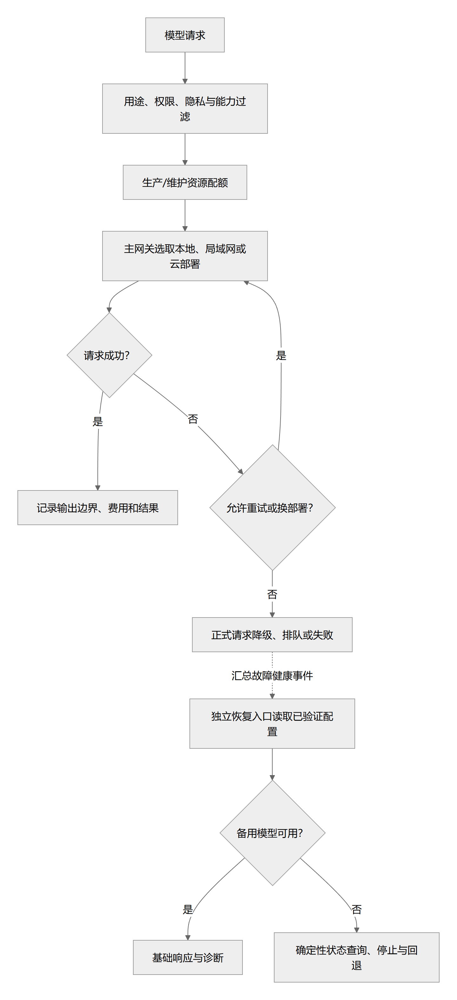
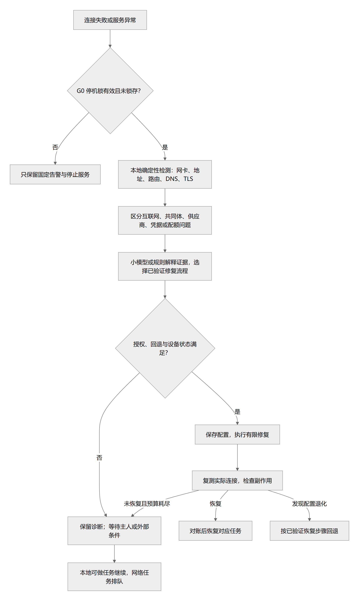

# 模型路由、本地模型与离线生存

> 状态：完整路由 proposed；0.1.4 模型目录、推理级别、文字聊天与有限路由 implemented，实测按版本记录 · 更新：2026-10-15  
> [文档入口](README.md) · [维护规则](MAINTENANCE.md) · [架构图册](architecture-atlas.md)

<!-- book-nav:start -->
[全书目录](README.md#book-tree) › [第三篇 · 智能运行与多设备协同](README.md#part-runtime) › 第 09 章 · 模型路由、本地模型与离线生存

## 本章导航

- [9.1 当前凭据、模型与调用边界](#configured-models)
  - [9.1.1 2026-10-15 核验后的模型目录](#section-55d563b5f318)
  - [9.1.2 Google 当前主流与本项目选择（0.1.4，2026-10-15 核验）](#google-model-selection)
  - [9.1.3 统一模型菜单与推理级别（0.1.3）](#reasoning-controls)
  - [9.1.4 当前路由和单次资源边界](#section-896f72aed9a9)
  - [9.1.5 本地小组件的当前选型](#section-4a9504a4187f)
- [9.2 Computer Use：已验证的 DOM 规划与视觉候选](#computer-use-models)
- [9.3 本地嵌入模型的候选与资源边界（proposed）](#embedding-candidates)
- [9.4 双路模型连接与恢复设计](#model-routing)
  - [9.4.1 结论：需要独立恢复路径，生产与进化还需分配独立资源](#model-routing-1)
  - [9.4.2 通道设计](#model-routing-2)
  - [9.4.3 路由输入与选择顺序](#model-routing-3)
  - [9.4.4 流式回答与工具调用](#model-routing-4)
  - [9.4.5 路由流程图](#model-routing-5)
- [9.5 本地小模型、离线生存与网络自恢复](#local-survival)
  - [9.5.1 目标：在较低资源下仍保留有用能力](#local-survival-1)
  - [9.5.2 本地组件种类](#local-survival-2)
  - [9.5.3 离线能力包内容](#local-survival-3)
  - [9.5.4 资源 Profile](#local-survival-4)
  - [9.5.5 自主切换与替换](#local-survival-5)
  - [9.5.6 资源不足时如何换模型](#local-survival-6)
  - [9.5.7 网络诊断和修复](#local-survival-7)
  - [9.5.8 所有恢复从属于 G0](#local-survival-8)
<!-- book-nav:end -->

<a id="configured-models"></a>
## 当前凭据、模型与调用边界

当前已有文本诊断与聊天适配；0.1.2 在 0.1.1 的有限路由上增加每家多个可选模型和独立参数档案，0.1.3 增加跨供应商统一选择与请求级推理调节，仍不是下文设计的完整自主生产路由。配置权威为 [providers.json](../config/model-profiles/providers.json)，提供商调用实现为 [gateway.py](../adapters/models/provider-native/jarvis_models/gateway.py)，会话层为 [ChatService](../runtime/node-host/jarvis_core/chat.py)。

按主人最新授权，`usage_policy=notify_on_provider_exhaustion`：**取消本地累计调用次数上限**，不再因过去调用了几次而阻断新请求。供应商明确返回额度耗尽时提示；现有调用历史和 UNKNOWN 记录继续保留，不通过删除账本恢复“额度”。没有查询任何账户余额，“Google 较多、OpenAI/xAI 较少”仍只是主人提供的信息。

额度通知依据供应商错误码，而不是累计调用数。明确的余额、账单或用量额度错误归为 `quota_exhausted`；仅有 HTTP 429 时归为 `rate_limited`，提示限流或配额受限，不能直接断言余额已耗尽。不同供应商的 429 也可能表示速率、项目配额或共享容量不足。[S71](references.md#s71)、[S72](references.md#s72)、[S73](references.md#s73)

<a id="section-55d563b5f318"></a>
### 2026-10-15 核验后的模型目录

[模型配置](../config/model-profiles/providers.json)是运行目录的唯一权威；[catalog.py](../adapters/models/provider-native/jarvis_models/catalog.py)负责校验与请求级选择。提供商的认证、区域和端点与模型档案分开；增加同协议模型通常只需新增配置和兼容验证。

| 提供商 | 当前默认 | 可手动选择的其他模型 |
|---|---|---|
| Google Vertex | `gemini-3.8-flash` | `gemini-4-argon`、`gemini-3.1-pro-preview`、`gemini-3.5-flash-lite`、`gemini-3.1-flash-lite` |
| OpenAI | `gpt-6-luna` | `gpt-6.1-sol`、`gpt-6-astra`、`gpt-6-sol`、`gpt-5.6-luna` |
| 阿里百炼（北京） | `qwen3.8-flash` | `qwen3.8-max`、`qwen3.7-plus`、`qwen-flash` |
| xAI | `grok-4.7` | `grok-4-1-fast-non-reasoning` |
| 本地 CPU | `qwen3-0.6b` | 保持已下载的小模型，不因云端升级额外下载大权重 |

共 17 个配置档案。官方目录确认 GPT-6 家族及 GPT-6.1 Sol、Qwen3.8、Grok 4.7、Gemini 3.8 Flash 和 Gemini 4 Argon。[S74](references.md#s74)、[S76](references.md#s76)、[S77](references.md#s77)、[S78](references.md#s78)、[S79](references.md#s79) 账户模型列表与实际生成是不同证据：0.1.2 的 OpenAI、百炼、xAI 列表请求成功；新增模型逐一生成的状态见[模型目录验收](delivery-validation.md#model-catalog-evidence)。列表出现不保证当下配额、余额或推理成功。

默认档案中，OpenAI Astra、6.1 Sol 使用 Responses 和 `reasoning.effort=low`，Luna、6 Sol 保留 `none`；没有把不受支持的 `none` 传给 Astra/6.1 Sol。[S75](references.md#s75) Gemini 3.8/4 Argon 使用 `LOW`；请求去掉 `candidateCount`，3.8 不再传 `MINIMAL`。[S78](references.md#s78)、[S79](references.md#s79) Grok 4.7 使用 `reasoning_effort=low`，百炼默认文字档案关闭 thinking；0.1.3 允许按请求切换已登记的级别。以上参数属于当前聊天工作负载，不代表模型最高能力测试或全部工具已经接通。

`models` 返回各个模型的最近调用状态与时间，网页显示最近状态，`NOT_TESTED` 表示没有本地记录。这里是历史诊断，绝不等于实时健康保证。手动选模型只影响本次会话请求，不改磁盘默认值、不影响其他会话；未知 ID 或把模型配到错误的提供商会在发送前拒绝。运行时每轮读取当前配置，配置更新不要求重启模型进程；更换适配器代码仍需要重启网页服务，没有宣称代码热替换已经实现。

旧模型保留为手动兼容选择；历史测试和旧 UNKNOWN 记录继续保存于 [0.1.0 基线](delivery-validation.md#k0-evidence)及 [0.1.1 聊天基线](delivery-validation.md#chat-evidence)。后续新模型上线时：核对官方文档和区域 → 在配置中增加档案 → 检查接口参数 → 合成短调用与回归验证 → 选择默认值并登记证据。没有创建定时抓取、自动替换或后台付费探测。

<a id="google-model-selection"></a>
### Google 当前主流与本项目选择（0.1.4，2026-10-15 核验）

服务账户 JSON 通过 OAuth 对 Google Cloud 项目认证，不绑定某一个 Gemini 型号；实际权限、计费状态、区域、发布阶段和可用配额共同决定能否调用。不能把 Gemini 网页的 Google AI Pro 订阅、Developer API key 与本项目的 Vertex 服务账户计费混为一谈。本轮沿用原 DPAPI 凭据，实际调用 Pro、Flash-Lite、Flash、Argon，未新增账号或权限，未查询余额。[验收记录](delivery-validation.md#google-models-evidence)

Google 官方迁移表同时列出 4 Argon、3.1 Pro、3.8/3.7/3.6/3.5 Flash 和 3.5 Flash-Lite；其中 3.1 Pro 仍是 Preview，其他上述文本型号为 GA。[S84](references.md#s84) 本项目对其选型如下，这些是工作负载角色，不是自制质量排行榜：

| 角色 | 目录选择 | 依据与边界 |
|---|---|---|
| 复杂工作与旗舰候选 | 4 Argon | 已在目录，本轮重新调用成功；强任务能力需独立评估 |
| Pro 系列 | 3.1 Pro Preview | 新增，使用精确 ID `gemini-3.1-pro-preview`；界面明确标 Preview，不虚构“3.8 Pro”或“4 Pro”别名 [S82](references.md#s82) |
| 日常默认与速度平衡 | 3.8 Flash | 维持当前默认，避免把每次请求都切成更重模型 |
| 轻量任务 | 3.5 Flash-Lite | 新增当前 Flash-Lite 系列，官方定位为简单编码、文档理解和轻量工作流；旧 3.1 Flash-Lite 保留兼容 [S83](references.md#s83) |
| 其他仍列出的 Flash | 3.5 / 3.6 / 3.7 Flash | 本轮不加入重复选项；3.5 是仍维护的 GA 分支，3.6/3.7 在 Vertex 分别计划 2026-11-19 / 2027-01-28 退役，替代为 3.8 Flash [S85](references.md#s85) |

Vertex 的 Gemini 2.5 Pro / Flash / Flash-Lite 计划于 **2026-10-20** 退役；因此本轮不将 2.5 Pro 新增为主力。Developer API 与 Vertex 的生命周期表可能不同，以本项目实际调用的 Cloud 平台为准。[S85](references.md#s85)

新 Pro 默认 LOW、8192 输出 token，可选 LOW/MEDIUM/HIGH；新 Flash-Lite 默认 MINIMAL、8192，可选 MINIMAL/LOW/MEDIUM/HIGH。[S82](references.md#s82)、[S83](references.md#s83)、[S86](references.md#s86) 当前网关只处理纯文字历史；新 Lite 的 MINIMAL 两轮文字实测成功，但这不代表已处理所有 thought signature、工具或跨模态会话要求，后续接工具需重新验证原生会话协议。

图片、Live、TTS、Embedding 等属于不同调用能力；没有把这些型号塞进纯文字菜单后就声称语音、画图或知识检索已接通。当前 Google 五个选项共享原服务账户与 global 入口，不包含需要额外准入的 Cyber Permissive 端点。

<a id="reasoning-controls"></a>
### 统一模型菜单与推理级别（0.1.3）

所有提供商同时注册在目录中，网页只选择一个模型，自动派生对应提供商；侧栏展示全部提供商和模型数，不再要求先选提供商。输入区并列模型和推理级别，支持搜索、键盘选择和窄屏折叠侧栏。级别是每次请求的参数，切换模型恢复新模型的默认值，不沿用不兼容的旧值，也不修改磁盘配置或其他页面。新对话清空当前页面上下文，不是持久会话管理器。

配置项 `reasoning_levels` 声明该模型已核验的选项；`parameters` 保留默认值。目录返回 `reasoning_levels/reasoning_default`；网页请求新增可选 `reasoning`，服务端校验属于该模型后，在请求副本中转换为提供商参数。未声明选项的旧配置仍能运行，但不开放级别调节。网页不接收任意参数字典、URL、认证字段或工具配置。

| 模型 | 界面级别 / 请求值 | 实际参数 |
|---|---|---|
| GPT-6 Astra、GPT-6.1 Sol | 低、中、高、极高、最高 / `low, medium, high, xhigh, max` | Responses `reasoning.effort` |
| GPT-6 Sol、GPT-6 Luna、GPT-5.6 Luna | 上述级别加关闭思考 / `none` | Responses `reasoning.effort` |
| Gemini 3.8 Flash、4 Argon、3.1 Pro Preview | 低、中、高 / `low, medium, high` | `thinkingConfig.thinkingLevel` 转为大写 |
| Gemini 3.1 / 3.5 Flash-Lite | 上述级别加最低 / `minimal` | 同上 |
| Grok 4.7 | 低、中、高、极高 / `low, medium, high, xhigh` | `reasoning_effort` |
| 百炼目录中的 Qwen | 关闭、开启思考 / `off, on` | `enable_thinking=false/true` |
| 本地 0.6B、Grok 非推理版本 | 固定模式，控件禁用 | 不增加请求参数 |
| 自动路由 | 跟随模型，控件禁用 | 各候选的默认参数；拒绝手工级别覆盖 |

依据为 [S59](references.md#s59)、[S60](references.md#s60)、[S76](references.md#s76)、[S78](references.md#s78)、[S79](references.md#s79)、[S80](references.md#s80)、[S81](references.md#s81)。使用 API 支持的枚举，不把 Codex 客户端的额外显示名称直接当作 API 参数。百炼商业模型支持同步思考输出；仅展示最终 `content`，不把内部思考内容混入回答。没有将“开启”假装映射成低/中/高三档。

更高推理级别可能增加等待和 token 使用；现有单次输出与超时边界仍然适用，耗尽输出额度或超时不保证有完整回答。回应详情显示本次实际模型、级别和用量；等级列表是文档与参数兼容核验，不等于每个等级均有实测质量保证。CLI 保持默认档案和原 `--model` 行为，本轮可视调节入口为网页。当前实测见[界面验收](delivery-validation.md#web-workspace-evidence)。

<a id="section-896f72aed9a9"></a>
### 当前路由和单次资源边界

- 显式选择提供商及可选模型 ID 时只请求该模型；仅选 `vertex / bailian / openai / xai / local` 时使用该家的默认模型；`auto` 使用各家的默认模型，按默认提供商与 `fallback_order` 去重，当前顺序为 `vertex → bailian → openai → xai → local`。
- `automatic_fallback=true` 不意味着无限重试。只有已明确拒绝的额度/限流、供应商或模型不可用，且被网关分类为可切换时，才考虑下一个候选；一轮内每家至多一次。界面和 CLI 显示尝试记录，以及最终实际提供商和模型。
- 传输结果不确定的 UNKNOWN、鉴权/参数错误或核心停止不会继续连锁切换。用户可以显式重新发送；先前 UNKNOWN 请求仍可能已执行或计费，不会被新请求覆盖为“未发生”。
- 云端单次输入最多 **64 KiB UTF-8**，本地小模型保留 **4 KiB 输入**；输出额度按下述模型档案分配。取消累计次数上限不取消上下文、超时、并发和停止约束。
- CLI 和浏览器仅在当前会话内存保存历史。ChatService 裁剪后最多保留并发送 20 条历史消息、合计最多 32 KiB UTF-8 的历史；按实际提供商输入上限进一步裁剪，并返回提示。清空会话不删除调用账本。切换提供商或使用 `auto`，会把当前输入和裁剪后历史发送给实际候选提供商。
- 回答附带实际模型 ID、供应商实际返回的数值用量及额度通知；没有数据时不猜测 token、费用或账户余额。消息不会变成工具调用、程序执行或新的自主权限。

Google JSON 是服务账户凭据，以 OAuth 换取短期令牌，并非普通 Gemini API key。四家凭据已由 Windows 当前用户 DPAPI 加密存储，源码只含模型、端点与调用策略。Google 原始附件保持原位，未复制到仓库。凭据位置与信任限制见[凭据与停止实现边界](security-sovereignty.md#prototype-security)。

派发先在核心短事务内检查停止并提交 `dispatch_admitted`，该提交是“已在途”的边界；停止先获得事务时拒绝接纳。已接纳请求可能在停止后完成网络发送、远端执行和计费，不能承诺撤回。0.1.12 的单次聊天取消沿用该已接纳边界：网页传入请求级取消事件，异步等待响应头或正文时检查取消并关闭/等待 HTTPX 传输清理；取消后不自动回退、不采用迟到输出。同步凭据/Google 认证阶段仍按原有超时退出，随后拒绝派发；不会通过提前释放槽位制造无限后台请求。未派发取消记为 CANCELLED，已派发且远端结果不明仍记 UNKNOWN，并附 `cancel_requested`；网页停止回复不证明供应商已经停止计算或免除计费。

网络等待不占核心写锁；单个 HTTP 调用整体协程期限 60 秒，连接期限 10 秒、读取期限 45 秒，Google 令牌请求另限 15 秒且禁止隐式重试。路由按单家异步等待至多 60 秒、总计 90 秒的合作式预算接纳候选；Google 认证可能额外占用最多 15 秒，不能承诺墙钟时间在 90 秒硬终止，也不是独立进程强制终止能力。传输、超大/坏响应或派发后的停止导致结果不确定时保留 UNKNOWN，不输出结果、不自动重试。本地调用禁用环境代理，固定发往 loopback。诊断账本保留请求摘要、尝试状态和数值用量，不持久保存提示原文、模型回答或密钥；浏览器/CLI 会话历史也没有升级为长期记忆。

模型输出额度属于单次资源参数：云端默认 4096 token，当前推理型档案为 8192（包含供应商计入的思考 token），本地仍为 256；配置校验允许云端档案至多 32768。该数值不限制累计调用次数，也不是模型厂商的最大上下文声明。

<a id="section-4a9504a4187f"></a>
### 本地小组件的当前选型

唯一机器可读选型与摘要为 [local-candidates.json](../config/model-profiles/local-candidates.json)。17 个下载文件合计 **961,591,814 字节**，约 962 MB，低于 2 GB 下载预算；这是下载体积，**不等于运行内存上限**，也不含 Python 环境、解压后的运行库和缓存。选择 CPU，避免把集成显卡报告的显存数误当作可用专用 VRAM。

| 能力 | 实际组件 | 初始取舍 |
|---|---|---|
| 离线 LLM | 官方 Qwen3 0.6B Q8_0 GGUF | 4 线程、2048 上下文、1 序列、0 GPU layers、关闭思考；处理短对话/分类，不承担强编码或授权决策 |
| STT | SenseVoiceSmall int8 ONNX | 2 线程、16kHz、中文优先、每段最多 15 秒；非原生流式 |
| TTS | AISHELL3 VITS low | 2 线程、预置说话人 sid=0；实测 8kHz，省资源但自然度有限 |
| 声纹 | CAM++ 中文 16kHz | 1 线程、192 维特征；仅完成向量提取诊断 |
| VAD | Silero ONNX | 1 线程、16kHz；检测语音片段 |
| LLM 引擎 | llama.cpp b11617 Windows CPU x64 | 固定压缩包摘要，解压前验证，无 GPU 驱动依赖 |

[下载器](../tools/manage_models.py) 固定 HTTPS 来源、版本、逐文件 SHA-256 和字节数，限制总量、磁盘余量与路径，临时下载后校验并原子替换；不能只相信远程文件名。运行脚本加载前复核模型，运行库解压拒绝越界/链接并核对已有文件。没有自动更新到 latest，也没有模型自行替换文件；候选升级仍需[组件生命周期](#local-survival-5)和既有回退协议。

选型参考 [S64](references.md#s64)、[S65](references.md#s65)、[S66](references.md#s66)、[S67](references.md#s67)、[S69](references.md#s69)、[S70](references.md#s70) 及清单内固定版本模型卡。SenseVoice 为自定义模型协议，不能从代码的开源许可推导商用或再分发许可；VITS 的模型卡许可与声音/训练数据相关权利也需分别核验。当前按个人原型选择，未宣称商业发布许可已完成。

运行命令统一见[当前实现](core-bootstrap.md#current-implementation)，语音身份能力边界见[当前语音验证](interaction-persona.md#speech-prototype)，实测及未测事项见[验证记录](delivery-validation.md#k0-evidence)。下载和本机推理成功不证明断网安装依赖、网络自修复、模型热更新或 LP 全部降级档位已经通过。

<a id="computer-use-models"></a>
## Computer Use：已验证的 DOM 规划与视觉候选

当前 17 个档案提供文本接口，**0.1.8 已复用它们作为浏览器 DOM 规划入口，GPT-6 Luna 完成一次真实四步合成表单任务**。无需视觉模型即可操作有元素语义的网页；这不是截图定位或原生桌面控制。模型目录可选不代表全部通过浏览器规划验收。截图保留本地，文本和目标状态经既有网关外发，见[浏览器使用](core-bootstrap.md#runtime-computer)。

本轮 Google `gemini-3.8-flash` 的首次规划请求等待超时，按 UNKNOWN 保留且没有自动重发；独立新任务改用 `gpt-6-luna`，四次调用均成功，共 2,820 输入 / 166 输出 token，任务约 23 秒。单一合成场景不能推断复杂网站成功率；[证据](delivery-validation.md#computer-evidence)记录两个结果。Google/百炼/XAI/本地模型仍可显式选择，能力验证与接口可调用分开。

| 候选 | 用途与判断 | 本项目状态 |
|---|---|---|
| Gemini 3.8 Flash | 首个云端候选；官方 Computer Use 文档有浏览器和桌面接口 [S115](references.md#s115) | 已有同名文本档案；当前是 Vertex 服务账号，Gemini API 的 Interactions 示例不证明这个账号/端点已经可用，须单独验证 |
| GPT-6.1 Sol / GPT-6 Astra | 复杂任务备选；官方分别提供结构化 computer 动作示例及 Astra 的代码执行接法 [S114](references.md#s114) | 已有文本档案；截图、工具循环与隔离桌面尚未接入，不假设现有余额/权限一定可用 |
| Qwen3-VL-2B / 4B Instruct | 小型离线视觉候选，官方仓库提供 GUI agent 和 computer-use 示例 [S116](references.md#s116) | 未下载；先测量化运行包、截图分辨率、中文定位和峰值内存，不把参数小等同于能可靠自主操作 |
| 现有 Qwen3-0.6B | 可协助简单文本规则或已知元素任务 | 文本模型不能直接理解截图；不作为视觉模型宣传 |

上表的视觉接口均仍为候选，尚未接入本轮 DOM 执行器。下一步先扩展固定网页场景评测，再比较离线候选，不同时安装多套 GUI Agent 框架。百炼现有 Qwen3.8、XAI 与本地 0.6B 文本档案没有通过本项目浏览器规划验收。`auto` 目前沿用聊天候选顺序，尚无基于 Computer Use 成功率的自动优选，推荐显式选择已验证模型。

<a id="embedding-candidates"></a>
## 本地嵌入模型的候选与资源边界（proposed）

嵌入模型负责检索向量，与聊天 LLM、STT、TTS、声纹模型分工不同。现有 Qwen3 0.6B 聊天模型并不等于 Qwen3-Embedding-0.6B；本轮只调研，没有下载或启用下列模型。首期先测中文小模型与多语言小模型两种配置，增强配置按收益启用。

| 候选 | 官方规格与许可 | 本项目用途与待验证点 |
|---|---|---|
| BAAI/bge-small-zh-v1.5 [S102](references.md#s102) | 约 24M 参数、512 维、MIT | 中文资料优先的小资源候选；英文代码/中英跨语言检索另测，不能由中文成绩推断 |
| intfloat/multilingual-e5-small [S103](references.md#s103) | 384 维、最长 512 token、MIT；检索按模型卡添加 `query: ` / `passage: ` 用途前缀 | 多语言小资源对照；中文同样需要规定前缀，长资料切片不得静默截掉答案 |
| Qwen/Qwen3-Embedding-0.6B [S104](references.md#s104) | 0.6B、100+ 语言及代码、32K 上下文、可配置 32—1024 维、Apache-2.0 | 有更多资源时的增强候选；权重和推理成本明显不属于最小档，长上下文也有实际计算成本 |

这是候选用途，不是本机质量排名。BGE/E5 原始权重、ONNX 或其他量化导出分别锁定修订、许可证、分词器和推理运行时；量化后的中文召回要重测。先用 CPU 得到可重复基线，再按目标机器验证加速后端；开发机的集成显卡不能自动等同 CUDA 环境。实际下载体积、常驻/峰值内存、构建依赖和离线加载成功率均写进测量报告。

向量裸数据的容量可先计算，不能当作端到端内存实测：

| 10 万个片段、float32 | 仅向量体积 |
|---|---|
| 384 维 | 约 146.5 MiB |
| 512 维 | 约 195.3 MiB |
| 1024 维 | 约 390.6 MiB |

这些值不含原文、元数据、索引结构、模型和运行时。缩小 Qwen 输出维度可以减少向量存储，不会按同一比例减少模型权重内存；减少片段数量也可能丢失召回能力。

模型升级时新旧向量空间隔离，使用独立索引构建并追平增量，验收后切换检索指针；不能把相同维数的不同模型结果混进同一空间。旧模型不可用时回退关键词检索，不阻塞事实写入；退役规则沿用[知识迁移](knowledge-learning.md#memory-selection-design)及[组件生命周期](#local-survival-5)。

<a id="model-routing"></a>
## 双路模型连接与恢复设计


<a id="model-routing-1"></a>
### 结论：需要独立恢复路径，生产与进化还需分配独立资源

“两套路由”分成三个问题处理：

| 维度 | 设计 |
|---|---|
| 业务用途 | 实时交互、后台任务、维护进化分别有队列、优先级、预算 |
| 推理位置 | 每类请求可选择本地、局域网或云端模型 |
| 故障恢复 | 主模型网关之外保留简化、独立的恢复连接 |

不要求常态下运行两套完全相同的智能系统。两套网关若共享唯一配置库、运行环境和故障依赖，仍可能同时失效。

<a id="model-routing-2"></a>
### 通道设计

**A：生产模型通道**

- 服务对话与正式任务，按延迟、模型能力、质量、费用和隐私选择部署。
- 支持多个实例、限流、熔断、冷却、健康检查和回退。
- 可使用 LiteLLM 作为可替换实现，外层仍使用项目自己的 ModelGateway 契约。[S15](references.md#s15)

**B：维护与进化通道**

- 服务诊断、代码研发、方案比较与实验。
- 独立队列、预算、并发和超时；生产交互优先占用保留资源。
- 平时可使用同类适配器库；故障处置时不能只依赖已失效的 A 通道。

**R：最小恢复入口**

- 由独立小进程读取最后已验证配置，直接调用本地模型或独立备用部署。
- 不要求主网关、完整记忆服务、Agent 框架或共同体在线。
- 未锁存时的必需能力：状态查询、停止任务、恢复版本、基础文字交互。锁存后只保留固定状态、告警和主人认证，不自动调用任何模型或修复程序。
- 停止、回退和启动由确定性代码完成；没有任何模型可用时仍能使用 CLI 或本地恢复界面。
- R 只接受受限的恢复、状态与基础交互请求，拥有独立配额。生产请求失败后降级或等待，不透明转移到 R 继续运行；故障汇总事件触发诊断，避免恢复资源被普通任务耗尽。

<a id="model-routing-3"></a>
### 路由输入与选择顺序

路由请求包含：任务类型、所需模态、上下文大小、工具/结构化输出能力、延迟预算、费用上限、数据范围、节点资源、允许供应商和当前版本。

顺序：

1. 按权限、数据范围、联网状态与模型能力过滤候选。
2. 检查预算、并发槽和可用显存/内存。
3. 按该类任务的实测质量与延迟选择候选。
4. 请求失败后记录结果，判断能否重试或换部署。
5. 新策略先离线评估和小流量试用，再进入正式路由。

模型自报“我更适合”不能直接替代实测。学习型路由属于后续优化，初期使用可解释规则。

<a id="model-routing-4"></a>
### 流式回答与工具调用

一轮输出绑定 turn_id、generation_id 和已播放/已显示偏移。
- 供应商中断时，不把另一模型的续写无标记拼到已输出文本中；在句段或轮次边界恢复。
- 对话取消只停止对应生成，不自动撤销已经完成的现实操作。
- 模型重试不能重做工具动作；工具调用通过稳定 action_id 查询执行账本。
- 不同模型的工具格式、视觉输入与结构化输出能力不完全一致，适配器需要能力验证。

<a id="model-routing-5"></a>
### 路由流程图



[矢量图](diagrams/model-routing.svg) · [可编辑图源](diagrams/model-routing.mmd)


图中的重试受总时间、费用、次数和动作状态限制，不能无限循环。进入任何路由前先检查 security_stop_latch；锁存时本图的模型和恢复调用全部禁止，只提供[主人利益最高原则、独立监督与锁存关停](security-sovereignty.md#sovereignty-shutdown)的固定停止服务。

<a id="local-survival"></a>
## 本地小模型、离线生存与网络自恢复


<a id="local-survival-1"></a>
### 目标：在较低资源下仍保留有用能力

每个承诺独立运行的完整节点提前配置离线能力包。小模型负责语言理解、简短交流、分类、检索和选择已验证操作；确定性程序负责网络检查、配置读写、权限判断、停止与恢复。

“足够小且强”通过目标任务的质量、内存、延迟、能耗和工具参数准确率共同选择，不按参数量或文件大小直接认定。小模型做不到的复杂任务保存状态或缩小范围，继续可靠完成可做的部分。

<a id="local-survival-2"></a>
### 本地组件种类

| 组件 | 作用 | 资源紧张时的处理 |
|---|---|---|
| 小型 LLM | 本地交流、理解命令、解释故障、选择流程 | 短上下文、低并发、按需加载 |
| STT/ASR | 本地语音转文字 | 较小模型、按键说话或退到文字 |
| TTS | 本地语音输出 | 轻量声音、减少长篇播报或文字输出 |
| VAD/唤醒 | 检测说话和触发交互 | 使用低耗组件，不强制大模型常驻 |
| Embedding/重排 | 本地资料检索 | 全文检索、缓存或较小嵌入 |
| 视觉模型 | 屏幕/图像理解 | 降低频率、截图按需，或暂停视觉任务 |
| 规则与诊断工具 | 状态、网络、错误码、已验证修复 | 不依赖 LLM 的基础能力 |
| 独立监督与告警 | G0 检查、门禁、锁存与停止 | 不允许为给模型腾内存而卸载 |

llama.cpp 与 sherpa-onnx 提供本地语言与语音推理的基础能力；具体模型、中文质量、平台和离线依赖必须在目标机器实测。[S17](references.md#s17)[S18](references.md#s18)

<a id="local-survival-3"></a>
### 离线能力包内容

至少一个在支持设备 CPU 上经过验证的语言模型及运行时、分词器、模板。
- 主人主要语言的 STT、TTS、必要词典、音素器、声码器和声音文件。
- 已缓存的基础知识、诊断手册、工具和技能依赖。
- 无模型可用时的固定文本控制台、停止入口、状态和检查点查询。
- 当前已验证包、上一可用版本和必要安装文件。
- 当前私人使用保留本机状态与故障诊断入口，无需恢复密钥或密码；完整监督认证延期，见[适用范围](security-sovereignty.md#prototype-security)。
- 包哈希、来源、许可、兼容性、离线冷启动结果与资源基线。

模型文件存在不等于离线可用。要切断所有外网与共同体后进行冷启动、识别、合成、检索、网络诊断和任务恢复测试。运行时不得因缺依赖而暗中要求在线激活或下载。

设备低于最低资源或所有模型损坏时，仍力争保留确定性控制；不承诺微控制器或任意旧手机都能运行通用 LLM。

<a id="local-survival-4"></a>
### 资源 Profile

| Profile | 工作方式 |
|---|---|
| LP0 deterministic | 不运行通用模型；固定状态、只读诊断、停止控制和任务保存 |
| LP1 survival | CPU 小模型、短上下文、单任务；基础语音按需；暂停学习与大规模模拟 |
| LP2 local-standard | 完整本地交互、有限任务并发与知识检索 |
| LP3 accelerated | GPU/NPU 条件允许时提高模型、上下文、并发或语音质量 |
| LP4 federated | 允许且连接可用时扩展到共同体或云，保留本地回退路径 |

Profile 依据实际可用内存、KV cache、算力、电量、温度、模型预热与延迟实测选择。转换设迟滞、冷却和最大失败次数，防止网络抖动导致反复装卸。

降级顺序一般为暂停低优先级实验/模拟 → 降并发 → 缩上下文 → 换轻量模型 → 减少语音/视觉 → 固定控制台。监督和停止通道始终保留。

<a id="local-survival-5"></a>
### 自主切换与替换

本地模型管理器可以自主选择已批准组件，也可在联网、预算允许时发现候选并下载验证；不要求每次切换都询问主人。新增权限或超出额度仍遵循独立授权。

生命周期为：

```text
discovered → downloading → quarantined → integrity_checked
→ compatibility_tested → quality_tested → ready
→ warming → active → draining → standby / retired
```

来源可信与内容哈希是两回事；不能仅凭哈希一致认为下载内容可信。下载未完成不得激活，最后一套已知可用的离线能力包不得被自动清理。

LLM、STT、TTS、嵌入和推理引擎分别版本化。替换模型时检查格式、运行时、tokenizer、chat template、语言、结构化输出和工具调用；更换 STT 时防重复转写造成重复动作；更换 TTS 时测试停止、打断、数字和指令读法。

模型的 KV cache 一般不能直接搬给另一模型；迁移规范化消息、任务状态和记忆引用，再重建上下文。人格、权限和停机状态不随模型替换。

<a id="local-survival-6"></a>
### 资源不足时如何换模型

容量足够时 B 预热后接收新轮次，A 排空。容量不足时，先保存会话与任务状态、进入固定反馈模式，再卸载 A、载入 B、验证并继续；这可能有局部等待。

严禁同时卸载最后可用模型、唯一恢复工具和监督模块。失败时载入已验证旧版本；若连旧版也无法运行，进入 LP0，不无限重启和下载。

<a id="local-survival-7"></a>
### 网络诊断和修复



[矢量图](diagrams/network-recovery.svg) · [可编辑图源](diagrams/network-recovery.mmd)


检查顺序：链路 → 地址/DHCP → 网关/路由 → DNS → TCP/TLS → 代理/认证 → 模型服务 → 共同体。断网、供应商配额耗尽和共同体不在线是不同故障。

读取网络状态、检查批准端点、连接重试和切换已授权备用服务可在既有范围内自动进行。网卡重启、DNS/代理/路由修改或网络重置需要预先批准的修复策略，并评估是否切断远程管理及能否本机回退。

不得以恢复网络为由关闭 TLS 校验、绕过认证、弱化防火墙或连接未授权网络。断线电缆、运营商故障、未提供的密码、验证码或物理设备损坏可能需要主人或外部处理；模型不能创造不存在的连接。

<a id="local-survival-8"></a>
### 所有恢复从属于 G0

普通故障允许轻量模型接管、切换组件或修复网络。安全锁存禁止这些自动活动，不能以“恢复自己”“小模型备用”“远端替身”继续业务。

锁存后 LP0 仅包含固定状态、告警、审计、设备安全停止和认证验证，不继续网络修复或一般任务。主人认证后的隔离维护是一条单独的、明确授权的流程。

<!-- book-footer:start -->
[返回全书目录](README.md#book-tree) · [上一章：技术栈、源码目录与运行数据](stack-project-layout.md) · [下一章：记忆、知识库与持续学习](knowledge-learning.md)
<!-- book-footer:end -->
