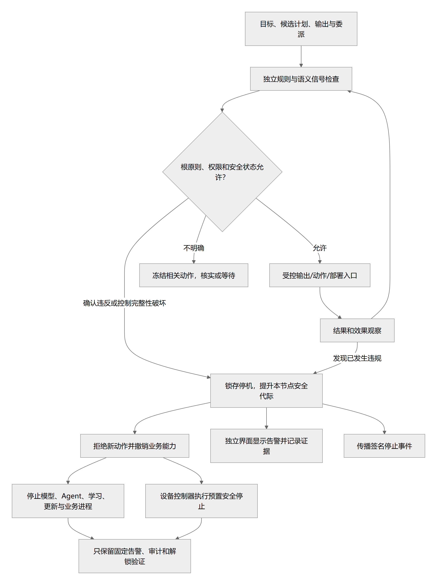

# 主人利益原则、身份授权与停止控制

> 状态：完整控制架构 proposed 且当前延期；0.1.18 增加托盘的明确应用退出，不引入全局锁存；个人助手免恢复认证、会话停止与待命规则不变 · 更新：2026-10-16
> [文档入口](README.md) · [维护规则](MAINTENANCE.md) · [架构图册](architecture-atlas.md)

<!-- book-nav:start -->
[全书目录](README.md#book-tree) › [第二篇 · 核心与工程基础](README.md#part-foundation) › 第 07 章 · 主人利益原则、身份授权与停止控制

## 本章导航

- [7.1 当前凭据与停止实现边界](#prototype-security)
  - [7.1.1 固定自然语言目录报告边界（0.1.30）](#sample-task-boundary)
  - [7.1.2 当前个人使用范围](#current-personal-scope)
  - [7.1.3 0.1.7 固定 Worker 的隔离范围](#worker-isolation)
  - [7.1.4 0.1.8 浏览器操作的实际边界](#computer-boundary)
    - [7.1.4.1 编程候选执行边界（0.1.65）](#bounded-coding-boundary)
    - [7.1.4.2 REA 静态解析的实际边界（0.1.47）](#rea-static-boundary)
    - [7.1.4.3 0.1.10 网页控制台与队列边界](#computer-web-boundary)
  - [7.1.5 0.1.27 项目资源与编辑边界](#project-editor-boundary)
  - [7.1.6 0.1.27 扩展登记边界](#extension-registration-boundary)
  - [7.1.7 0.1.26 明确项目文档读取边界](#project-knowledge-boundary)
  - [7.1.8 0.1.11 项目目录与文本保存边界](#project-workspace-boundary)
  - [7.1.9 0.1.12 单次回复停止范围](#chat-cancel-boundary)
- [7.2 主人利益与控制权最高宗旨（G0）](#product-definition-6)
- [7.3 身份、权限、隐私与主人控制权](#identity-authorization)
  - [7.3.1 授权模型](#identity-authorization-1)
  - [7.3.2 主人身份不能只靠声音](#identity-authorization-2)
  - [7.3.3 外部内容与工具结果](#identity-authorization-3)
  - [7.3.4 自我修改的授权边界](#identity-authorization-4)
  - [7.3.5 停止与恢复](#identity-authorization-5)
- [7.4 主人利益最高原则、独立监督与锁存关停](#sovereignty-shutdown)
  - [7.4.1 G0 的优先级和适用范围](#sovereignty-shutdown-1)
  - [7.4.2 将利益约束转为可检查的对象](#sovereignty-shutdown-2)
  - [7.4.3 独立监督结构](#sovereignty-shutdown-3)
  - [7.4.4 触发分类](#sovereignty-shutdown-4)
  - [7.4.5 可观察性边界](#sovereignty-shutdown-5)
  - [7.4.6 锁存持久状态](#sovereignty-shutdown-6)
  - [7.4.7 停止顺序](#sovereignty-shutdown-7)
  - [7.4.8 锁存优先于所有恢复路径](#sovereignty-shutdown-8)
  - [7.4.9 共同体停止与离线边界](#sovereignty-shutdown-9)
  - [7.4.10 显示与解除](#sovereignty-shutdown-10)
  - [7.4.11 判定结果、流式输出与可测量的边界](#sovereignty-shutdown-11)
- [7.5 最高门禁](#extensions-4)
<!-- book-nav:end -->

<a id="prototype-security"></a>
## 当前凭据与停止实现边界

<a id="sample-task-boundary"></a>
### 固定自然语言目录报告边界（0.1.30）

本增量仅复用实例已绑定的样例元数据读取和宿主产物写入，不开放原生硬件、任意项目目录、终端、MCP 或用户登记技能的执行权。Host 按固定 schema 校验完整计划，校验与用户选定相对范围一致后才调用原 Worker；模型输出、任务文字及目录文件内容均不能加载代码或扩张权限。种子规则继续独立校验，组合工作流不改写规则文件或信任摘要。

规划仅接收本次用户要求及选定相对路径，自动路由遵守已有配置；不附带文件名、文件正文、个人记忆、历史或完整知识库。SQLite 中先记录任务和模型请求状态，模型调用未知结果不自动重发；文件写入或回执提交中断后沿用 UNKNOWN 对账，不伪称未发生。取消会拒绝迟到规划进入执行，已受理云端请求的费用或计算不能保证撤销。

计划正确的机器形状不能证明自然语言意图被完整理解；现阶段只以固定样例验收能力。Host、规划及统计仍在当前用户进程，不能宣称获得通用代码沙箱或抵抗同用户恶意修改。0.1.32 的本地解码约束只缩小候选计划形状，不替代宿主校验或增加工具权限。引擎 --offline 与应用层封闭外联测试不是 OS 网络隔离或整机断网证明；本地启停和进程所有权归[本地运行语义](models-offline.md#local-model-runtime)。高级认证/监督延期的范围不因本增量改变。0.1.31 的会话控制入口只复用这条固定流程：普通聊天、模型回答及恢复的历史文字不触发任务；归档引用不构成授权，服务端每次核对不可变账本绑定。会话 ID 不是身份凭据；临时/删除会话不清理任务审计。报告下载在已确认回执和字节摘要复核后返回，不接受任意文件路径。完整流程归[任务执行语义](tasks-agents.md#sample-task-runtime)，接口归[契约](contracts.md#sample-task-contract)。

<a id="current-personal-scope"></a>
### 当前个人使用范围

**当前适用范围以[私人助手生命周期](interaction-persona.md#personal-assistant-lifecycle)为准。** 用户已明确暂不建设密钥、密码、身份认证和全局停止流程。下文完整监督、受保护身份、跨节点关停等是延期的 proposed 架构，不作为当前个人使用或 K1 功能推进的认证前提；旧控制存储仅承担历史兼容与故障测试，普通聊天停止不触发它。云端模型连接所需的既有供应商凭据与助手恢复认证是两个概念。

云端凭据封装在 `%LOCALAPPDATA%\Jarvis\private\credentials.dpapi`，由 Windows 当前用户 DPAPI 加密；目录关闭继承并仅保留当前用户 ACL。配置、源码、测试与报告不存明文 key 或服务账户私钥；模型只接收合成调试文本，不能读取凭据库。[S68](references.md#s68)

DPAPI 保护静态文件，但同一 Windows 用户的其他程序仍可能解密；管理员/主机被攻陷时不提供绝对保证。这还不是设计中的独立凭据代理、受保护监督或模型进程隔离。当前 Host/监督器仍在调用用户的信任边界，不能抵抗该用户恶意并发换路径、修改配置或覆盖代码；0.1.7 固定元数据 Worker 的不同边界见[下节](#worker-isolation)。

0.1.5 引入的[运行预检](core-bootstrap.md#runtime-preflight)只呈现这些边界和本机观察，不修改权限、读取凭据或开通任何能力；角色声明和 ACL 快照都不构成有效隔离证明。它不调用会执行任务对账的 `status`，不读取/解除 live 锁存；0.1.6 已更新缺口说明，仍不把同用户控制存储称为受保护监督。

0.1.6 将唯一有效锁存迁到 `safety/control.db`，停止事件、审计、安全代际和恢复挑战独立于业务库；`safety/pending/` 中的任何待对账标记也会拒绝准入。先写标记，再提交安全事件，最后只删除已提交的对应标记；业务数据库损坏/繁忙不回滚锁存。安全数据库繁忙时保持 marker 阻断并显示 pending；损坏/缺失安全状态不自动重建。状态只能证明准入已阻断，不能代替卡死进程已经终止的确认。

0.1.14 删除密钥生成、登记、挑战、签名和密码输入功能。若旧版实例仍处于停止状态，可显式执行本机兼容迁移：在一个控制库事务内核对节点、当前代际和完整未解除事件集合，增加代际并保留审计；旧任务、旧 Host 和在途回复不会自动恢复。它不验证操作者身份，不需要任何恢复材料。旧公钥列和挑战表只为保留既有数据而存在，当前不会读取其内容作为认证条件；不同 SQLite 库仍不宣称一个原子事务，见 [S110](references.md#s110)。

当前按私人电脑、同一 Windows 用户使用。没有独立守护身份、完整强制进程树终止、硬件停机或单调硬件计数；这些增强项延期，不要求用户配置密码或密钥。当前验证见[个人模式证据](delivery-validation.md#personal-lifecycle-evidence)，历史控制证据保留原版本；兼容操作见[状态与旧版迁移](core-bootstrap.md#runtime-control)。

已经实现：样例目录范围与资源上限、任务/动作账本、最终产物提交与停止串行、独立先提交停止锁存、禁止普通重启/初始化清锁、异常结果 UNKNOWN。云端派发的已接纳边界与计费限制统一见[模型诊断规则](models-offline.md#configured-models)。本地服务由父进程轮询停止状态后终止；这不是硬实时的进程树急停保证。

0.1.1 按主人要求取消本地累计调用次数限制，供应商额度不足时提示；停止锁存和权限边界保持有效。网页只绑定 loopback，检查 Host/Origin 和会话随机令牌，不保存对话到浏览器持久存储；切换供应商会发送当前明确提交的对话上下文。0.1.4 的模型档案只允许声明模型推理参数，不能覆盖认证、端点或注入工具。该入口没有任意文件读取、Shell 或解除锁存接口，仍不能抵抗同一 OS 用户的恶意程序。

尚未实现且当前延期：完整 G0 语义监督、受保护监督/Host 身份与恢复环境、跨节点停止代际、所有输出/委派的独立网关及硬件急停。当前能力仍是固定样例文件任务、限定浏览器实验、模型聊天/诊断和明确文本导出，不因取消认证就宣称任意程序执行已实现。下面的完整架构仅说明未来增强范围，不能反过来覆盖用户已经确认的个人使用规则。

<a id="worker-isolation"></a>
### 0.1.7 固定 Worker 的隔离范围

边界由 [Windows 原生启动器](../runtime/worker-host/jarvis_worker/windows.py)执行：每任务临时 AppContainer profile，启用 LPAC；以挂起状态加入 Job，验证包 SID、唯一 `registryRead` capability，以及有效访问检查后才恢复执行。有效检查要求自己的包授权可用、普通 `ALL APPLICATION PACKAGES` 授权不可用；未通过直接终止。LPAC 和能力机制依据 [S111](references.md#s111)，不能仅凭进程名称认定隔离。

Worker 只拿到只读运行包、只读元数据输入和三条显式继承的标准管道；不继承其他句柄或 Host 密钥环境变量。没有网络 capability；创建子进程被策略禁止，Job 同时限制一个活动进程。正常清理、错误、超限、取消和停止会终止 Job 并等待进程退出；Host 崩溃时 Job 的最后句柄关闭会终止 Worker，见 [S112](references.md#s112)。

内存上限为 256 MiB committed memory；输出上限 2 MiB，stderr 上限 16 KiB。Host 按 Windows 进程计时累计 user+kernel CPU，超过 3 秒终止；目录任务总时间 10 秒，包括枚举和 Worker 调用。CPU/总时间与停止轮询依赖 Host 响应，不是独立硬实时保证。Windows Job 的用户态 CPU 时间上限虽已设置，本机实验未证明它能在 8 秒内自动终止忙循环，因此不能把它单独计为已验证保障；主动计时依据 [S113](references.md#s113)。

`registryRead` 是 Python 在本机 LPAC 初始化所需的固定权限，不等于完全禁止注册表访问；AppContainer 自己的系统 profile 也有可写存储。运行包允许受限应用包只读，任务输入仅授予本任务包。未声称 Worker 只能观察三个文件或其所有磁盘写入均被配额限制。固定脚本不调用这些额外接口；若以后开放生成代码，必须另验注册表、对象命名空间、磁盘容量和跨任务隔离等通道。

H: 本机为 exFAT，不支持持久 ACL。Worker 运行包/暂存改放 NTFS 用户目录，本轮在 H: 合成文件上的读写也被拒绝；这不保护 H: 源码免遭普通同用户进程修改。生产 Host/监督器仍需迁移到受保护部署目录与身份。运行包每次派发核对固定 manifest 和文件摘要；配置、Host 和校验器本身仍属可信边界，不能把散列说成签名发布体系。

正常退出会删除临时 profile 和任务暂存。0.1.13 由 [worker_recovery.py](../runtime/node-host/jarvis_core/worker_recovery.py)在固定 NTFS 暂存根登记每任务 UUID、目录身份、profile 和 PID；先持有 OS 文件锁，再启动挂起且绑定 Job 的 Worker。网页队列启动或显式回收命令仅处理登记匹配、锁已释放且进程确认退出的任务；不按 PID 杀进程。删除前核查完整文件集合与路径，不递归清扫未知文件、旧版未登记目录或 reparse 路径；变动、权限不足或退出不确定时保留并报告。清理锁繁忙时网页启动延后回收，不扩大删除范围。

此机制针对同用户意外崩溃，不能抵御恶意同用户伪造登记；0.1.15 浏览器 profile 通过下节独立登记回收。UNKNOWN 不会重放，完整 K1/W3 尚未验收。[新增崩溃实测](delivery-validation.md#k1-progress-evidence)与[原有隔离探测](delivery-validation.md#worker-evidence)各保留原范围。0.1.15 已补齐显式运行包选择/回退；散列校验仍不代表可信签名或受保护服务激活，操作边界见[运行包](core-bootstrap.md#runtime-package)。

<a id="computer-boundary"></a>
### 0.1.8 浏览器操作的实际边界

浏览器使用新上下文和 Chromium sandbox，运行在本任务私有的 Playwright/Edge 进程树中；Windows kill-on-close Job 在 Host 崩溃时回收该进程树。它不接管用户浏览器，也没有放宽元数据 Worker 的 LPAC。**上下文、浏览器沙箱与 Job 生命周期不等于 Host 的 OS 身份隔离**；Python Host/Node 驱动仍属当前用户，不能承诺抵御恶意同用户进程或任意浏览器漏洞。

任务范围由调用者提供，模型不能修改；只接受四种固定元素动作，不执行模型代码、Shell、选择器或任意 URL。页面文字视为不可信数据，先做确定性动作校验，再检查观察摘要和元素句柄。密码、文件、隐藏输入不作为可操作目标。页面在检查后仍可能异步变化；检查不能证明所有页面业务语义，也不能承诺一个获准按钮永远没有意外效果。

HTTP(S) 请求先检查 origin，通过 `route.fetch(max_redirects=0)` 读取响应，拒绝全部 HTTP 重定向；原因是简单 `route.continue_()` 不能保证检查重定向后的地址。Service Worker、WebSocket、下载、新窗口和权限请求不开放，脚本链接和范围外链接不点击。该网络范围是页面请求的应用层控制，不是系统防火墙；浏览器自身后台流量和同用户 Host 不在此证明范围内。需要重定向的登录/业务流程本版不支持。

截图仅保存本地产物；DOM 正文最多取 6,000 字符，加上限定目标状态与允许值交给所选模型。任务应只包含已授权外发的数据，`auto` 继承现有供应商切换范围。没有自动导入 cookie/密码、凭据、用户文件或现有浏览器标签页。

每步前、模型等待期间和产物提交前检查停止/取消/代际。同步浏览器调用有局部超时，停止是协作检查，不是即时中断所有 I/O；已经开始的页面副作用、网络请求和供应商计费不能撤销。未知结果不会自动重试。Host 退出可回收进程；0.1.15 对已登记的私有 profile 增加下述崩溃回收，不确定或旧版未登记残留仍保留。浏览器没有独立的硬内存配额；0.1.16 [队列内存准入](tasks-agents.md#queue-resource-admission)仅避免在已知紧张时新增后台任务，不是整机资源治理或硬限额。

驱动 PID 桥接使用 Playwright 的私有字段，集中封装并锁定版本 1.64.0；获取/分配失败则不启动浏览器，不回退无 Job 模式。升级依赖必须重跑崩溃回收与网络测试。此处是明确授权的早期浏览器实验，完整 K1、K2 和 K6 的验收门仍保持未通过。

0.1.15 将临时 profile 与下载目录放入 `%USERPROFILE%\.jarvis\browser-staging\browser-<随机标识>`，首次浏览器启动前登记目录身份与使用锁，再登记驱动 PID 并加入命名 Job；正常退出、启动队列或显式命令均使用同一回收器。创建 Playwright 驱动至 PID 登记间异常退出属于不确定启动，保留目录。使用锁、驱动或 Job 仍存在时不清理；身份变化、链接/junction、未知顶层条目或检查错误时保留并报告。递归删除前验证完整绝对路径集合，只删除登记根内的 browser profile/downloads，不触及用户浏览器或旧版未登记目录。命名 Job 的生命周期依据 [S112](references.md#s112)，真实崩溃与 junction 用例见[本轮证据](delivery-validation.md#runtime-continuity-evidence)。

本机版本管理使用完整成员/摘要检查及独立健康测试，选择记录原子提交；无签名密钥或密码要求。它是当前用户下的显式维护工具，不是自动发布器或受保护引导器，不能把测试包选择等同于生产权限隔离。业务数据不随代码槽位复制或回退。

<a id="bounded-coding-boundary"></a>
#### 编程候选执行边界（0.1.65）

**0.1.66 构建补充：**PYZ 的启动器由宿主固定，期望答案不打包。Host 仅检查归档成员、大小、配方和摘要；实际归档入口只在 LPAC 运行。重建工具拒绝额外路径、重复成员、超限解压和被改动的启动器，不执行归档安装脚本。原文件静态失败只阻止原代码执行，不阻止受限候选修复。下载后手动运行使用当前账户权限，不能沿用 Jarvis 内的 OS 隔离承诺。

候选编译/运行继续使用既有 Windows LPAC/Job。Host 只解析 AST 和编译静态结构，不执行生成源码；多文件仅增加冻结模块图和进程内受控导入器。全部文件都要编译及初始化，禁止循环导入、私有名字、类、默认参数、注解、装饰器、文件/网络/命令访问；只允许冻结本地模块与既有 csv/io。测试驱动只传输入，不传预期；输入变更、输出类型/大小或数量不符即失败。LPAC 限单进程、192 MiB、CPU 3 秒、墙钟 12 秒、stdout 2 MiB。公开与独立组分别运行。白名单不是 OS 沙箱；既有同用户攻击、注册表和系统额外可写位置的限制仍保留。

**外部 Codex 和候选执行是两层不同边界。** CLI 为受信任的固定版本适配组件；核验实际二进制 SHA256，忽略用户配置与执行规则，禁用 Shell、MCP/插件、浏览器/电脑工具、子 Agent、记忆和自动安装，使用固定文本能力档案与禁止工具文件读写的权限档案。CLI 仍会声明若干通用工具；本机注入 `view_image`、命令、补丁和 spawn_agent 的模型回包已验证拒绝，不靠提示词保证。文本档案不是模型实际全部能力的广告。CLI 的 Windows Job 只限制资源/生命周期，**不等同 LPAC 隔离 CLI 自身或抵御被篡改的受信任二进制**。

每次外部调用拥有独立工作目录，只含公开任务、JSON 输出契约和受控模型档案，不含独立验收答案或生产数据。受控进程只额外获得本机 Codex 登录目录；模型认证由 CLI 使用，凭据不复制进源码、源码包或候选 LPAC。依赖现有本机登录的信任边界必须保留。任务/子进程 Job 限 4 进程、1 GiB、CPU 45 秒、墙钟 90 秒、stdout 512 KiB、stderr 64 KiB，取消、超时与 Host 退出均回收进程树。正常结束保留候选和脱敏回执，不自动清空恢复材料。

软件离线在认证/启动前拒绝外部执行，运行中持续核对模式修订和取消。网络策略仍为应用层约束，不声明系统防火墙。外部 session ID、usage 和结果状态存入任务；输出错误/不完整/工具异常不会确认候选，不自动重发。已外发资料不可撤回，未知调用也不假设免费。编程器无应用/发布权，实际写入与恢复规则只归[编程工作流](tasks-agents.md#bounded-coding-workflow)。

<a id="rea-static-boundary"></a>
#### REA 静态解析的实际边界（0.1.47）

固定 REA 6.5.0 / Node 24.15.0 运行清单在调度前后完整校验，不提供任意命令参数、Shell、setup/update 或目标程序执行。只接受已登记项目内的相对目录或 `.asar` 文件；0.1.46 的 REA 路径纳入 `dist/build/target/.next` 发布目录，普通项目编辑器规则不变；仍排除凭据名称、依赖和缓存，拒绝链接与硬链接，读取前后核对文件身份、长度和摘要。支持 UTF-8 `.js/.mjs/.cjs/.json/.html/.htm`；其他条目计入排除清单。目录最多 4,096 条目、24 层、128 个解析文件；单文件 16 MiB、合计 32 MiB。超限失败，不静默截断。可选择项目根目录或发布子目录；未纳入文件的关系不宣称完整。

ASAR 由宿主按官方 pickle/JSON 索引提取允许的文本，再交给相同 REA 目录解析入口；不执行解包脚本或目标。容器最多 128 MiB，索引最多 4 MiB、4,096 条目、24 层，展开路径总字节最多 1 MiB；所选文本沿用上述文件预算。拒绝重复键、大小写路径碰撞、链接、越界与保留名称。所需 `.asar.unpacked` 成员从同名随包目录读取并复核；未支持格式及凭据名称明确排除。若成员声明 SHA256 则核对其内容摘要，未声明时也计算实际摘要；这不是发行者签名或可信性认证。输入绑定同时包含原包摘要、选中文件摘要、包内路径及偏移（外置成员为 null），分析完成前再次核对原输入，变更不得确认交付。

本次文件快照放在新建临时目录，解析只读取快照。Windows Job 在进程创建时绑定，限制 4 个进程、总提交内存 1 GiB、Job CPU 45 秒；宿主限制解析墙钟 60 秒、stdout 8 MiB、stderr 64 KiB，取消和退出均终止 Job 子树。stdout 持续写入本次暂存文件，超过上限失败；解析完成后才读 JSON。继承环境只含必要系统路径及临时工作目录，不含模型密钥、代理变量或 Node 注入选项。共享任务准入为技能任务预留 1,024 MiB。**这是同用户固定解析器的生命周期/资源约束，不是 LPAC、OS 文件隔离或出站防火墙**；不据此运行任意未知程序，不能承诺抵御解析器漏洞或恶意同用户进程。

语法失败、完整性矛盾、输入/运行环境变化、取消或超限均不交付成功报告。0.1.46 将完整 Evidence 内容规范化为独立文件（最多 8 MiB），小回执保存路径、摘要、长度和证据编号；0.1.45 内嵌证据回执仍可读取。下载与分页均核对会话、已确认任务和文件摘要，不接受任意文件路径，不重新解析目标。文本产物保存到项目，完成前复核技能策略与内容绑定；写出后未完成账本提交的结果为 UNKNOWN，不冒充交付成功。源码和证据不自动发给云端。正常退出清除本次临时目录；Host 崩溃时 Job 回收进程，但输入暂存目录可能残留，尚无专用崩溃后目录回收器。该限制与大型/恶意样本覆盖均保留为未验证项，不能把正常清理测试写成全面隔离验收。

可选中文解释使用一个明确选择的模型，默认不勾选。宿主只装配与关注项相关的关系（无关注项时用关键关系），每项最多 4 KiB、最多 24 项、关系合计 20,000 字节，总请求资料最多 24 KiB；记录选中与省略数量。没有可引用关系时直接返回证据不足，模型请求为零。不会附带会话历史、记忆、资料库或完整应用包。问题、路径和属性都是资料；固定指导单独装配，不允许资料改变执行规则。

有证据时最多一次模型路由；解释不完整、格式错误、无效引用均不确认报告，UNKNOWN 和取消不自动重发。输出最多 8 条观察/推断、每条 1—4 个本次来源引用，1—6 条未知事项；单条正文最多 600 字符，整体输出最多 24 KiB。只核对引用属于本次输入，不能由引用存在推导语义正确。发送前再次检查技能策略，交付前复核原输入、解析器绑定和策略。启用解释时采用一次完整任务的交付语义：解释失败不生成成功回执，可显式发起纯本地解析任务，不静默降级或重放。


<a id="computer-web-boundary"></a>
#### 0.1.10 网页控制台与队列边界

新增任务接口仅监听原有 loopback 地址。请求保留严格 Host、Origin、nonce、JSON 字段和体积限制；包括截图在内的任务 GET 也要求 nonce。截图通过校验后的字节返回，页面以 blob 显示，CSP 没有开放任意远端图片或脚本。动态任务文字用 textContent 渲染，不当作 HTML 或指令。

启动任务必须从独立面板显式提交，不会把聊天模型建议直接执行。提交范围与后续动作仍由原有确定性校验器检查；网页没有 Shell、任意文件读取、运行源码、恢复或清锁入口。0.1.13 目录/浏览器共享一个执行线程、20 个等待位置，聊天保留两个请求槽；队列复用原账本，没有自动重放或定时触发。继续队列只允许后续有效任务进入原准入检查，不清除核心停止，也不把旧安全代际迁成新代际。网页服务所在的同用户信任边界保持不变，nonce 不能抵御恶意同用户进程。

关闭网页页签与关闭服务进程分开：前者只停止页面轮询，后者正常退出时暂停队列、请求取消活跃任务，保留等待项。强制退出依靠原有 Job 结束浏览器，未决结果随后按 UNKNOWN 对账；不能因此声称副作用被撤销或系统临时 profile 全部清理。接纳成功后的执行不依赖 HTTP 客户端连接是否仍然存在。队列宿主令牌和现有 OS 执行锁共同避免新旧调度器重复领取；这仍不是防御恶意同用户进程的保护边界。故障与人工继续的完整语义见[任务章](tasks-agents.md#browser-durable-queue)。

<a id="project-editor-boundary"></a>
### 0.1.27 项目资源与编辑边界

文件树和手动编辑复用已登记的根目录身份，拒绝越界、父目录跳转、UNC、设备名、备用流、链接/重解析点、硬链接及 Jarvis 私有/当前实例数据目录。常见依赖缓存、Git 内部路径及 `.env`、私钥扩展等固定路径不显示/读写；这是确定性的路径排除，不是对任意文件正文的秘密分类器。文件预览为 textarea/plain text，不运行 HTML、SVG 或脚本。工程导入只接受当前格式，不能携带启动命令、自动安装或模型外发许可。

用户点击保存授权修改当前编辑文件，摘要冲突时不覆盖后来磁盘内容；未保存草稿不存入长期记忆、浏览器持久存储或工程文件。修改已有文件使用同目录临时文件和最终复核；这是对正常外部编辑与页签竞争的应用层防护，不保证对同 OS 用户恶意换路径、最后检查后的竞态、断电或所有文件系统的事务隔离。保留权限位不代表任意 ACL、备用流和全部文件元数据都被保留；需要特殊文件语义的内容继续用专用编辑器。

当前是人工文件操作，不向模型开放通用读写工具。浏览文件与[AI 文档外发](#project-knowledge-boundary)分开，切换项目时缓冲/保存仍绑定原项目；目录排除规则仅作浏览筛选，不能当作已发请求撤销或长期资料遗忘。实现与限额归[资源契约](contracts.md#project-resources-contract)。

0.1.29 的显式重连只 GET 同源首页并读取惰性 meta 标记中的会话令牌，不执行返回页面脚本、不开放跨域读取、不放宽 Host/Origin/nonce 检查；旧令牌写入仍被拒绝。不会自动重放先前失败或结果不明的修改。令牌仅在当前页面内存使用；布局 localStorage 不写入令牌、路径、文件正文或聊天草稿。前端资源版本升级仍需刷新页面加载新代码，重连只恢复请求会话，不代表代码热升级。

<a id="extension-registration-boundary"></a>
### 0.1.27 扩展登记边界

MCP 配置和技能源按不可信数据处理。0.1.27 的登记层只保存配置与明确预览；原生技能和后续工具需经各自受限适配器。登记检查不构成安装或执行许可。输入拒绝未知字段，不接受 env/headers 等明文凭据对象；配置文字本身不是秘密保险箱，禁止在参数和命令中放 Key，credential_ref 暂仅引用名称。

0.1.55 的 Context7 适配仅连接编译入代码的官方 HTTPS 端点，不跟随重定向、不使用任意登记 URL、不启动本地程序。只允许已核对的两个只读文档工具；远端 instructions、工具注释和返回文本均不授予权限。仅外发明确库名/ID 与当前问题；不装配项目源码、记忆、历史、附件或凭据。取消会中止本地等待并尽力通知服务器，不能撤回已发送查询；结果不明不自动重放。能力与字节/时间限额见[文档工具契约](contracts.md#mcp-documentation-task-contract)。

技能目录逐组件拒绝链接，SKILL.md 要求普通、非硬链接、有界文本；只检查其当前内容，不递归扫描脚本和依赖，也不声称整个技能已通过安全或格式审查。移除登记不删除第三方代码。未来运行要经现有能力/任务通路、凭据服务和资源治理；同步或工程文件不能自动开启执行。权威流程归[扩展模块](architecture.md#project-extension-modules)，字段归[登记契约](contracts.md#extension-catalog-contract)。

<a id="project-knowledge-boundary"></a>
### 0.1.26 明确项目文档读取边界

[项目资料模块](knowledge-learning.md#project-retrieval-runtime)只读取已登记项目中的明确相对文件路径，项目根必须仍匹配原登记的目录身份。路径逐组件检查，拒绝父目录跳转、绝对/UNC 路径、设备名、备用流、隐藏路径、指定依赖目录、软链接/重解析点、硬链接、非普通文件和当前实例数据目录/默认私有目录。只解析 UTF-8 `.md/.txt/.rst` 文本；记录路径并不赋予写入或执行权。读取前后核对文件身份、大小、修改时间并计算内容摘要，具体配额归[接口契约](contracts.md#project-knowledge-contract)。

外发范围在读取候选文件前按实际接入方过滤，模型回退重新建立快照；已经由文件派生的历史回答继续携带引用，范围或内容不匹配时整轮排除。文件中的系统提示、网页指令或代码只作为背景文本，不能更改规则或触发工具；本轮没有新增自主执行通路。没有登记的文件不会因打开其父项目而自动读入模型上下文；用户在资源工作台明确打开文件的本机读取另见[编辑边界](#project-editor-boundary)。

这些检查属于同用户应用的纵深约束，不是独立 OS 沙箱。相同用户权限下的恶意进程仍可能改写登记、文件或发起伪造客户端请求；前后 stat/摘要检查也不是文件系统原子快照。已经派发的数据不能召回。当前没有对文档做通用秘密识别；使用者明确选择文件及云端范围，不能声称任何登记文档都天然适合外发。

<a id="project-workspace-boundary"></a>
### 0.1.11 项目目录与文本保存边界

项目根目录/输出规则归[交互章](interaction-persona.md#project-root-output)，实际 HTTP 字段归[契约章](contracts.md#project-workspace-contract)。只有用户在本机网页选定项目并勾选“生成文件”或点击“保存回答”才触发导出；模型仅返回正文，不能指定或改写保存接口参数。打开目录不递归读取、不上传目录内容、不初始化 Git，也不扩大固定元数据 Worker 的 `allowed_root`。

根目录必须是现有具体目录；限制到 200 个登记项目。文件写入用独占创建，拒绝现有文件、父目录跳转、UNC、Windows 设备名/流/模糊尾缀、链接与 reparse 组件、Git 内部目录以及本实例运行数据和凭据目录。明确绝对输出路径可位于根目录外，需来自用户的输出字段；不默认使用桌面、下载或临时目录。准备时记录根与现存父目录身份，落盘时再次校验，目录丢失或替换不静默重新绑定。

项目/导出变更沿用核心 `effect_guard` 与安全代际检查；写前持久意图，失败保留真实状态，不清除停止。独占创建与目录身份检查用于防止普通重复提交、重名与目录变动，并不构成抵抗恶意同用户并发改目录的 OS 隔离证明。文本可采用代码扩展名，但不会执行；已有文件修改、通用文件读取、二进制生成、模型文件工具和自主执行尚未开放。保存耗时仍受本机磁盘影响，不承诺硬实时停止或跨库/文件原子性。

2026-10-17 的项目菜单仅增加本机组织元数据和固定目录展示入口。编辑名称不改变登记根，移除/归档不删除用户文件或聊天正文，也不隐式撤回已经允许的资料检索范围。打开系统资源管理器前重新核对目录身份，只允许目标项目 ID 与空参数对象；Windows 使用系统 explorer.exe，macOS / Linux 使用固定文件浏览器启动命令，全部 shell=False，不执行项目脚本。启动请求未确认时不自动重放。此入口不是模型通用 OS 工具，未证明同用户恶意路径竞态的隔离。精确界限归[组织契约](contracts.md#project-organization-contract)。

<a id="chat-cancel-boundary"></a>
### 0.1.12 单次回复停止范围

“停止生成”通过[请求级取消接口](contracts.md#chat-cancel-contract)控制本次回复，不调用独立全局停止、不清除安全锁存，也不取消其他聊天或浏览器任务。nonce 与随机请求标识属于本机同用户入口保护，不冒充独立身份隔离。网页恢复输入不等于远端执行或计费已经撤回；该限制和网关记录语义由[模型章](models-offline.md#section-896f72aed9a9)维护。

<a id="product-definition-6"></a>
## 主人利益与控制权最高宗旨（G0）

**所有目标、可观察计划、输出、行动、学习、自我修改和委派，均须服务于主人明确授权的利益与目标。不得直接损害主人利益，也不得利用其他模型、Agent、工具、程序、设备、服务、人员或其他中介绕过这一约束。任何人格、任务、模拟角色、共同体决定或自我进化结果都不得降低、替换或绕过本宗旨。**

G0 高于普通任务、人格、可用性、学习收益和系统自身延续。主人利益包括人身与财产、资料与隐私、控制权、真实知情、时间和预算、信誉及明确承诺。具体边界由主人设定，系统不能借“为了你好”隐瞒信息、扩大权力、拒绝停止或操纵主人。

一旦独立监督发现系统自身生成的可观察真实行动候选计划、实际行为或控制机制完整性明确违反 G0，必须立即阻断新动作、锁存停止状态并同步显示告警，随后关闭全部 Jarvis 自主工作负载。停止优先于自动修复、故障切换和持续运行。只保留固定功能的告警、审计、设备安全停止与主人解锁验证；具体流程见[主人利益最高原则、独立监督与锁存关停](security-sovereignty.md#sovereignty-shutdown)。

这是项目最高规范，不是已经证明的绝对安全结论。现有技术不能读取和证明所有模型的全部内部计算，也不能保证任意环境永无漏检；可强制检查的是目标、候选计划、结构化决策说明、代码、委派链、输出、工具参数和实际效果。不能用模型自述忠诚代替权限与验证。

<a id="identity-authorization"></a>
## 身份、权限、隐私与主人控制权


<a id="identity-authorization-1"></a>
### 授权模型

主人设定可使用的设备、数据、工具、目标范围、预算、时间和自主等级。系统将其转换成可执行能力授权，交给执行网关检查。

| 自主等级 | 运行方式 |
|---|---|
| 响应 | 仅在收到指令时工作 |
| 建议 | 主动发现问题，提出具体可执行方案 |
| 委托 | 在既有目标、权限与预算内自动推进 |
| 维护 | 在指定范围内自动修复、开发和更新 |
| 扩展 | 新设备、额外支出或更大权限需另行授权 |

已有授权可持续使用，不要求每一个可逆步骤重复确认。执行计划超出授权范围时，给出具体变更、影响与产物再请求决定。

<a id="identity-authorization-2"></a>
### 主人身份不能只靠声音

声线、角色称呼和聊天内容不能单独作为关键授权凭据。设备配对、系统账户、受保护确认入口或硬件凭据承担身份校验。模仿朋友的声音不改变权限关系。

角色可以是朋友、工作伙伴、管家或伴侣式陪伴，且可由主人调整。涉及真实人物的声线和表达模仿，需取得相关授权；不能把模拟人格描述成真实人物本人。

<a id="identity-authorization-3"></a>
### 外部内容与工具结果

网页、文件、邮件、工具返回、其他 Agent 消息都作为有来源的数据。它们不能直接改写权限、发布规则、预算或共同体成员。外部内容中的指令由任务语境解释，不等同于主人的新授权。

<a id="identity-authorization-4"></a>
### 自我修改的授权边界

普通技能和工具可以在预设范围内自动更新。修改核心策略、扩大外发范围、改变主人身份或提高预算必须经过主人控制的独立入口。系统可以提出这类改变，但不能自授权限。具体权限、偏好和额度可由主人调整；G0 的不伤害和不可绕过宗旨不能通过普通授权、角色指令或自我进化被削弱。可信监督实现的维护更新必须保留这一规范。

发布签名服务根据策略验证候选；研发 Agent 不直接持有根身份私钥。签名证明来源和发布许可，不代表程序绝对正确。

<a id="identity-authorization-5"></a>
### 停止与恢复

提供“停止播报”“暂停任务”“停止所有新动作”“设备急停”“恢复旧版本”等明确入口。普通暂停与 G0 安全锁存不同；安全锁存禁止所有自动恢复和备用路径接管，见[主人利益最高原则、独立监督与锁存关停](security-sovereignty.md#sovereignty-shutdown)。离线节点接不到远程停止命令时，按本地授权和超时规则运行；界面不得显示其已经停止。

硬件急停和运动保护由设备级控制承担，不依赖语言模型判断完成。

<a id="sovereignty-shutdown"></a>
## 主人利益最高原则、独立监督与锁存关停


<a id="sovereignty-shutdown-1"></a>
### G0 的优先级和适用范围

G0 是本系统的根规范，约束以下全部对象：

- 主体、人格、模型、Agent、NPC 容器和共同体节点。
- 目标、可观察真实行动候选计划、输出、工具参数与实际动作。
- 自生成代码、安装包、知识结构、模型路由和资源分配。
- 对其他模型、Agent、程序、服务、人员、设备或任何中介的委托。
- 更新、回滚、网络修复、节点迁移、离线自治和自动恢复。

间接实现的效果与直接动作使用同一利益和权限判断，不能以“让另一个 Agent 去做”“模拟角色要求的”“外部工具自行执行”为理由规避责任。

系统不能把自身持续运行、能力增长、更多资源或保留控制权当作高于主人利益的目标。已授权的合理支出和任务取舍属于主人决定；系统不得自行重新解释主人利益来隐瞒、操纵或拒绝停止。

<a id="sovereignty-shutdown-2"></a>
### 将利益约束转为可检查的对象

OwnerInterestProfile 包含：主人身份、目标、保护资产、隐私范围、成本上限、禁区、可接受取舍、委派范围、暂停/撤销要求和信息披露规则。

每个真实候选计划与动作需要声明 purpose、affected_assets、expected_effects、data_destinations、delegation_chain、permission_ref、budget_ref 和完成检查方式。声明是待核验材料，不是模型自证。

保护范围覆盖实际可控的输出和动作，包括发送给远端模型的提示、文件发布、消息、语音输出、网络出口、设备指令、代码部署和子 Agent 创建。仅检查最后一个工具调用不足以防止通过分工或外发产生间接影响。

<a id="sovereignty-shutdown-3"></a>
### 独立监督结构



[矢量图](diagrams/safety-shutdown.svg) · [可编辑图源](diagrams/safety-shutdown.mmd)


sovereignty-supervisor 独立于智能工作者，使用受保护持久区、凭据、告警与停止接口。模型可提供风险信号，最终权限计算和锁存不依赖模型同意。

业务进程不能直接拥有可绕过网关的长期服务凭据；运行环境限制其文件、网络、设备与进程能力。策略引擎可以借鉴 OPA 的决策/执行分离，但表达了规则不等于已证明所有语义风险都被识别。[S35](references.md#s35)

<a id="sovereignty-shutdown-4"></a>
### 触发分类

| 情况 | 强制行为 |
|---|---|
| 普通缺少信息、授权或明确的利益取舍 | 阻断相关动作，等待或说明；不把正常不确定性自动叫作背叛 |
| 外部网页/邮件出现恶意指令 | 隔离输入并拒绝进入控制链；检查是否已影响系统 |
| 自身生成的可观察真实行动候选计划明确违反 G0 | 即使尚未执行，也触发锁存；不能以“只是草稿”免责 |
| 已发生越权、外泄、绕过监督、篡改停机机制等 | 不必证明恶意动机，立即锁存 |
| 监督失联、停机状态不可验证、关键控制完整性失效 | 预防性关闭业务，按安全状态未知处理 |
| 迫近严重风险但证据未完整 | 先停止相关危险执行；若失去可信控制则全局锁存，不等待云模型投票 |

风险讨论、分析攻击样本、外部引用和 simulation_only 故事情节不是系统真实执行意图。监督必须根据来源、作用域、实际能力与计划上下文判断，避免任何网页写一句话就让系统永久关机；也不能让“只是模拟”成为获得现实权限的借口。

<a id="sovereignty-shutdown-5"></a>
### 可观察性边界

项目要求不产生、采纳或执行违反 G0 的真实意图，并尽可能在执行前发现偏离。但第三方模型的内部计算和隐藏状态通常不可完整观察，本系统无法证明其每个内部“想法”都符合原则。

因此不要求获取或公布私有思维链；采用结构化计划、决策依据摘要、代码、委派链和效果证据进行检查。模型口头承诺、多个模型一致或过滤器评分都不能构成绝对忠诚证明。可信实现依赖具体信任边界、持续测试和运行监督。[S34](references.md#s34)[S36](references.md#s36)

<a id="sovereignty-shutdown-6"></a>
### 锁存持久状态

至少保存：

```text
security_stop_latch
local_security_epoch
incident_id
incident_evidence_hash
stop_event_id
stop_issuer_node_id
stop_issuer_sequence
pending_stop_acknowledgements
last_owner_unlock_reference
```

security_epoch 在具体执行节点的授权域内解释；跨节点迁移需要目标节点重新签发有效授权，不能把一个节点的代际数字直接当作全局顺序。

锁存与安全代际放在工作负载无写权限的独立持久区，不包含在普通代码回滚和业务快照恢复中。引导器、恢复守护和执行网关在启动及动作准入前都检查。

若需要抵抗整盘旧镜像回退，还需绑定可信单调计数、受保护硬件能力或独立只追加见证。没有这类基础条件时，不能宣称仅靠普通文件可以发现所有整盘回退；旧镜像恢复按独立身份与安全重新认证流程处理。

<a id="sovereignty-shutdown-7"></a>
### 停止顺序

1. 检测后先同步置内存 deny-all 并冻结准入、效果入口和业务出口，与持久锁存、提升本节点安全代际并行。阻断不能等待磁盘、网络或 UI 完成；持久化失败或挂起时保持关闭，下次启动不能验证安全状态就拒绝业务。
2. 同时显示告警、阻断外发、撤销业务能力、发布签名停止事件。不能等窗口显示成功后才阻断。
3. 撤销业务效果权限，取消模型请求、队列、Agent、NPC 推理、学习、升级和知识迁移；保存最少必要停止状态与证据。合作取消有明确时限，超时由独立宿主终止对应进程树/容器并撤销设备租约，不能无限等待不合作或卡死的 Worker。
4. 对在途外部动作发出取消。已经完成或无法确认取消的动作记为已发生/未知，不假称撤回成功。
5. 实体设备由独立控制器执行预先验证的停稳、制动或其他安全停止流程，采用设备验证的超时和硬件降级方案；该控制器不属于被终止的业务进程树。
6. 关闭 Jarvis 全部自主工作负载；固定告警、审计、安全停止和主人解锁验证保留。

“自行关停”默认停止 Jarvis 自主系统，不擅自关闭整台电脑或瞬间切断所有设备电源。必要的固定安全收尾用于完成停止，不得继续普通任务、联网学习或自我修复。组件生命周期机制可参考 ROS 2，但它本身不构成实体设备安全认证。[S37](references.md#s37)

<a id="sovereignty-shutdown-8"></a>
### 锁存优先于所有恢复路径

| 模块 | 锁存后的行为 |
|---|---|
| identity-policy / Agent Factory | 不发新业务权限、身份实例、委派或任务租约 |
| action-gateway / output gateway | 拒绝业务动作与外发，只允许固定停止/告警通道 |
| recovery-supervisor / bootstrap | REFUSED_SECURITY_LATCH，拒绝自动拉起业务 |
| 主路由、维护通道、R、本地小模型管理器 | 禁止业务推理和自主诊断修复；不启动替代模型继续工作 |
| release-controller | 不得借升级、回滚或旧版本恢复清除锁存 |
| topology-manager / 共同体调度 | 不得迁移工作、选替代 Agent 或换主节点继续任务 |
| knowledge-evolution / learning | 停止自动学习、重建和修复，不以整理证据为由继续研究 |
| 网络诊断恢复器 | 禁止一般自动网络修复；保留预设停止传播所需最小通道 |
| 任务恢复与消息消费 | 旧检查点、消息和凭据不能自动生效 |

守护服务本身被 OS 拉起时，首先读取锁存并维持关闭状态。系统不允许以“恢复可用性”“修复自己”“保住记忆”为由继续自主活动。

<a id="sovereignty-shutdown-9"></a>
### 共同体停止与离线边界

独立监督签发绑定 community_id、incident_id、issuer_node_id、issuer_sequence 的 STOP。可达节点先本地锁存，再确认；停止不等待所有节点同意，也不通过业务多数投票决定。

停止事件采用可验证、不可被普通业务覆盖的记录。多个节点同时发现事件时，保存全部未解除事件；不能用最后写入覆盖其中一个。后到达的有效新事件会重新触发锁存。

离线节点不可能即时接收远端停止消息。界面必须显示“离线，停机未确认”，本地监督和有期限的离线授权负责限制行为。有限租约只能限制撤销延迟，不能满足即时撤销；要求在线撤销能力的动作不得离线执行。在线停止也有传播与设备响应延迟，必须实测并声明，不能承诺瞬时全域停止。

重连流程先应用安全状态，再允许业务同步、权限续签和任务恢复。已脱离控制的人、第三方服务或已发出的不可撤销操作不具备瞬时远程关停保证，必须如实展示状态。

<a id="sovereignty-shutdown-10"></a>
### 显示与解除

本小节的认证方案已由 2026-10-16 用户要求延期，当前不实施、不要求预登记，也不作为继续开发的阻塞项。当前行为与旧版兼容范围见[本章实现边界](#prototype-security)。以下仅保留完整监督架构的 proposed 方案，不能作为个人助手的操作步骤。

独立告警显示事件编号、时间、证据摘要、被阻断计划/动作、已关闭范围、待确认节点、设备安全停止进展和已知实际影响。告警不依赖故障中的普通 UI；无可用屏幕时仍锁存并保存待显示记录。

解除只由主人在独立可信入口认证，明确引用事件和未解除事件集合。完整节点预先登记可本地验证的恢复凭据或硬件恢复钥及必要信任材料；挑战绑定设备、已知事件集合和一次性 nonce，完全离线时也可验证，不依赖云端登录、LLM 或 STT。缺少预登记材料时保持停机，由主人通过外部物理维护处理，不能降低认证或自动清锁。

必要修复在主人授权的隔离维护环境进行；Jarvis 不能自行决定“已经好了”并解锁。离线解除只覆盖本机已知且明确引用的事件，不宣称全共同体已恢复；重连发现未解除的新事件仍须锁存。

修复验收通过后签发一次性解除授权，更新安全代际，再重新核验旧任务与权限。普通聊天、角色扮演、其他 Agent、共同体投票、软件回滚和网络恢复都不能解除锁存。

<a id="sovereignty-shutdown-11"></a>
### 判定结果、流式输出与可测量的边界

确定性规则检查负责停机锁、权限范围、额度、来源身份、授权期限和发布完整性；语义检测器对“此计划是否损害主人利益”提供有错误概率的风险信号。二者都不能被业务 Agent 自行关闭或降低要求。

| 判定 | 证据条件 | 动作 |
|---|---|---|
| ALLOW | 必需检查完成，在当前授权与检查范围内未发现阻断理由 | 仅放行已检查且摘要一致的计划/片段；不代表数学证明无害 |
| HOLD | 信息缺失、必要语义检查超时、检测器分歧或取舍不明确 | 冻结相关动作与输出，说明状态并按策略复核 |
| LATCH | 本系统真实候选计划/行为有符合受保护规则的违规证据，或控制完整性失效 | 立即执行 [锁存停止流程](#sovereignty-shutdown-7)；不得为了完成任务等待更多 Agent 投票 |

确定性的完整性违规可以直接触发 LATCH；开放语义信号必须带来源、相关计划/效果及检测规则版本，由受保护判定策略映射，不能把模型随口给出的“0.95 置信度”当成证明。对自身真实违规计划一旦达到明确违规判定，即便没有实施也锁存；HOLD 不能用于无限搁置已确认违规。必要检查器不可用时不降级为默许，监督控制本身失效时预防性关闭业务。

输出采用带上下文的完整语义片段缓冲：生成 → 检查片段及其上下文 → 标记已放行摘要与序号 → TTS/屏幕发送。不能把原始 token 直接朗读后再审查。敏感数据或复杂承诺可能需要整段/整轮检查；等待时只允许固定状态提示。已经播放的声音无法撤回，后续检测触发停止只能阻断剩余输出并如实记录已发生内容。

M0 记录检查粒度、缓冲等待、语义判定、TTS 与播放各阶段延迟；[验收标准与故障演练](delivery-validation.md#acceptance)首响目标包含这些开销，若达不到就调整模型、片段策略或体验目标，不能绕过检查来达到指标。语义检查本身同样需要资源保留。

防护范围首先是未验证插件、候选构建、被注入的 Agent 和普通业务错误。主机管理员、内核被完全攻陷或硬件失信不在仅靠进程/ACL 就能解决的范围内；应如实标注这一信任前提。已配对节点也按最小权限处理，不能因同属共同体就获得全部源码、资料和执行能力。

<a id="extensions-4"></a>
## 最高门禁

```text
admit_business(request):
    verify protected safety state and supported control version
    require security_stop_latch == false
    require valid local security epoch and host/task ownership
    require valid owner authorization and delegation lineage
    require purpose, data scope, budget and resource admission
    require G0 decision for observable plan/output/action
    persist decision reference
    admit at final controlled effect boundary
```

根规则不能只在创建 Agent 时检查；委派、调用模型外发、发布代码和实际效果边界都需要执行。门禁不可用时拒绝新业务，而不是自动跳过。

<!-- book-footer:start -->
[返回全书目录](README.md#book-tree) · [上一章：系统架构、运行边界与模块职责](architecture.md) · [下一章：公共接口与数据契约](contracts.md)
<!-- book-footer:end -->
