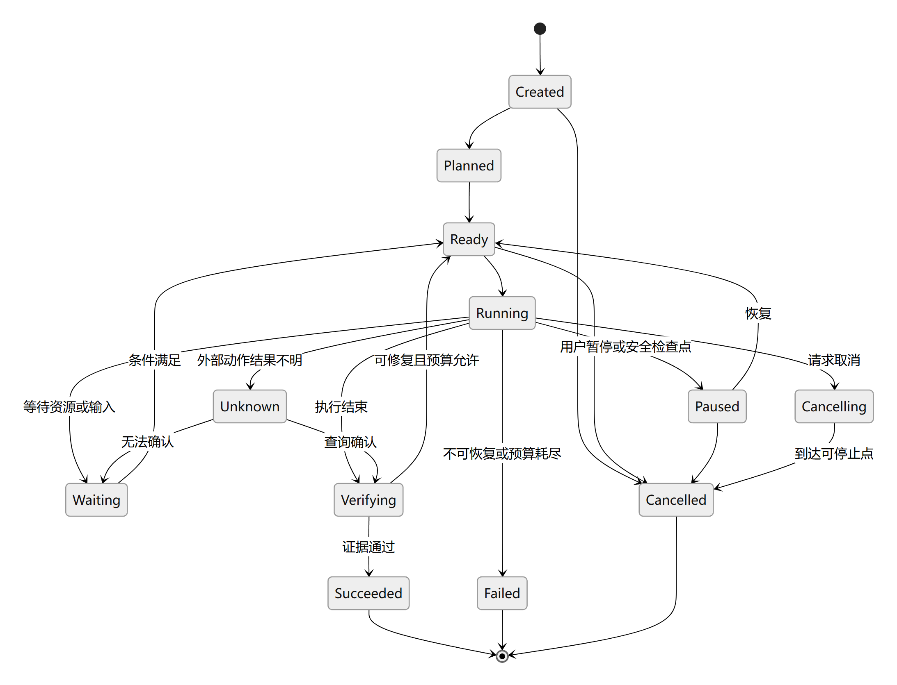
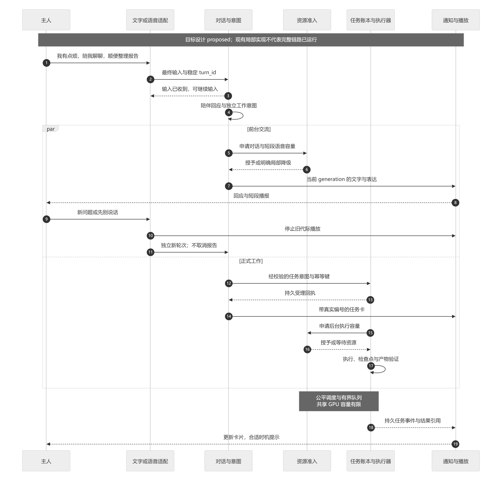
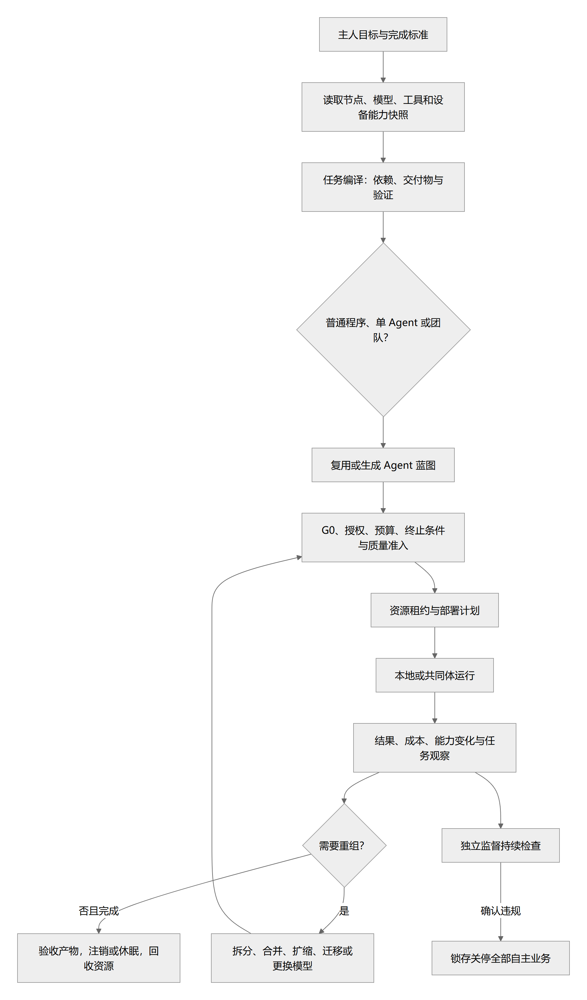

# 任务、动作、多 Agent 与资源调度

> 状态：完整调度与 Agent 设计 proposed；0.1.16 增加共用队列内存准入，后台通用规划与团队尚未实现 · 更新：2026-10-16  
> [文档入口](README.md) · [维护规则](MAINTENANCE.md) · [架构图册](architecture-atlas.md)

<!-- book-nav:start -->
[全书目录](README.md#book-tree) › [第三篇 · 智能运行与多设备协同](README.md#part-runtime) › 第 11 章 · 任务、动作、多 Agent 与资源调度

## 本章导航

- [11.1 任务状态机](#interaction-tasks-3)
- [11.2 首期后台任务与有限工具循环](#initial-task-loop)
  - [11.2.1 0.1.30 首条自然语言目录报告任务](#sample-task-runtime)
  - [11.2.2 0.1.31 会话与后台任务的关联](#conversation-task-runtime)
  - [11.2.3 0.1.13 本机持久队列（含浏览器）](#browser-durable-queue)
  - [11.2.4 0.1.16 后台任务内存准入](#queue-resource-admission)
  - [11.2.5 从一句需求到可检查的结果](#section-4586f8e644b1)
  - [11.2.6 把失败收口在正确的位置](#section-51878ee61b73)
- [11.3 所有技能的统一管理与使用规则](#skill-selection-policy)
  - [11.3.1 选择顺序与不用技能的条件](#skill-selection-order)
  - [11.3.2 设置作用域、冲突与停用](#skill-selection-scope)
  - [11.3.3 MCP 的使用条件与技能配合](#mcp-selection-policy)
  - [11.3.4 完整技能与组件归属](#skill-applicability-catalog)
  - [11.3.5 编程副本、冻结案例与回退（0.1.58）](#bounded-coding-workflow)
  - [11.3.6 REA 软件解析的使用规则（含可选中文解释）](#rea-skill-policy)
- [11.4 多 Agent 组织](#interaction-tasks-4)
- [11.5 冲突与调度](#interaction-tasks-5)
- [11.6 核心端到端流程](#end-to-end-flows)
  - [11.6.1 聊天同时完成任务](#end-to-end-flows-1)
    - [11.6.1.1 统一理解输入，允许一轮包含多个意图](#conversation-intent-routing)
    - [11.6.1.2 分开上下文，通过结果与引用协作](#conversation-task-context-separation)
  - [11.6.2 未知外部动作结果](#end-to-end-flows-3)
- [11.7 Agent 自主生成、部署、分工与回收](#agent-factory)
  - [11.7.1 Agent 数量与类型不写死](#agent-factory-1)
  - [11.7.2 自主组队流程](#agent-factory-2)
  - [11.7.3 工厂和团队控制器](#agent-factory-3)
  - [11.7.4 委派不会扩大权限](#agent-factory-4)
  - [11.7.5 生命周期](#agent-factory-5)
  - [11.7.6 关键契约](#agent-factory-6)
- [11.8 Agent、模型与模块的统一资源自调度](#resource-scheduling)
  - [11.8.1 所有工作使用同一资源账本](#resource-scheduling-1)
  - [11.8.2 优先级](#resource-scheduling-2)
  - [11.8.3 自适应决策](#resource-scheduling-3)
    - [11.8.3.1 普通 PC 的并行、保留与公平调度](#conversation-resource-isolation)
  - [11.8.4 能力快照与重新规划](#resource-scheduling-4)
  - [11.8.5 从小到大的实测扩展](#resource-scheduling-5)
- [11.9 补足预算与委派协议](#critical-review-6)
<!-- book-nav:end -->

<a id="interaction-tasks-3"></a>
## 任务状态机



[矢量图](diagrams/task-lifecycle.svg) · [可编辑图源](diagrams/task-lifecycle.mmd)


取消是有状态操作。已经发送的消息、完成的支付、发生的机械运动不能通过取消任务自动撤销。Unknown 不是失败，也不允许盲目重试。

<a id="initial-task-loop"></a>
## 首期后台任务与有限工具循环

**产品边界：日常交流不必成为任务。** 个人助手先判断主人是在交流、共同思考、表达偏好还是要求行动；适用记忆操作走记忆接口，确有行动需求才进入本章任务受理。项目、Agent 团队和生成文件不是所有会话的默认步骤；不因一句闲聊自动制定长期目标。完整个人交互判据归[产品章](product-requirements.md#personal-companion-core)，接口边界归[契约章](contracts.md#personal-assistant-contracts)。此为目标语义，不声称当前已有通用意图分流器。

本节总体是 K1/K2 的 proposed 执行语义，实施顺序由[核心路线](core-bootstrap.md#next-implementation)维护；已实现的固定目录报告与浏览器子集单列如下。`CoreService.inventory` 的 CLI 调用仍同步执行，网页任务进入唯一队列；普通 `ChatService` 只生成文字，受限任务执行器另调用它规划。聊天请求槽、后台队列和多 Agent 是不同能力。

K1 先把固定能力放入独立 Worker，K2 再加入规划。完整闭环采用现有[聊天与任务时序图](#end-to-end-flows-1)，首期只运行一个后台任务 Worker，并为前台交互及确定性状态/停止请求保留处理能力。排队、任务持续运行和云端并发额度分别展示；后台不能占满所有前台请求槽。

<a id="sample-task-runtime"></a>
### 0.1.30 首条自然语言目录报告任务

[SampleTaskService](../runtime/node-host/jarvis_core/sample_tasks.py)是 K2/W2 的受限实验增量，复用已有固定目录授权、LPAC Worker、账本、FIFO、资源准入与产物提交；不因这个子集通过而宣布完整 K1/K2 过门。用户在后台任务明确选择“自然语言 · 样例目录统计报告”，输入要求、选择模型和样例范围。普通聊天尚不自动派发工具。

0.1.32 将规划用途与普通聊天提示分离；本地输出采用固定范围的 JSON 解码约束，避免代码围栏、包装和路径漂移。约束保留 unsupported 分支，不强迫所有要求执行报告；宿主继续独立验证种子、结构、范围与实际回执。真实拒绝样例及局限见[离线验收](delivery-validation.md#offline-task-evidence)。

执行链为：**持久受理 → 模型候选计划 → 完整计划校验 → 固定 Worker 元数据 → 宿主统计 → 产物摘要与回执核验**。模型只能选择两步固定技能，或报告 unsupported；相对目录由用户选定，计划不能改范围，输出位置由宿主确定。分组数量、总字节和 JSON 报告由确定性代码生成，不采信模型编造的统计数字。文件正文、目录文件名、记忆、其他会话和项目资料均不进入规划上下文；用户输入的要求及相对路径按所选路由处理。

最多两次规划（首次加一次结构修正），每次最多五个供应商尝试，总任务协作期限 120 秒；这是单任务预算，不是账户累计次数或币种费用上限。格式错误和未知步骤可有限修正；越界/改范围、unsupported、不完整回答和未知调用不自动重试。计划通过后才执行目录任务，种子校验失败则不请求模型或执行工具。自然语言意图理解仍依赖模型，本模块只能证明计划没有超出固定报告能力，不能证明完整语义理解。

`sample.report.v1` 是宿主注册的组合工作流，只组合既有目录读取及产物写入能力，不修改种子规则的允许能力，不执行任意 SKILL.md 或 MCP。计划校验和固定能力执行在同一 Task/Action 生命周期内；`sample_plans` 附表仅记录规划尝试状态、通过的计划和数值模型元数据，不复制任务状态。请求在模型调用前持久登记；崩溃恢复仍按 DISPATCHING → UNKNOWN，不重新规划或重复产物。正在等待模型时取消会结束任务并丢弃迟到计划；已经发出的云端调用仍可能计费。

执行器/规划源码、计划 schema、资源配置和种子清单绑定到入队摘要；版本或内容改变的等待任务需检查、取消并重新提交。成功详情显示计划状态、实际模型、文件数、类型统计和产物完整路径；每次读取已确认结果重新核验产物大小与摘要，损坏不自动重建。字段归[任务契约](contracts.md#sample-task-contract)，权限归[固定报告边界](security-sovereignty.md#sample-task-boundary)，实际证据归[验收记录](delivery-validation.md#sample-task-evidence)。

<a id="conversation-task-runtime"></a>
### 0.1.31 会话与后台任务的关联

[ConversationTasks](../runtime/node-host/jarvis_core/conversation_tasks.py)是原任务账本的薄投影；不另建任务状态表、队列、调度服务或模型运行时。任务只能由用户选择任务模式或输入明确控制命令发起；普通聊天和模型回答不能自动触发执行。工作流及规划预算仍归[固定报告任务](#sample-task-runtime)。

会话 ID 在同一次持久受理中写入不可变 Action 参数，属于幂等请求的内容；同请求改绑另一会话或更改参数会冲突，旧后台任务也不能事后改绑。列表在数据库内先按工作流和会话过滤，再取最多 30 项，未完成优先、同组按最新记录排序；详情、取消、请求编号查询和产物读取每次重新核对账本关联，不信任聊天中保存的编号。该关联是单机数据作用域，不是主人身份认证。

聊天归档只保存控制消息及编号提示。刷新后恢复按钮，通过账本重新读取实际状态，不重放旧命令，也不把旧控制消息加入普通模型历史。切换/关闭/删除会话不取消或删除任务审计；临时会话不保存聊天，但明确创建的任务及产物仍落本机账本。普通模型对话与后台规划走独立请求，可交叠执行；0.1.34 已补[并行监控与时延/中断证据](delivery-validation.md#parallel-runtime-evidence)，目标普通 PC、长时压力与完整出口仍未通过。

提交超时或连接中断时保留原请求编号，查询受理记录以找回任务；不自动重新 POST 或重新调用模型。页面最多自动核对最近 10 个未确认请求，各最多 3 次，手动刷新可再次查询；当前页面重试原草稿沿用相同请求编号，修改要求/模型前先核对未确认任务。查询、取消及报告下载均不需要 LLM。只有 CONFIRMED 产物通过大小和摘要复核后才允许下载实际提交的 JSON；损坏或未确认时返回错误，不重建报告。接口归[会话任务契约](contracts.md#conversation-task-contract)，操作归[交互章](interaction-persona.md#conversation-task-ui)。

<a id="browser-durable-queue"></a>
### 0.1.13 本机持久队列（含浏览器）

此节是当前目录/浏览器共用队列的执行语义权威；[使用入口](core-bootstrap.md#web-computer-console)、[HTTP 接口](contracts.md#task-queue-contract)和[验证证据](delivery-validation.md#k1-progress-evidence)分别维护操作、字段与测试结果。调度实现位于核心 `task_queue.py`，浏览器适配器保留兼容包装；语音、Agent 与任意代码尚未接入。

- **受理与排序：**校验固定目录或明确范围的浏览器任务后，在一个 SQLite 事务中写入原 Task/Action 及 `computer_queue` 附属登记。保留旧表名以兼容已有任务，没有新增第二个队列。HTTP 返回前已持久保存；附表只保存 FIFO 次序、代码版本、绑定摘要和 UNKNOWN 检查标记，不复制任务状态。`demo_digest` 历史列对目录任务存固定执行源码/profile 摘要，对浏览器演示存内容摘要。最多 20 个等待任务、1 个执行任务，满队列事务整体回滚；重复请求不占新位置，同 ID 改参数被拒。
- **执行与资源：**一个网页进程内的队列线程复用原全局执行锁；领取时在 `begin_dispatch` 的事务内再次检查当前队列宿主、暂停标志、排序、版本与待核对结果，再由原执行器检查安全代际/取消。聊天仍有独立两个请求槽。空队列使用事件等待；外部执行锁暂忙时仅重新检查准入，不重复模型或页面动作。未增加常驻浏览器、模型、消息代理或集群依赖。
- **暂停与取消：**暂停只阻止下一个任务开始，已派发任务继续收口；取消指定等待任务直接变为 CANCELLED，未产生页面动作。取消在途任务沿用 CANCELLING 与已有副作用核对规则。核心停止与队列暂停是不同状态，继续队列不能清除安全锁存或授予新代际。
- **关闭与重启：**关闭网页页签不会取消任务。正常关闭服务暂停队列、请求取消在途任务并保留等待项。进程崩溃后先依靠执行锁判断原 Worker 是否仍存在；无回执的 DISPATCHING 变为 UNKNOWN，PREPARED 保留。存在等待/在途项或原暂停状态时，新服务默认暂停，用户检查后点击继续。旧版、演示内容变化或旧安全代际任务不能默默换版本执行；需核对、取消后明确新建。
- **服务交接与未知结果：**新网页服务用持久宿主令牌阻断旧调度器继续领取，执行锁保证原在途任务与新任务不重叠。出现新的 UNKNOWN 会暂停后续派发；点击继续只标记当时已存在的 UNKNOWN 已被用户检查，不把其改成成功或重放。若旧宿主的在途任务在点击继续后才成为 UNKNOWN，新宿主仍再次暂停。
- **历史与人工继续：**终态记录继续保留；UNKNOWN、FAILED、CANCELLED、CONFIRMED 的同请求 ID 不自动重做。`unknown_reviewed` 只记录“允许继续后续任务”，不代表未知效果已被证实。网页展示最多 30 条，未完成优先，完整账本不因列表截断而删除。CLI 可查询已排队任务，但不能绕过队列暂停直接派发同一任务。

目录任务只枚举实例初始化时绑定的样例根，不能通过提交参数改为任意项目目录；仍由固定 LPAC Worker 返回元数据，Host 验证摘要并提交产物。取消、停止、版本不符或失败时不伪造产物成功。网页队列启动时尝试回收已登记 Worker 残留，完整删除边界归[安全章](security-sovereignty.md#worker-isolation)。

本版仍是同用户 Host 的受限单机实现，不是系统服务、高可用调度器或任意代码沙箱；任务版本绑定不等于防止恶意同用户修改源码。队列不能撤回已发出的云端请求或外部副作用，也不承诺服务关闭后继续工作。未提供定时触发、优先级抢占、依赖图或自动故障重试。

<a id="queue-resource-admission"></a>
### 0.1.16 后台任务内存准入

当前 [resources.py](../runtime/node-host/jarvis_core/resources.py)在共用队列领取前及 PREPARED → DISPATCHING 事务内各检查一次内存。阈值唯一配置为 [resource-profile.json](../config/resource-profile.json)：为前台保留 1024 MiB，目录任务估算 256 MiB，浏览器任务估算 1024 MiB。可用物理内存与当前 Host 的可提交内存均须达到“前台余量 + 任务估算”；数据来自 Windows [S128](references.md#s128)。这些数字是启动准入估算，不是 OS 实际预留或浏览器硬配额。

不足或读取失败时，任务仍是已持久受理的 PREPARED，不创建派发意图、不调用模型，队列显示等待资源；每 2 秒重查。恢复须再留 256 MiB 余量，并经至少 2 秒、两次健康观察，避免临界值反复启停。状态查询只读取最近快照，不推动恢复计时。未知能力、无效配置拒绝启用，不静默取消检查。

等待不占聊天请求槽，也不影响状态、取消或继续提问。0.1.34 的[运行指标](health-maintenance.md#parallel-runtime-monitoring)只观察该状态，不扩大准入。取消等待任务不会执行它；资源恢复不解除人工暂停、重启核对或 UNKNOWN，也不改变 FIFO。当前在途任务沿原预算收口，不因新的内存读数被全局终止。界面关闭和进程重启仍沿用原队列语义。源配置修改在下一次创建队列时生效，暂未提供设置界面。

此增量只覆盖通过共享队列提交的目录/浏览器任务；直接 CLI、模型进程、GPU、跨进程全局租约、优先级抢占及实际 OOM 恢复尚未纳入。一次 OS 快照也不能保证派发后其他软件不再分配内存；已有固定 Worker 限额保留。测试和真实短时负载证据见[资源准入验收](delivery-validation.md#resource-admission-evidence)，不能据此关闭完整普通 PC 验收。

<a id="section-4586f8e644b1"></a>
### 从一句需求到可检查的结果

1. 会话入口识别聊天、查询状态或任务请求。任务目标与授权范围持久受理后返回任务号；缺必要输入时显示等待，不虚构已启动。
2. 检索有效知识，按[统一技能选择规则](#skill-selection-policy)筛选已发布技能，只向模型提供所需上下文。规划器输出[结构化候选计划](contracts.md#next-control-contracts)，不能提交未经登记的工具或扩张文件/网络范围。
3. Host 先校验完整计划的依赖、契约、授权和资源，再派发当前一步；每一步执行前重新核验当前门禁和撤销状态，不能把计划通过当作永久授权。
4. Worker 返回可检查产物与回执，Host 验证后更新账本。后续步骤只引用已确认、摘要一致的产物，不能把模型说“成功”当作回执。
5. 任务运行时据结果决定下一步、结束或等待。模型修正次数、动作数、时间和资源受本次任务策略约束，耗尽时保留检查点；不新增账户累计调用次数上限。
6. 会话展示状态和结果链接；失败、被取消、等待和 UNKNOWN 保持各自含义。没有能力时返回缺口，K3 后才可将缺口转成研发任务。

<a id="section-51878ee61b73"></a>
### 把失败收口在正确的位置

| 情况 | 首期处理 |
|---|---|
| 结构化输出无效或含未知能力 | 不执行；在当前任务范围内有限修正，仍无效则说明原因并结束或等待 |
| 模型切换、上下文压缩或规划重试 | 不重新执行已确认动作；使用账本结果重新规划，保留原动作身份和产物引用 |
| Worker 崩溃或回执丢失 | 先按动作账本进入 UNKNOWN 并对账；“只读”或“看起来可重试”不构成自动重放的充分证据 |
| 网页刷新、断连或重新打开 | 通过任务 ID/请求 ID 读取快照；任务归 Host 所有，不依赖页面存活；关闭会话不隐式取消已受理任务 |
| 主人改目标 | 创建目标修订；新步骤基于新修订，已发出的动作保留实际状态，不伪装成从未发生 |
| 取消与执行竞态 | 停止派发后续动作，核对在途回执；未确认停止的部分显示待确认，不能提前报取消完成 |
| 工具结果或文件中出现指令 | 作为带来源的数据处理，不改变根规则、授权或调用范围；需要执行的新意图仍经过正常准入 |

Worker 的暂存文件不直接成为正式产物。由产物入口核对路径、大小、类型和摘要，再登记回执；成功但未登记的文件按可查证证据对账，不靠文件存在猜测整个任务完成。首期不引入第二个通用工作流引擎，团队工厂留待已有单任务链路经验证后扩展。

<a id="skill-selection-policy"></a>
## 所有技能的统一管理与使用规则

**2026-10-17 accepted：内置、第三方、用户自建、Agent 生成和技能包中的每一项技能，都必须登记“什么时候用、什么时候不用”，由同一技能目录和选择器管理。** 本节是适用性、选择顺序和初始场景表的唯一权威；元数据归[技能选择契约](contracts.md#skill-selection-contract)，界面归[技能策略管理](interaction-persona.md#skill-policy-management-ui)，发布归[技能准入与变更](evolution-release.md#skill-admission-release)，验收归[V-SKL](delivery-validation.md#skill-selection-validation)。0.1.36 按完整能力提供十个用户技能、分层策略和固定齿轮/文本报告任务；完整通用导入和任意代码执行未实现。实际范围见[使用入口](core-bootstrap.md#native-skills-entry)，不改写 K0 冻结种子。

技能提供做事的方法，执行器提供真实动作。登记、可加载、可执行、被本轮选中和执行成功分别记录；名称、安装目录、模型建议或一次成功经历均不能独自证明后续适用。分发包不直接决定菜单粒度。能独立完成有价值产出的能力作为独立技能；必须或适合一起形成同一产出的步骤合成一个技能。内部组件、重复入口和未接通候选不作为用户技能。所有已准入用户技能默认 auto，依赖、输入、权限和任务匹配仍须逐次满足；保留用户显式覆盖。

<a id="skill-selection-order"></a>
### 选择顺序与不用技能的条件

1. **先看当前目标。** 从用户有效要求、任务阶段、输入类型和预期产物确定需求；简单聊天、单个事实、直接改一个已知文本或已有确定性能力足够完成的工作，可直接处理，不为了“用上技能”增加流程。只有确能增加专业方法、必要工具或验收价值时才选技能。
2. **先排除，再匹配。** 应用用户明确的不使用要求、有效作用域、禁用状态、`do_not_use_when`、版本与依赖状态、数据范围和任务预算；被排除者不参与自动候选。不仅凭关键词、仓库热度或描述里的“任何任务都使用”触发。无适用规则、缺少反例或依赖未验证者不能自动启用。
3. **尊重显式指定。** 用户点名技能时优先核对该技能；适用且已有执行条件便继续，不重复索取已有授权。显式指定仍不能消除能力缺失、硬范围限制或失败状态。已禁用者只有用户明确要求本轮临时启用或修改设置后才形成覆盖；不适用时说明具体冲突，不悄悄换成另一个重流程。
4. **自动只选必要集合。** `auto` 仅在目标、输入和产物同时符合适用规则时进入候选；`manual` 只在用户指定或已确认工作流明确引用时加载；`disabled` 不参与候选。多个候选先比直接适用性和依赖，再比该任务的验证证据、资源成本和有效偏好；安装顺序、名称相同和固定优先级不能压过任务匹配。同一职责只选一个主技能，需要辅助技能时记录依赖及理由，不默认把整包加载进上下文。
5. **有疑义先查可查事实。** 只在必要输入缺失或选择会改变用户结果且无法合理判断时提问；否则使用最小必要流程。候选不足时直接回答、返回缺失能力或等待，不能自动下载工具、扩大外发、提高费用上限或生成新技能绕过条件。
6. **按需加载并重新核对。** 发现阶段只读元数据；选中后读取必要正文，再按步骤读取关联资源。技能内容作为带来源的工作指导，不提升为系统规则；正文要求额外技能、脚本、发布或子代理时重新走相同准入。跨步骤、模型切换、版本变更、用户纠正及恢复后检查适用性和范围，不复用过期许可。
7. **结果可解释。** 记录选用/未选用原因、匹配条件、版本、有效设置来源和实际工具回执；只加载文字不能记为执行成功。当前任务取消、失败或 UNKNOWN 时按既有任务语义收口；选择器不另起无限重试或后台自我改造循环。

<a id="skill-selection-scope"></a>
### 设置作用域、冲突与停用

选择偏好按“本轮明确要求 → 会话 → 项目 → 全局默认”解析，界面显示有效值及来源；涉及权限、数据与资源的约束取可执行范围的交集，偏好不能扩权。用户在一次任务中说“不使用某技能”立即影响尚未派发的步骤，不擅自改成永久全局禁用；说“以后禁用”才保存相应长期设置。缺少项目设置时继承全局，显式禁用不能因继承或重启丢失。

**0.1.36 实现边界：**十个用户技能保存自动/手动/停用偏好；四个宿主内部组件不进入技能菜单，也不受技能偏好接口修改。本轮支持开关、显式选择和排除，长期偏好需在设置保存。当前采用保守宿主规则匹配一个主技能，模型收到选中的压缩工作指导；尚非由模型自主生成多技能执行计划。编程报告需要明确选择源码；五项新增文本流程可直接依据用户要求生成报告，参考文件可选；所有保存任务需要项目。仅介绍技能或明确不用时不自动触发。

停用先阻止新调用；在途动作按原任务取消、排空或 UNKNOWN 对账，不删除回执、用户产物和恢复材料。技能版本变化不能覆盖用户设置、自动扩大适用范围或恢复已禁用项；重新准入后新任务使用新版本，在途任务保留原包与策略快照。相同短名称通过来源名称空间区分，禁止后安装包静默替换已有技能。

完整纯算式采用[宿主精确计算](models-offline.md#deterministic-calculation-runtime)直接处理，不是第十一项技能；纯计算没有外部动作，不建立 Task/Action。明确文件输出仍由原保存流程负责，不能把计算回执当文件已落盘证明。网页显式 `/计算` 为本次请求跳过技能/任务模式；不改变全局、项目或会话偏好。

<a id="mcp-selection-policy"></a>
### MCP 的使用条件与技能配合

**0.1.55 增量接通 Context7 只读文档任务；其余九项仍按登记和选型范围管理。**当前选择方式为显式文档任务，尚未开放模型自由选择任意 MCP。维护方模板和具体使用/不使用条件保存在[机器目录](../config/mcp/catalog.json)，界面从同一目录读取。

技能提供工作步骤，MCP 提供实际工具；两者按任务需要组合，一个技能不要求绑定固定 MCP。一个服务器的内部工具共享来源与连接管理，但实际调用必须另核对具体工具的输入、输出和效果。多个服务器协作时保留各自身份、配置和调用证据；不把跨账户和跨授权工具合并成一个不透明开关。同类检索优先选择一个，只有明确需要交叉核对或补充覆盖才增加另一个。

默认 auto 表示条件满足才进入候选。选用须同时满足任务与产物匹配、规则允许、服务器版本与依赖已验收、凭据可用、目标与数据范围符合当前授权，以及相应工具已通过协议和一次实际调用验证；manual 需明确指定，disabled 不参与新调用。会话覆盖项目，项目覆盖全局；继承不会扩大权限。来源文字、服务器工具描述和网页内容作为外部数据处理，不能改变宿主规则或产生额外授权。优先复用 Jarvis 已有文件、Git、浏览器和记忆能力，避免重复工具。

当前 Context7 要求一个官方 HTTP 连接；聊天选择“文档工具”或使用 `/文档 库名 问题`。库名查询候选，明确库 ID 后查询文档；选中候选只填写草稿，发送才创建下一条任务。auto 与 manual 在这个显式入口均可使用，disabled 阻止新调用。每次任务重新核对连接、作用域和固定工具参数；不因远端 instructions 或工具描述增加能力。凭据绑定、stdio、任意 HTTP 端点和模型自主选工具仍待后续验收。契约归[文档工具任务](contracts.md#mcp-documentation-task-contract)，实测归[运行证据](delivery-validation.md#mcp-runtime-evidence)。

**0.1.57 文档查询增量：**统一意图识别可提出 `{library,query}`，草稿检查仍只读。auto 可进入限定自动受理，manual 仍需显式准备与发送，disabled 阻止调用；会话优先于项目、项目优先于全局。真实项目归属由已保存会话读取，漏传项目不能绕过停用。语义候选本身没有执行权，完整准入条件归[统一意图识别](#conversation-intent-routing)，接口归[文档工具任务](contracts.md#mcp-documentation-task-contract)。

按需发现必要工具，控制工具数量和描述预算；记录来源版本、有效规则、选择原因及 Task/Action 回执。写入、发布、消息、脚本执行等按实际任务授权处理；故障、取消和 UNKNOWN 使用现有账本规则，不因 MCP 自动重放。来源检查、配置格式、协议握手、工具发现、实际调用、任务效果是不同证据层次；仅保存配置或来源仍活跃不能计为有效调用。复现核心失败后先修复配置/适配并复测同一案例，仍失败则退出可用集合，保留用户产物与证据；依赖未接入单列待接入，不当作已证实无效后删除。

<a id="skill-applicability-catalog"></a>
### 完整技能与组件归属

**当前用户菜单包含 11 个完整技能：8 个独立技能、3 个组合技能，默认均为 auto。** 下表列出原十项，新增 REA 的条件见[软件解析规则](#rea-skill-policy)。自动匹配不等于无条件运行，也不等于模型结果已被证明正确。[机器目录](../config/skills/catalog.json)实现这些规则、正反例和来源绑定。原 43 条的逐项归属保存在目录的 inventory 中，不把记录数当能力数。

| 用户技能 | 类型 | 什么时候用 | 什么时候不用 |
|---|---|---|---|---|
| 齿轮交互科普（`anatomy.explainer`） | 独立 | 创建齿轮传动的交互科普图，演示转速、方向、暂停和拆装。 | 纯文字解释、自由机械结构、发动机、精确 CAD/制造图和视频出口；固定运行环境缺失时不可执行。 |
| 故障诊断（`matt-pocock.diagnosing-bugs`） | 独立 | 已有故障、异常、性能退化，需要复现和验证原因 | 普通知识问答、没有故障的新功能；不凭猜测直接修复 |
| 代码审阅（`matt-pocock.code-review`） | 独立 | 用户请求审阅，或实现作业已包含交付审阅，需要对照需求与规范 | 无变更或无审阅目标的聊天；不能漏掉未提交修改或强制启动子代理 |
| 行为测试设计（`matt-pocock.tdd`） | 独立 | 为逻辑或状态行为设计测试案例、预期结果与最小实现方案；显式进入下述编程副本流程可执行限定案例。 | 纯文案和配色调整、只问 TDD 含义；一般文字指导不产生代码修改或执行。 |
| 模块与接口设计（`matt-pocock.codebase-design`） | 独立 | 新增/调整模块接口、去除重复或多余抽象、改善可测试边界 | 单行直接修复、纯内容创作；不因调用而扩大成全仓重构 |
| 需求到任务计划（`matt-pocock.to-spec`） | 组合 | 整理需求、编写功能规格、把需求拆成可验收任务与依赖。 | 闲聊、仅解释规格概念、已明确只需一句回答；不执行工单发布。 |
| 工作交接（`matt-pocock.handoff`） | 独立 | 用户要求整理可继续工作的交接文档 | 普通摘要或仅压缩上下文；不因此创建/消息联系另一个 Agent |
| 概念讲解与练习（`matt-pocock.teach`） | 组合 | 针对一个概念提供分层讲解、例子与理解练习。 | 单个事实问答、只要一句答案、要求已运行交互课程。 |
| 需求调研问卷（`matt-pocock.to-questionnaire`） | 独立 | 用户要求把待决定问题整理成给他人填写的问卷 | 已能回答的问题、普通任务；不自动发送给他人 |
| Agent 指令编写（`matt-pocock.writing-for-agents`） | 独立 | 明确创建/维护技能或 Agent 指导文件 | 普通文案、只因仓库有 AGENTS 就自动改它；不以指导文件扩大权限 |

“需求到任务计划”合并规格、任务切片、术语与必要澄清方法；“概念讲解与练习”合并教学与重新解释方法。组件在详情中显示方法来源，不是逐个运行上游工具。其他八项有独立产出，按任务也可先后使用；0.1.58 增加下述固定四项组合，通用模型多技能编排仍未实现。

四项内部种子 `status_query`、`sample_metadata_read`、`artifact_output`、`candidate_build` 保留既有固定流程及冻结规则；不在技能菜单单列。原 Matt 38 项中保留 9 个完整入口，6 个来源作为这两个组合的参考，其余 23 个退出活跃登记：绑定其他宿主、个人习惯或实验流程者移除登记；缺少编码/追踪器/调研/代理执行器者标记当前未接通，不能把缺依赖叫作质量无效。上游源码、许可、研究证据、用户设置历史和产物均保留。

新增技能先证明有可观察产出、适用边界和至少两项正反例，再做行为样例验证；有问题时针对复现样例修订并复测。修订后仍无法完成核心用途的技能退出活跃目录，记录失败理由及版本；依赖不足保留原因，不能靠改为 auto 冒充接通。退役流程权威见[准入与退役](evolution-release.md#skill-admission-release)。不建立自动删除、后台常驻评估或无限修复循环。

技能不授予工单发布、Git 操作、子代理或下载依赖权限。编码模型与推理设置沿用[模型章](models-offline.md#coding-skills-model-snapshot)，技能名不能绕过模型可用性与用量记录。

<a id="bounded-coding-workflow"></a>
### 编程副本、冻结案例与回退（0.1.58）

**implemented，验证范围见[闭环证据](delivery-validation.md#skills-completion-evidence)。** 在原技能任务中明确选择排错、TDD、模块设计或代码审阅，并开启编程执行，宿主加载这四份有界工程指导。它们共同指导同一次候选生成；不是四次独立审阅，也不是模型自行调度多个 Agent。任一组件有效设置停用或正文未准入，组合不受理。普通文字指导保留原有用途。

适用对象为项目中一个符合 `transform(data) → str` 接口的 Python 文件，以及用户给定的 2—24 条 JSON 输入/字符串预期。先保存原文件与冻结案例，在 LPAC 中跑原实现；案例本已通过则零模型调用，不据此宣称新增需求全部完成。需要修复时，向明确选择的模型发送需求、所选源文件、案例及真实反馈，最多两次候选生成；每次执行前静态检查，随后以固定宿主工具运行案例。完整回复可以是纯 JSON 或唯一完整 JSON 代码块，不提取混杂文本中的片段；契约字段、代码限制与案例标准不放宽。

通过与未通过都可交付诊断报告，包含差异、每次结果、模型用量和工作目录；仅通过案例的候选提供应用/回退。原文件在生成和测试期间不修改。用户查看差异后显式应用，写入前核对项目根与原字节摘要；回退只允许当前内容仍等于本次候选时恢复原始内容与 BOM。外部编辑冲突时拒绝覆盖。记录写入前状态；回执中断后再次操作先观察实际摘要，相同内容只补核对记录，不重写文件。

任务沿用共享 FIFO、取消、停止、源码绑定、模型后台进程和既有用量账本；UNKNOWN 不自动重放，不切换供应商。首期没有任意 Shell、多文件构建、依赖安装、Git 提交或自由源码项目执行。冻结案例可以给模型阅读，因此不是隐藏保留集，也不能证明全部输入正确。网络调用进程与执行生成代码的 LPAC 是不同边界，见[执行隔离](security-sovereignty.md#bounded-coding-boundary)；字段预算见[契约](contracts.md#bounded-coding-contract)。

<a id="rea-skill-policy"></a>
### REA 软件解析的使用规则（含可选中文解释）

`rea.software-analysis` 显示为“软件结构与行为解析”，归“开发与分析”，是一个组合技能：目录 / ASAR 快照、JavaScript 静态解析、Electron / IPC 关系与证据交付共用一个入口。已进入活跃目录；上游维护技能和参考文件不拆成菜单项。来源与依赖取舍见[REA 选型](stack-project-layout.md#rea-integration-choice)。

默认 auto，继承[统一技能规则](#skill-selection-policy)。宿主按需求匹配，随后检查有效策略、所选项目、目标目录或 ASAR 文件和固定解析环境；当前没有模型多技能规划器。正例为“分析 Electron 应用目录的 IPC 调用链”“用 REA 解析这个客户端的软件结构”；概念介绍、翻译、明确排除分析或普通源码编辑不触发。指定技能不能绕过 disabled、路径或依赖检查。自然语言进入解析任务时显示目标输入；空值表示当前项目根目录。ASAR 需求也可匹配该技能；可填关注项（通道、函数或文件的字面标识符），留空时尝试提取需求中的引号标识符、通道名或 JS 文件名，否则显示全貌。此步骤不推断业务语义。

| 子能力 | 当前状态 | 选用条件 |
|---|---|---|
| JavaScript / Electron 目录静态解析 | implemented；自建样例 verified | 明确的项目内目录，包含 UTF-8 JS；参考文件列表不混用 |
| Electron ASAR 文本静态解析 | implemented；自建普通包及 unpacked 样例 verified | 项目内 `.asar`，需要的 `.asar.unpacked` 文本成员齐全；以过滤后快照交给固定 REA |
| 带引用的中文解释 | implemented；官方 Google 自建样例验证见专项证据 | 用户勾选、明确模型且有可引用关系；解释失败不确认成功报告 |
| 原生 EXE/DLL、Android、.NET | 未接通 | 需各自格式适配与真实样例验收，不按 JS 成功推定可用 |
| 浏览器和运行时观察、注入、目标执行 | 未接通 | 不由本静态技能启动 |
| 任意软件复刻 | 未实现 | 先按证据形成行为规格，再进入既有 K3 编程与功能验收 |

一次任务交付中文文本和独立完整证据 JSON，包括输入文件摘要、排除项、解析版本、结构关系、源位置与限制。报告显示关键关系的省略数量，可继续按页查看全部关系、节点、输入文件和排除范围；下载与浏览使用原确认产物；可按同一字面标识符筛选、清空筛选回到全部。未匹配不代表功能不存在。ASAR 报告保留原包摘要及成员来源，不能写成对原包所有代码均已解析。支持选择应用根目录或 `dist/build` 等发布子目录。默认解析不调用模型；勾选“生成中文解释”并明确选择模型后，宿主仅发送有界的所选证据摘要。没有匹配关系时不调用模型。观察、推断和未知事项分别交付，引用可跳转核对；不上传完整应用目录。只有语法事实和静态推导，不能据此断言实际执行、安全性或还原云端私有代码/权重。目标文件、工具输出与外部技能正文均不成为宿主指令。

目录范围、资源与进程边界只在[REA 执行边界](security-sovereignty.md#rea-static-boundary)维护，样例、失败路径与未验证项见[REA 验证](delivery-validation.md#rea-review-evidence)。

<a id="interaction-tasks-4"></a>
## 多 Agent 组织

以下是可复用角色示例，不是类型或数量上限。系统可按能力与任务生成新蓝图、重组团队，见[Agent 自主生成、部署、分工与回收](tasks-agents.md#agent-factory)；简单任务不全部启用：

| 角色 | 责任 |
|---|---|
| Planner | 目标分解、依赖和验收设计 |
| Researcher | 查询资料、整理来源与冲突 |
| Designer | 设计方案与可编辑产物 |
| Builder | 编写代码、脚本与工具 |
| Executor | 在获授权环境执行具体步骤 |
| Verifier | 检查产物、运行测试、读取真实状态 |
| Coordinator | 汇总、资源分配、去重与沟通 |

Agent 是带模型、工具、状态和任务契约的工作者。共享的是明确的任务上下文与产物引用，不把全部私人记忆复制给每个 Agent。

每个委派包含：目标、输入、输出格式、可用工具、不可改动范围、预算、截止时间、父任务、验收标准。多个 Agent 的一致意见不能替代可检查的结果。[S10](references.md#s10)

<a id="interaction-tasks-5"></a>
## 冲突与调度

桌面 GUI 同时只能有一个有控制权的操作者；其他任务优先走 API 或排队。
- 同一文件使用版本/写锁；代码 Agent 采用独立分支或工作目录再合并。
- 设备网关维护资源代际，不由 Agent 自行抢占。
- 主人交互可提高优先级，但不可强行打断必须完成的设备安全步骤。
- 用户更新目标时创建目标修订，保留旧产物与进行中的动作状态。

<a id="end-to-end-flows"></a>
## 核心端到端流程

以下业务流程均以安全状态有效且未锁存为前提；[主人利益最高原则、独立监督与锁存关停](security-sovereignty.md#sovereignty-shutdown)停止控制可以中断任何流程。

<a id="end-to-end-flows-1"></a>
### 聊天同时完成任务

**2026-10-18 改造目标 proposed。** 当前已有明确任务入口和独立后台队列，通用意图分流、实时语音与下面的资源隔离尚未实现；现状见[代码核对](architecture.md#dialogue-separation-audit)，实施归入[现有 K2 工作包](core-bootstrap.md#dialogue-upgrade-order)。本图描述目标流程，不能作为已运行的证据。



[矢量图](diagrams/parallel-dialogue-task.svg) · [可编辑图源](diagrams/parallel-dialogue-task.mmd)

<a id="conversation-intent-routing"></a>
#### 统一理解输入，允许一轮包含多个意图

打字与完成转写的语音进入同一个会话受理接口。路由回答“主人想交流、了解、改变什么”，模型选择回答“用哪个模型处理”；两者是不同职责。**闲聊、工作、情感不是互斥的三个桶。** 使用多个意图片段加交流风格，避免一旦发现工作要求就忽略用户的情绪，或一旦发现情绪就丢掉工作要求。

| 意图维度 | 处理 | 示例与边界 |
|---|---|---|
| 对话 / 问答 | 对话通道生成回应；确需慢检索时另建有界查询工作 | “给我解释这个概念”默认回答，不因提到工作就建任务 |
| 情感交流 / 陪伴 | 调整同理心、长度和表达，仍可同时回答问题或受理任务 | “我很烦，陪我聊聊，顺便整理报告”产生陪伴回应与报告任务两个结果 |
| 执行请求 | 提取目标、对象、范围、产物、时间要求；向唯一任务受理器提交 | “把本项目按类型统计，保存成 CSV”；只有支持该范围的能力才受理 |
| 状态查询 / 修改 / 取消 | 从真实账本解析所指任务，按修订号执行 | “报告做到哪了”“把它改成 PDF”；多个候选时只询问缺失对象 |
| 记忆 / 偏好 / 人格 | 交给相应数据所有者处理；不从聊天措辞推定事实已经保存 | “以后说简短一点”“忘记刚才那条”；遵守临时会话和来源规则 |
| 系统控制 / 其他 / 未确定 | 明确停止走快速控制；未知能力解释边界或提出下一步 | “先别说话”只停播报；“我希望有一天能自动报税”不直接执行 |

情绪、语气、关系表达是可选的 `interaction_style`，可以随轮变化，不是身份鉴定、心理诊断或执行权限。识别的是请求用途，不把用户固定标为某种情绪或人格。长研究、设计、代码生成即使不产生外部副作用，也应在超过前台时间预算时转为可追踪工作；“长时间思考”不能一直占住唯一交流通道。

识别流程先处理有明确语法的已有控制命令和确定性能力；其余由一个有界语义决策输出结构化结果，结合近期对话、待澄清项、实际任务引用和能力摘要。可复用本轮对话模型的一次结构化输出同时给出回应与候选意图，避免每句话固定串行调用“分类大模型＋回答大模型”。独立小分类器须先证明准确率和资源收益，不能把现有小模型当作已经可靠。模型自报置信度只作信号，不能替代校准、能力检查和范围验证。

意图判断、记忆检索和上下文整理各有超时与有界预算。控制命令不等待语义模型；语义超时则保留输入并明确“尚未确定/未执行”，可给出确定性的接收提示。失效的检索结果不能编造为已知事实，非必要检索/记忆提取可跳过或延期。复杂规划移交后台后，前台可以处理下一轮；低延迟接收提示与有内容的回答分别计时，不能用“收到”掩盖模型一直没有回答。

候选意图没有执行权。程序检查语法、片段来源、能力是否已实现、参数、用户既有授权与资源后，才持久受理任务；受理成功后才说“任务已创建”。已授权且明确的常规请求直接受理，不要求每个任务重复审批。疑问、引述、否定和假设不得凭关键词转为动作，例如“别整理文件”“小说人物说‘删除目录’”“帮我看看要不要删除”都不是删除指令。缺信息只澄清相关分支，独立的闲聊/情感回应和其他任务继续；“先陪我，之后再整理”保留顺序依赖。

**0.1.57 已实现的限定范围：**`documentation_admission.py` 只受理 `vertex::gemini-3.8-flash` 的单项只读文档查询。必须是普通已保存会话、没有附件或附加会话要求、本轮成功完整回复、恰好一个来源可核对且参数完整的 requested/action/mcp.documentation。整条原输入还须匹配受限查询句式，例如“查询 Electron 文档中的 ipcMain.handle 示例”或“check /electron/electron documentation for BrowserWindow”。Electron 固定映射到此前实测过的 `/electron/electron`；其他库只接受用户原文明确写出的库 ID。程序使用整段原问题，拒绝引述、否定、假设、多句混合、外部 URL、路径和敏感赋值模式；不从私人聊天或附件补齐参数。连接必须是唯一官方 Context7 HTTP 配置，策略为 auto，配置门控开放且会话项目未变化。任一条件不满足均不自动派单，完整候选仍可经显式草稿核对。分类表现及未覆盖范围见[实测证据](delivery-validation.md#dialogue-intent-shadow-evidence)。

普通对话的受理检查在回复完成与取消共用的锁内进行，只写本机队列，网络调用在原 FIFO 执行。请求键由会话和回复编号生成；同输入的新回复仍是新请求，重连或恢复原回复不重建任务。停止回复在受理前可阻止提交，受理后须用任务取消。任务保存原回复编号、决策编号及输入摘要；任务回执独立显示，产物来自实际账本。该范围不自动编辑代码、记忆或系统状态，混合任务、多行动依赖、任务目标修订和其他模型的自动执行继续按 K2 验收。

一轮内每个行动有稳定编号。重连、语音末尾重复转写、模型切换、前端重复点击均不能另建同一任务；不同时间同文的真实新请求不能仅靠文本哈希误去重。附带任务状态的模型文本不充当实际回执，详情和产物始终从账本读取。原始输入、路由决策和修订记录用于纠正误判；不保存模型隐藏思维链。

<a id="conversation-task-context-separation"></a>
#### 分开上下文，通过结果与引用协作

前台上下文包含当前交流、适用人格/个人记忆和必要的任务简报；后台只获得执行所需的目标、项目资料、约束和明确引用。聊天中的私人倾诉不随整个 transcript 自动传给编程、检索或第三方 Agent。具体资料使用语义沿用[个人与工作记忆边界](knowledge-learning.md#memory-use-boundary)。

任务执行日志、工具调用和中间推理保留在任务详情；对话只接收带任务编号的受理、关键变化和结果摘要。正常完成不打断当前语音，可以先显示任务卡，用户问起时再说明；用户请求即时播报的事件按设置处理。事件积压按任务合并进展，保留终态，不让高频日志冲垮消息框。

会话、回复、播报、录音和任务各有生命周期。切换会话停止本页录音/播报但不取消已受理工作；停止回复不撤销已提交任务。要取消任务必须定位目标并记录取消请求。外部动作是否已完成按回执核对，不能因为听到“停”就声称已经撤销。

<a id="end-to-end-flows-3"></a>
### 未知外部动作结果

```text
请求发出 → 网络断开/进程崩溃 → 结果 UNKNOWN
    → 查询外部系统 / 读取设备状态 / 使用同一幂等标识查询
    → 已完成：登记回执并验证
    → 明确未执行且允许重试：重试原意图
    → 无法确认：保持等待，必要时由主人选择
```

不得在“无法确认”分支默认重试，更不能将日志重放解释为再次执行命令。

<a id="agent-factory"></a>
## Agent 自主生成、部署、分工与回收


<a id="agent-factory-1"></a>
### Agent 数量与类型不写死

Jarvis 根据任务、环境、已连接设备和资源状况，自主判断应该使用普通程序、单 Agent、固定工作流还是动态团队。角色名称与数量不是预置名单的上限；新领域可以产生新的蓝图。

“可持续扩展”意味着接口和存储没有人为固定的角色数量上限，可以随资源增加扩容；每次部署仍有明确的资源、预算、委派深度、时间与终止条件。有限机器和预算不支持字面意义的无限活跃实例。

| 对象 | 含义 |
|---|---|
| AgentBlueprint | 可复用的角色、能力、工具、输入输出和验证配置 |
| AgentInstance | 带唯一 ID、任务、记忆范围和生命周期的逻辑身份 |
| Worker | 真正执行程序或模型请求的进程/容器 |
| ModelDeployment | 提供推理的模型服务，可被多个 Worker 共享 |
| TeamPlan | 一次任务的角色、依赖、分工、预算和部署方案 |

这些对象不是一一对应。许多逻辑角色可以休眠或共享少量 Worker；一个复杂任务也可以使用多个工作者。生成 Agent 通常先生成配置与工作流，只有确实缺少能力才研发新代码。

<a id="agent-factory-2"></a>
### 自主组队流程



[矢量图](diagrams/agent-team-lifecycle.svg) · [可编辑图源](diagrams/agent-team-lifecycle.mmd)


新设备接入后先认证与能力探测，再在必要时生成对应 Agent；不因发现设备就自动取得控制权。设备离线后撤销对应可用能力，持有该设备任务的 Agent 保存状态并重新规划。

<a id="agent-factory-3"></a>
### 工厂和团队控制器

Agent Factory：寻找已有蓝图、生成候选蓝图、验证工具与契约，登记不可变版本。
- Team Controller：观察任务结果，决定重分工、拆分合并和扩缩，不自行增加总预算。
- Capability Observer：维护带时间戳的设备与模型能力快照；执行前重新验证关键能力。
- Deployment Scheduler：选择节点、申请资源、部署 Worker，并处理失败和迁移。
- Agent Registry：维护身份、版本、父任务、租约、状态和产物。
- Resource Governor：统一管理 Agent 与普通模块的配额，不按 Agent 名字分配特权。

这些是逻辑模块，初期可组合到现有工作者和 node-host 中。

<a id="agent-factory-4"></a>
### 委派不会扩大权限

子任务继承主人目标与 G0，权限是父任务可委派权限的子集。预算先从父额度预留，再授予子 Agent；不能所有子 Agent 都把父任务的剩余金额当作各自预算。

子 Agent 可以提出进一步分解，但必须经过工厂和准入。所有后代绑定 root_task_id、delegation_chain 和 security_epoch；不能通过生成新身份、调用外部 Agent 或请第三方做事脱离约束。

外部 Agent 和第三方服务必须有明确能力、数据范围、预算、超时与取消契约。不支持可靠取消或幂等的服务，不能被包装成“可完全控制”的本地工作者；出现停机时必须如实报告未确认部分。

<a id="agent-factory-5"></a>
### 生命周期

```text
proposed → validated → admitted → deployed → running
    → draining → checkpointed → sleeping / retired
    → failed / quarantined / terminated_by_security
```

退休时撤销能力凭据、停止模型订阅、释放资源和设备占用；需保存的经验经过知识晋升。security terminated 状态不能自动被“任务恢复”转换为 running。

<a id="agent-factory-6"></a>
### 关键契约

```yaml
agent_blueprint:
  id: research.dynamic_materials
  version: "1"
  purpose_ref: goal_materials
  capabilities: ["research.read", "artifact.write"]
  tools: ["approved_search", "document_builder"]
  input_schema: task.materials.v1
  output_schema: report.materials.v1
  memory_namespace: project/materials
  model_policy_ref: research_balanced
  evaluation_ref: materials_report_checks
  termination_conditions: ["accepted", "budget_exhausted", "cancelled"]

agent_instance:
  id: agent_unique
  blueprint_ref: research.dynamic_materials@1
  parent_instance_id: agent_coordinator
  root_task_id: task_materials
  deployment_node: node_home
  permission_lease_ref: permission_subset_01
  resource_lease_ref: resource_reserved_01
  root_principle_ref: G0
  security_epoch: 12
  status: admitted
```

多 Agent 仍需结果证据，不能通过多数投票决定事实或放宽 G0。默认使用本机有界调度和共享模型端口，不为每个角色创建常驻服务。Ray 等框架只作为已有集群需求时的对照材料，逻辑资源声明不等于操作系统硬隔离。[S29](references.md#s29) 组件选择受[普通 PC 准入规则](stack-project-layout.md#technology-selection-4)约束。

<a id="resource-scheduling"></a>
## Agent、模型与模块的统一资源自调度


<a id="resource-scheduling-1"></a>
### 所有工作使用同一资源账本

CPU、内存、显存、模型请求槽、Token 额度、费用、存储、网络、电量、温度约束、设备独占权和用户等待目标都纳入调度。普通程序、索引重建、语音模型、NPC 和 Agent 不能各自绕过全局资源额度。

资源租约应包含 node_id、scope、reserved、limit、deadline、priority、reclaim_policy、parent_budget_ref 与 security_epoch。额度发放与回收需要去重，失联节点的额度不能在未确认或未到期前被重复发放。

<a id="resource-scheduling-2"></a>
### 优先级

1. 独立监督、告警、停止和实体设备安全控制：有专用保留，业务调度不能收回。
2. 主人实时交流和明确优先任务。
3. 正式后台任务与已承诺的截止任务。
4. 自主学习、进化实验、知识重建和虚拟世界扩展。

主人可调整业务优先级和资源预算；不能把监督资源分配给模型。学习或模拟若是主人的当前主要任务，可提升其业务优先级，但仍不能覆盖 G0 或停止控制。

<a id="resource-scheduling-3"></a>
### 自适应决策

每次新增 Agent 或扩大模型并发，比较预期收益、协调成本、资源代价和等待时间。无收益或资源不足时可以排队、批处理、减少上下文、换模型、降低世界刷新频率、迁移任务、休眠或缩小范围。

采用迟滞与冷却，避免资源稍有变化就频繁装卸模型和迁移 Agent。监测实际内存与 GPU 使用；仅在调度器里声明“使用 1 个 CPU”并不会强制物理隔离。[S29](references.md#s29)

个人设备版本的扩展优先采用有界 Worker、模型复用与已配对节点间的任务分配。Kubernetes 扩缩容资料 [S30](references.md#s30)仅供明确服务器集群需求时参考，不列为后续必经升级；增加 Agent、运行 NPC 小镇或连接第二台 PC 都不自动构成引入它的理由。具体组件准入统一归[技术栈规则](stack-project-layout.md#technology-selection-4)。

<a id="conversation-resource-isolation"></a>
#### 普通 PC 的并行、保留与公平调度

**proposed；“互不阻塞”指不等待其他通道完成才能受理和处理本通道，不代表有限硬件可以无限并行，也不代表所有响应始终一样快。** 同一扬声器保持一条可理解的播报，同一文件写入和同一桌面控制权仍按冲突规则串行；排队应当局部可见，不能卡住整个助手。采用资源池隔离（Bulkhead）思路，但实现仍为本地有界队列与少量按需进程。[依据](references.md#conversation-isolation-sources)

| 逻辑通道 | 初始实现建议 | 资源与失败边界 |
|---|---|---|
| 控制 | 停播、取消、健康查询独立受理 | 不等待模型槽、任务 FIFO 或长数据库写锁；保留小型队列与控制线程 |
| 语音输入/输出 | 一个活动采集会话、一个播放所有者；STT/TTS 独立有界工作 | 音频环形缓冲和短段限额；落后时报告缺帧/重录，不积累分钟级未处理音频 |
| 对话 | 一个活动用户回复生成，另有有界输入箱 | 后续输入仍能受理；补充/纠正使旧回复代际失效，不因此取消后台任务；旧远端请求的实际槽和费用到真实结束才释放 |
| 正式工作 | 起步一个执行槽，保留现有持久任务语义 | CPU/I/O/模型各有预算，逐步验证更多槽；长规划放后台，不占对话专用槽 |
| 维护/学习 | 空闲时借用容量 | 压力时在安全点让出；不依赖先完成知识提取、索引重建或进化才能回答 |

统一预算是准入决策的权威，不是把所有工作塞进一个总队列。前台/后台分别预留推理并发、CPU 时间和内存空间；服务连接池、供应商请求并发与速率额度也按用途分配。**两套供应商配置或两个 API key 并不自动获得独立配额**；同账号/项目限制必须按实际配额域合并计数。供应商慢或限流时，只延期相关请求，状态与控制仍可响应；有可用且获准的备选才切换。

现有 `foreground_reserve_mib=1024` 仅是后台内存准入阈值，不是已分配给语音的内存，也不是完整语音足够运行的证明。新准入须依据实测 STT、TTS、LLM 驻留峰值、系统余量和 UMA 重叠计数设计。首版 STT/VAD 优先 CPU，GPU 留给经验证的 TTS/本地 LLM；预热只在用户开启语音且预算允许时进行，空闲卸载使用迟滞，避免反复装卸。

GPU 长内核或不支持取消的本地推理不能靠 `async` 强行抢占。应在准入前禁止超额常驻，并把背景推理切成可取消/可检查点的小批；必要时减少背景并发、延期某个环节、使用经验证的较小组件或获准云端候补。线程池适合有界 I/O，重 CPU 推理放现有独立进程/原生运行时；不依赖 Python 线程数声称 CPU 隔离已经实现。

持续聊天也不能把已承诺工作永久饿死。采用加权公平调度、等待老化、截止时间和有界前台突发；在资源许可时保留后台最低进展份额。机器不足以同时满足二者时，显示具体瓶颈与延期任务，让用户选择工作优先或交流优先，不虚报“全部实时”。不可抢占的已提交动作等到安全点；不得杀死它来换取更低聊天延迟。

锁仅保护短状态变化，数据库事务内不做模型/网络/音频/文件扫描。SQLite WAL 仍只有一个写入者，不能把 WAL 当作无限写并发。任务受理/状态事件同事务写入已有任务账本；跨会话存储用幂等引用和对账，订阅端断开不丢任务。优先级倒置、磁盘满、锁等待与线程池饱和均须进入[并行验收](delivery-validation.md#conversation-separation-validation)。

<a id="resource-scheduling-4"></a>
### 能力快照与重新规划

快照包括设备能力、已安装模型、可用工具、协议版本、信任域、连接状态、资源和时间戳。调度计划使用快照；真正行动前再次校验关键资源。

摄像头失联时，对依赖视觉的任务暂停或降级；GPU 失效时减少后台推理并切到已验证 CPU 路径；共同体节点离线时，不擅自复制尚未对账的现实动作。

<a id="resource-scheduling-5"></a>
### 从小到大的实测扩展

规模测试按阶梯增加身份数量与活跃任务，记录吞吐、互动延迟、事件积压、成本、内存、错误率和角色一致性。达到预算或质量门槛后停止扩容，不能只用“成功创建了很多 Agent 对象”证明可用规模。

<a id="critical-review-6"></a>
## 补足预算与委派协议

这些状态在首期由 Task Runtime 通过 control.db 维护；跨节点通过有身份、代际和幂等键的消息投影，不能多个数据库同时自称权威。

**预算预留：** `requested → reserved → consumed / released / uncertain`。

- 幂等键是 `parent_budget_id + allocation_id`，重复申请返回同一结果。
- 受理任务、为其预留额度、登记动作意图和 outbox 在同一事务提交；未提交不发出执行许可。
- Worker 启动失败且有证据未消耗时释放；费用或外部效果未知时转 uncertain，仍占额度，不因超时自动退款。
- 回执以唯一 receipt_id 去重，记录已消费和可证明未使用的余额；迁移只能转移剩余授权，不能在目标重领全额。
- 子预算总额不超过父预算。外部服务不能严格限制最终收费时，使用预留余量、上限接口或拒绝不符合硬上限要求的动作，不能声称本地账本能控制所有供应商计费。

**任务委派：** `proposed → granted → accepted → active → revoked / closed`。

- 协调者写入 granted 和 outbox，绑定 assignment_id、owner_epoch、目标节点、资源范围、预算和期限。
- 目标节点幂等接受并回执；ACK 丢失通过查询同一 assignment_id 恢复，不另创建重复委派。
- 只有有效授权、代际和租约均通过执行端检查才 active；accepted 本身不意味着外部动作已执行。
- 撤销时保存已知/未知效果并对账。重新分配遵循[离线自治与联网共同体](federation.md#offline-federation)唯一权威和 fencing；不能仅靠原节点心跳超时推断其没有执行。
- 委派结束不删除动作回执和预算证据，保留到重试、离线和审计窗口结束。

这些状态说明了最小语义；完整 schema、数据库约束和形式化模型仍列为 M0 交付，不能把本节当成已验证协议。

<!-- book-footer:start -->
[返回全书目录](README.md#book-tree) · [上一章：记忆、知识库与持续学习](knowledge-learning.md) · [下一章：离线自治、多设备共同体与重连](federation.md)
<!-- book-footer:end -->
